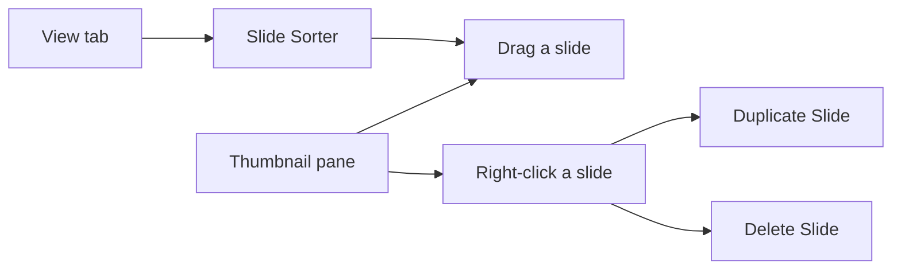

## Goal

By the end of this lesson, you can move, duplicate and delete slides to put them in the right order.

## Why It Matters

A family plans a wedding. The events must go in the right order: first Mehndi, then Barat, then
Walima. A school programme lists the welcome speech before the prize giving. Your slides also
need the right order, so that your talk makes sense. Sometimes you need a copy of a slide, or a
slide is no longer needed. Moving slides in PowerPoint is like moving pages in a file folder.

**Diagram in words:** To move a slide, drag it in the thumbnail pane or in Slide Sorter view.
To copy or delete a slide, right-click it in the thumbnail pane and choose Duplicate Slide or
Delete Slide.

## Key Terms

| Term | Simple meaning |
|------|----------------|
| Rearrange | To change the order of things, like putting the pages of a file in the right order. |
| Slide Sorter view | A view that shows all your slides as small pictures in rows, like cards laid out on a table. |
| Duplicate Slide | A command that makes an exact copy of a slide. The copy goes right after the first one. |
| Delete Slide | A command that removes a slide from the presentation. |
| Right-click | To press the right mouse button once. It opens a short list of commands. |

You met the thumbnail pane and Normal view in [Lesson 5.1](./starting-powerpoint.mdx).

## Step by Step

Open PowerPoint and start a blank presentation (see [Lesson 5.1](./starting-powerpoint.mdx)).
Make these four slides for the Rehman family's wedding plan (see
[Lesson 5.2](./adding-slides-and-text.mdx)). They are in the wrong order on purpose.

| Slide | Layout | Title | Other text |
|-------|--------|-------|------------|
| 1 | Title Slide | Our Wedding Plan | The Rehman family |
| 2 | Title and Content | Walima | Day 3; Lunch at the community hall |
| 3 | Title and Content | Mehndi | Day 1; Evening at home |
| 4 | Title and Content | Barat | Day 2; Evening at the marriage hall |

The right order is Mehndi, then Barat, then Walima. So Walima must move to the end.

**Moving a slide in the thumbnail pane**

1. In the thumbnail pane, click the **Walima** slide (slide 2). *The slide is selected.* This
   shows which slide you will move.
2. Drag the **Walima** slide down, below the **Barat** slide, and let go. *Walima is now slide
   4. Mehndi is slide 2 and Barat is slide 3.* PowerPoint numbers the slides again for you.

You can also use the keyboard. Select a slide in the thumbnail pane. Press **Ctrl+Up arrow** to
move it up one place, or **Ctrl+Down arrow** to move it down one place.

**Using Slide Sorter view**

With many slides, the thumbnail pane gets long. Slide Sorter view shows all the slides at once.

3. Select the **View** tab, then select **Slide Sorter**. *You see all four slides as small
   pictures in rows.* Now you can see the whole plan in one look.
4. Drag the **Barat** slide in front of the **Mehndi** slide. *Barat becomes slide 2.* This is
   the wrong order, so put it back.
5. Drag the **Barat** slide after the **Mehndi** slide again. *The order is Our Wedding Plan,
   Mehndi, Barat, Walima.*
6. Select the **View** tab, then select **Normal**, so that you can work on your slides again.

You can also find the Slide Sorter and Normal buttons on the status bar at the bottom of the
window.

{/* Screenshot to add: PowerPoint 2021 in Slide Sorter view, showing the four wedding plan slides in rows, with the Slide Sorter button on the View tab circled. */}

**Duplicating a slide**

The family also wants a Dholki evening before the Mehndi. That slide looks like the Mehndi
slide, so you copy it. A copy keeps the same layout and look. You only change the words.

7. In the thumbnail pane, right-click the **Mehndi** slide. Select **Duplicate Slide**. *A copy
   of Mehndi appears right after it, as slide 3.*
8. On the copy, change the title to **Dholki**. Change **Day 1** to **The day before Mehndi**.
9. Drag the **Dholki** slide above the **Mehndi** slide in the thumbnail pane, so that the
   events are in the right order. *The order is Our Wedding Plan, Dholki, Mehndi, Barat,
   Walima.*

**Deleting a slide**

The family decides not to have a separate Dholki evening.

10. In the thumbnail pane, right-click the **Dholki** slide. Select **Delete Slide**. *The slide
    goes away, and the other slides move up.*
11. Changed your mind? Press **Ctrl+Z** to undo. *The Dholki slide comes back.*
12. This time, delete it with the keyboard. Click the **Dholki** slide in the thumbnail pane and
    press **Delete**. *The slide goes away again.* Now you know two ways to delete a slide.
13. Save the presentation as **Wedding Plan** (see
    [Lesson 5.3](./saving-and-slide-show.mdx)), so that your work is kept.

## Practice

Green Valley School has an Annual Day programme. The slides were made in a hurry and are in the
wrong order. Fix them.

| Slide | Layout | Title |
|-------|--------|-------|
| 1 | Title Slide | Annual Day Programme |
| 2 | Title and Content | Prize Giving |
| 3 | Title and Content | Welcome Speech |
| 4 | Title and Content | Tea |
| 5 | Title and Content | Grade 3 Tableau |

1. Open PowerPoint and select **Blank Presentation**. Make the five slides in the table. Add
   one short line of your own on slides 2 to 5.
2. Select the **View** tab, then **Slide Sorter**, so that you can see all five slides at once.
3. Drag the slides into this order: Annual Day Programme, Welcome Speech, Grade 3 Tableau, Prize
   Giving, Tea.
4. Select the **View** tab, then **Normal**.
5. In the thumbnail pane, right-click **Grade 3 Tableau** and select **Duplicate Slide**. Change
   the copy's title to **Grade 5 Song**. Now the programme has one more item.
6. There is no tea this year. Right-click the **Tea** slide and select **Delete Slide**.
7. Start the slide show from the beginning (see [Lesson 5.3](./saving-and-slide-show.mdx)).
   Check that the slides come in the right order. Press **Esc** at the end.
8. Save the presentation as **Annual Day**.
9. Check your work: the presentation has five slides in this order: Annual Day Programme,
   Welcome Speech, Grade 3 Tableau, Grade 5 Song, Prize Giving. There is no **Tea** slide. The
   title bar shows **Annual Day**.

## Check Questions

1. Show how you open Slide Sorter view, and how you go back to Normal view.

   

   
Show answer

   **Answer:** Select the **View** tab, then **Slide Sorter**. To go back, select the **View**
   tab, then **Normal**.

   

2. You duplicate slide 4. Where does the copy go?

   

   
Show answer

   **Answer:** Right after the first one. The copy becomes slide 5.

   

3. You deleted the wrong slide. What do you do?

   

   
Show answer

   **Answer:** Press **Ctrl+Z** to undo. The slide comes back.

   

## Common Mistakes

- **Dragging a slide to the wrong place** → Drag it again to the right place. Watch the slide
  numbers to check the order.
- **Deleting the wrong slide** → Press **Ctrl+Z** at once, so that the slide comes back.
- **Forgetting to change the words on a duplicated slide** → Two slides then say the same thing.
  Change the title and text on the copy.
- **Not knowing how to leave Slide Sorter view** → Select the **View** tab, then **Normal**.

## Sources

*These official pages were checked when this lesson was written.*

- [Microsoft Support, "Add, rearrange, duplicate, and delete slides in PowerPoint"](https://support.microsoft.com/en-us/office/add-rearrange-duplicate-and-delete-slides-in-powerpoint-e35a232d-3fd0-4ee1-abee-d7d4d6da92fc) (applies to PowerPoint 2021, **Windows** tab): "Move a single slide: In the pane on the left, click the thumbnail of the slide that you want to move, then drag it to the new location"; "In the thumbnail pane on the left, right-click the slide thumbnail that you want to duplicate, and then click Duplicate Slide. The duplicate is inserted immediately after the original"; "Right-click the slide in the thumbnail pane on the left, then select Delete Slide."
- [Microsoft Support, "Use a screen reader to work with slides in PowerPoint"](https://support.microsoft.com/en-us/accessibility/powerpoint/use-a-screen-reader-to-work-with-slides-in-powerpoint) (applies to PowerPoint 2021, **Windows** tab): to delete a slide, in the thumbnail pane, "press Delete"; "To move the slide up the list of slides, press Ctrl+Up arrow key"; "To move the slide down the list of slides, press Ctrl+Down arrow key."
- [Microsoft Support, "Choose the right view for the task in PowerPoint"](https://support.microsoft.com/en-us/powerpoint/training/choose-the-right-view-for-the-task-in-powerpoint) (applies to PowerPoint 2021, **Windows** tab): "You can get to Slide Sorter view from the task bar at the bottom of the slide window, or from the View tab on the ribbon"; "Slide Sorter view (below) displays all the slides in your presentation in horizontally sequenced, thumbnails"; it is "helpful if you need to reorganize your slides—you can just click and drag your slides to a new location"; "You can get to Normal view from the task bar at the bottom of the slide window, or from the View tab on the ribbon."
- [Microsoft Support, "Add bullets or numbers to text"](https://support.microsoft.com/en-us/office/add-bullets-or-numbers-to-text-a6f1b87e-fca8-47da-ade9-5d99b7f41f04) (applies to PowerPoint 2021): "On the View tab, in the Presentation Views group, click Normal."
- [Microsoft Support, "Undo, redo, or repeat an action"](https://support.microsoft.com/en-us/office/undo-redo-or-repeat-an-action-84bdb9bc-4e23-4f06-ba78-f7b893eb2d28) (applies to PowerPoint 2021, **Windows** tab): "To undo an action press Ctrl+Z on your keyboard, or select Undo on the Quick Access Toolbar."
