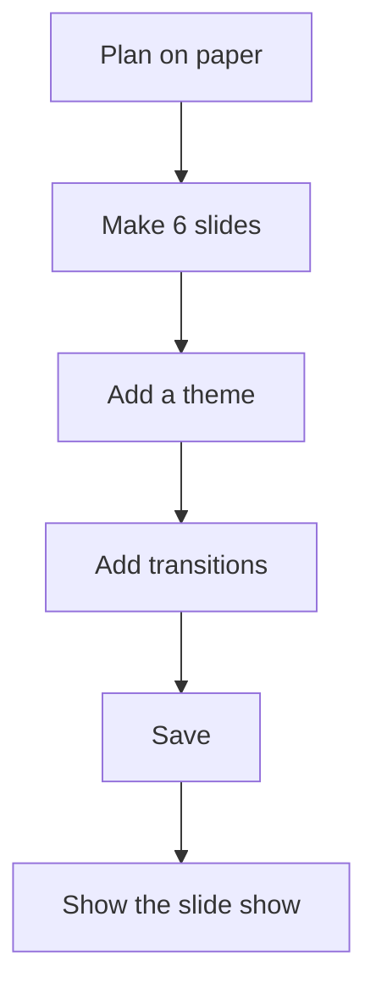

## Goal

By the end of this lesson, you can plan a 6-slide presentation on paper, make it in PowerPoint with a theme, pictures, a chart and transitions, and show it as a slide show.

## Why It Matters

In this project you use everything from Lessons 5.1 to 5.11 together. Hamza Mobile Centre has
three new phones. Hamza wants to show them on a screen in his shop, so that customers see the
phones, the prices and last month's sales. Shops, tuition centres and offices in Pakistan need
slides like these. If you can make a neat 6-slide presentation, you can help at work, in college
and in freelancing jobs.

**Diagram in words:** First plan the 6 slides on paper. Then make them in PowerPoint, add a
theme and transitions, save, and show the slide show.

## Key Terms

| Term | Simple meaning |
|------|----------------|
| Project | A bigger task where you use many skills together to make one finished piece of work. |
| Plan | A rough sketch on paper of what goes on each slide, made before you start. |
| Audience | The people who watch your slide show, for example the customers in a shop. |
| Title slide | The first slide. It says what the presentation is about. |
| Contact details | The address, phone number and opening hours, so people can find you. |

A plan is like a tailor's measurements. The tailor measures first, then cuts the cloth. You plan
first, then make the slides. This saves time and mistakes.

All the names, prices and numbers in this project are made up for practice.

## Step by Step

You need three pictures saved on your computer, for example photos of phones. If you have no
phone pictures, use any three pictures from your **Pictures** folder for practice.

**Part 1: Plan on paper**

1. Take a sheet of paper. Draw 6 boxes on it, one box for each slide. A box is a small picture of
   a slide.
2. Copy this plan into the boxes. Write only the title and a few short words in each box.

| Slide | Layout | Title | Points | Picture or chart |
|-------|--------|-------|--------|------------------|
| 1 | Title Slide | Hamza Mobile Centre | New phones for October | None |
| 2 | Title and Content | Tara 5 | Rs 25,000; Big battery; 1 year shop warranty | A phone picture |
| 3 | Title and Content | Kiran Max | Rs 39,500; Good camera; 1 year shop warranty | A phone picture |
| 4 | Title and Content | Sitara Lite | Rs 18,500; Light and slim; 1 year shop warranty | A phone picture |
| 5 | Title and Content | Phones Sold in September | None | A column chart |
| 6 | Title and Content | Thank You | Shop 12, Main Bazaar; Phone 0300-0000000; Open 10 am to 9 pm | None |

3. Read your plan again. Each slide has one idea and only a few words. People should listen to
   you, not read long sentences on the screen.

**Good slide rules for this project**

- Keep each point short, on one line.
- Keep the text size 18 or bigger, so that people can read it from far away.
- Use one picture on a slide, not many.
- Use one calm theme and one transition for the whole presentation.

**Part 2: Make the slides**

4. Open PowerPoint and select **Blank Presentation** (see
   [Lesson 5.1](./starting-powerpoint.mdx)).
5. On slide 1, type the title **Hamza Mobile Centre**. In the box below it, type **New phones
   for October** (see [Lesson 5.2](./adding-slides-and-text.mdx)).
6. Save now with the name **Shop Presentation** (see
   [Lesson 5.3](./saving-and-slide-show.mdx)). After this, press **Ctrl+S** often, so that you
   never lose your work.
7. On the **Home** tab, select the arrow by **New Slide**. Select **Title and Content**. Type the
   title **Tara 5** and the three points from your plan.
8. Select the **Insert** tab. Select **Pictures**, then **This Device**. Choose a phone picture
   and select **Insert** (see [Lesson 5.6](./pictures-and-shapes.mdx)). *The picture appears on
   the slide.*
9. Make the picture smaller with a corner handle while you hold **Shift**. Move it to the right
   side of the slide, so that it does not cover the points.
10. Make slides 3 and 4 in the same way: **Kiran Max** and **Sitara Lite**, each with its points
    and one picture.

**Part 3: The sales chart**

11. Add slide 5 with the **Title and Content** layout. Type the title **Phones Sold in
    September**.
12. Select the **Insert** tab, then **Chart**. Select **Column**, then double-click **Clustered
    Column** (see [Lesson 5.7](./tables-and-charts.mdx)). *A chart and a small worksheet
    appear.*
13. In the worksheet, type this data over the sample data, starting in cell A1.

    | | A | B |
    |---|---|---|
    | **1** | Phone | Sold |
    | **2** | Tara 5 | 18 |
    | **3** | Kiran Max | 7 |
    | **4** | Sitara Lite | 25 |

14. The sample data has more rows and columns than you need. Drag the handle at the lower-right
    corner of the marked cells, until only cells A1 to B4 are marked. *The chart shows only your
    three phones.*
15. Close the worksheet with its **Close** button (**X**). *You see the chart on the slide.*
    Sitara Lite has the tallest column, because it sold the most: 25 phones. In all, the shop
    sold 50 phones.

**Part 4: The last slide**

16. Add slide 6 with the **Title and Content** layout. Type the title **Thank You** and the
    three points from your plan. This slide tells customers where to find the shop.

**Part 5: Make it look good**

17. Select the **Design** tab. Choose a calm theme (see [Lesson 5.5](./design-themes.mdx)).
    *All six slides get the same look.*
18. Look at each slide. If a picture covers words, make it smaller or move it. Check the text size too.
    If any text is smaller than 18, select it. Type a bigger number in the **Font Size** box on
    the **Home** tab (see [Lesson 5.4](./formatting-text-on-slides.mdx)).
19. Check the order of the slides in the thumbnail pane. If a slide is in the wrong place, drag
    it to the right place (see [Lesson 5.8](./organizing-slides.mdx)).

**Part 6: Add movement and notes**

20. Select slide 2. Select the **Transitions** tab and choose a calm transition. Select **Apply
    To All** (see [Lesson 5.9](./slide-transitions.mdx)). *Every slide now has the same
    transition.*
21. If you like, give one phone picture an entrance animation, such as **Fly In** (see
    [Lesson 5.10](./simple-animations.mdx)). Use one animation at most on a slide.
22. In the Notes pane of slides 2, 3 and 4, type one reminder for each phone (see
    [Lesson 5.11](./speaker-notes-and-printing.mdx)). For example: **Ask if the customer wants a
    cover**.
23. Press **Ctrl+S** to save.

**Part 7: Show it**

24. Select the **Slide Show** tab, then **From Beginning**. *Slide 1 fills the screen.*
25. Press **N** or the **Spacebar** to move through all six slides. If you added an animation,
    press once more to bring in the picture. Say a sentence or two about each slide, as if
    customers are watching.
26. Press **Esc** at the end.

{/* Screenshot to add: Slide Sorter view of the finished Shop Presentation in PowerPoint 2021, showing all six slides with one theme. */}

## Practice

Bright Future Tuition Centre starts a new session on 1 November. Make a 6-slide presentation for
parents. Plan it on paper first, then make it.

| Slide | Title | Points | Picture or table |
|-------|-------|--------|------------------|
| 1 | Bright Future Tuition Centre | New session from 1 November | One picture, for example books |
| 2 | Maths | Rs 2,500 a month; Monday, Wednesday, Friday; 4 pm to 5 pm | None |
| 3 | English | Rs 2,000 a month; Tuesday and Thursday; 4 pm to 5 pm | None |
| 4 | Science | Rs 2,500 a month; Monday, Wednesday, Friday; 5 pm to 6 pm | None |
| 5 | Students Last Session | None | A table |
| 6 | Join Us | Street 5, Model Town; Phone 0300-0000000; All three subjects: Rs 7,000 a month | None |

The table on slide 5 has 2 columns and 5 rows:

| Subject | Students |
|---------|----------|
| Maths | 32 |
| English | 27 |
| Science | 21 |
| Total | 80 |

1. Draw 6 boxes on paper and write your plan in them, so that you know what goes on each slide.
2. Open PowerPoint and start a blank presentation. Make slide 1 with the **Title Slide** layout.
3. Save the presentation with the name **Tuition Centre Session**.
4. Add slides 2 to 6 with the **Title and Content** layout. Type the titles and points.
5. On slide 1, insert one picture from your computer. Make it smaller and move it, so that it
   does not cover the title.
6. On slide 5, insert a table with 2 columns and 5 rows (see
   [Lesson 5.7](./tables-and-charts.mdx)). Type the data.
7. On the **Design** tab, choose one calm theme.
8. Check that all text is size 18 or bigger, and that no picture covers words.
9. On the **Transitions** tab, choose one transition and select **Apply To All**.
10. Type one reminder in the Notes pane of slide 6, for example **Give parents the fee card**.
11. Press **Ctrl+S**. Then show the slide show from the beginning and move through all six
    slides. Press **Esc** at the end.
12. Check your work: you have 6 slides in the order of your plan. All slides have the same theme
    and the same transition. Slide 1 has a picture, and slide 5 has a table with a total of 80.
    The title bar shows **Tuition Centre Session**.

## Check Questions

1. Why do you plan your slides on paper before you open PowerPoint?

   

   
Show answer

   **Answer:** So that you know what goes on each slide before you start. It saves time, and
   each slide gets one clear idea with few words.

   

2. Show how you give the same transition to all six slides.

   

   
Show answer

   **Answer:** Select a slide. On the **Transitions** tab, choose a transition, then select
   **Apply To All**.

   

3. Look at the chart on slide 5 of the shop presentation. Which phone sold the most, and how many
   phones did the shop sell in all?

   

   
Show answer

   **Answer:** Sitara Lite sold the most, 25 phones. In all, the shop sold 50 phones
   (18 + 7 + 25).

   

## Common Mistakes

- **Starting in PowerPoint without a plan** → Plan the 6 slides on paper first. Then you know
  what each slide needs.
- **Long sentences on the slides** → Write short points, one line each. Put the extra details
  in the Notes pane.
- **A picture covers the words** → Make the picture smaller with a corner handle, then move it
  to an empty part of the slide.
- **The chart still shows sample data** → Select the chart. On the **Chart Design** tab, select
  **Edit Data**. Drag the corner of the marked cells, until only your data is marked.
- **Not saving until the end** → Save at the start with a clear name, then press **Ctrl+S**
  often.

## Sources

*These official pages were checked when this lesson was written.*

- [Microsoft Support, "Tips for creating and delivering an effective presentation"](https://support.microsoft.com/en-us/powerpoint/tips-for-creating-and-delivering-an-effective-presentation) (applies to PowerPoint 2021): "Try to avoid using font sizes smaller than 18 pt"; "Keep your text simple and minimize the amount of text on your slides"; "Use bullets or short sentences, and try to keep each to one line"; "You want your audience to listen to you present your information, rather than read the screen"; "Don't overwhelm your audience by adding too many graphics to a slide"; "Choose an appealing, consistent template or theme that is not too eye-catching".
- [Microsoft Support, "Add, rearrange, duplicate, and delete slides in PowerPoint"](https://support.microsoft.com/en-us/office/add-rearrange-duplicate-and-delete-slides-in-powerpoint-e35a232d-3fd0-4ee1-abee-d7d4d6da92fc) (applies to PowerPoint 2021, **Windows** tab): "On the Home tab, select the arrow by New Slide. Select a layout"; "In the pane on the left, click the thumbnail of the slide that you want to move, then drag it to the new location."
- [Microsoft Support, "Insert a picture in PowerPoint"](https://support.microsoft.com/en-us/office/insert-a-picture-in-powerpoint-5f7368d2-ee94-4b94-a6f2-a663646a07e1) (applies to PowerPoint 2021): "On the Insert tab, in the Images group, select Pictures and then select This Device"; "browse to the picture that you want to insert, select that picture, and then select Insert."
- [Microsoft Support, "Change the size of a picture, shape, text box, or WordArt"](https://support.microsoft.com/en-us/office/change-the-size-of-a-picture-shape-text-box-or-wordart-98929cf6-8eab-4d20-87e9-95f2d33c1dde) (applies to PowerPoint 2021): "To maintain the proportions, press and hold Shift while you drag a corner sizing handle."
- [Microsoft Support, "Use charts and graphs in your presentation"](https://support.microsoft.com/en-us/office/use-charts-and-graphs-in-your-presentation-c74616f1-a5b2-4a37-8695-fbcc043bf526) (applies to PowerPoint 2021): "Click Insert > Chart"; "Click the chart type and then double-click the chart you want"; "In the worksheet that appears, replace the placeholder data with your own information"; "When you've finished, close the worksheet."
- [Microsoft Support, "Available chart types in Office"](https://support.microsoft.com/en-us/office/available-chart-types-in-office-a6187218-807e-4103-9e0a-27cdb19afb90) (applies to PowerPoint 2021): "A clustered column chart shows values in 2-D columns."
- [Microsoft Support, "Update the data in an existing chart"](https://support.microsoft.com/en-us/office/update-the-data-in-an-existing-chart-9776678e-c608-4a7c-9679-5c70e374f9be) (applies to PowerPoint 2021): "Change the number of rows and columns in the chart-rest the pointer on the lower-right corner of the selected data and drag to select to increase or decrease the desired data."
- [Microsoft Support, "Change the data in an existing chart"](https://support.microsoft.com/en-us/powerpoint/change-the-data-in-an-existing-chart) (applies to PowerPoint 2021, **Newer versions** tab): "On Chart Design tab, in the Data group, select Edit Data."
- [Microsoft Support, "Add a table to a slide"](https://support.microsoft.com/en-us/office/add-a-table-to-a-slide-34f106c9-5320-4b89-9129-806e64b258ac) (applies to PowerPoint 2021, **Windows** tab): "On the Insert tab, select Table"; "Use the mouse to select the number of rows and columns that you want"; "To add text to the table cells, click a cell, and then enter your text."
- [Microsoft Support, "Add color and design to your slides with Themes"](https://support.microsoft.com/en-us/office/add-color-and-design-to-your-slides-with-themes-a54d6866-8c32-4fbc-b15d-6fcc4bd1edf6) (applies to PowerPoint 2021): "On the Design tab, pick a theme with the colors, fonts, and effects that you like."
- [Microsoft Support, "Change the font size"](https://support.microsoft.com/en-us/office/change-the-font-size-931e064e-f99f-4ba4-a1bf-8047a35552be) (applies to PowerPoint 2021): "On the Home tab, click the font size in the Font Size box. You can also type in any size you want".
- [Microsoft Support, "Add, change, or remove transitions between slides"](https://support.microsoft.com/en-us/office/add-change-or-remove-transitions-between-slides-3f8244bf-f893-4efd-a7eb-3a4845c9c971) (applies to PowerPoint 2021, **Windows** tab): "Select the Transitions tab and choose a transition"; "Select Apply To All to add the transition to the entire presentation."
- [Microsoft Support, "Add speaker notes to your slides"](https://support.microsoft.com/en-us/office/add-speaker-notes-to-your-slides-26985155-35f5-45ba-812b-e1bd3c48928e) (applies to PowerPoint 2021, **Windows** tab): "The Notes pane is a box that appears below each slide."
- [Microsoft Support, "Basic tasks for creating a PowerPoint presentation"](https://support.microsoft.com/en-us/office/basic-tasks-for-creating-a-powerpoint-presentation-efbbc1cd-c5f1-4264-b48e-c8a7b0334e36) (applies to PowerPoint 2021): "Press Ctrl+S often"; "To start the presentation at the first slide, in the Start Slide Show group, click From Beginning"; "To get out of Slide Show view at any time, on the keyboard, press Esc."
- [Microsoft Support, "Use keyboard shortcuts to deliver PowerPoint presentations"](https://support.microsoft.com/en-us/office/use-keyboard-shortcuts-to-deliver-powerpoint-presentations-1524ffce-bd2a-45f4-9a7f-f18b992b93a0) (applies to PowerPoint 2021): "Perform the next animation or advance to the next slide. N, Enter, Page down, Right arrow key, Down arrow key, Spacebar".

All numbers were checked again before writing: phones sold 18 + 7 + 25 = 50, and Sitara Lite
(25) is the biggest. Tuition students 32 + 27 + 21 = 80. Fees for all three subjects
Rs 2,500 + Rs 2,000 + Rs 2,500 = Rs 7,000.
