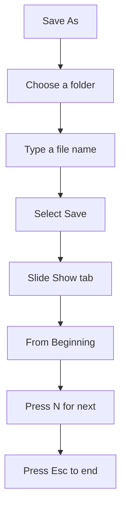

## Goal

By the end of this lesson, you can save a presentation, open it again, and show it on the full screen as a slide show.

## Why It Matters

A shop owner makes slides about new phones on Monday and shows them to customers on Friday. A
school makes sports day slides and shows them to parents in the hall. First you save your
slides so they are not lost. Then you show them on the full screen, one slide at a time.

**Diagram in words:** First save your presentation with a name in a folder. Then start the
slide show from the beginning, press N to go to the next slide, and press Esc to end.

## Key Terms

| Term | Simple meaning |
|------|----------------|
| Slide show | Showing your slides one at a time on the full screen, for people to watch. |
| Slide Show view | The view that fills the whole screen with one slide. Nothing else is shown. |
| Slide Show tab | The ribbon tab with the buttons that start a slide show. |
| From Beginning | The button that starts the slide show at slide 1. |
| From Current Slide | The button that starts the slide show at the slide you have selected. |
| Esc key | The key marked **Esc** on your keyboard. In a slide show, it ends the show. |

You learned **Save As**, file names and folders in
[Lesson 4.3](../module-04-ms-word/saving-closing-opening.mdx). Saving in PowerPoint works the
same way. Folders were explained in
[Lesson 1.8](../module-01-computer-basics/files-folders-saving-deleting.mdx).

A slide show is like a picture album that you turn one page at a time for your family. You
decide when to turn the page.

## Step by Step

Use the sports day presentation from [Lesson 5.2](./adding-slides-and-text.mdx). If you closed
it without saving, make the three slides again first.

**Saving for the first time**

1. Select the **File** tab, then select **Save As**. You use Save As the first time, so that
   you can choose a folder and a name.
2. Select **Browse**. *You see the **Save As** box open.*
3. In the **Save As** box, select the **Documents** folder. This is where you keep your work,
   so you can find it again.

   :::tip[If your screen looks different]

   If you cannot find **Documents** in the box, save in the folder the box suggests. Remember
   that folder name, so you can find your file later.

   :::

4. Select the **File name** box. Type **Sports Day**. A clear name tells you what is inside.
5. Select **Save**. *You see the name **Sports Day** in the title bar at the top.* This shows
   that your presentation is saved.

**Saving a change**

6. Make a small change. For example, on slide 3, add a new point: **Tea for all parents**.
7. Press **Ctrl+S**, so that the change is kept. *No box opens. PowerPoint saves with the same
   name.*

**Closing and opening again**

8. Select the **Close** button (**X**) in the upper-right corner. *PowerPoint closes.* Your work
   is safe, because you saved it.
9. Open PowerPoint again (see [Lesson 5.1](./starting-powerpoint.mdx)). *On the start screen,
   you see a list of recent presentations.*
10. Select **Sports Day** in the list. *Your presentation opens with all three slides.*

    :::tip[If your screen looks different]

    If you do not see **Sports Day** in the list, select **Blank Presentation**. Then select
    **File** > **Open** > **Browse**. Go to the **Documents** folder, select **Sports Day**, and
    select **Open**.

    :::

**Showing the slide show from the beginning**

11. Select the **Slide Show** tab. In the **Start Slide Show** group, select **From
    Beginning**. *Slide 1 fills the whole screen.* This is how your audience sees it.
12. Press **N** to go to the next slide. *You see slide 2.* The **Spacebar**, **Enter** and the
    **Right arrow** key also go to the next slide. Use the one that feels comfortable.
13. Press **P** to go back one slide. *You see slide 1 again.* The **Left arrow** key also goes
    back. This helps when someone asks about the slide before.
14. Press **Esc** to end the slide show. *You see the PowerPoint window again.* You can press
    **Esc** at any time.

**Showing the slide show from the current slide**

15. In the thumbnail pane, select slide 2. Sometimes you only need to show part of your slides.
16. On the **Slide Show** tab, select **From Current Slide**. *The show starts at slide 2, not
    slide 1.*
17. Press **Esc** to end the show.

There are keyboard shortcuts too. Press **F5** to start from the beginning. Press
**Shift+F5** to start from the current slide.

{/* Screenshot to add: The Slide Show tab in PowerPoint 2021, with the From Beginning and From Current Slide buttons circled in the Start Slide Show group. */}

## Practice

Your cousin is getting married. The family wants three slides to show the wedding plan to
relatives. Make them, save them and show them.

| Slide | Layout | Title | Other text |
|-------|--------|-------|------------|
| 1 | Title Slide | Our Family Wedding | Plan for relatives |
| 2 | Title and Content | Mehndi | Thursday evening; At home |
| 3 | Title and Content | Barat | Saturday at 7 pm; Green Garden Hall |

1. Open PowerPoint, start a blank presentation and make the three slides from the table (see
   [Lesson 5.2](./adding-slides-and-text.mdx)).
2. Select **File** > **Save As** > **Browse**. Select the **Documents** folder.
3. Type **Wedding Plan** in the **File name** box and select **Save**.
4. Close PowerPoint with the **Close** button (**X**).
5. Open PowerPoint again and select **Wedding Plan** in the list of recent presentations.
6. On the **Slide Show** tab, select **From Beginning**.
7. Press the **Spacebar** to move to slide 2, then to slide 3.
8. Press **P** to go back to slide 2. Then press **Esc** to end the show.
9. Select slide 3 in the thumbnail pane. Press **Shift+F5**, so that the show starts from
   slide 3. Press **Esc** to end it.
10. Check your work: the title bar shows **Wedding Plan**. The slide show filled the whole
    screen. It started at slide 1 with **From Beginning** and at slide 3 with **Shift+F5**.

## Check Questions

1. Show how you start a slide show from the first slide.

   

   
Show answer

   **Answer:** Select the **Slide Show** tab. In the **Start Slide Show** group, select **From
   Beginning**. Or press **F5**.

   

2. The slide show is running. Name two keys that take you to the next slide.

   

   
Show answer

   **Answer:** Any two of these: **N**, **Spacebar**, **Enter**, **Right arrow**.

   

3. How do you end a slide show?

   

   
Show answer

   **Answer:** Press **Esc**.

   

## Common Mistakes

- **Closing PowerPoint before saving** → Save first with **File** > **Save As**. After that,
  press **Ctrl+S** often.
- **Saving with a name like "new" or "abc"** → Use a clear name, such as **Sports Day**, so you
  can find the file later.
- **Starting from the wrong slide** → Use **From Beginning** to start at slide 1. Use **From
  Current Slide** only when you want to start from the slide you selected.
- **Not knowing how to leave the full screen** → Press **Esc**.

## Sources

*These official pages were checked when this lesson was written.*

- [Microsoft Support, "Save your presentation file"](https://support.microsoft.com/en-us/powerpoint/save-your-presentation-file) (applies to PowerPoint 2021): "On the File tab, select Save as"; "Under Save As, select Browse, pick a path and file folder, and then name the file. Select Save."
- [Microsoft Support, "Basic tasks for creating a PowerPoint presentation"](https://support.microsoft.com/en-us/office/basic-tasks-for-creating-a-powerpoint-presentation-efbbc1cd-c5f1-4264-b48e-c8a7b0334e36) (applies to PowerPoint 2021): "In the File name box, type a name for your presentation, and then choose Save"; "Press Ctrl+S often"; "To start the presentation at the first slide, in the Start Slide Show group, click From Beginning"; "If you're not at the first slide and want to start from where you are, click From Current Slide"; "To get out of Slide Show view at any time, on the keyboard, press Esc."
- [Microsoft Support, "Use a screen reader to save your presentation in PowerPoint"](https://support.microsoft.com/en-us/accessibility/powerpoint/use-a-screen-reader-to-save-your-presentation-in-powerpoint) (applies to PowerPoint 2021): "To save new changes to a file that's already been saved in the correct location with the name you want, press Ctrl+S."
- [Microsoft Support, "Rename a file"](https://support.microsoft.com/en-us/office/rename-a-file-baea7aab-760b-4ee0-af58-06e940d505a4) (applies to PowerPoint 2021): the desktop app shows "the file name on the title bar".
- [Microsoft Support, "Basic tasks to create a presentation in PowerPoint with a screen reader"](https://support.microsoft.com/en-us/office/basic-tasks-to-create-a-presentation-in-powerpoint-with-a-screen-reader-1ada02d7-2f1c-496e-92fd-6a811547a7c3) (applies to PowerPoint 2021): "PowerPoint opens in a view showing recent presentations"; "PowerPoint keeps a list of files you have recently opened".
- [Microsoft Support, "Open files from the File menu"](https://support.microsoft.com/en-us/office/collab-files/open-files-from-the-file-menu) (applies to PowerPoint 2021): "Open your Office app, select File > Open"; "To find a document on your computer but aren't sure where it is, select Browse."
- [Microsoft Support, "Use PowerPoint to save or open a presentation in the OpenDocument Presentation (.odp) format"](https://support.microsoft.com/en-us/office/use-powerpoint-to-save-or-open-a-presentation-in-the-opendocument-presentation-odp-format-94805e84-1b09-4c98-a8b5-0da2a52242a0) (applies to PowerPoint 2021): in the Open box, "Click the file you want to open, and then click Open."
- [Microsoft Support, "Use a screen reader to explore and navigate PowerPoint"](https://support.microsoft.com/en-us/office/use-a-screen-reader-to-explore-and-navigate-powerpoint-a11115c7-6038-44a9-b355-8e133a4e9594) (applies to PowerPoint 2021): "the Slide Show tab for setting up and starting your slide show"; "The App controls at the upper-right corner of the screen include, for example, the Minimize and Close buttons."
- [Microsoft Support, "Use keyboard shortcuts to deliver PowerPoint presentations"](https://support.microsoft.com/en-us/office/use-keyboard-shortcuts-to-deliver-powerpoint-presentations-1524ffce-bd2a-45f4-9a7f-f18b992b93a0) (applies to PowerPoint 2021): "Start a presentation from the beginning. F5"; "Start a presentation from the current slide. Shift+F5"; "advance to the next slide. N, Enter, Page down, Right arrow key, Down arrow key, Spacebar"; "return to the previous slide. P, Page up, Left arrow key, Up arrow key, Backspace"; "End the presentation. Esc".
- [Microsoft Support, "Choose the right view for the task in PowerPoint"](https://support.microsoft.com/en-us/office/video-choose-the-right-view-for-the-task-9efd315f-7ae8-43a6-91f3-5f77db2e44a7) (applies to PowerPoint 2021): "Slide Show view occupies the full computer screen, exactly the way your presentation will look on a big screen when your audience sees it."
