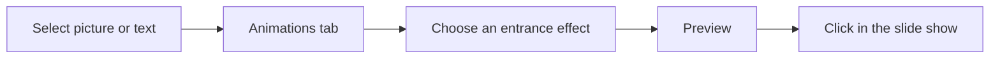

## Goal

By the end of this lesson, you can add an entrance animation to a picture or to text on a slide, and preview it.

## Why It Matters

An animation makes one thing on a slide move. A mobile shop can make the picture of a new phone
fly in, so that customers look at it. A health worker can make each point of a talk appear one at
a time, so that people read one point and listen. A small animation shows people where to look.
Too many animations do the opposite: they pull eyes away from your words.

**Diagram in words:** Select a picture or some text, open the Animations tab and choose an
entrance effect. Preview it, then click in the slide show to make it come in.

## Key Terms

| Term | Simple meaning |
|------|----------------|
| Animation | A movement given to one thing on a slide, such as a picture or some text. |
| Animations tab | The ribbon tab with all the animations and their settings. |
| Entrance effect | An animation that makes a picture or text come onto the slide. Its icon in the gallery is green. |
| Effect Options | A button that changes how an animation moves, for example the side it comes from. |
| Preview | A short play of the animations on the slide, so you can see them before the slide show. |
| Animation marker | A small mark next to a picture or text. It shows that it has an animation. |

A transition moves the **whole slide** ([Lesson 5.9](./slide-transitions.mdx)). An animation
moves **one thing** on the slide. Think of a stage: the transition is the curtain opening. The
animation is one actor walking onto the stage.

## Step by Step

Open your **Mobile Centre** presentation from
[Lesson 5.6](./pictures-and-shapes.mdx). Its slide has a title, the line **New phones this
month**, a picture and a shape. If you do not have it, make that slide again first.

**Animating the picture**

1. Click the picture, so that it is selected. PowerPoint must know which thing will move.
2. Select the **Animations** tab. *You see a gallery of animation effects in the **Animation**
   group.* The green icons are entrance effects. They bring things onto the slide.
3. In the gallery, select **Fly In**. *The picture flies in once on the slide.* PowerPoint plays
   the animation right away, so you can see it.

   :::tip[If your screen looks different]

   If you cannot see **Fly In** in the row, select the **More** arrow next to the gallery. You
   see more effects. Look for **Fly In** under the green entrance effects.

   :::

4. Select **Effect Options** and choose a side for the picture to come from, for example the
   left. Effect Options change the direction of the movement.
5. Select **Preview** in the **Preview** group. *The picture flies in again from the new side.*
   Use **Preview** any time you want to watch the animations on the slide.

*You see a small animation marker next to the picture.* It tells you that the picture has an
animation.

**Animating the text**

6. Select the box that contains **New phones this month**. The animation will move all the text
   in the box.
7. On the **Animations** tab, select **Appear**. *The text appears on the slide.* **Appear** is a
   calm effect, good for words.
8. Select **Preview**. *First the picture flies in. Then the text appears.* The animations play
   one after the other.

**Watching it in the slide show**

9. Start the slide show from the beginning (see [Lesson 5.3](./saving-and-slide-show.mdx)).
   *You see the title, but not the picture or the text yet.*
10. Click the mouse, or press **N**. *The picture flies in.* Click or press **N** again. *The
    text appears.* You decide when each thing comes in, so people look at it when you talk
    about it.
11. Press **Esc** to end the show.

**Removing an animation**

12. Select the shape with the word **New**. If it has no animation, add one: select **Fly In**.
13. Now take it off. With the shape selected, select **None** in the animation gallery. *The
    shape has no animation now.* Use this when an animation does not help.
14. Press **Ctrl+S** to save, so that your animations are kept.

{/* Screenshot to add: The Animations tab in PowerPoint 2021, with the animation gallery (green entrance effects), Effect Options and the Preview button circled, and a selected picture on the slide. */}

Use one or two calm animations on a slide, not more. The picture or point should help your
message, not hide it.

## Practice

Open your **Clean Water** presentation from [Lesson 5.5](./design-themes.mdx). If you do not
have it, make these slides again first.

| Slide | Title | Points |
|-------|-------|--------|
| 2 | Boil Your Water | Boil for a few minutes; Let it cool; Keep it covered |
| 3 | Store It Safely | Use a clean pot; Use a clean cup to take water out |

1. Select slide 2 in the thumbnail pane.
2. Select the box that contains the three points.
3. Select the **Animations** tab. Select **Appear**, so that the points come in when you click.
4. Select **Preview** to watch it.
5. On slide 3, select the box with the two points. Select **Fly In**.
6. Select **Effect Options** and choose a side you like. Select **Preview**.
7. Start the slide show from the beginning. On slides 2 and 3, click to bring in the points.
   Press **Esc** at the end.
8. Press **Ctrl+S** to save your work.
9. Check your work: in the slide show, the points on slide 2 appear when you click. The points
   on slide 3 fly in when you click. Slide 1 has no animation.

## Check Questions

1. Point to the **Preview** button on the **Animations** tab.

   

   
Show answer

   **Answer:** It is on the **Animations** tab, in the **Preview** group.

   

2. What is the difference between a transition and an animation?

   

   
Show answer

   **Answer:** A transition moves the whole slide when it comes in. An animation moves one thing
   on a slide, such as a picture or some text.

   

3. In the gallery, what colour are the entrance effects?

   

   
Show answer

   **Answer:** Green.

   

## Common Mistakes

- **Choosing an animation before selecting anything** → Select the picture or the text box
  first, then choose the animation.
- **Animating everything on every slide** → Use one or two calm animations on a slide, so that
  people listen to you.
- **Thinking the animation is broken because the picture is missing in the slide show** →
  Click, or press **N**. An animation waits for your click.
- **Wanting to take an animation off** → Select the thing, then select **None** in the animation
  gallery.

## Sources

*These official pages were checked when this lesson was written.*

- [Microsoft Support, "Animate text or objects"](https://support.microsoft.com/en-us/office/animate-text-or-objects-305a1c94-83b1-4778-8df5-fcf7a9b7b7c6) (applies to PowerPoint 2021, **Windows** tab): "You can animate the text, pictures, shapes, tables, SmartArt graphics, and other objects"; "Select the object or text you want to animate. Select Animations and choose an animation. Select Effect Options and choose an effect"; "On Click: Start an animation when you click a slide"; "Select an animation marker."
- [Microsoft Support, "Animation basics for your presentation"](https://support.microsoft.com/en-us/office/animation-basics-for-your-presentation-4fbc7d35-3548-431a-a871-709945f9352c) (applies to PowerPoint 2021): "On the Animations tab, select an animation effect from the gallery in the Animation group. Choose the More arrow to see more options"; "In the gallery, entrance effects icons are colored green"; "on the Animations tab, select Preview in the Preview group"; "Presentation experts recommend using animations and sound effects sparingly"; "too much animation can be distracting."
- [Microsoft Support, "Animate or make words appear one line at a time"](https://support.microsoft.com/en-us/office/animate-or-make-words-appear-one-line-at-a-time-cfb5ebdc-90cf-4324-8933-874c7c840175) (applies to PowerPoint 2021, **Windows** tab): "On the slide, select the box that contains your text"; "pick an animation, such as Appear, Fade In, or Fly In"; "For some animations, such as Fly In, select Effects Options, as you'll need to pick a direction ... such as bottom, top, left, or right"; "PowerPoint immediately previews the animation for you"; "By default, when you present in Slide Show, each paragraph appears in response to a click."
- [Microsoft Support, "Change, remove, or turn off animation effects in PowerPoint"](https://support.microsoft.com/en-us/powerpoint/change-remove-or-turn-off-animation-effects-in-powerpoint) (applies to PowerPoint 2021, **Windows** tab): "To remove all animation effects from text or an object, select the object that you want to stop animating. Then, on the Animations tab, in the gallery of animation effects, select None."
- [Microsoft Support, "The difference between animations and transitions"](https://support.microsoft.com/en-us/office/the-difference-between-animations-and-transitions-bae174a4-dad3-4268-bf9c-c201a70995f1) (applies to PowerPoint 2021): "An animation is a special effect that applies to a single element on a slide"; "A transition is applied to an entire slide"; "Entrance effects make an object appear."
- [Microsoft Support, "Use keyboard shortcuts to deliver PowerPoint presentations"](https://support.microsoft.com/en-us/office/use-keyboard-shortcuts-to-deliver-powerpoint-presentations-1524ffce-bd2a-45f4-9a7f-f18b992b93a0) (applies to PowerPoint 2021): "Perform the next animation or advance to the next slide. N, Enter, Page down, Right arrow key, Down arrow key, Spacebar"; "End the presentation. Esc".
