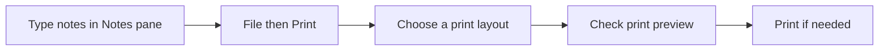

## Goal

By the end of this lesson, you can write speaker notes for your slides, and print notes pages or handouts, or check them in print preview.

## Why It Matters

Your slides show a few short words. You still need to remember what to say about each slide.
Speaker notes hold those reminders. A shop owner can write the price details for each phone in
the notes. A health worker can write the questions to ask people. You can also print your
slides on paper. Parents at a school meeting can take home a handout with the slides on it.

**Diagram in words:** Type your notes in the Notes pane. Then select File and Print, choose
Notes Pages or a Handouts layout, check the preview, and print only if you need paper.

## Key Terms

| Term | Simple meaning |
|------|----------------|
| Speaker notes | Reminders that you write for yourself about a slide. The audience does not see them. |
| Notes pane | The box below the slide where you type your speaker notes. |
| Notes Pages | A print layout. Each page shows one slide with its notes below it. |
| Handouts | A print layout with several slides on one page, to give to people. |
| Print preview | A picture of how your pages will look on paper. |
| Presenter View | A view on your own screen during a slide show. It shows your notes. The audience sees only the slides. |

Speaker notes are like the small card a speaker holds at a school function. The card has the
points to say. The people listening see only the speaker, not the card.

Print preview works the same way as in Word
([Lesson 4.11](../module-04-ms-word/page-setup-and-printing.mdx)). You do not need a printer to
see it.

## Step by Step

Open your **Sports Day** presentation from [Lesson 5.3](./saving-and-slide-show.mdx). It has
three slides. If you do not have it, make the three slides again (see
[Lesson 5.2](./adding-slides-and-text.mdx)).

**Writing speaker notes**

1. Select slide 1 in the thumbnail pane. The notes you type go with the slide you select.
2. Look below the slide. *You see a box that says **Click to add notes**.* This is the Notes
   pane.

   If you do not see it, select **Notes** on the bar at the bottom of the PowerPoint window. *The
   Notes pane opens below the slide.*

3. Click in the Notes pane and type: **Welcome parents and guests. Thank the principal.** These
   are reminders for you. They do not show on the slide.
4. Select slide 2. In its Notes pane, type: **The 100 metre race starts at 10:30 am.** Slide 2
   lists the races. The note keeps the time for you, so the slide stays short.
5. Select slide 3. In its Notes pane, type: **Prizes are given at 1 pm.**
6. If your notes are long, make the Notes pane bigger. Point to the top line of the pane. *The
   pointer becomes a double-headed arrow.* Drag it upward.

When your computer is connected to a projector, PowerPoint can show Presenter View on your
screen. You see your notes there. The audience sees only the slides.

**Print preview of notes pages**

7. Select the **File** tab, then select **Print**. *On the right, you see a preview of your
   slides. On the left, you see the **Print** button and the **Settings**.*
8. Under **Settings**, select the second box. It says **Full Page Slides**. *You see a list of
   layouts.* The pictures in the list show how each layout prints.
9. Under **Print Layout**, select **Notes Pages**. *The preview shows one slide on the page,
   with your notes below it.* Notes pages are for you, to hold while you speak.

**Print preview of handouts**

10. Select the same box again. Under **Handouts**, select **3 Slides**. *The preview shows three
    slides on one page, with lines for notes.* People can write their own notes on the lines.
11. Check that all three slides are on the page. Handouts save paper, because several slides
    fit on one sheet.

{/* Screenshot to add: The File, then Print screen in PowerPoint 2021, with the print layout list open, showing Full Page Slides, Notes Pages and the Handouts layouts including 3 Slides. */}

**Printing, or going back**

12. If you have a printer and need paper, check the **Copies** box. Choose **1** copy, then select
    **Print**. One copy is enough to check your work.
13. If you have no printer, stop at the preview. The preview shows what would print.
14. Press **Esc** to go back to your slides. You can also select the back arrow at the top left.
15. Press **Ctrl+S** to save, so that your notes are kept.

## Practice

Open your **Wedding Plan** presentation from [Lesson 5.3](./saving-and-slide-show.mdx). You
will add notes for the person who explains the plan to relatives. You do not need a printer.

| Slide | Title | Notes to type |
|-------|-------|---------------|
| 1 | Our Family Wedding | Welcome everyone. Thank them for coming. |
| 2 | Mehndi | Ask the cousins to bring dholak. |
| 3 | Barat | Cars leave the house at 6 pm. |

1. Select slide 1. In the Notes pane, type the note from the table.
2. Type the notes for slides 2 and 3 in the same way, so that each slide has its own reminder.
3. Select **File**, then **Print**.
4. Under **Settings**, open the layout box. Select **Notes Pages**. Look at the preview of each
   slide's notes.
5. Open the layout box again. Under **Handouts**, select **3 Slides**.
6. Print one copy only if you have a printer and need paper. Otherwise, stop at the preview.
7. Press **Esc** to go back to your slides. Press **Ctrl+S** to save.
8. Check your work: each slide has its note in the Notes pane. The Notes Pages preview shows a
   slide with its note below it. The handout preview shows all three slides on one page.

## Check Questions

1. Point to the Notes pane on your screen.

   

   
Show answer

   **Answer:** It is the box below the slide. When it is empty, it says **Click to add notes**.

   

2. Can the audience see your speaker notes during the slide show?

   

   
Show answer

   **Answer:** No. The notes are for you. In Presenter View, you see them on your screen. The
   audience sees only the slides.

   

3. You want to give people a page with three slides on it. Which layout do you choose?

   

   
Show answer

   **Answer:** Under **Handouts**, choose **3 Slides**. It also has lines for notes.

   

## Common Mistakes

- **Typing your notes on the slide itself** → Type them in the Notes pane, so that the slide
  stays short and clear.
- **Writing every word you will say** → Write short reminders. Read your notes only to remember
  the next point.
- **Printing Full Page Slides when you wanted notes** → Under **Settings**, select **Notes
  Pages** before you print.
- **Selecting Print when there is no printer** → Stop at the print preview. It shows what would
  print.

## Sources

*These official pages were checked when this lesson was written.*

- [Microsoft Support, "Add speaker notes to your slides"](https://support.microsoft.com/en-us/office/add-speaker-notes-to-your-slides-26985155-35f5-45ba-812b-e1bd3c48928e) (applies to PowerPoint 2021, **Windows** tab): "During your presentation, the speaker notes are visible on your monitor, but aren't visible to the audience"; "The Notes pane is a box that appears below each slide"; "An empty Notes pane will prompt you with text that says, Click to add notes"; "If you don't see the Notes pane or it is completely minimized, click Notes on the task bar across the bottom of the PowerPoint window"; "enlarge the Notes pane by pointing your mouse at the top line of the pane and then dragging upward after the pointer turns into a double-headed arrow"; "When your computer is connected to a projector and you start the slide show, Presenter View appears on your computer's screen, while only the slides appear on the projector screen."
- [Microsoft Support, "Print your PowerPoint slides, handouts, or notes"](https://support.microsoft.com/en-us/office/print-your-powerpoint-slides-handouts-or-notes-194d4320-aa03-478b-9300-df25f0d15dc4) (applies to PowerPoint 2021, **Windows** tab): "On the File tab, select Print"; "Print Layout: Choose to print just the slides, just the speaker notes, an outline, or handouts"; "If you choose to print Handouts, you can print several slides on one page"; "For Copies, select how many copies you want to print. Select Print."
- [Microsoft Support, "Print slides with or without speaker notes"](https://support.microsoft.com/en-US/PowerPoint/print-slides-with-or-without-speaker-notes) (applies to PowerPoint 2021): "Under Settings, click the second box (which defaults to say Full Page Slides), then under Print Layout, click Notes Pages"; "Notes Pages prints one slide per page, with speaker notes below. The Preview Pane shows you what each layout option looks like."
- [Microsoft Support, "Print your handouts, notes, or slides"](https://support.microsoft.com/en-us/powerpoint/print-your-handouts-notes-or-slides) (applies to PowerPoint 2021): "The “3 Slides” layout for handouts includes lines for taking notes"; "The thumbnail images you see show a preview of how the pages will look when printed."
- [Microsoft Support, "Printing and print preview"](https://support.microsoft.com/en-us/office/printing-and-print-preview) (PowerPoint section): "PowerPoint combines Print and Preview in the same window. Click File > Print. On the right, you'll see a preview of your presentation. On the left, you'll see the Print button and the configurable Settings." This page's "Applies to" list names Office 2021 apps but not PowerPoint 2021; the same facts are confirmed for PowerPoint 2021 by the three print pages above.
- [Microsoft Support, "Create and print notes pages"](https://support.microsoft.com/en-US/PowerPoint/create-and-print-notes-pages) (applies to PowerPoint 2021): "Each notes page shows a slide thumbnail, together with the notes that accompany that slide"; "Under Settings, select the arrow next to Full Page Slides, and then under Print Layout, select Notes Pages."
- [Microsoft Support, "Start Backstage with the File tab"](https://support.microsoft.com/en-us/office/start-backstage-with-the-file-tab-04610088-406c-43d0-98a0-c1999ab4ef53) (applies to PowerPoint 2021): "The Print command is available on the Backstage navigation pane"; "To exit Backstage and return to the document, select the Back arrow at the top left of the navigation pane, or just press the Escape key on your keyboard."
- [Microsoft Support, "Tips for creating and delivering an effective presentation"](https://support.microsoft.com/en-us/powerpoint/tips-for-creating-and-delivering-an-effective-presentation) (applies to PowerPoint 2021): "Don't read the presentation. Practice the presentation so that you can speak from bullet points. The text should be a cue for the presenter rather than the full message for the audience."
