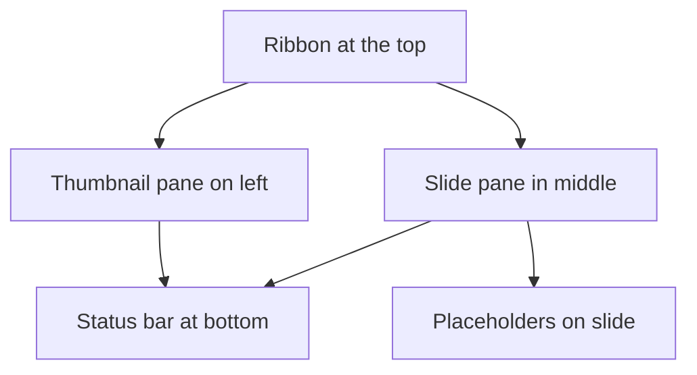

import Tabs from '@theme/Tabs';
import TabItem from '@theme/TabItem';

## Goal

By the end of this lesson, you can open PowerPoint, start a blank presentation and point to the main parts of the PowerPoint window.

## Why It Matters

Microsoft PowerPoint is a program for making slides. A mobile shop can show its new phones on a
big screen. A school can show the sports day programme to parents. A health worker can explain
clean habits to a group of mothers. Before you make any slides, you need to open PowerPoint and
know your way around its window.

**Diagram in words:** The ribbon is at the top of the window. Below it, the small slides are on
the left and the big slide is in the middle. The status bar is at the bottom.

## Key Terms

| Term | Simple meaning |
|------|----------------|
| Presentation | A set of slides that you show one after another. It is one PowerPoint file. |
| Slide | One page of a presentation. It is like one page of a flip chart. |
| Blank Presentation | A new, empty presentation with no design, ready for your own words. |
| Thumbnail pane | The column of small slides on the left side of the window. A thumbnail is a small picture of a slide. |
| Slide pane | The big area in the middle. It shows the slide you are working on. |
| Placeholder | A box with a dotted border on a slide. It holds a title, text or a picture. |
| Normal view | The main way of looking at your slides while you make them. |

You met the ribbon, tabs and groups in [Lesson 4.1](../module-04-ms-word/starting-word.mdx).
PowerPoint has a ribbon too. It works in the same way.

Think of a presentation like a flip chart in a meeting. You show one page, talk about it, then
turn to the next page. In PowerPoint, each page is a slide.

## Step by Step

Follow these steps on your own computer. You learned **Start** in
[Lesson 1.4](../module-01-computer-basics/starting-up-and-shutting-down.mdx) and clicking in
[Lesson 1.5](../module-01-computer-basics/using-the-mouse.mdx).

**Opening PowerPoint**

The steps are a little different on Windows 10 and Windows 11. Choose the tab for your computer.

<Tabs groupId="windows-version">
<TabItem value="win10" label="Windows 10">

1. Select **Start**, so that you can see your programs. *You see the Start menu open, with a
   list of programs.*
2. Scroll down the list until you see **PowerPoint**. The list is in A to Z order, like names
   in a phone's contact list.
3. Select **PowerPoint** to start the program. *You see PowerPoint start.*

</TabItem>
<TabItem value="win11" label="Windows 11">

1. Select **Start**, so that you can see your programs. *You see the Start menu open.*
2. Select **All**. On an older Windows 11 computer, this button says **All apps**. This shows
   every program. *You see a list of programs in A to Z order.*
3. Scroll down to **PowerPoint** and select it to start the program. *You see PowerPoint
   start.*

</TabItem>
</Tabs>

**Another way, on both Windows 10 and Windows 11:** press the **Windows key**, type
**powerpoint**, then select **PowerPoint** in the list of results. This is faster when the list
is long.

**Starting a blank presentation**

4. Look at the PowerPoint start screen. *You see your recent presentations, some designs and
   **Blank Presentation**.*
5. Select **Blank Presentation**, so that you start with clean slides. *You see a new
   presentation with one slide.*

   :::tip[If your screen looks different]

   If you cannot see **Blank Presentation**, select **New** in the pane on the left side first.
   Then select **Blank Presentation**.

   :::

PowerPoint adds the first slide for you. It is a title slide, the cover page of your
presentation.

**The PowerPoint window**

6. Find the slide pane in the middle. This big slide is where you type and add pictures.
7. Find the placeholder that says **Click to add title**. Its dotted border shows the box. You
   will type your title here in the next lesson.
8. Find the thumbnail pane on the left. *You see a small copy of your slide, with the number
   1.* Later, when you have many slides, you use this pane to move between them.
9. Find the ribbon at the top. Find these tabs: **File**, **Home**, **Insert**, **Design**,
   **Slide Show** and **View**.
10. Select the **Insert** tab. *The buttons on the ribbon change.* Each tab shows its own set
    of buttons, like in Word.
11. Select the **Home** tab. Find the **New Slide** button. You will use it to add slides.
12. Select the **View** tab. In the **Presentation Views** group, select **Normal**. *The
    window stays the same.* Normal view is the view you work in most of the time. If you ever
    get lost in another view, come back this way.
13. Look at the bar at the bottom of the window. This is the status bar. Near its right end are
    small buttons for the most used views, such as Normal view.

Below the slide, you may see a space for notes. You can leave it for now.

14. Select the **Close** button (**X**) in the upper-right corner of the window, so that
    PowerPoint closes when you finish. *You see PowerPoint close.*

{/* Screenshot to add: The PowerPoint 2021 window with a blank presentation in Normal view. Label the ribbon tabs, the thumbnail pane, the slide pane, the "Click to add title" placeholder, the status bar and the Close button. */}

## Practice

Imagine that a health worker in your area will give a talk on clean habits. She wants you to make
her slides next week. First, get to know the PowerPoint window.

1. Open PowerPoint from the Start menu, the same way as in Step by Step.
2. Select **Blank Presentation**, so that you have a new, empty presentation.
3. Point to the slide pane and say its name out loud. Saying it helps you remember it.
4. Point to the thumbnail pane on the left. Count how many slides it shows.
5. Point to the placeholder that says **Click to add title**.
6. Select the **Design** tab, then the **Slide Show** tab. Look at how the buttons change.
7. Select the **Home** tab and find **New Slide**.
8. Select the **View** tab, then select **Normal**, so that you know how to get back to Normal
   view.
9. Close PowerPoint with the **Close** button (**X**) in the upper-right corner.
10. Open PowerPoint again and select **Blank Presentation**. Doing it twice helps you remember the
    steps.
11. Check your work: PowerPoint is open with one empty slide. You can point to the ribbon, the
    thumbnail pane, the slide pane, a placeholder and the status bar without looking at this
    page.

## Check Questions

1. Point to the thumbnail pane on your screen. What does it show?

   

   
Show answer

   **Answer:** It is the column on the left side of the window. It shows small pictures of your
   slides, with their numbers.

   

2. What is a placeholder?

   

   
Show answer

   **Answer:** A box with a dotted border on a slide. It holds a title, text or a picture. For
   example, the box that says **Click to add title**.

   

3. You are in a different view and the window looks strange. How do you go back to Normal view?

   

   
Show answer

   **Answer:** Select the **View** tab. In the **Presentation Views** group, select **Normal**.

   

## Common Mistakes

- **Not finding PowerPoint in the Start menu list** → The list is in A to Z order. Scroll down
  to the letter P, or press the Windows key and type **powerpoint**.
- **Selecting a design instead of Blank Presentation** → Close PowerPoint, open it again, and
  select **Blank Presentation**.
- **Mixing up the thumbnail pane and the slide pane** → The thumbnail pane has the small slides
  on the left. The slide pane has the one big slide in the middle.
- **Ending up in a different view** → Select **View** > **Normal** to come back.

## Sources

*These official pages were checked when this lesson was written.*

- [Microsoft Support, "Create a presentation in PowerPoint"](https://support.microsoft.com/en-us/office/create-a-presentation-in-powerpoint-422250f8-5721-4cea-92cc-202fa7b89617) (applies to PowerPoint 2021, PowerPoint 2024, PowerPoint 2019, PowerPoint 2016 and PowerPoint for Microsoft 365): "Open PowerPoint. In the side pane, select New"; "To create a presentation from scratch, select Blank Presentation"; "In the Home tab, in the Slides section, select New Slide."
- [Microsoft Support, "Basic tasks to create a presentation in PowerPoint with a screen reader"](https://support.microsoft.com/en-us/office/basic-tasks-to-create-a-presentation-in-powerpoint-with-a-screen-reader-1ada02d7-2f1c-496e-92fd-6a811547a7c3) (applies to PowerPoint 2021): "Press the Windows logo key, type PowerPoint"; "PowerPoint opens in a view showing recent presentations, a search field, templates, and themes. The focus is on the Blank Presentation template."
- [Microsoft Support, "Basic tasks for creating a PowerPoint presentation"](https://support.microsoft.com/en-us/office/basic-tasks-for-creating-a-powerpoint-presentation-efbbc1cd-c5f1-4264-b48e-c8a7b0334e36) (applies to PowerPoint 2021): "PowerPoint presentations work like slide shows. To convey a message or a story, you break it down into slides."
- [Microsoft Support, "Use a screen reader to work with slides in PowerPoint"](https://support.microsoft.com/en-us/office/use-a-screen-reader-to-work-with-slides-in-powerpoint-566c021b-7fe5-4f96-a0f7-eca68335f991) (applies to PowerPoint 2021): "In a new presentation, the title slide is added automatically."
- [Microsoft Support, "Use a screen reader to explore and navigate PowerPoint"](https://support.microsoft.com/en-us/office/use-a-screen-reader-to-explore-and-navigate-powerpoint-a11115c7-6038-44a9-b355-8e133a4e9594) (applies to PowerPoint 2021): the main screen elements are "The active slide", "The status bar", "The ribbon tabs" and "The Thumbnails pane"; "the Home tab with options for formatting text, the Insert tab for inserting new slides or images, the Design tab for changing the appearance of the presentation, the Slide Show tab for setting up and starting your slide show, and the View tab"; "The App controls at the upper-right corner of the screen include, for example, the Minimize and Close buttons."
- [Microsoft Support, "Choose the right view for the task in PowerPoint"](https://support.microsoft.com/en-us/office/video-choose-the-right-view-for-the-task-9efd315f-7ae8-43a6-91f3-5f77db2e44a7) (applies to PowerPoint 2021): "Normal view is the editing mode where you'll work most frequently to create your slides"; it "displays slide thumbnails on the left, a large window showing the current slide, and a section below the current slide where you can type your speaker notes"; the most used views are also "on the task bar at the bottom right of the slide window."
- [Microsoft Support, "Add bullets or numbers to text"](https://support.microsoft.com/en-us/office/add-bullets-or-numbers-to-text-a6f1b87e-fca8-47da-ade9-5d99b7f41f04) (applies to PowerPoint 2021): "On the View tab, in the Presentation Views group, click Normal."
- [Microsoft Support, "Add, edit, or remove a placeholder on a slide layout"](https://support.microsoft.com/en-us/powerpoint/add-edit-or-remove-a-placeholder-on-a-slide-layout) (applies to PowerPoint 2021): "a placeholder is a pre-formatted container on a slide for content (text, graphics, or video)."
- [Microsoft Support, "What is a slide layout?"](https://support.microsoft.com/en-us/office/what-is-a-slide-layout-99da5716-92ee-4b6a-a0b5-beea45150f3a) (applies to PowerPoint 2021): "Placeholders are the dotted-line containers on slide layouts that hold such content as titles, body text, tables, charts".
- [Microsoft Support, "Title a slide"](https://support.microsoft.com/en-us/powerpoint/title-a-slide) (applies to PowerPoint 2021): "Select the Click to add title text box. Enter your title for that slide."
- [Microsoft Support, "Can't find Office applications in Windows 10?"](https://support.microsoft.com/en-us/office/can-t-find-office-applications-in-windows-10-907ce545-6ae8-459b-8d9d-de6764a635d6) (applies to Office 2021): "For Microsoft 365, Office 2021, Office 2019, or Office 2016, choose Start and scroll to the Office application name"; or start typing its name and click it in the results.
- [Microsoft Support, "Find your files and apps in Windows"](https://support.microsoft.com/en-us/windows/find-all-your-apps-and-programs-cadb9c4b-459d-dfcb-2964-14aac1d7d964) (Windows 10 and Windows 11): on Windows 11, "Start, select All, and then scroll through the alphabetical list on the left"; on both versions, press the Windows key and type the name of the app.
- [Microsoft Support, "Find all your apps and programs" (archived Microsoft page, January 2024)](https://web.archive.org/web/20240120035001/https://support.microsoft.com/en-us/windows/find-all-your-apps-and-programs-cadb9c4b-459d-dfcb-2964-14aac1d7d964): the older Windows 11 wording, "Select Start, select All apps, and then scroll through the alphabetical list on the left."
