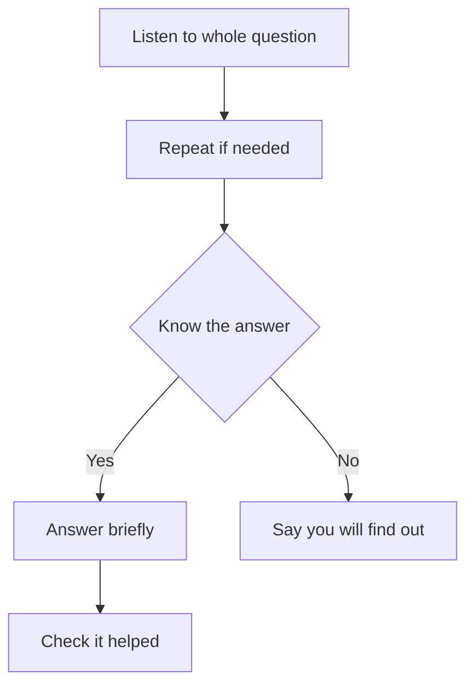

## Goal

By the end of this lesson, you can listen to a whole question, answer it briefly, and say you will find out when unsure.

## Why It Matters

After a talk, people often ask questions. At a job interview, the whole meeting is questions and
answers. Customers ask a shop owner about prices and warranty. Parents ask about fees at a
tuition centre meeting. Good answers help people trust you and what you said. Questions also
show that people were interested in your talk.

**Diagram in words:** Listen to the whole question, and repeat it if needed. If you know the
answer, answer briefly and check that it helped. If you do not know, say that you will find out.

## Key Terms

| Term | Simple meaning |
|------|----------------|
| Question time | The part at the end of a talk when listeners ask you questions. |
| Repeat the question | To say the question again in your own words, to check that you understood it. |
| Brief answer | A short answer that gives only what the person asked for. |
| Off-topic question | A question about something that is not part of your talk. |
| Find out | To look for the right answer later, then give it to the person. |

Answering a question is like a shopkeeper finding an item for a customer. First you hear the
whole request. Then you give exactly what was asked for, not the whole shop.

## Step by Step

Ayesha works at Bright Future Tuition Centre. She has given a short talk to parents about the
new session. Here are the facts from her slides (from the project in
[Lesson 5.12](../module-05-ms-powerpoint/project-shop-presentation.mdx)).

| Subject | Fee | Days | Time |
|---------|-----|------|------|
| Maths | Rs 2,500 a month | Monday, Wednesday, Friday | 4 pm to 5 pm |
| English | Rs 2,000 a month | Tuesday and Thursday | 4 pm to 5 pm |
| Science | Rs 2,500 a month | Monday, Wednesday, Friday | 5 pm to 6 pm |

All three subjects together cost Rs 7,000 a month. The new session starts on 1 November.

Follow Ayesha's steps. Read each sample line aloud, as if you are Ayesha. These steps work the
same when you speak in Urdu.

**Before the talk: get ready for questions**

1. Write down three questions that people may ask. Next to each one, write a short answer.
   Practise saying the answers aloud, so that you are ready.
2. Decide when you will take questions. At the start of your talk, tell people. For example:
   "Please keep your questions for the end." Then you can finish your talk without stopping.
   Some early questions are also answered by your later slides.

**When someone asks a question**

3. Look at the person who is asking. Listen to the whole question. Do not stop the person in the
   middle, even if you think you know the question. Hearing all of it helps you give the best
   answer.
4. Thank the person. *You hear Ayesha say, "Thank you for that question."* This is polite, and
   the person feels that the question was welcome.
5. Pause for a few seconds before you answer. A short pause helps you think of a good answer.
6. If you are not sure what the person asked, repeat the question in your own words. If the room
   is big, repeat it loudly too, so that everyone hears it.

:::note[Sample talk]

**Parent:** My son is in grade 8. He wants English. What is the fee, and on which days is it?

**Ayesha:** Thank you for that question. You want to know the fee and the days for English.
English is Rs 2,000 a month. It is on Tuesday and Thursday, from 4 pm to 5 pm. Does that answer
your question?

:::

7. Answer briefly. Give only what the person asked for, and then stop. A short answer leaves
   time for other people's questions.
8. Speak to everyone, not only the person who asked. Then the answer is for the whole group, not
   a private chat.
9. Ask, "Does that answer your question?" When the person says yes, move on to the next
   question.

**When you do not know the answer**

10. Do not guess. Say so politely, and promise to find out.

:::note[Sample talk]

**Parent:** Do you have a van to bring children from school?

**Ayesha:** That is a good question. I do not know the answer yet. I will find out and tell you
tomorrow.

:::

11. Keep your promise. Find the answer, and then tell the person.

**When a question is not about your talk**

12. Answer politely, and offer to talk after the talk is over. This keeps your talk on its
    topic.

:::note[Sample talk]

**Parent:** Which school is best for my daughter?

**Ayesha:** I am sorry, that question is outside this talk. I will be happy to talk with you
about it afterwards.

:::

13. When time is almost over, say, "I will take one last question." Then people know that the
    talk is ending.

## Practice

Practise question time with a family member or a friend. Use the Hamza Mobile Centre slides from
[Lesson 5.12](../module-05-ms-powerpoint/project-shop-presentation.mdx). These are your facts:

| Phone | Price | Main point | Warranty |
|-------|-------|------------|----------|
| Tara 5 | Rs 25,000 | Big battery | 1 year shop warranty |
| Kiran Max | Rs 39,500 | Good camera | 1 year shop warranty |
| Sitara Lite | Rs 18,500 | Light and slim | 1 year shop warranty |

The shop is at Shop 12, Main Bazaar. It is open from 10 am to 9 pm.

Give your helper these questions on a piece of paper. They can ask them in any order:

- Which phone is the cheapest?
- Which phone has the best camera, and what does it cost?
- What time does the shop open and close?
- Does the Kiran Max come in red?
- What is your favourite cricket team?

1. Write three questions you think customers may ask, with a short answer for each. Say the
   answers aloud once.
2. Tell your helper about the three phones in about 1 minute. At the start, ask them to keep
   their questions for the end.
3. Ask your helper to ask the questions from the paper, one at a time.
4. For each question, look at your helper and listen until the question ends.
5. Thank your helper. Pause for a moment. Repeat the question in your own words if you are not
   sure of it.
6. Answer in one or two sentences. Then ask, "Does that answer your question?"
7. For the question about red colour, the facts do not tell you. Say that you will find out.
8. For the cricket question, say politely that it is not part of your talk.
9. If you like, record question time on your phone and listen to it later.
10. Check your work: tick each one. ☐ You let your helper finish every question. ☐ Each answer
    was one or two sentences. ☐ You said "I will find out" for the red phone. ☐ You answered the
    cricket question politely, without a long talk. ☐ You looked at your helper while you
    answered.

## Check Questions

1. A customer asks a question, and you do not know the answer. What do you say, and what do you
   do after the talk?

   

   
Show answer

   **Answer:** Thank the person and say politely that you do not know yet. Promise to find out,
   for example: "I will find out and tell you tomorrow." After the talk, find the answer and
   give it to the person.

   

2. Read this question from a parent: "When is Science, and how much does it cost?" Answer it
   aloud in two sentences, using the table in Step by Step.

   

   
Show answer

   **Answer:** For example: "Science is on Monday, Wednesday and Friday, from 5 pm to 6 pm. It
   costs Rs 2,500 a month." Then ask, "Does that answer your question?"

   

3. Why do you sometimes repeat a question before you answer it?

   

   
Show answer

   **Answer:** To check that you understood it correctly. In a big room, repeating it loudly also
   helps everyone hear the question.

   

## Common Mistakes

- **Answering before the person finishes the question** → Listen to the whole question first,
  so that you can give the best answer.
- **Giving a long answer** → Answer briefly, so that there is time for other questions.
- **Guessing when you do not know** → Say that you will find out. Then find the answer and give
  it to the person.
- **Looking down at your papers while someone asks** → Look at the person who asks, and listen.
- **Making the person feel silly for asking** → Thank every person for their question.

## Sources

*These official pages were checked when this lesson was written.*

- [Northern Illinois University, Effective Presentation Skills Tutorial, "Handling Questions and Answers"](https://www.niu.edu/presentations/questions/index.shtml): "When someone is asking a question, make eye contact with that person, listen positively, and acknowledge by saying 'thank you for that question'"; "If the audience is in a large room and cannot hear each other's questions, repeat the question loudly for everyone to hear, before answering it"; "respond appropriately and briefly so you can take more questions"; for an off-topic question, "that question is outside the scope of this presentation, but I will be happy to stay after the presentation and discuss it with you"; "I will take one last question"; "If you do not know the answer to a question say, 'That is an interesting question, and I will have to get back to you later on that'"; things not to do: "Shuffling papers or technology and not making eye contact with the questioner"; "Belittling the questioner".
- [Vancouver Island University, Learning Matters, "Top tips for answering questions"](https://learningmatters.viu.ca/answer): "It is important to listen to all parts of a question before answering"; "If you are worried that you haven't understood a question, clarify before responding. Repeat the question back to confirm you have heard what has been asked of you"; "be sure to direct the answer to the questioner and the rest of the audience. Keep your answer short and to the point"; "Ask 'Does that answer your question?' Once the question asker responds 'Yes,' you have your permission to move on"; "This way you can prepare the best response."
- [University of South Africa, myStudentSkillsHub, "Basic Skills in Presentations: 6. Handling Questions"](https://adovh.unisa.ac.za/mod/page/view.php?id=1234): "Listen to the whole question, do not interrupt, or allow anyone else to interrupt the person asking the question"; "Once you have heard the question, pause for a few seconds (literally) and reflect"; "Involve the whole audience when repeating and responding to the question. Do not let it be a dialogue between you and the person posing the question"; "Respond concisely"; "Answering questions from the audience can improve your presentation and make you look more credible"; allowing questions "will assist in keeping them engaged".
- [Northern Illinois University, Effective Presentation Skills Tutorial, "Rehearsing the Presentation"](https://www.niu.edu/presentations/rehearse/index.shtml): "Think of possible questions the audience may ask, and rehearse the answers for those questions."
- [Northern Illinois University, Effective Presentation Skills Tutorial, "Delivering the Presentation"](https://www.niu.edu/presentations/deliver/index.shtml): "Decide how you will handle questions during the presentation, and either request the audience to wait until you are finished with your presentation or make sure you will have time".
- [Microsoft Support, "Tips for creating and delivering an effective presentation"](https://support.microsoft.com/en-us/powerpoint/tips-for-creating-and-delivering-an-effective-presentation) (applies to PowerPoint 2021): "Ask your audience to hold questions until the end"; "Questions are an excellent indicator that people are engaged by your subject matter and presentation skills"; "if you save questions until the end of the presentation, you'll get through your material uninterrupted. Also, early questions are often answered by ensuing slides and commentary."
