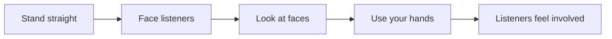

## Goal

By the end of this lesson, you can stand straight, face your listeners, look at them, and use your hands to help your words.

## Why It Matters

Your listeners see you as well as hear you. At a job interview, the panel forms a first
picture of you in the first few seconds, before you say much. A shop owner showing a new phone to
customers looks more confident when they stand up straight. In a college project, you talk to
the listeners, not to the screen. Body language works the same whether you
speak in English or in Urdu.

**Diagram in words:** Stand straight, face your listeners, look at their faces and use your
hands. Then your listeners feel part of your talk.

## Key Terms

| Term | Simple meaning |
|------|----------------|
| Body language | The message your body gives: how you stand, where you look and how you move your hands. |
| Posture | The way you hold your body when you stand or sit. |
| Eye contact | Looking at a listener's face for a short moment while you speak. |
| Gesture | A movement of your hands or arms that helps your words, such as holding up fingers to count. |
| Open body language | Your body turned towards the listeners and your hands free, not in your pockets. |
| Nervous habit | A movement you make without thinking when you are nervous, such as playing with your hair or a pen. |

The **audience** is the group of people who listen to your talk (see
[Lesson 5.12](../module-05-ms-powerpoint/project-shop-presentation.mdx)). In this lesson we call
them your listeners.

## Step by Step

You will practise with a short talk. Hamza owns Hamza Mobile Centre. He tells his customers about
a new phone. All the names and prices in this lesson are made up.

:::note[Sample talk]

Good morning. I am Hamza from Hamza Mobile Centre. Today I want to show you our new phone. It has
three good points. One: the battery lasts all day. Two: the camera takes clear photos at night.
Three: the price is only 35,000 rupees. You can try it in our shop this week. Thank you for
listening.

:::

Copy the talk onto a card or a sheet of paper. Use a room at home with some open space. Place
three objects at eye height in front of you: one on the left, one in the middle and one on the
right. A cup, a book and a cushion are fine. They stand for three listeners.

**Stand well**

1. Stand with your feet apart, about as wide as your shoulders. Keep your weight on both feet.
   This helps you stand steady.
2. Pull your shoulders back and hold your head up. *You feel taller.* This posture helps you
   breathe and feel more confident.
3. Do not lean on a table or a wall, and do not slouch. Good posture helps you look confident.
4. Stand still most of the time. Move only on purpose, for example one step forward for an
   important point. Rocking and swaying distract your listeners from your message.

**Face your listeners, not the screen**

5. If you show slides, stand to one side of the screen. Then you do not block the slides, and you
   can see your listeners without turning your back to them.
6. Before you speak, take a deep breath. Wait for the listeners to be quiet, smile, and then say
   hello. This gives you a calm start.
7. Talk to the people, not to the screen or your paper. Look down at your card for a moment, then
   look up again before you speak. Try to look up more than down.

**Make eye contact**

8. Read the first sentence of the talk and look at the object in the middle. Read the next
   sentence and look at the object on the left. Read the next one and look at the object on the
   right. *Your eyes move around the whole "room".* A short look at each listener is enough.
9. Keep going to the end of the talk. Do not stare at one listener for a long time, and do not
   look only at one side. Try to look at everyone at least once.
10. If looking into people's eyes is hard for you, look at their foreheads. This works well
    too.
11. In a real talk, watch your listeners' faces as you speak. Their faces show you if they
    understand, or if you need to slow down and explain again.

**Use your hands**

12. Take your hands out of your pockets and put down anything you do not need, such as a pen.
    Free hands can make gestures.
13. Read the talk again. At "One", hold up one finger. At "Two", hold up two fingers. At
    "Three", hold up three fingers. *Your hands match your words.* Gestures help you stress your
    points.
14. Let other gestures come naturally. For example, point to the slide when you say "Look at
    this". Do not wave your hands all the time, because too much movement is distracting.
15. Watch for nervous habits: touching your hair or clothes, playing with a pen, or tapping on a
    table. If you notice one, stop and let your hands rest by your sides.
16. If you show slides from a computer, take your hand off the mouse when you are not using it.
    Then you do not move the pointer around the screen by mistake.

**Finish well**

17. After "Thank you for listening", pause for a moment. Look at your listeners and smile. This
    gives your talk a clear end.

## Practice

You are at a job interview. The panel says, "Please tell us about yourself." You will practise a
short answer with your body language.

1. Write four or five short sentences about yourself on a card. Say your name, where you live,
   what you studied, one skill and why you want the job.
2. Stand in front of a mirror, or in front of one or two family members. If you are alone, use
   three objects on the left, in the middle and on the right as listeners.
3. Stand with your feet apart and your shoulders back, so that you look steady and sure.
4. Take a deep breath, smile and say "Good morning", so that you start calmly.
5. Give your answer. Look at a different listener or object for each sentence.
6. When you name your skills, hold up a finger for each one, so that your hands help your words.
7. At the end, pause, look at your listeners and say "Thank you".
8. If you can, record yourself on your phone and watch the video. This step is optional.
9. Check your work: tick each one. ☐ You stood with your feet apart and your shoulders back. ☐
   You did not lean, sway or rock. ☐ You looked up at a listener at least 3 times. ☐ You looked
   at the left, the middle and the right. ☐ Your hands were out of your pockets and you used
   them to count. ☐ You did not play with your hair, clothes or a pen.

## Check Questions

1. Stand up and show how you stand at the start of a talk. Describe what your feet, shoulders
   and head are doing.

   

   
Show answer

   **Answer:** Your feet are apart, about as wide as your shoulders, with your weight on both
   feet. Your shoulders are back and your head is up. You face your listeners and your hands are
   free.

   

2. Your slides are on a screen behind you. Where should you stand, and where should you look?

   

   
Show answer

   **Answer:** Stand to one side of the screen, so that you do not block it. Look at your
   listeners, not at the screen. Look at the slide only for a moment, then turn back to them.

   

3. You are speaking to a room of 20 people. How do you make eye contact with all of them?

   

   
Show answer

   **Answer:** Look at one person for a short moment, then move to a person in another part of
   the room. Look at the left, the middle and the back. Try to look at everyone at least once. If
   eyes are hard, look at foreheads.

   

## Common Mistakes

- **Talking to the screen with your back to the listeners** → Stand to one side of the screen.
  Look at a slide for a moment, then turn back to your listeners.
- **Hands in your pockets or holding a pen tightly** → Keep your hands free. Use them to count
  your points.
- **Looking only at the floor, your paper or one person** → Move your eyes around the room. Give
  each listener a short look.
- **Swaying or rocking while you speak** → Stand with your feet apart and your weight on both
  feet. Move only on purpose.

## Sources

*These official pages were checked when this lesson was written.*

- [UNSW Sydney, "Preparing and delivering a presentation"](https://student.unsw.edu.au/node/291): "Position yourself with feet apart, facing the audience. Avoid slouching, shuffling, or leaning on furniture"; "Take a deep breath and wait for the audience to settle before starting to speak"; "Start by saying hello"; "Avoid reading directly from a script, notes or visuals"; "Eye contact helps you connect. Scan the room and engage with as many people as possible. A brief glance is enough"; "Add emphasis and interest with hand gestures. Use 'open' body language to convey confidence"; choose "a standing spot … without turning your back to the audience"; "Ensure that you won't accidentally block the screen while presenting by standing off to the side"; "Use eye contact to gauge audience reactions and adjust your delivery accordingly."
- [University of Puget Sound, Center for Speech and Effective Advocacy, "Delivery Tips" (PDF)](https://www.pugetsound.edu/sites/default/files/2022-11/delivery-tipsdocx.pdf): "Posture. Feet should be evenly spaced, proportionate with shoulders. Shoulders back, head up"; "Try to look at everyone in the room, at least once"; "Keep hands free for gesturing (not in your pants pockets)"; "Audiences form impressions of you based on the first few seconds of your behavior"; "When you conclude your speech, pause for a few seconds, look directly at the audience"; distracting mannerisms include "touching hair/face, playing with pen, … swaying, tapping on the podium."
- [University of Hohenheim, Faculty of Agricultural Sciences, "Tips for Presenting" (PDF)](https://agrar.uni-hohenheim.de/fileadmin/einrichtungen/agrar/Studium/Internat-Masters/Writing_Aid_Materials/Tips_for_presenting.pdf): "don't be tempted to slouch – standing with your shoulders back will help you to breath and feel more confident"; "Don't eyeball anybody! Shift your gaze frequently. If you do have issues with eye contact, looking at people's foreheads is an effective alternative"; gestures: "Be animated, but not so much that it's distracting"; "Don't turn your back on your audience … And don't be tempted to address your slides instead of your listeners."
- [Boston University, "Advice to Students on Preparing for Oral Presentations"](https://www.bu.edu/teaching-writing/resources/advice-to-students-on-preparing-for-oral-presentations/): "Try to stand relatively still except for purposeful movement"; "Try not to slouch"; avoid habits "like playing with hair, adjusting clothing, rocking back and forth"; eye contact means "surveying all individual faces as you speak in order to make people feel involved and also in order to see how they are responding"; "Match motion to your words by holding up fingers when counting … or 'Look…' while pointing."
- [William & Mary Writing Resources Center, "General Guidelines for Speech Delivery" (PDF)](https://www.wm.edu/as/wcc/newresources/handouts/guidelines-for-speech-delivery.pdf): "Make eye contact with individuals in your audience as you speak"; "Try to look up more than down"; "Add emphasis to your speech by gesturing with your hands and arms"; "Avoid distracting mannerisms and gestures such as playing with your hair or clothes or swaying"; "Rehearse in front of a mirror."
- [University of Hawai'i Maui Community College Speech Department, "Presenting Your Speech"](https://hawaii.edu/mauispeech/html/presenting_speeches.html): "Gestures can help you paint pictures with words, but make sure they don't get in the way, and they are natural"; "Correct posture conveys confidence."
- [Microsoft Support, "Tips for creating and delivering an effective presentation"](https://support.microsoft.com/en-us/powerpoint/tips-for-creating-and-delivering-an-effective-presentation) (applies to PowerPoint 2021): "When you're not using the pointer, remove your hand from the mouse. This helps to stop you from moving the pointer unconsciously, which can be distracting."
