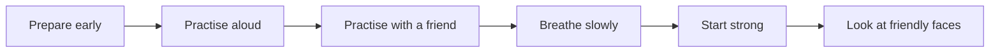

## Goal

By the end of this lesson, you can prepare and practise a talk, and use slow breathing and other ways to control nervousness.

## Why It Matters

Almost everyone feels nervous before speaking to a group. Even people who speak often feel it. You
may feel it before a job interview, a college project talk, or a short speech at a family dinner.
A health worker may feel it before a talk at a Basic Health Unit. The good news: nervousness is
normal, you can manage it, and it usually gets less each time you speak. These ways work the same
when you speak in Urdu.



**Diagram in words:** Before the talk, prepare early, practise aloud, and practise with a friend.
On the day, breathe slowly, start loud and strong, and look at friendly faces.

## Key Terms

| Term | Simple meaning |
|------|----------------|
| Nervousness | A worried feeling. Your hands may sweat, your knees may shake, or your mouth may feel dry. |
| Stage fright | Nervousness about speaking or performing in front of people. |
| Prepare | Get your talk ready early: know your main points and make your notes. |
| Rehearse | Practise your whole talk aloud, the same way you will give it. |
| Cue card | A small card with a few key words to remind you of your points. |
| Slow breathing | Breathing in slowly and breathing out slowly. It can help you feel calmer. |

Think of a cricket batter before a big match. They still feel nervous, but they have practised
for many hours. Practice gives them something to trust. Your practice does the same for you.

## Step by Step

Zainab is a student. Next week she will give a 2-minute talk about her college project. She feels
nervous. Follow her plan and do each step with a short talk of your own. All the names in this
lesson are made up.

**A week before: prepare**

1. Choose a topic that interests you, if you have a choice. When you care about a topic, it shows
   in your voice.
2. Start preparing early. Plan your talk with a beginning, a middle and an end (see
   [Lesson 6.2](./planning-your-talk.mdx)). The earlier you start, the better you know your talk.
3. Do not learn every word by heart. Learn your main points instead, and speak to people in a
   natural way. It is very hard to remember every word perfectly. Main points are easier.
4. Write a few key words for each point on a cue card. Number your cards, so that you can put them
   back in order if you drop them. If you use slides, you can put these key words in the speaker
   notes. [Lesson 5.11](../module-05-ms-powerpoint/speaker-notes-and-printing.mdx) shows how.

*Zainab's cue card looks like this:*

```text
1. Hello - my project: saving water at home
2. Point 1: fix dripping taps
3. Point 2: bucket, not hose, to wash the car
4. Point 3: reuse water for plants
5. End: small steps save a lot - thank you
```

**The days before: practise**

5. Practise the talk aloud, alone, several times. Each time, look at your cards less. Practice is
   the best way to feel less nervous, because your talk becomes familiar.
6. While you practise, imagine the room and the people who will listen. Then the real day feels
   less new.
7. Practise in front of a mirror, or record yourself on your phone. Recording is optional.
8. Give the talk to a family member or a friend, exactly as on the real day. Stand up, use your
   cards, and time yourself. Ask them what was clear and what was not.

**On the day: get ready**

9. Get a good night's rest before the talk. Arrive early, so that you are not rushing. If you use
   slides, check that the computer and projector work.
10. Keep a bottle or glass of water near you. If your mouth feels dry, take a sip.
11. Remind yourself: "I have prepared, and I have practised." Positive thoughts help turn
    nervousness into energy.

**Right before you speak: breathe slowly**

12. Take three long, slow breaths before you go up to speak. Breathe in slowly, then breathe out
    slowly. Slow breathing can lower your heart rate and stop you from rushing.
13. When you are in your place, take one more slow breath. Then smile and say hello.

**While you speak**

14. Start loud and strong. Your first sentence sets the tone for the whole talk.
15. Look for friendly faces: people who nod or smile. Look at them often. This keeps your
    listeners with you and helps you feel calmer (see
    [Lesson 6.5](./body-language-and-eye-contact.mdx)).
16. Pause and take a breath between your points. Nervous people often rush, so a pause helps you
    slow down (see [Lesson 6.4](./your-voice.mdx)).
17. Move a little and use your hands. Gestures use up some of your nervous energy, and you look
    more confident.
18. Remember: you do not look as nervous as you feel. Listeners cannot see sweaty hands or
    shaky knees. Do not tell them you are nervous.

**If something goes wrong**

19. If you lose your place, do not tell the listeners. Pause, take a breath, and look at your cue
    card. Find your place, then carry on.
20. If you make a mistake, correct it and move on. Mistakes happen to every speaker, even
    experienced ones.
21. After the talk, think about what went well. Nervousness usually gets less each time you speak
    in front of people.

## Practice

You will give a 1-minute talk about a place in your town or village that you like. For example,
a market, a park, a school or a shop. Use the calm plan from this lesson.

1. Choose your place. Write three things you like about it, so that your talk has three main
   points.
2. Make one cue card. Write a hello, your three points in a few key words, and a thank-you. Number
   the lines.
3. Practise the talk aloud alone three times. Each time, look at the card less.
4. Practise once in front of a mirror, or record yourself on your phone. This is optional.
5. Give the talk to a family member or a friend. Before you start, take three long, slow breaths.
6. Start loud and strong. Look at your listener's face as you speak.
7. Ask your listener to stop you once in the middle by saying "Wait!". Then pause, take a breath,
   look at your card, find your place and carry on. This trains you for a real mistake.
8. Check your work: tick each one. ☐ You practised aloud at least three times. ☐ You used a cue
   card with key words, not every word. ☐ You took three slow breaths before you started. ☐ Your
   first sentence was loud and clear. ☐ After the "Wait!", you found your place and carried on. ☐
   You did not say "I am nervous".

## Check Questions

1. What is the best way to feel less nervous before a talk?

   <details>
   <summary>Show answer</summary>

   **Answer:** Prepare early and practise the talk aloud many times. The more you practise, the
   more comfortable and confident you feel.

   </details>

2. Take three long, slow breaths now. When should you do this before a talk?

   <details>
   <summary>Show answer</summary>

   **Answer:** Before you go up to speak. Take one more slow breath when you are in your place.
   You can also take a breath between your points.

   </details>

3. In the middle of your talk, you forget what comes next. What do you do?

   <details>
   <summary>Show answer</summary>

   **Answer:** Do not tell the listeners. Pause, take a breath and look at your cue card. Find
   your place, then carry on.

   </details>

## Common Mistakes

- **Learning every word by heart** → Learn your main points and use a cue card with key words.
  Main points are easier to remember than every word.
- **Leaving practice until the night before** → Start preparing early. Practise aloud on several
  days.
- **Telling the listeners "I am so nervous"** → Do not say it. They cannot see most of your
  nervousness.
- **Stopping or giving up after a mistake** → Correct it, take a breath and move on. Every
  speaker makes mistakes.
- **Rushing to get it over with** → Take slow breaths and pause between your points.

## Sources

*These official pages were checked when this lesson was written.*

- [University of Arkansas, Walton College of Business, "Speaking Apprehension: Managing Nervousness in Public Speaking" (PDF)](https://walton.uark.edu/business-communication-lab/Resources/final_Speech_Apprehension_Resource.pdf): the fear of public speaking "is very common. Even seasoned speakers experience nervousness"; "Choose a topic that interests you"; "Prepare early"; "Practice increases the quality of your presentation, as well as your confidence. While practicing, envision your audience and the room"; "Find a friend or family member to listen to your presentation, and deliver it exactly as if you were in the real setting"; "you should not memorize your speech. It is unrealistic to expect perfect recitation"; "remember your main points"; "Think positively"; "Start loud and strong. The very first sentence of your introduction sets the tone"; "Breathe deeply and slowly. Slowing your breathing will lower your heart rate and prevent you from speeding through your presentation"; "walking and gesturing will help you use your adrenaline … It will also help you to appear more confident"; "find audience members who are nodding or smiling, and make frequent eye contact. This will both engage your audience and reduce nervousness"; "If you do make a mistake, … correct your error and move on."
- [University of Puget Sound, Center for Speech and Effective Advocacy, "Delivery Tips" (PDF)](https://www.pugetsound.edu/sites/default/files/2022-11/delivery-tipsdocx.pdf): "slow breath in and slow breath out can help control stress"; "YOU CAN FEEL NERVOUS AND YET APPEAR COOL, CALM AND COLLECTED"; "Audiences do not know how you feel, so don't tell them"; "Have some water handy, … in case your mouth becomes dry"; speech anxiety is "Normal (everyone experiences it to some extent)", "Manageable" and "Likely to diminish with repeated experiences of speaking in public."
- [William & Mary Writing Resources Center, "General Guidelines for Speech Delivery" (PDF)](https://www.wm.edu/as/wcc/newresources/handouts/guidelines-for-speech-delivery.pdf): "Rehearsing the speech before you deliver it will help you to feel more comfortable with your material and less nervous"; "Try to rely on your notes less each time"; "Move around your space as you speak. This helps to control nervousness"; "Most signs of nervousness are invisible to your audience (e.g. sweaty palms, shaky knees, cottonmouth, butterflies, etc.). You do not look as nervous as you feel"; "If you lose your place, do not tell the audience. Take time to collect yourself, find your place, and resume speaking."
- [UNSW Sydney, "Preparing and delivering a presentation"](https://student.unsw.edu.au/node/291): on rehearsing, "It's also the only way to combat nerves. The more you practice, the more comfortable and confident you will feel"; "Rehearse in front of a mirror or record yourself"; "Take a deep breath and wait for the audience to settle before starting to speak"; "Nervous speakers often rush, so pace yourself."
- [Boston University, "Advice to Students on Preparing for Oral Presentations"](https://www.bu.edu/teaching-writing/resources/advice-to-students-on-preparing-for-oral-presentations/): "Some strategies to help you calm down and maintain poise include visualizing the room/audience and reviewing the speech in your mind, or taking three long breaths before you go up to present, and another after you're in place"; "Don't dwell on mistakes, which happen to everybody."
- [University of Hohenheim, Faculty of Agricultural Sciences, "Tips for Presenting" (PDF)](https://agrar.uni-hohenheim.de/fileadmin/einrichtungen/agrar/Studium/Internat-Masters/Writing_Aid_Materials/Tips_for_presenting.pdf): "You shouldn't learn a script word for word"; "prepare notes or cue cards. If the latter, number them in case you drop them"; "Make sure you get a good night's rest"; "Arrive early"; "Test any equipment"; "Prepare a bottle or glass of water to take up with you in case your throat gets dry"; "when you're anxious, your breathing can become fast and shallow … take a deep breath or two to help ground yourself"; "Many people feel nervous before public speaking."
- [University of Hawai'i Maui Community College Speech Department, "Presenting Your Speech"](https://hawaii.edu/mauispeech/html/presenting_speeches.html): "Breathing helps you control nervousness."
- [Microsoft Support, "Tips for creating and delivering an effective presentation"](https://support.microsoft.com/en-us/powerpoint/tips-for-creating-and-delivering-an-effective-presentation) (applies to PowerPoint 2021): "Show up early and verify that your equipment works properly"; "Practice the presentation so that you can speak from bullet points."
