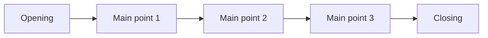

## Goal

By the end of this lesson, you can plan a short talk on paper with an opening, two or three main points and a closing.

## Why It Matters

A talk without a plan is like a trip without a route. You may get lost, and your listeners get
lost with you. People find it hard to understand a talk that jumps around. They may also trust
the speaker less. A plan helps a job seeker answer "Tell us about yourself" in a clear order. It
helps a shop owner explain a new service at a meeting, and a student present a college project.



**Diagram in words:** A talk has a beginning, a middle and an end. The opening comes first. The
middle has two or three main points. The closing comes last.

## Key Terms

| Term | Simple meaning |
|------|----------------|
| Opening | The beginning of your talk. It catches attention and says what the talk is about. |
| Hook | Your first words, planned to make people want to listen, such as a short story or a surprising fact. |
| Preview | A short list, in your opening, of the main points you will talk about. |
| Main point | One important idea in the middle of your talk. A short talk has two or three. |
| Linking words | Words that show you are moving to the next point, such as "first", "next" and "finally". |
| Closing | The end of your talk. It sums up your points and repeats your main message. |
| Cue card | A small card or piece of paper with a few key words that remind you what to say. |

There is an old rule for talks: tell them what you are going to tell them, tell them, then tell
them what you told them. The opening, the middle and the closing do these three jobs. Listeners
often remember your opening and your closing best, so plan them with care.

## Step by Step

Take a sheet of paper and a pen. You will read a short sample talk, find its parts, and then
plan it on paper. In [Lesson 6.1](./what-makes-a-good-presentation.mdx), you learned to find a
talk's main message. Here you build a whole talk around one.

:::note[Sample talk]

**Opening:** Good evening, everyone. My name is Nadia, and I run Nadia Sweets on Mall Road. Many
of you asked me, "Can you bring sweets to our home?" Today I have good news. From 1 November, we
deliver to your door. I will tell you three things: how to order, where we deliver, and what it
costs.

**Middle:** First, how to order. Call our shop on 0300-0000000, any day from 10 am to 8 pm. Next,
where we deliver. We deliver in Model Town and Garden Colony, within two hours. Finally, the cost.
Delivery costs Rs 100. If you buy sweets for Rs 1,000 or more, delivery is free.

**Closing:** So, to sum up: call us, choose your sweets, and we bring them to your door. Delivery is free
on orders of Rs 1,000 or more. Save our number today. Thank you.

:::

**Find the three parts**

1. Read the sample talk aloud. You hear how one part leads to the next.
2. Look at the opening. Find three things in it: the hook, the main message and the preview.
   *The hook is the question customers asked. The main message is "we deliver to your door". The
   preview names three points.* The preview helps listeners know what to listen for.
3. Look at the middle. Count the main points. *There are three: how to order, where, and the
   cost.* A short talk needs no more than three main points, so that listeners can follow them.
4. Find the linking words in the middle. *You find "First", "Next" and "Finally".* These words
   tell listeners that a new point is starting.
5. Look at the closing. *Nadia sums up her points and repeats her main message. Then she asks
   people to do one thing: save her number.* A clear last line tells listeners the talk is over.

**Plan a talk on paper**

6. Write your plan in three parts: beginning, middle and end. A plan on one page lets you see the
   whole talk at once. Here is Nadia's plan:

   ```text
   MAIN MESSAGE: We now deliver sweets to your door.

   BEGINNING
     Hook: customers asked, "Can you bring sweets home?"
     Who I am: Nadia, Nadia Sweets, Mall Road
     Main message: from 1 November, we deliver
     Preview: how to order, where, cost

   MIDDLE
     1. How to order: call 0300-0000000, 10 am to 8 pm
     2. Where: Model Town, Garden Colony, 2 hours
     3. Cost: Rs 100, free on Rs 1,000 or more

   END
     Main message again: we bring sweets to your door
     Sum up: call us, free on Rs 1,000 or more
     Last line: save our number today
   ```

7. Look at the middle of the plan. Each point has a few key words and one detail or example. You
   do not write whole sentences here, because you will speak, not read.
8. Plan your time. Spend most of your time on the middle. Keep the opening short, and keep the
   closing a little shorter than the opening.

**Make cue cards and say the talk aloud**

9. Cut a sheet of paper into small cards. Make one card for the opening, one for each main point
   and one for the closing. Write a few key words on each card. Small cards help you find your
   place again if you get lost or nervous.
10. Write your first line and your last line in full sentences, if you like. Listeners remember
    the opening and the closing best, so you want those words exactly right.
11. Hold your cards and say the talk aloud. Look at a card, look up, and speak. *You hear the
    whole talk from beginning to end.*
12. Time yourself with a watch or a clock on a phone. Then ask: "Did I stay within my time?" If
    the talk is too long, cut a detail from the middle, not the opening or the closing.

If you plan to use slides, you can type your key words in PowerPoint's Notes pane instead of on
cards (see [Lesson 5.11](../module-05-ms-powerpoint/speaker-notes-and-printing.mdx)). This plan
works the same when you speak in Urdu.

## Practice

At a job interview, you may hear: "Tell us about yourself." Plan a one-minute answer for a
computer operator job.

1. Write your main message at the top of a sheet of paper. For example: **I have good computer
   skills, and I want to use them in this job.**
2. Under **BEGINNING**, write a short hook, your name and your main message. Then write a preview
   of your three points.
3. Under **MIDDLE**, write three main points with a few key words each: your studies, your
   computer skills, and why you want this job. Add one detail or example to each point.
4. Under **END**, write a sum-up, your main message again and a polite last line, such as
   **Thank you for this chance.**
5. Make a cue card for each part. Write key words only, with your first and last lines in full if
   you like.
6. Say your answer aloud with your cards. Say it to a family member or a friend, or record
   yourself on a phone.
7. Time yourself. If you are over one minute, cut a detail from the middle.
8. Ask your listener: "What were my three points?" If they cannot name them, make your linking
   words clearer and try again.
9. Check your work: tick each one. ☐ My plan has a beginning, a middle and an end. ☐ My opening
   has a hook, my main message and a preview. ☐ My middle has two or three main points, with
   linking words. ☐ My closing sums up and repeats my main message. ☐ My answer took one minute or
   less. ☐ My listener could name my main points.

## Check Questions

1. Name the three parts of a talk and say what each part does.

   <details>
   <summary>Show answer</summary>

   **Answer:** The opening catches attention and says what the talk is about. The middle gives two
   or three main points. The closing sums up the points and repeats the main message.

   </details>

2. These lines from a talk are mixed up. Write the letters in the right order on paper, and label
   each one opening, middle or closing.

   - A. "Next, the fee: Rs 2,500 a month."
   - B. "So, our new Science group meets five days a week, for Rs 2,500 a month. Thank you."
   - C. "Good morning. I am Farhan from Star Tuition Centre. Today I will tell you about our new
     Science group: its timings and its fee."
   - D. "First, the timings: Monday to Friday, 5 pm to 6 pm."

   <details>
   <summary>Show answer</summary>

   **Answer:** C, D, A, B. C is the opening. D and A are the middle: the first point and the next
   point. B is the closing.

   </details>

3. Why should your opening give a preview of your main points?

   <details>
   <summary>Show answer</summary>

   **Answer:** A preview prepares listeners to listen for your points. Listeners sometimes stop
   listening for a moment, so hearing the points more than once helps them follow.

   </details>

## Common Mistakes

- **Too many main points** → For a short talk, keep two or three. Put the rest away for another
  day.
- **Stopping suddenly, with no closing** → Plan a closing. Sum up your points, repeat your main
  message and say a clear last line.
- **Writing the whole talk and reading it** → Put key words on cue cards. Look at a card, then
  look up and speak.
- **A long opening that never gets to the point** → Say your main message early. Then move to
  your first point.
- **Points that run into each other** → Use linking words, such as "first", "next" and
  "finally", so listeners know when a new point starts.

## Sources

*These official pages were checked when this lesson was written.*

- [University of Pittsburgh Department of Communication, "Structuring the Speech"](https://www.comm.pitt.edu/structuring-speech): "Audiences are unlikely to understand disorganized speeches and even less likely to think that disorganized speakers are reliable or credible. Speeches are organized into three main parts: introduction, body, and conclusion"; "Speakers must have an “attention grabber” to interest the audience—a joke, astonishing fact, or anecdote"; "Give a preview. Mentioning the main points to be covered in the body prepares the audience to listen for them. Repetition is an important aspect of public speaking, for listening is an imperfect art, and audience members nearly always tune out in parts"; "For short … speeches, under 10 minutes, speeches should not have more than three main points"; "speakers might number main points—first, second, third or first, next, finally"; "The conclusion should be somewhat shorter than the introduction and accomplishes two purposes: summarize main ideas and give the speech a sense of closure and completion."
- [Sheffield Hallam University Library, "Presentation Skills: Structure and formatting"](https://libguides.shu.ac.uk/presentations/Structure): "Tell them what you are going to tell them (and why it is interesting). Tell them (bring the subject to life). Tell them what you've told them (remind them of the key points and your conclusion)"; "Opening and closing statements tend to be the parts of your presentation the audience remember the best. Because of this, it is important to plan these carefully and even consider having them written out in full sentences as part of your notes"; "The introduction and conclusion should be more than 5% of your total time (each), saving 90% for your content"; "condense your points down to well-spaced bullet points on small cue cards or pieces of paper"; "should you lose your place or get nervous, it is easier to recover your composure and move on if your notes are in small chunks."
- [Norwich University of the Arts Library, "Study Skills: Presentations"](https://library.norwichuni.ac.uk/study-skills/presentations/): Beginning: "Introduce yourself"; "Outline the topic: what is your talk about?"; "The hook"; "Coming next: what key points will you discuss?" Middle: "Divide the topic into key points to discuss. Consider what details or examples you might mention. Plan how much time you'd like to spend on each point." End: "Summarize: what main points were covered?"; "Memorable ending: state your final point; have a call to action". Also: "Create prompts such as a script, PowerPoint notes or A5 index cards."
- [The Writing Center, University of North Carolina at Chapel Hill, "Speeches"](https://writingcenter.unc.edu/handouts/speeches/): "Tell your listeners your thesis right away"; "Incorporate previews and summaries into the speech"; "I'm here today to talk to you about three issues … First, … Second, … Third"; "Restate your main points"; "Speeches often close with an appeal to the audience to take action"; "be sure the action you recommend is specific and realistic"; "read your speech to a friend or in front of a mirror"; "Did I stay within my time limit?"
- [Microsoft Support, "Tips for creating and delivering an effective presentation"](https://support.microsoft.com/en-us/powerpoint/tips-for-creating-and-delivering-an-effective-presentation) (applies to PowerPoint 2021): "Don't read the presentation. Practice the presentation so that you can speak from bullet points"; "If you plan a certain amount of time for your presentation, don't go over."
- [Microsoft Support, "Add speaker notes to your slides"](https://support.microsoft.com/en-us/office/add-speaker-notes-to-your-slides-26985155-35f5-45ba-812b-e1bd3c48928e) (applies to PowerPoint 2021, **Windows** tab): "The Notes pane is a box that appears below each slide"; "During your presentation, the speaker notes are visible on your monitor, but aren't visible to the audience."
