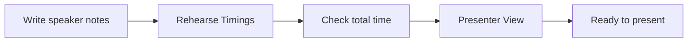

## Goal

By the end of this lesson, you can practise a talk using speaker notes, Rehearse Timings and Presenter View.

## Why It Matters

A good talk needs practice before the real day. A student may get five minutes to present a
college project. A shop owner may have ten minutes in a meeting with a supplier. If you talk for
too long, people stop listening. PowerPoint has tools that help you practise. They show your
notes, and they tell you how long each slide takes.

**Diagram in words:** First write short speaker notes. Then use Rehearse Timings to check how
long your talk takes. Then practise with your notes in Presenter View, and you are ready.

## Key Terms

| Term | Simple meaning |
|------|----------------|
| Speaker notes | Short reminders you write for yourself below a slide. The audience does not see them. |
| Rehearse | To practise a talk aloud, from start to end, as if people are listening. |
| Rehearse Timings | A button on the **Slide Show** tab. It runs your slide show and measures how long you talk about each slide. |
| Slide timing | The time you spent on one slide while you rehearsed. |
| Presenter View | A view on your own screen during a slide show. It shows your notes, the next slide and a timer. The audience sees only the slides. |
| Timer | A clock that counts how long you have been talking. |

You learned to write speaker notes in [Lesson 5.11](../module-05-ms-powerpoint/speaker-notes-and-printing.mdx).
In this lesson you use them to practise.

Rehearse Timings is like a stopwatch at a school race. It does not run the race for you. It
only tells you how long you took, so that you can do better next time.

## Step by Step

Open your **Sports Day** presentation from
[Lesson 5.11](../module-05-ms-powerpoint/speaker-notes-and-printing.mdx). It has three slides with
speaker notes. If you do not have it, make the three slides again (see
[Lesson 5.2](../module-05-ms-powerpoint/adding-slides-and-text.mdx)).

You will give a 1-minute talk to parents about Green Valley School Sports Day. That is about 20
seconds for each slide. These steps work the same when you speak in Urdu.

**Check your speaker notes**

1. Select slide 1 in the thumbnail pane. Look at the Notes pane below the slide. *You see your
   note: **Welcome parents and guests. Thank the principal.***
2. Look at the notes on slides 2 and 3 too. Each note should be a short reminder, not a full
   speech. Short notes help you speak to people, not read to them.

   If you do not see the Notes pane, select **Notes** on the bar at the bottom of the PowerPoint
   window.

3. Read this sample talk aloud once. It shows how a short note turns into a few spoken
   sentences.

:::note[Sample talk]

**Slide 1:** Good morning, parents and guests. Welcome to Green Valley School Sports Day. Thank
you to our principal for making this day possible.

**Slide 2:** Today we have three races and games: the 100 metre race, the sack race and tug of
war. The 100 metre race starts at 10:30 am.

**Slide 3:** All players get a certificate. The top three in each race get medals. Prizes are
given at 1 pm, and there is tea for all parents.

:::

4. Now close the book page, or look away from it. Say the talk in your own words, using only
   the notes. *You hear yourself speak without reading every word.*

**Measure your talk with Rehearse Timings**

5. Select the **Slide Show** tab. Select **Rehearse Timings**. *The slide show starts on the full
   screen. A small bar shows a **Next** button, a **Pause** button and two times.* The first time
   counts this slide. The second time counts the whole talk.
6. Say your words for slide 1 aloud, as if parents are listening. Speak the same way you will
   speak on the real day, so that the time is true.
7. Select **Next** to go to slide 2. You can also click the mouse or press the **Right arrow**
   key. *The slide time starts again from zero. The total time keeps counting.*
8. If someone interrupts you, select **Pause**. Select **Resume Recording** when you are ready
   again. This keeps the time correct.
9. Talk about slides 2 and 3 in the same way. On slide 3, before you go on, look at the total
   time and write it down. *For example, your total time may be 1 minute and 5 seconds.*
10. Select **Next** after slide 3. *A message asks if you want to keep the slide timings.*
11. Select **No**. You only wanted to know your time. If you select **Yes**, your slides may
    move on by themselves when you present.
12. Look at your total time. If it is much more than 1 minute, cut some words. If it is much
    less, add one more detail. Then rehearse again. Staying on time keeps people listening.

To leave a rehearsal early, press **Esc**.

{/* Screenshot to add: PowerPoint 2021 during Rehearse Timings, with the small timing bar showing the Next button, the Pause button, the slide time and the total time. */}

**Practise with Presenter View on one screen**

13. Select slide 1. Press **Alt+F5**. *Presenter View opens. You see the current slide, the next
    slide and your speaker notes on the right. A timer runs in the upper left.* Alt+F5 shows Presenter
    View even when you have only one screen.
14. Make the notes bigger or smaller with the two font buttons at the lower left of the notes.
    Large notes are easier to read with a quick look.
15. Say your talk for slide 1. Look at the notes only to remember the next point. Then look up
    again, as if the parents are in front of you.
16. Select the **Next** arrow, next to the slide number, to go to slide 2. *You see slide 2, and
    its notes show on the right.*
17. Watch the timer while you talk about slides 2 and 3. It helps you keep a steady pace.
18. Press **Esc** to close Presenter View. Press **Ctrl+S** to save.

{/* Screenshot to add: Presenter View in PowerPoint 2021 on one screen, showing the current slide, the next slide, the speaker notes on the right and the timer at the top. */}

**On the real day, with a projector**

When your computer is connected to a projector, start the show with **From Beginning** on the
**Slide Show** tab. PowerPoint shows Presenter View on your computer screen. The projector shows
only the slides. If Presenter View is on the wrong screen, select **Display Settings** at the
top of Presenter View. Then select **Swap Presenter View and Slide Show**.

If you do not want Presenter View, clear the **Use Presenter View** check box on the **Slide
Show** tab.

You can also practise in other ways. Practise in an empty room, or in front of a family member
or friend. They can tell you about your pace and time. You can also record yourself on a phone
and listen for clear words and pace.

## Practice

Your cousin's wedding is close. You will explain the plan to relatives in about 1 minute. Open
your **Wedding Plan** presentation from
[Lesson 5.11](../module-05-ms-powerpoint/speaker-notes-and-printing.mdx). It has these notes:

| Slide | Title | Speaker note |
|-------|-------|--------------|
| 1 | Our Family Wedding | Welcome everyone. Thank them for coming. |
| 2 | Mehndi | Ask the cousins to bring dholak. |
| 3 | Barat | Cars leave the house at 6 pm. |

1. Check that each slide has its note in the Notes pane. Type any note that is missing.
2. Plan about 20 seconds for each slide. Say one or two sentences for each note in your own
   words, so that you know what to say.
3. On the **Slide Show** tab, select **Rehearse Timings**. Say your talk aloud.
4. On slide 3, write down the total time before you select **Next**. Then select **No** in the
   message.
5. If your time is far from 1 minute, change what you say and rehearse again.
6. Select slide 1 and press **Alt+F5**. Give the talk again in Presenter View. Look up from the
   notes after each sentence.
7. Make the notes bigger with the font buttons, so that you can read them with a quick look.
8. Press **Esc** at the end, then press **Ctrl+S**.
9. If you like, give the talk once more to a family member, or record it on your phone.
10. Check your work: tick each one. ☐ Every slide has a short note. ☐ You wrote down your total
    time. ☐ Your talk took about 1 minute. ☐ You selected **No**, so the slides do not move by
    themselves. ☐ You gave the talk in Presenter View and looked up after each sentence.

## Check Questions

1. Start Presenter View on your computer, even if you have only one screen. Which keys do you
   press?

   

   
Show answer

   **Answer:** Press **Alt+F5**. Presenter View opens with the current slide, the next slide,
   your notes and a timer.

   

2. During Rehearse Timings, you see two times on the small bar. What does each time show?

   

   
Show answer

   **Answer:** The first time, next to **Pause**, shows the time for the current slide. The
   second time shows the time for the whole talk so far.

   

3. You selected **Yes** by mistake after rehearsing. Now your slides move on by themselves. How
   do you stop this?

   

   
Show answer

   **Answer:** On the **Slide Show** tab, select **Set Up Slide Show**. Under **Advance slides**,
   select **Manually**.

   

## Common Mistakes

- **Writing every word of the talk in the notes** → Write short reminders. Practise until you
  can speak from them, so that you talk to people instead of reading.
- **Rehearsing silently, in your head** → Rehearse aloud, the same way you will speak on the
  real day, so that your time is true.
- **Slides move on by themselves during the talk** → On the **Slide Show** tab, select **Set Up
  Slide Show**. Under **Advance slides**, select **Manually**.
- **Presenter View shows on the projector** → Select **Display Settings** at the top of
  Presenter View, then **Swap Presenter View and Slide Show**.
- **Going over your time** → Check the total time in Rehearse Timings. Cut words until the talk
  fits.

## Sources

*These official pages were checked when this lesson was written.*

- [Microsoft Support, "Rehearse and time the delivery of a presentation"](https://support.microsoft.com/en-us/office/rehearse-and-time-the-delivery-of-a-presentation-8424270a-d865-4aed-a321-1d2dd656381a) (applies to PowerPoint 2021): "PowerPoint helps you record and time a presentation before you present it to an audience"; "Select Slide Show > Rehearse Timings"; "Select Next, click the mouse, or press the Right Arrow key to go to the next slide"; "The time for the current slide is shown to the right of the Pause icon. The time to the right of that is the time for the whole presentation"; "Select Pause to pause the recording. Select Resume Recording to resume"; "Select Yes to save the slide timings, or No to discard them"; "You can also press Esc to stop the recording and exit the presentation"; "To prevent slides from automatically advancing … select Set Up Slide Show. In the Set Up Show dialog box, under Advance slides, select Manually."
- [Microsoft Support, "Use keyboard shortcuts to deliver PowerPoint presentations"](https://support.microsoft.com/en-us/office/use-keyboard-shortcuts-to-deliver-powerpoint-presentations-1524ffce-bd2a-45f4-9a7f-f18b992b93a0) (applies to PowerPoint 2021): "Start the presentation in Presenter View. Alt+F5"; "To start a presentation in Presenter View even if you have only a single display, press Alt+F5"; "The timer starts running as soon as you start Presenter View"; "Close Presenter View. Esc".
- [Microsoft Support, "Use Presenter View in PowerPoint"](https://support.microsoft.com/en-us/office/what-is-presenter-view-98f31265-9630-41a7-a3f1-9b4736928ee3) (applies to PowerPoint 2021): "PowerPoint Presenter View shows you the current slide, the next slide, and your speaker notes"; "Select the Use Presenter View checkbox"; "Select the arrows next to the slide number to go between slides"; "pause or reset the slide timer in the upper left"; "See the current time to help you pace your presentation"; "Select the font icons to make the speaker notes larger or smaller."
- [Microsoft Support, "Start the presentation and see your notes in Presenter view"](https://support.microsoft.com/en-us/office/start-the-presentation-and-see-your-notes-in-presenter-view-4de90e28-487e-435c-9401-eb49a3801257) (applies to PowerPoint 2021, **Windows** tab): "On the Slide Show tab, in the Start Slide Show group, select From Beginning"; "When your computer is connected to a projector and you start the slide show, Presenter View appears on your computer's screen, while only the slides appear on the projector screen"; "The notes appear in a pane on the right"; "You can change the size of the text in the Notes pane by using the two buttons at the lower left corner of the Notes pane"; "select Display Settings, and then select Swap Presenter View and Slide Show"; "On the Slide Show tab of the ribbon, clear the check box named Use Presenter View."
- [Microsoft Support, "Add speaker notes to your slides"](https://support.microsoft.com/en-us/office/add-speaker-notes-to-your-slides-26985155-35f5-45ba-812b-e1bd3c48928e) (applies to PowerPoint 2021, **Windows** tab): "During your presentation, the speaker notes are visible on your monitor, but aren't visible to the audience"; "If you don't see the Notes pane or it is completely minimized, click Notes on the task bar across the bottom of the PowerPoint window."
- [Microsoft Support, "Tips for creating and delivering an effective presentation"](https://support.microsoft.com/en-us/powerpoint/tips-for-creating-and-delivering-an-effective-presentation) (applies to PowerPoint 2021): "Don't read the presentation. Practice the presentation so that you can speak from bullet points. The text should be a cue for the presenter rather than the full message for the audience"; "Stay on time. If you plan a certain amount of time for your presentation, don't go over."
- [Northern Illinois University, Effective Presentation Skills Tutorial, "Rehearsing the Presentation"](https://www.niu.edu/presentations/rehearse/index.shtml): "decide how much time to spend on each screen or each major point in your presentation, or use the auto-timer included in some presentation tools to adjust the pace of your presentation"; "Rehearse the presentation by actually delivering it in an empty room or with a few friends or colleagues, who can monitor the pace of your presentation and the time you take"; "record your delivery … and analyze it for clarity, pace, fillers".
