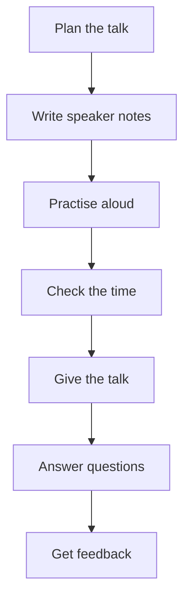

## Goal

By the end of this lesson, you can give a 3-minute talk with your own slides and get feedback with a checklist.

## Why It Matters

In this project you use everything from Lessons 6.1 to 6.8 together. You give a real talk with
the Hamza Mobile Centre slides that you made in
[Lesson 5.12](../module-05-ms-powerpoint/project-shop-presentation.mdx). Many real situations give
you only a few minutes. A shop worker explains new phones to customers. A job seeker talks about
their skills at an interview. A student presents a college project. If you can give a clear
3-minute talk, you can do all of these.



**Diagram in words:** Plan the talk, write short notes, practise aloud and check the time. Then
give the talk, answer questions and get feedback from your listener.

## Key Terms

| Term | Simple meaning |
|------|----------------|
| Main message | The one idea you want listeners to remember after your talk. |
| Time plan | A list of how many seconds you will talk about each slide. |
| Listener | The person who listens to your talk. In this project, a family member or a friend. |
| Feedback | What a listener tells you about your talk: what was good and what to do better. |
| Checklist | A list of things to check. You tick each one that is done. |

You met beginning, middle and end in
[Lesson 6.2](./planning-your-talk.mdx), and Rehearse Timings and Presenter View in
[Lesson 6.7](./practising-with-powerpoint.mdx).

Feedback is like a mirror before you leave the house. It shows you what others will see. Then
you can fix it before the real day.

## Step by Step

Open your **Shop Presentation** from
[Lesson 5.12](../module-05-ms-powerpoint/project-shop-presentation.mdx). It has six slides. If you
do not have it, make it again with the plan in that lesson. You also need paper, a pen, and a
phone or watch to time yourself. You can give this talk in English or in Urdu. The steps work
the same in both.

**Part 1: Plan the talk on paper**

1. Write your main message at the top of the paper: **There is a new phone for every pocket at
   Hamza Mobile Centre.** Everything in your talk should support this one idea.
2. Write the three parts of your talk. Each part matches some of your slides.

| Part | Slides | What you do |
|------|--------|-------------|
| Beginning | 1 | Greet people, ask a question, and say what the talk is about. |
| Middle | 2, 3, 4 and 5 | Talk about the three phones, then the sales chart. |
| End | 6 | Repeat the main message, say where the shop is, and invite questions. |

3. Write a time plan. Three minutes is 180 seconds. Six slides share these seconds. The phone
   slides get the most time, because they are the main points.

| Slide | Title | Seconds |
|-------|-------|---------|
| 1 | Hamza Mobile Centre | 20 |
| 2 | Tara 5 | 35 |
| 3 | Kiran Max | 35 |
| 4 | Sitara Lite | 35 |
| 5 | Phones Sold in September | 30 |
| 6 | Thank You | 25 |
| | **Total** | **180 seconds = 3 minutes** |

4. Read this sample talk aloud once. It follows the plan. Use it to see the idea, then make your
   own talk in your own words.

```text
Slide 1: Good evening, everyone. My name is Imran, and I work at
Hamza Mobile Centre. Are you looking for a new phone, but worried
about the price? Today I will show you our three new phones for
October. There is one for every pocket.

Slide 2: The first phone is the Tara 5. It costs Rs 25,000.
It has a big battery, so it is good if you are out all day.
It has a one-year shop warranty, like all three phones.

Slide 3: Next is the Kiran Max, for Rs 39,500. It costs the most,
because it has a good camera. Choose it if you like to take
family photos.

Slide 4: The third phone is the Sitara Lite, for Rs 18,500. It has
the lowest price of the three. It is light and slim, so it is
comfortable to carry.

Slide 5: This chart shows the phones we sold in September.
Sitara Lite sold the most: 25 phones. Tara 5 sold 18, and
Kiran Max sold 7. In all, we sold 50 phones.

Slide 6: So, there is a new phone for every pocket: Sitara Lite
for Rs 18,500, Tara 5 for Rs 25,000 and Kiran Max for Rs 39,500.
Visit us at Shop 12, Main Bazaar, from 10 am to 9 pm, or call
0300-0000000. Thank you for listening. Do you have any questions?
```

**Part 2: Write short speaker notes**

5. For each slide, type one or two short reminders in the Notes pane. For example, on slide 1:
   **Greet. Ask: worried about price? One for every pocket.** Short notes help you look at
   people, not at the screen (see [Lesson 6.7](./practising-with-powerpoint.mdx)).
6. On slide 6, write the main message again in the notes. Then you will not forget your ending.
7. Press **Ctrl+S** to save.

**Part 3: Practise aloud**

8. Select slide 1 and press **Alt+F5**. *Presenter View opens with your notes and a timer.*
9. Stand up and say the whole talk aloud. Speak slowly and clearly (see
   [Lesson 6.4](./your-voice.mdx)). Look up from the notes after each sentence (see
   [Lesson 6.5](./body-language-and-eye-contact.mdx)).
10. Practise twice, so that you know the talk well. Press **Esc** at the end.

**Part 4: Check the time**

11. Select the **Slide Show** tab, then **Rehearse Timings**. Give the whole talk aloud.
12. On slide 6, look at the total time before you go on. Write it down.
13. Select **Next** after slide 6. In the message, select **No**, so that your slides do not move
    on by themselves.
14. Compare your total time with 3 minutes. If you went over, cut some words from the longest
    slide. If you were much shorter, add one detail. Rehearse again until you are close to 3
    minutes.

**Part 5: Get ready for questions**

15. Write three questions a customer may ask, with short answers. For example: "Which phone has
    the best battery?" Answer: "The Tara 5." (See [Lesson 6.8](./answering-questions.mdx).)

**Part 6: Give the talk to a listener**

16. Ask a family member or a friend to be your listener. Give them the feedback checklist below
    on paper, and a phone or watch to time you. They fill it in while they listen.
17. Before you start, take a few deep breaths (see [Lesson 6.6](./handling-nervousness.mdx)).
    Stand to one side of the screen and face your listener.
18. Start the slide show with **From Beginning** on the **Slide Show** tab. Give your talk. When
    you do not use the mouse, take your hand off it, so that the pointer does not move about.
19. At the end, invite questions. Answer them briefly. If you do not know an answer, say that
    you will find out.
20. Press **Esc** to end the slide show.

**The feedback checklist for your listener**

Copy this checklist onto paper for your listener. They write **Yes** or **No** for each line.

| # | The speaker… | Yes or No |
|---|--------------|-----------|
| 1 | said what the talk was about at the start. | |
| 2 | talked about the three phones and the chart in the middle. | |
| 3 | repeated the main message at the end. | |
| 4 | spoke slowly and clearly, loud enough to hear. | |
| 5 | looked at me, not only at the screen or the notes. | |
| 6 | spoke in their own words, without reading the slides line by line. | |
| 7 | stood straight and faced me. | |
| 8 | finished in 3 minutes or a little less. | |
| 9 | answered my question briefly. | |

At the bottom, your listener also writes:

- **One thing you did well:** …
- **One thing to do better next time:** …

**Part 7: Use the feedback**

21. Read the checklist with your listener. Thank them, even for the **No** answers. Feedback
    helps you improve.
22. Choose the one thing to do better. Practise that part again. Then give the talk once more
    if you can.

{/* Screenshot to add: Presenter View in PowerPoint 2021 showing slide 1 of the Shop Presentation with its speaker notes and the timer. */}

## Practice

Give a second 3-minute talk with the **Tuition Centre Session** slides from the practice in
[Lesson 5.12](../module-05-ms-powerpoint/project-shop-presentation.mdx). Imagine you speak to
parents at Bright Future Tuition Centre. Choose a different listener this time, if you can.

| Slide | Title | Points |
|-------|-------|--------|
| 1 | Bright Future Tuition Centre | New session from 1 November |
| 2 | Maths | Rs 2,500 a month; Monday, Wednesday, Friday; 4 pm to 5 pm |
| 3 | English | Rs 2,000 a month; Tuesday and Thursday; 4 pm to 5 pm |
| 4 | Science | Rs 2,500 a month; Monday, Wednesday, Friday; 5 pm to 6 pm |
| 5 | Students Last Session | Table: Maths 32, English 27, Science 21, Total 80 |
| 6 | Join Us | Street 5, Model Town; Phone 0300-0000000; All three subjects: Rs 7,000 a month |

1. Open **Tuition Centre Session**. If you do not have it, make it again from Lesson 5.12.
2. Write your main message on paper. For example: **Your child can learn Maths, English and
   Science with us from 1 November.**
3. Plan the beginning, the middle and the end, and match each part to its slides.
4. Write a time plan that adds up to 180 seconds.
5. Type short reminders in the Notes pane of each slide. Press **Ctrl+S**.
6. Practise aloud twice in Presenter View with **Alt+F5**.
7. Check your time with **Rehearse Timings**. Select **No** at the end. Change the talk until it
   is close to 3 minutes.
8. Write three questions parents may ask, with short answers.
9. Give the talk to your listener with the feedback checklist. Change line 2 of the checklist to
   "talked about the three subjects and the table in the middle."
10. Answer your listener's questions. Then read the checklist together.
11. Check your work: tick each one. ☐ Your time plan adds up to 180 seconds. ☐ Each slide has
    short notes. ☐ Your Rehearse Timings total was close to 3 minutes. ☐ Your listener wrote
    **Yes** for at least 7 of the 9 lines. ☐ You know one thing to do better next time.

## Check Questions

1. Your talk must last 3 minutes, and you have 6 slides. On average, how many seconds can you
   talk about each slide?

   <details>
   <summary>Show answer</summary>

   **Answer:** 30 seconds. Three minutes is 180 seconds, and 180 ÷ 6 = 30. Main slides can get a
   little more time, and short slides a little less, as long as the total stays 180.

   </details>

2. Show how you check the total time of your talk in PowerPoint. What do you select at the end,
   so that the slides do not move on by themselves?

   <details>
   <summary>Show answer</summary>

   **Answer:** On the **Slide Show** tab, select **Rehearse Timings** and give the talk aloud.
   The total time shows on the small bar. At the end, select **No** in the message.

   </details>

3. What three things do you do in the end part of your talk?

   <details>
   <summary>Show answer</summary>

   **Answer:** Repeat the main message and the main points, give the last details (such as where
   the shop is), and invite questions.

   </details>

## Common Mistakes

- **Going over 3 minutes** → Check your time with Rehearse Timings. Cut words from the longest
  slide until the talk fits.
- **Reading the slides line by line** → Practise from short notes, so that you speak in your own
  words.
- **Stopping suddenly after the last slide** → Plan your ending. Repeat the main message, thank
  people and invite questions.
- **Standing in front of the screen** → Stand to one side, so that people can see your slides.
- **Feeling upset about a No on the checklist** → Feedback is help, not a mark. Choose one thing
  to improve and practise it.

## Sources

*These official pages were checked when this lesson was written.*

- [Northern Illinois University, Effective Presentation Skills Tutorial, "Organizing the Presentation"](https://www.niu.edu/presentations/organize/index.shtml): "Begin the presentation with something that attracts the audience's attention"; you can "ask a question that interests the audience in the topic"; "End the presentation by reiterating the purpose of the presentation, summarizing the major points, and concluding with a quote, remark or fact that the audience will remember."
- [Northern Illinois University, Effective Presentation Skills Tutorial, "Rehearsing the Presentation"](https://www.niu.edu/presentations/rehearse/index.shtml): "Based on the time allotted for your presentation, decide how much time to spend on each screen or each major point"; "Rehearse the presentation by actually delivering it in an empty room or with a few friends or colleagues, who can monitor the pace of your presentation and the time you take, and give you constructive feedback"; "Face the audience during your presentation"; "Make sure you spend enough time on the beginning, middle and end of the presentation"; "Think of possible questions the audience may ask, and rehearse the answers for those questions."
- [Northern Illinois University, Effective Presentation Skills Tutorial, "Delivering the Presentation"](https://www.niu.edu/presentations/deliver/index.shtml): "Before you begin to speak, take a few deep breaths and calm yourself"; "Speak slowly and clearly, and do not rush through sentences"; "look at the audience from one side of the room to the other side"; "stand to one side of the screen. Ideally, you should be facing your audience at all times"; "Do not read presentation materials line-by-line".
- [Northern Illinois University, Effective Presentation Skills Tutorial, "Presentation Preparation Checklist"](https://www.niu.edu/presentations/preparation-checklist/index.shtml): "Presentation has a beginning, middle and end"; "Presentation has been rehearsed, and timing is adequate for the allotted duration"; "Gestures, eye contact, and body language are appropriate for the presentation"; "Prepared responses for anticipated questions are appropriate"; "Prepared conclusion ends the presentation appropriately, and does not end it abruptly."
- [Northern Illinois University, Effective Presentation Skills Tutorial, "Handling Questions and Answers"](https://www.niu.edu/presentations/questions/index.shtml): "At the end of your presentation … solicit questions from the audience"; "respond appropriately and briefly"; "I will have to get back to you later on that".
- [Microsoft Support, "Tips for creating and delivering an effective presentation"](https://support.microsoft.com/en-us/powerpoint/tips-for-creating-and-delivering-an-effective-presentation) (applies to PowerPoint 2021): "Don't read the presentation. Practice the presentation so that you can speak from bullet points"; "Stay on time. If you plan a certain amount of time for your presentation, don't go over"; "When you're not using the pointer, remove your hand from the mouse. This helps to stop you from moving the pointer unconsciously, which can be distracting."
- [Microsoft Support, "Rehearse and time the delivery of a presentation"](https://support.microsoft.com/en-us/office/rehearse-and-time-the-delivery-of-a-presentation-8424270a-d865-4aed-a321-1d2dd656381a) (applies to PowerPoint 2021): "Select Slide Show > Rehearse Timings"; "The time to the right of that is the time for the whole presentation"; "Select Yes to save the slide timings, or No to discard them."
- [Microsoft Support, "Use keyboard shortcuts to deliver PowerPoint presentations"](https://support.microsoft.com/en-us/office/use-keyboard-shortcuts-to-deliver-powerpoint-presentations-1524ffce-bd2a-45f4-9a7f-f18b992b93a0) (applies to PowerPoint 2021): "To start a presentation in Presenter View even if you have only a single display, press Alt+F5"; "End the presentation. Esc".
- [Microsoft Support, "Add speaker notes to your slides"](https://support.microsoft.com/en-us/office/add-speaker-notes-to-your-slides-26985155-35f5-45ba-812b-e1bd3c48928e) (applies to PowerPoint 2021, **Windows** tab): "the Notes pane is the place to store talking points that you want to mention when you give your presentation."
- [Microsoft Support, "Start the presentation and see your notes in Presenter view"](https://support.microsoft.com/en-us/office/start-the-presentation-and-see-your-notes-in-presenter-view-4de90e28-487e-435c-9401-eb49a3801257) (applies to PowerPoint 2021, **Windows** tab): "On the Slide Show tab, in the Start Slide Show group, select From Beginning."

All numbers were checked again before writing. Time plan: 20 + 35 + 35 + 35 + 30 + 25 = 180
seconds = 3 minutes, and 180 ÷ 6 = 30 seconds on average. Phones sold: 18 + 7 + 25 = 50.
Prices from Lesson 5.12: Sitara Lite Rs 18,500 (lowest), Tara 5 Rs 25,000, Kiran Max Rs 39,500
(highest).
