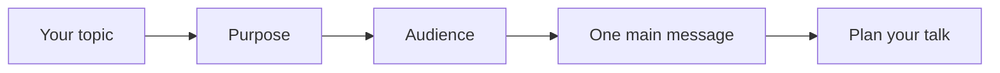

## Goal

By the end of this lesson, you can name the purpose, the audience and the one main message of a short talk.

## Why It Matters

At a job interview, someone says, "Tell us about yourself." A shop owner wants customers to know
about a new service. A health worker at a Basic Health Unit talks to mothers who are waiting. A
college student explains a project to a group. Each one gives a presentation. A good
presentation starts before you speak. First you decide why you speak, who is listening, and what
one thing they must remember.



**Diagram in words:** Start with your topic. Decide your purpose, think about your audience, and
choose one main message. Then you are ready to plan your talk.

## Key Terms

| Term | Simple meaning |
|------|----------------|
| Presentation | A short talk to a group of people. It often has slides, but it does not need them. |
| Audience | The people who listen to your talk. |
| Purpose | What you want your audience to know or do after your talk. |
| Inform | To give people facts or teach them something new. |
| Persuade | To make people agree with you, or make them want to do something. |
| Main message | The one most important idea of your talk, said in one short sentence. |

A good presentation is like a good road sign. It is made for the people who read it. It gives
one clear message, and people understand it the first time.

A good presentation has three parts that work together:

- **Content:** what you say, in a clear order.
- **Delivery:** how you say it, with confidence.
- **Engagement:** how you connect with your audience.

This module teaches all three. This lesson starts with content: your purpose, your audience and
your main message. These skills work the same when you speak in Urdu, so you can give your talks
in either language.

## Step by Step

Take a sheet of paper and a pen. You will read a short sample talk. Then you will find its
purpose, audience and main message, and write them down.

:::note[Sample talk]

Good evening, everyone. My name is Hamza, and I own Hamza Mobile Centre in Main Bazaar. Today I
have one piece of news: we now repair phones in our shop. We can change a broken screen or a weak
battery. Most repairs are ready on the same day. So next time your phone breaks, bring it to us
first.

:::

**Find the purpose**

1. Read the sample talk aloud, slowly. You hear the talk the way a listener hears it. Listeners
   hear each word only once, so a talk must be clear.
2. Ask yourself: what does Hamza want the listeners to know or do? *He wants them to bring a
   broken phone to his shop.*
3. Write **Purpose: persuade** on your paper. Hamza wants people to do something, so his purpose
   is to persuade. If he only wanted to give facts, his purpose would be to inform.

**Think about the audience**

4. Write **Audience:** and then the answer to "Who is listening?" *The listeners are his
   customers.*
5. Under it, answer these three questions in a few words. They help you choose your words and how
   much to explain.
   - What do the listeners already know? *They know phones. They may not know about repairs.*
   - Why are they listening? *They want a phone that works.*
   - How much detail do they need? *Only a little: what he repairs and how fast.*

**Find the one main message**

6. Look for the most important sentence in the talk. Write it in your own words, in one short
   sentence.

   ```text
   Main message: Hamza Mobile Centre now repairs phones, so bring your broken phone to us.
   ```

7. Test your main message with the question "So what?" After the talk, the listeners should know
   why it matters to them. *A customer with a broken phone now knows where to go.* If you cannot
   answer "So what?", your message is not clear yet.
8. Look at where Hamza says his news. *He says it near the start: "we now repair phones."* A good
   talk gives the main idea early, so listeners do not get bored or confused.

**Compare a talk with no main message**

Read this second version of Hamza's talk.

:::note[Sample talk]

Good evening, everyone. We sell phones, covers and chargers. The bazaar is very busy these days.
We also sell SIM cards. My cousin opened a shop in Lahore. Oh, and we repair phones too.

:::

9. Read it aloud. Then try to write its main message in one sentence. *It is hard. The talk jumps
   from one idea to the next.*
10. Count the ideas in the second talk. *There are at least five.* Listeners cannot follow and
    remember so many ideas. The fewer the main ideas, the better.
11. Look at your paper. *You see three lines: purpose, audience and main message.* These three
    lines are the start of every talk you plan. In [Lesson 6.2](./planning-your-talk.mdx), you
    build a whole talk around them.

## Practice

Choose one of these real-life talks. Then find its purpose, audience and main message.

| Talk | Who is speaking |
|------|-----------------|
| A job interview: "Tell us about yourself" | You, at an interview for a computer operator job |
| A family event | You, thanking the guests at your grandmother's 80th birthday |
| A college project | You, telling your group what your project is about |

1. Write the name of the talk at the top of a sheet of paper.
2. Write **Purpose:** and choose **inform** or **persuade**. Add a few words to say what you want
   the listeners to know or do.
3. Write **Audience:** and say who is listening. Then answer the three audience questions from the
   Step by Step: what they know, why they listen, and how much detail they need.
4. Write your **Main message** in one short sentence. Use words your audience knows.
5. Test it with "So what?" Change the sentence until the listeners would know why it matters to
   them.
6. Say your main message aloud to a family member or a friend. If no one is free, record yourself
   on a phone and listen. Hearing your words helps you notice what is not clear.
7. Ask your listener: "What is my main message?" Listen to their answer. If it is different from
   yours, make your sentence clearer and try again.
8. Check your work: tick each one. ☐ I wrote my purpose: inform or persuade. ☐ I wrote who my
   audience is, with three short answers about them. ☐ My main message is one short sentence. ☐ It
   passes the "So what?" test. ☐ My listener could repeat my main message in their own words.

## Check Questions

1. Before you plan a talk, which three things should you decide?

   <details>
   <summary>Show answer</summary>

   **Answer:** Your purpose, your audience and your one main message.

   </details>

2. A shopkeeper says: "From Monday, our shop opens at 8 am, so you can buy fresh bread before
   work." Write this talk's purpose and main message on paper.

   <details>
   <summary>Show answer</summary>

   **Answer:** Purpose: persuade, because she wants people to come early and buy bread. Main
   message: the shop now opens at 8 am, so you can buy fresh bread before work. Your words may be
   different, but the idea should be the same.

   </details>

3. Why should a short talk have only one main message?

   <details>
   <summary>Show answer</summary>

   **Answer:** Listeners hear each word only once. They cannot follow and remember many ideas.
   Listeners understand and remember one clear message much better.

   </details>

## Common Mistakes

- **Trying to say everything you know** → Choose one main message. Keep only what helps it.
- **Forgetting who is listening** → Think about what your audience already knows. Use words they
  understand, and explain new words.
- **Keeping the main message until the very end** → Say it near the start, so listeners know
  what your talk is about.
- **Talking for too long** → Stay inside your time. If there is no time limit, take less time
  rather than more.

## Sources

*These official pages were checked when this lesson was written.*

- [Norwich University of the Arts Library, "Study Skills: Presentations"](https://library.norwichuni.ac.uk/study-skills/presentations/): "What makes a good presentation? Content: plan a logical structure that shows your knowledge/research. Delivery: communicate your ideas confidently and effectively. Engagement: make a connection with the audience."
- [The Writing Center, University of North Carolina at Chapel Hill, "Speeches"](https://writingcenter.unc.edu/handouts/speeches/): "When you write a speech, your audience is made up of listeners. They have only one chance to comprehend the information"; "the content of the speech and your delivery must fit the audience"; "The purpose of your speech is to get the response you want"; "What do you want the audience to learn or do?"; "Do they know as much about your topic as you, or will you be introducing them to new ideas?"; "Why are these people listening to you? What are they looking for?"; "What level of detail will be effective for them?"; "Tell your listeners your thesis right away"; "if you do so, they will most likely become bored or confused"; "read your speech to a friend or in front of a mirror."
- [Sheffield Hallam University Library, "Presentation Skills: Planning your presentation"](https://libguides.shu.ac.uk/presentations/planning): "whether the aim of your presentation is to inform or persuade. A good way to look at this is by asking the question “so what?”"; "Knowing who your audience is helps set the level of formality and the language you should be using. Understanding the audience's prior knowledge of a topic helps to determine how much you need to explain terminology or concepts".
- [University of Pittsburgh Department of Communication, "Structuring the Speech"](https://www.comm.pitt.edu/structuring-speech): "The introduction is the place where the main claim or idea should be stated very clearly to give the audience a sense of the purpose of the speech"; "In the body, the fewer the main points the better"; "more than five main points ensures that audiences will have trouble following and remembering the speech."
- [Microsoft Support, "Tips for creating and delivering an effective presentation"](https://support.microsoft.com/en-us/powerpoint/tips-for-creating-and-delivering-an-effective-presentation) (applies to PowerPoint 2021): "If you plan a certain amount of time for your presentation, don't go over. If there's no time limit, take less time rather than more to ensure that people stay engaged."
