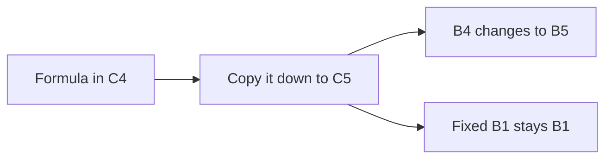

import PracticeFile from '@site/src/components/PracticeFile';

## Goal

By the end of this lesson, you can fix a cell in a formula with `$` signs, so that it stays the
same when you copy the formula.

## Why It Matters

A shop gives the same discount on every item in a sale. A cloth seller charges one price per
metre to every customer. You type that one number in one cell. Every row's formula must use that
same cell, even after you copy the formula down. When the rate changes, you change one cell, and
every row updates.

**Diagram in words:** When you copy the formula from C4 to C5, the normal address B4 changes to
B5. The fixed address `$B$1` stays B1, so every row uses the same discount rate.

## Key Terms

| Term | Simple meaning |
|------|----------------|
| Relative reference | A normal cell address, like B4. When you copy the formula, it changes to match the new row. |
| Absolute reference | A cell address with `$` signs, like `$B$1`. It stays the same when you copy the formula. It is like the price board on a shop wall: every customer reads the same board. |
| Dollar sign | The `$` sign. In a cell address, it fixes the column letter or the row number that comes after it. |
| Mixed reference | A cell address with only one `$` sign, like `$A1` or `A$1`. Only one part is fixed. |
| F4 key | A key on the top row of the keyboard. In the formula bar, it changes the `$` signs of a cell address. |
| Discount rate | The part of the price taken off, like 10% off. |

You met relative references in [Lesson 7.7](fill-handle.mdx). There, `=C2*D2` changed to
`=C4*D4` in row 4, and that was what you wanted. This lesson shows when you do **not** want a
cell to change.

## Step by Step

:::info[Practice files]

- <PracticeFile href="/files/excel/absolute-references/shop-discount-starter.xlsx">Download the starter file: Shop Discount</PracticeFile>.
  It has the rate and the prices already typed in, so that you can go straight to the formulas.
- <PracticeFile href="/files/excel/absolute-references/shop-discount-finished.xlsx">Download the finished file: Shop Discount</PracticeFile>.
  It has every formula in place. Open it after you finish, to compare with your work.

:::

Bilal's school shop gives 10% off every item this week. You will work out the discount on each
item. The rate goes in one cell, B1. Open a new blank workbook
([Lesson 7.1](starting-excel.mdx)). Type this table, but leave columns C and D empty for now.
The table shows the formulas and the correct results, so that you can check your work.

| Row | A | B | C | D |
|-----|---|---|---|---|
| 1 | Discount rate | 10% | | |
| 2 | | | | |
| 3 | Item | Price (Rs) | Discount (Rs) | Price after discount (Rs) |
| 4 | School bag | 1500 | `=B4*$B$1` gives 150 | `=B4-C4` gives 1350 |
| 5 | Shoes | 2400 | 240 | 2160 |
| 6 | Water bottle | 450 | 45 | 405 |
| 7 | Lunch box | 650 | 65 | 585 |
| 8 | Raincoat | 1200 | 120 | 1080 |

For the rate, type 0.1 in B1. Then select **Percent Style** on the **Home** tab
([Lesson 7.5](number-formats.mdx)). *B1 shows 10%.*

**See the problem first**

1. Select C4. Type `=B4*B1` and press **Enter**. Price times rate gives the discount.
   *C4 shows 150, because 10% of 1500 is 150.*
2. Select C4 and drag the fill handle down to C8 ([Lesson 7.7](fill-handle.mdx)).
   *C5 to C8 do not show the right discounts.*
3. Select C5 and look at the formula bar, so that you can see what Excel copied.
   *The formula bar shows `=B5*B2`.*
4. Excel changed B4 to B5. That is right, because Shoes is in row 5. But Excel also changed B1
   to B2. B2 is empty, so there is no rate to use.
5. Press **Ctrl+Z** to undo the fill ([Lesson 7.2](entering-editing-saving-data.mdx)).
   *C5 to C8 are empty again.*

**Fix the cell with `$` signs**

6. Select C4. Type `=B4*$B$1` and press **Enter**. The `$` before B fixes the column. The `$`
   before 1 fixes the row. *C4 shows 150 again.*
7. Select C4 and drag the fill handle down to C8. *C5 to C8 show 240, 45, 65 and 120.*
8. Select C6 and read the formula bar. *It shows `=B6*$B$1`.* B4 changed to B6 for its own row.
   `$B$1` stayed the same, so every item uses the same rate.

**Price after discount**

9. Select D4. Type `=B4-C4` and press **Enter**. The price minus the discount is what the
   customer pays. *D4 shows 1350.*
10. Drag the fill handle from D4 down to D8. *D5 to D8 show 2160, 405, 585 and 1080.* No `$` is
    needed here, because each row must use its own price and discount.

**Change the rate in one place**

11. The shop wants to try 20% off. Select B1, type 0.2 and press **Enter**. *B1 shows 20%.
    C4 to C8 show 300, 480, 90, 130 and 240.* Every row changed, because every formula uses B1.
12. Type 0.1 in B1 again and press **Enter**, so that the rate is back to 10%.
    *C4 shows 150 again.*

**A faster way: the F4 key**

Typing `$` signs takes time. The F4 key can add them for you.

13. Select C4. In the formula bar, drag over `$B$1` to select it. F4 works on the address you
    select.
14. Press **F4** a few times and watch the formula bar. *Each press changes the `$` signs:
    two signs, one sign, or none.*
15. Keep pressing **F4** until you see `$B$1` again. Then press **Enter**, so that the formula
    stays correct.

If F4 does not change anything on your keyboard, type the `$` signs yourself, as in step 6.

**Half-fixed cells: mixed references**

Sometimes only one part of an address should stay fixed. In `$A1`, the column A is fixed, but
the row can change. In `A$1`, row 1 is fixed, but the column can change. This table shows what
happens when you copy a formula two cells down and two cells to the right.

| The address you copy | It becomes | Type |
|----------------------|------------|------|
| `$A$1` | `$A$1` | Absolute: nothing changes |
| `A$1` | `C$1` | Mixed: only the column changes |
| `$A1` | `$A3` | Mixed: only the row changes |
| `A1` | `C3` | Relative: both change |

In this course, you will mostly use the fully fixed kind, `$B$1`.

{/* Screenshot to add: Cell C6 selected, with the formula bar showing =B6*$B$1 and column C showing the five discounts. */}

## Practice

:::info[Practice files]

- <PracticeFile href="/files/excel/absolute-references/cloth-shop-starter.xlsx">Download the starter file: Cloth Shop</PracticeFile>.
  It has the price and the metres already typed in. Use it if you want more time for the
  formulas.
- <PracticeFile href="/files/excel/absolute-references/cloth-shop-finished.xlsx">Download the finished file: Cloth Shop</PracticeFile>.
  It shows the end of the task, with the price changed to 400. Open it after you finish.

:::

Rehana sells lawn cloth by the metre. Every customer pays the same price per metre, Rs 350. She
wants a bill for each customer and a total for the day. This is how your sheet should look at
first. Leave column C empty when you type.

| Row | A | B | C |
|-----|---|---|---|
| 1 | Price per metre (Rs) | 350 | |
| 2 | | | |
| 3 | Customer | Metres | Bill (Rs) |
| 4 | Ayesha | 3 | `=B4*$B$1` gives 1050 |
| 5 | Kamran | 2.5 | 875 |
| 6 | Nadia | 4 | 1400 |
| 7 | Tariq | 1.5 | 525 |
| 8 | Rubina | 5 | 1750 |
| 9 | Total | | `=SUM(C4:C8)` gives 5600 |

1. Open a new blank workbook. Type rows 1 to 8, and type Total in A9.
2. Select C4. Type `=B4*$B$1` and press **Enter**. Metres times the price gives the bill.
   Check: 1050.
3. Select C4 and drag the fill handle down to C8, so that every customer gets a bill.
   Check: 875, 1400, 525 and 1750.
4. Select C7 and read the formula bar. Check: `=B7*$B$1`.
5. Select C9. Type `=SUM(C4:C8)` ([Lesson 7.8](sum-and-average.mdx)) and press **Enter**, so
   that you see the day's total. Check: 5600.
6. The price of lawn goes up. Select B1, type 400 and press **Enter**.
7. Watch column C. Every bill and the total change at once, because every formula uses B1.
8. Save the workbook with the name **Cloth Shop**
   ([Lesson 7.2](entering-editing-saving-data.mdx)), so that your work is kept.
9. Check your work: C4 to C8 show 1200, 1000, 1600, 600 and 2000. C9 shows 6400. With C5
   selected, the formula bar shows `=B5*$B$1`.

## Check Questions

1. You copy `=B4*$B$1` from C4 down to C7. What formula is in C7?

   

   
Show answer

   **Answer:** `=B7*$B$1`. B4 changes to B7 for the new row. `$B$1` stays the same.

   

2. Open your Shop Discount sheet. Point to the cell that holds the rate, and say why its address
   has `$` signs.

   

   
Show answer

   **Answer:** Cell B1. Every item uses the same rate, so its address must not change when you
   copy the formula down.

   

3. Which of these is a mixed reference: `$A$1`, `A1` or `$A1`?

   

   
Show answer

   **Answer:** `$A1`. It has only one `$` sign, so only the column is fixed.

   

## Common Mistakes

- **Forgetting the `$` signs** → The first row is right, but the rows below are wrong. Select a
  lower cell, read the formula bar, and add `$` signs to the shared cell.
- **Putting the `$` signs on the wrong cell**, like `=$B$4*B1` → Every row uses the school bag's
  price, and the rate cell moves. Put the `$` signs on the cell that every row shares: `=B4*$B$1`.
- **Typing 10 in B1 and then selecting Percent Style** → B1 shows 1000%, and every discount is
  far too big. Type 0.1, then select **Percent Style** ([Lesson 7.5](number-formats.mdx)).
- **Pressing F4 with nothing selected in the formula bar** → First select the address in the
  formula bar, then press **F4**. Or type the `$` signs yourself.

## Sources

*These official pages were checked when this lesson was written.*

- [Microsoft Support, "Switch between relative, absolute, and mixed references"](https://support.microsoft.com/en-us/office/switch-between-relative-absolute-and-mixed-references-dfec08cd-ae65-4f56-839e-5f0d8d0baca9) (applies to Excel 2021): "When you copy a formula that contains a relative cell reference, that reference in the formula will change"; "you make the cell reference absolute by preceding the columns (B and C) and row (2) with a dollar sign ($)"; "when you copy the formula =$B$4*$C$4 from D4 to D5, the formula stays exactly the same"; "you might want to mix absolute and relative cell references by preceding either the column or the row value with a dollar sign ($)—which fixes either the column or the row (for example, $B4 or C$4)"; "Select the cell that contains the formula. In the formula bar, select the reference that you want to change. Press F4 to switch between the reference types." The table for a formula "copied two cells down and two cells to the right": $A$1 stays $A$1, A$1 changes to C$1, $A1 changes to $A3, A1 changes to C3.
- [Microsoft Support, "Overview of formulas in Excel"](https://support.microsoft.com/en-us/office/overview-of-formulas-in-excel-ecfdc708-9162-49e8-b993-c311f47ca173) (applies to Excel 2021): "An absolute cell reference in a formula, such as $A$1, always refers to a cell in a specific location"; "If you copy or fill the formula across rows or down columns, the absolute reference doesn't adjust"; "A mixed reference has either an absolute column and relative row, or absolute row and relative column. An absolute column reference takes the form $A1 … An absolute row reference takes the form A$1."
- [Microsoft Support, "Fill a formula down into adjacent cells"](https://support.microsoft.com/en-us/office/fill-a-formula-down-into-adjacent-cells-041edfe2-05bc-40e6-b933-ef48c3f308c6) (applies to Excel 2021): "When you fill formulas down, relative references will be put in place to ensure the formulas adjust for each row—unless you include absolute or mixed references before you fill the formula down."
- [Microsoft Support, "Keyboard shortcuts in Excel"](https://support.microsoft.com/en-us/office/keyboard-shortcuts-in-excel-1798d9d5-842a-42b8-9c99-9b7213f0040f) (applies to Excel 2021): "Cycle through all combinations of absolute and relative references in a formula if a cell reference or range is selected. F4"; "Undo the last action. Ctrl+Z".
- [Microsoft Support, "Format numbers as percentages"](https://support.microsoft.com/en-us/office/format-numbers-as-percentages-de49167b-d603-4450-bcaa-31fba6c7b6b4) (applies to Excel 2021): "if a cell contains the number 10, Excel multiplies that number by 100, which means that you will see 1000.00% after you apply the Percentage format"; "If you then format 0.1 as a percentage, the number will be correctly displayed as 10%"; for cells already formatted as percentages, "numbers smaller than 1 are multiplied by 100 to convert them to percentages."

All results were calculated and checked again before writing: 10% of 1500, 2400, 450, 650 and
1200 is 150, 240, 45, 65 and 120; prices after discount 1350, 2160, 405, 585 and 1080. At 20%:
300, 480, 90, 130 and 240. Cloth at Rs 350: 3 × 350 = 1050, 2.5 × 350 = 875, 4 × 350 = 1400,
1.5 × 350 = 525, 5 × 350 = 1750, total 5600 (16 metres). At Rs 400: 1200, 1000, 1600, 600, 2000,
total 6400.
