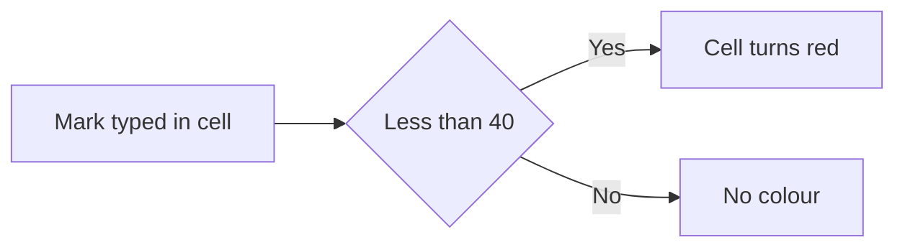

import PracticeFile from '@site/src/components/PracticeFile';

## Goal

By the end of this lesson, you can make cells change colour by themselves when their numbers or
words match a rule, and remove those rules.

## Why It Matters

A tuition centre wants to see the low marks at a glance, before the result goes home. A
shopkeeper wants the items that are running out to stand out in red. With many numbers, your eye
misses things. Conditional formatting colours the right cells for you. When a number changes,
the colour changes with it.

**Diagram in words:** The rule checks each mark. A mark below 40 turns red. Any other mark keeps
no colour.

## Key Terms

| Term | Simple meaning |
|------|----------------|
| Conditional formatting | Colours and styles that Excel adds to a cell only when the cell matches a rule. |
| Rule | The test that a cell must pass to get the colour, like "less than 40". |
| Highlight Cells Rules | A list of ready-made rules, such as **Greater Than** and **Text that Contains**. |
| Format | The look that a matching cell gets, such as a red fill and red text. |
| Data bar | A coloured bar inside a cell. A longer bar means a bigger number. |
| Clear Rules | Remove the colour rules, so that the cells go back to normal. |

In [Lesson 7.4](formatting-cells.mdx) you coloured cells yourself with **Fill Color**. That
colour stays even when the number changes. Conditional formatting checks the number every time.

## Step by Step

:::info[Practice files]

- <PracticeFile href="/files/excel/conditional-formatting/test-marks-starter.xlsx">Download the starter file: Test Marks</PracticeFile>.
  It has the marks and fees already typed in, with no colour rules, so that you can start at
  step 2.
- <PracticeFile href="/files/excel/conditional-formatting/test-marks-finished.xlsx">Download the finished file: Test Marks</PracticeFile>.
  It has all three rules in place, and Usman's English mark is already changed to 45. Open it
  after you finish, to compare with your work.

:::

Mr Imran runs a tuition centre. He has the monthly test marks of eight students, and their fee
status. He wants the low marks in red, the top marks in green and the unpaid fees in yellow.
Open the starter file, or type this table into a new blank workbook
([Lesson 7.1](starting-excel.mdx)).

| Row | A | B | C | D | E |
|-----|---|---|---|---|---|
| 1 | Student | Maths | English | Science | Fee |
| 2 | Ali | 78 | 35 | 62 | Paid |
| 3 | Sana | 92 | 88 | 95 | Paid |
| 4 | Hamza | 38 | 54 | 41 | Unpaid |
| 5 | Fatima | 65 | 71 | 90 | Paid |
| 6 | Usman | 45 | 29 | 33 | Unpaid |
| 7 | Ayesha | 91 | 77 | 84 | Paid |
| 8 | Bilal | 52 | 61 | 39 | Paid |
| 9 | Hira | 70 | 83 | 58 | Unpaid |

**Low marks in red: Less Than**

1. Open the starter file, or type the table.
2. Select B2 to D9, all the marks. The rule will check every cell you select.
3. On the **Home** tab, in the **Styles** group, select **Conditional Formatting**. Then select
   **Highlight Cells Rules**. *A list of rules opens.*
4. Select **Less Than**. *A small box opens.*
5. Type 40 as the value. Then pick a format from the list of formats. Choose a red one, so that
   low marks look like a warning. Select **OK**.
6. *Five cells turn red: C2, B4, C6, D6 and D8.* They hold 35, 38, 29, 33 and 39, all below 40.

:::tip[If your screen looks different]

If you cannot find **Less Than** in the list, select **Between** instead. Type 0 in the
first box and 39 in the second box. The marks are whole numbers, so this colours the same five
cells.

:::

**Top marks in green: Greater Than**

7. Keep B2 to D9 selected. Select **Conditional Formatting** > **Highlight Cells Rules** >
   **Greater Than**.
8. Type 89 as the value. "Greater than 89" means 90 and above. Pick a green format and select
   **OK**.
9. *Four cells turn green: B3, D3, D5 and B7.* They hold 92, 95, 90 and 91. C3 holds 88, so it
   stays plain.

**Unpaid fees in yellow: Text that Contains**

10. Select E2 to E9, the fee column.
11. Select **Conditional Formatting** > **Highlight Cells Rules** > **Text that Contains**.
12. Type Unpaid. Pick a yellow format and select **OK**. *E4, E6 and E9 turn yellow: Hamza,
    Usman and Hira.*

**Watch the colours change**

13. Usman's English mark was typed wrong. Select C6, type 45 and press **Enter**.
14. *C6 loses its red colour, because 45 is not below 40.* The red cells are now C2, B4, D6 and
    D8. You did not change any colour yourself. The rule did it.
15. Save the workbook with the name **Test Marks**
    ([Lesson 7.2](entering-editing-saving-data.mdx)), so that your work is kept.

{/* Screenshot to add: The Home tab with Conditional Formatting > Highlight Cells Rules open, showing the list of rules, and the Test Marks sheet behind it with red and green marks. */}

## Practice

:::info[Practice files]

- <PracticeFile href="/files/excel/conditional-formatting/shop-stock-starter.xlsx">Download the starter file: Shop Stock</PracticeFile>.
  It has the stock list already typed in. Use it if you want more time for the rules.
- <PracticeFile href="/files/excel/conditional-formatting/shop-stock-finished.xlsx">Download the finished file: Shop Stock</PracticeFile>.
  It shows the end of the task: the low-stock rule in column B, and no data bars. Open it after
  you finish.

:::

Naseem has a grocery shop. Before he goes to the wholesale market, he checks which items are
low. Anything with fewer than 10 in stock must be bought again.

| Row | A | B | C |
|-----|---|---|---|
| 1 | Item | In Stock | Sold This Month |
| 2 | Sugar (kg) | 25 | 60 |
| 3 | Tea (pack) | 8 | 45 |
| 4 | Cooking oil (litre) | 4 | 38 |
| 5 | Rice (kg) | 30 | 52 |
| 6 | Daal (kg) | 12 | 20 |
| 7 | Atta (10 kg bag) | 6 | 30 |
| 8 | Salt (pack) | 18 | 15 |
| 9 | Soap | 9 | 25 |
| 10 | Biscuits (pack) | 40 | 70 |
| 11 | Matchbox | 50 | 12 |

1. Open the starter file, or type the table into a new blank workbook.
2. Select B2 to B11, the stock numbers.
3. Select **Conditional Formatting** > **Highlight Cells Rules** > **Less Than**. Type 10,
   pick a red format and select **OK**. Check: B3, B4, B7 and B9 turn red. These are Tea 8,
   Cooking oil 4, Atta 6 and Soap 9. If **Less Than** is not in the list, use **Between**
   with 0 and 9.
4. Select C2 to C11, the monthly sales. Select **Conditional Formatting** > **Data Bars**, and
   then select any data bar. Check: Biscuits has the longest bar (70), and Matchbox has the
   shortest bar (12).
5. Naseem only needs the red cells today. Keep C2 to C11 selected. Select **Conditional
   Formatting** > **Clear Rules** > **Clear Rules from Selected Cells**. The data bars go away.
6. Save the workbook with the name **Shop Stock**, so that your work is kept.
7. Check your work: B3, B4, B7 and B9 are red, and no other cell in column B is red. Column C
   has no data bars. Naseem must buy tea, cooking oil, atta and soap.

## Check Questions

1. A cell has the rule **Less Than** 40. A student scores exactly 40. Does the cell turn red?

   

   
Show answer

   **Answer:** No. 40 is not less than 40. Only 39 and below turn red.

   

2. Point to the place where you remove all colour rules from the whole sheet at once.

   

   
Show answer

   **Answer:** On the **Home** tab: **Conditional Formatting** > **Clear Rules** > **Clear Rules
   from Entire Sheet**.

   

3. Which choice in **Highlight Cells Rules** colours only the cells that hold exactly one value,
   such as the mark 50?

   

   
Show answer

   **Answer:** **Equal To**. Type the value, such as 50, pick a format and select **OK**.

   

## Common Mistakes

- **Selecting only one cell before making the rule** → Only that cell is checked. Select all the
  cells first, like B2 to D9, then make the rule.
- **Typing 90 in Greater Than for "90 and above"** → A mark of 90 stays plain. Type 89, because
  90 is greater than 89.
- **Colouring low marks by hand with Fill Color** → The colour stays when the mark changes. Use a
  conditional formatting rule, which checks the mark every time.
- **Making a wrong rule** → Select the cells, then **Conditional Formatting** > **Clear Rules** >
  **Clear Rules from Selected Cells**. Then make the rule again.

## Sources

*These official pages were checked when this lesson was written.*

- [Microsoft Support, "Use conditional formatting to highlight information in Excel"](https://support.microsoft.com/en-us/office/use-conditional-formatting-to-highlight-information-in-excel-fed60dfa-1d3f-4e13-9ecb-f1951ff89d7f) (applies to Excel 2021): "To use it, you create rules that determine the format of cells based on their values"; "you could highlight products with fewer than 10 items on hand in yellow"; "examples of built-in conditional formatting criteria, such as Greater Than"; "On the Home tab, in the Style group, click the arrow next to Conditional Formatting, and then click Highlight Cells Rules. Select the command you want, such as Between, Equal To Text that Contains, or A Date Occurring. Enter the values you want to use, and then select a format"; "select Between and then enter 100 and 200, or select Equal to and then enter 1/1/2009"; "If the Text that Contains dialog box appears, enter the formatting option you want to apply and click OK"; "A longer bar represents a higher value, and a shorter bar represents a lower value"; "On the Home tab, in the Style group, click the arrow next to Conditional Formatting, click Data Bars, and then select a data bar icon"; "On the Home tab, click Conditional Formatting > Clear Rules > Clear Rules from Entire Sheet"; "On the Home tab, click Conditional Formatting > Clear Rules > Clear Rules from Selected Cells." The page names **Between**, **Equal To**, **Text that Contains** and **Greater Than**, but not **Less Than**, so the box after step 6 gives the **Between** way.

All results were worked out again before writing, with Python: below 40 are C2 (35), B4 (38),
C6 (29), D6 (33) and D8 (39); above 89 are B3 (92), D3 (95), D5 (90) and B7 (91); Unpaid is in
E4, E6 and E9. With C6 changed to 45, the cells below 40 are C2, B4, D6 and D8. Stock below 10
is in B3 (8), B4 (4), B7 (6) and B9 (9); the biggest monthly sale is Biscuits (70) and the
smallest is Matchbox (12).
