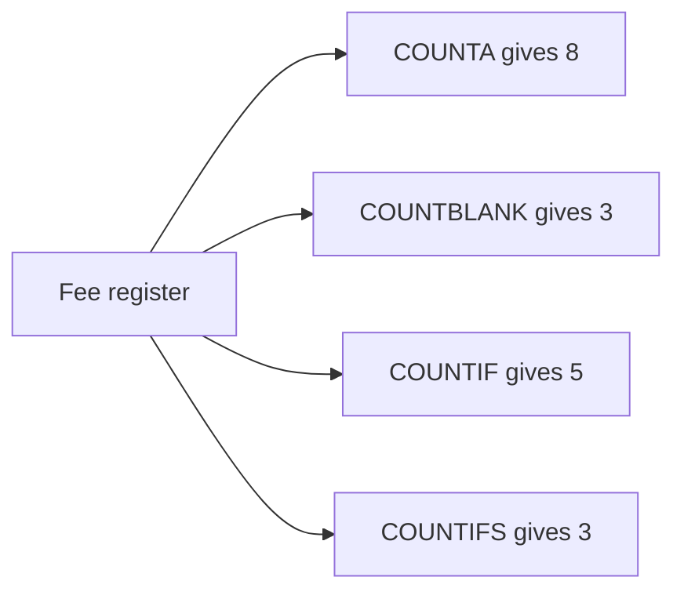
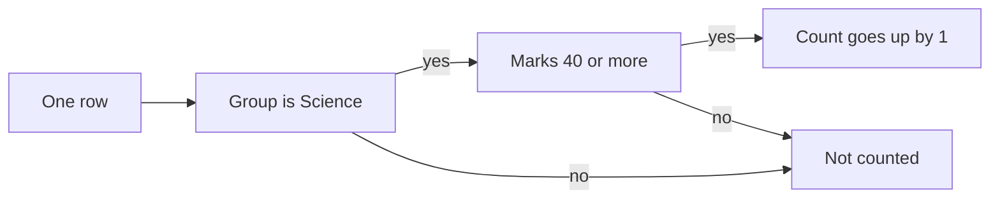

import PracticeFile from '@site/src/components/PracticeFile';

## Goal

By the end of this lesson, you can count filled cells, empty cells and cells that match a rule
with COUNTA, COUNTBLANK, COUNTIF and COUNTIFS.

## Why It Matters

A tuition centre wants to know how many students have not paid this month's fee. A school wants
to know how many students passed a test. An office wants to count the staff in the Sales
department. Counting by hand in a long list is slow, and one missed row gives a wrong answer.
These four functions count for you, and they update when the list changes.

**Diagram in words:** One fee register can answer four questions. COUNTA counts the 8 names,
COUNTBLANK counts the 3 empty fee cells, COUNTIF counts 5 passes, and COUNTIFS counts 3 Science
passes.

## Key Terms

| Term | Simple meaning |
|------|----------------|
| COUNTA | A function that counts the cells that are not empty. It counts words and numbers. |
| COUNTBLANK | A function that counts the empty cells in a range, like counting the empty boxes in a fee register. |
| COUNTIF | A function that counts the cells that match one rule, like "Science" or "40 or more". |
| COUNTIFS | A function that counts the rows that match two or more rules at the same time. |
| Criteria | The rule that decides which cells are counted. A word rule or a rule with a sign goes inside double quotes, like `"Science"` or `">=40"`. |
| `>=` | "Greater than or equal to". The rule `">=40"` means 40 or more. |

You met COUNT in [Lesson 7.9](min-max-count.mdx). COUNT counts only cells that hold numbers.
COUNTA counts every cell that is not empty, so it counts names too.

Think of an attendance register. COUNTA is "how many names are written". COUNTBLANK is "how many
boxes are still empty". COUNTIF is "how many boxes say Science".

## Step by Step

:::info[Practice files]

- <PracticeFile href="/files/excel/counting-functions/fee-register-starter.xlsx">Download the starter file: Fee Register</PracticeFile>.
  It has the register and the labels in column F already typed in, so that you can go straight to the formulas.
- <PracticeFile href="/files/excel/counting-functions/fee-register-finished.xlsx">Download the finished file: Fee Register</PracticeFile>.
  It has every formula in G2 to G7. Open it after you finish, to compare with your work.

:::

Mr. Khalid runs a small tuition centre. This is his fee register for October. Column B shows each
student's group, Science or Arts. An empty cell in column C means the fee is not paid yet. Open a new blank workbook
([Lesson 7.1](starting-excel.mdx)) and type the register. Leave C3, C6 and C9 empty.

| Row | A | B | C | D |
|-----|---|---|---|---|
| 1 | Student | Group | Fee Paid (Rs) | Test Marks |
| 2 | Ayesha | Science | 2000 | 72 |
| 3 | Bilal | Arts | *(empty)* | 35 |
| 4 | Hira | Science | 2000 | 58 |
| 5 | Kamran | Arts | 2500 | 81 |
| 6 | Maryam | Science | *(empty)* | 39 |
| 7 | Noman | Arts | 2500 | 44 |
| 8 | Rabia | Science | 2000 | 90 |
| 9 | Saad | Arts | *(empty)* | 28 |

Now type the labels in column F, so that each answer has a name. Leave column G empty. The table
shows the formulas and the correct results, so that you can check your work.

| Row | F | G |
|-----|---|---|
| 1 | What we count | Answer |
| 2 | Students | `=COUNTA(A2:A9)` gives 8 |
| 3 | Fees paid | `=COUNT(C2:C9)` gives 5 |
| 4 | Fees not paid | `=COUNTBLANK(C2:C9)` gives 3 |
| 5 | Science students | `=COUNTIF(B2:B9,"Science")` gives 4 |
| 6 | Passed (40 or more) | `=COUNTIF(D2:D9,">=40")` gives 5 |
| 7 | Science passes | `=COUNTIFS(B2:B9,"Science",D2:D9,">=40")` gives 3 |

**COUNT and COUNTA**

First, see why COUNT is the wrong tool for names.

1. Select cell G2. Type `=COUNT(A2:A9)` and press **Enter**. *G2 shows 0.*

The names are text, and COUNT counts only numbers. So it finds nothing to count.

2. Select G2 again. Type `=COUNTA(A2:A9)` and press **Enter**. *G2 shows 8.*

COUNTA counts every cell that is not empty, so all 8 names are counted.

3. Select G3. Type `=COUNT(C2:C9)` and press **Enter**. *G3 shows 5.*

Five fee cells hold a number, so five students have paid.

**COUNTBLANK**

This finds the students who still owe the fee.

4. Select G4. Type `=COUNTBLANK(C2:C9)` and press **Enter**. *G4 shows 3.*

C3, C6 and C9 are empty, so the answer is 3. Paid and not paid add up to 8 students.

**COUNTIF with a word**

5. Select G5. Type `=COUNTIF(B2:B9,"Science")` and press **Enter**. *G5 shows 4.*

The first part, B2:B9, is where to look. The second part, `"Science"`, is what to look for. The
words go inside double quotes, so that Excel reads them as text.

**COUNTIF with a number rule**

6. Select G6. Type `=COUNTIF(D2:D9,">=40")` and press **Enter**. *G6 shows 5.*

The rule `">=40"` means 40 or more. The rule has a sign, so it goes inside double quotes too.

**COUNTIFS with two rules**

7. Select G7. Type `=COUNTIFS(B2:B9,"Science",D2:D9,">=40")` and press **Enter**.
   *G7 shows 3.*

COUNTIFS takes the rules in pairs: a range, then its rule. A row is counted only when both
rules are true. Ayesha, Hira and Rabia are in the Science group with 40 or more. Maryam is in
Science, but she has 39, so she is not counted.

**Diagram in words:** COUNTIFS checks each row. The count goes up only when the group is
Science and the marks are 40 or more. If either answer is no, the row is not counted.

**See the answers change**

8. Select C3 and type 2500, then press **Enter**. This records Bilal's fee, so that you can see
   the counts update. *G3 changes to 6. G4 changes to 2.*
9. Select C3 and press **Delete** ([Lesson 7.2](entering-editing-saving-data.mdx)). This empties
   the cell again, because Bilal has not paid yet. *G3 shows 5 and G4 shows 3.*

{/* Screenshot to add: The fee register with column G showing 8, 5, 3, 4, 5 and 3, and G7 selected so the formula bar shows the COUNTIFS formula. */}

## Practice

:::info[Practice files]

- <PracticeFile href="/files/excel/counting-functions/course-list-starter.xlsx">Download the starter file: Course List</PracticeFile>.
  It has the students, courses, marks and labels already typed in. Use it if you want more time for the formulas.
- <PracticeFile href="/files/excel/counting-functions/course-list-finished.xlsx">Download the finished file: Course List</PracticeFile>.
  It has the six formulas in F2 to F7. Open it after you finish.

:::

Mrs. Nasreen runs a small computer centre. She wants a quick report on this month's exam. An
empty marks cell means the student missed the exam. The pass mark is 50.

| Row | A | B | C |
|-----|---|---|---|
| 1 | Student | Course | Exam Marks |
| 2 | Adeel | MS Office | 66 |
| 3 | Bushra | Typing | *(empty)* |
| 4 | Danish | MS Office | 48 |
| 5 | Farah | Graphics | 75 |
| 6 | Ghazala | Typing | 52 |
| 7 | Haris | MS Office | *(empty)* |
| 8 | Iqra | Graphics | 38 |
| 9 | Junaid | MS Office | 81 |
| 10 | Kiran | Typing | 45 |

1. Open a new blank workbook and type the table, rows 1 to 10. Leave C3 and C7 empty.
2. Type What we count in E1 and Answer in F1. Then type these labels in E2 to E7: Students,
   Sat the exam, Missed the exam, MS Office students, Passed (50 or more), MS Office passes.
3. In F2, count all the students with COUNTA on A2:A10.
4. In F3, count the students who sat the exam with COUNT on C2:C10. Only they have marks.
5. In F4, count the students who missed the exam with COUNTBLANK on C2:C10.
6. In F5, count the MS Office students with COUNTIF. Look in B2:B10 for `"MS Office"`.
7. In F6, count the passes with COUNTIF. Look in C2:C10 for `">=50"`.
8. In F7, count the MS Office students who passed. Use COUNTIFS with both rules from steps 6
   and 7.
9. Save the workbook with the name **Course List**
   ([Lesson 7.2](entering-editing-saving-data.mdx)), so that your work is not lost.
10. Check your work: F2 shows 9, F3 shows 7, F4 shows 2, F5 shows 4, F6 shows 4 and F7 shows 2.
    F7's formula is `=COUNTIFS(B2:B10,"MS Office",C2:C10,">=50")`.

## Check Questions

1. A range holds Ali, 45, an empty cell and Absent. What do COUNT, COUNTA and COUNTBLANK give?

   

   
Show answer

   **Answer:** COUNT gives 1, because only 45 is a number. COUNTA gives 3: Ali, 45 and Absent.
   COUNTBLANK gives 1, for the empty cell.

   

2. Write a formula that counts the students in B2:B9 who are in the Arts group.

   

   
Show answer

   **Answer:** `=COUNTIF(B2:B9,"Arts")`. In the fee register it gives 4.

   

3. In your Course List, select the cell that counts the MS Office passes. Point to its two pairs
   of range and rule.

   

   
Show answer

   **Answer:** Cell F7. The first pair is `B2:B10,"MS Office"`. The second pair is
   `C2:C10,">=50"`.

   

## Common Mistakes

- **Forgetting the double quotes**, like `=COUNTIF(D2:D9,>=40)` → The formula does not work.
  Put word rules and rules with signs in double quotes: `">=40"`, `"Science"`.
- **Using COUNT to count names** → COUNT gives 0 for text. Use COUNTA for names and words.
- **Typing 0 for an unpaid fee** → COUNTBLANK does not count a cell with 0. Leave the cell empty
  if nothing is paid.
- **Giving COUNTIFS ranges of different sizes**, like B2:B9 and D2:D8 → Each range must have the
  same number of rows. Use B2:B9 with D2:D9.

## Sources

*These official pages were checked when this lesson was written.*

- [Microsoft Support, "COUNTA function"](https://support.microsoft.com/en-us/excel/functions/counta-function) (applies to Excel 2021): "The COUNTA function counts the number of cells that are not empty in a range"; syntax `COUNTA(value1, [value2], ...)`; "The COUNTA function counts cells containing any type of information"; "The COUNTA function does not count empty cells."
- [Microsoft Support, "COUNT function"](https://support.microsoft.com/en-us/excel/functions/count-function) (applies to Excel 2021): "The COUNT function counts the number of cells that contain numbers"; "Empty cells, logical values, text, or error values in the array or reference are not counted."
- [Microsoft Support, "COUNTBLANK function"](https://support.microsoft.com/en-us/excel/functions/countblank-function) (applies to Excel 2021): "count the number of empty cells in a range of cells"; syntax `COUNTBLANK(range)`; "Cells with zero values are not counted."
- [Microsoft Support, "Use the COUNTIF function in Microsoft Excel"](https://support.microsoft.com/en-us/excel/get-started/use-the-countif-function-in-microsoft-excel) (applies to Excel 2021): "count the number of cells that meet a criterion"; "=COUNTIF(Where do you want to look?, What do you want to look for?)"; syntax `COUNTIF(range, criteria)`; example `=COUNTIF(A2:A5,"apples")`; `=COUNTIF(B2:B5,">=32")` counts "a value greater than (>) or equal to (=) 32"; "Be sure to enclose the criteria argument in quotes."
- [Microsoft Support, "COUNTIFS function"](https://support.microsoft.com/en-us/excel/functions/countifs-function) (applies to Excel 2021): "applies criteria to cells across multiple ranges and counts the number of times all criteria are met"; syntax `COUNTIFS(criteria_range1, criteria1, [criteria_range2, criteria2]…)`; "Each additional range must have the same number of rows and columns as the criteria_range1 argument"; example `=COUNTIFS(B2:B5,"=Yes",C2:C5,"=Yes")`.
- [Microsoft Support, "SUMIF function"](https://support.microsoft.com/en-us/excel/functions/sumif-function) (applies to Excel 2021), on criteria: "Any text criteria or any criteria that includes logical or mathematical symbols must be enclosed in double quotation marks ("). If the criteria is numeric, double quotation marks are not required."

All results were calculated and checked again before writing. Fee register: 8 names; fees in
C2, C4, C5, C7, C8, so 5 paid and 3 empty; Science is Ayesha, Hira, Maryam, Rabia (4); 40 or
more is 72, 58, 81, 44, 90 (5); Science with 40 or more is Ayesha, Hira, Rabia (3). Course list:
9 students; 7 marks and 2 empty; MS Office is Adeel, Danish, Haris, Junaid (4); 50 or more is
66, 75, 52, 81 (4); MS Office with 50 or more is Adeel and Junaid (2).
