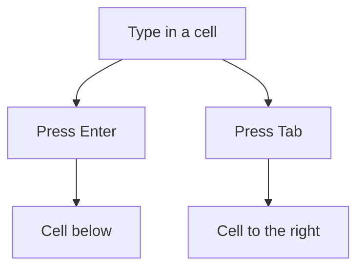

## Goal

By the end of this lesson, you can type a small shop list into Excel, correct it and save it as a workbook.

## Why It Matters

A grocery shop has many items, and each item has a quantity and a price. A mobile shop keeps a
stock list of covers, chargers and cards. In Excel you write each one in its own cell. If a
price changes, you change one cell, not the whole page. When you save the workbook, your list
is kept for next time.

**Diagram in words:** After you type in a cell, press Enter to go down one cell. Press Tab to go
one cell to the right.

## Key Terms

| Term | Simple meaning |
|------|----------------|
| Data | The words and numbers you type into cells. |
| Tab key | The key marked Tab on the keyboard. In Excel it moves you one cell to the right. |
| Edit | To change what is already in a cell, like correcting one word with a pen. |
| F2 key | One of the function keys, F1 to F12. In Excel it lets you edit the selected cell. |
| Clear | To remove what is in a cell, so the cell is empty again. |
| Undo | To take back your last action. The keys are **Ctrl+Z**. |
| Save | To keep your workbook as a file, so you can open it again later. |

## Step by Step

Follow these steps on your own computer. You will make a list for a small grocery shop. Open a
blank workbook, as in [Lesson 7.1](./starting-excel.mdx). You met the Enter, Backspace and
function keys in [Lesson 1.6](../module-01-computer-basics/keyboard-basics.mdx).

This is the list you will type. Type only the number in the price cells. Put "Rs" in the
heading only, so that each price cell holds a plain number.

| Item | Quantity | Price Rs |
|------|----------|----------|
| Sugar | 2 | 150 |
| Rice | 3 | 320 |
| Cooking oil | 1 | 560 |
| Tea | 2 | 450 |
| Milk | 4 | 220 |
| Eggs | 12 | 30 |

**Typing the headings**

Headings tell the reader what each column holds.

1. Click cell A1. Type **Item** and press **Tab**. Tab moves you to the right, so the next
   heading goes in the next column. *You see B1 become the active cell.*
2. Type **Quantity** and press **Tab**.
3. Type **Price Rs** and press **Enter**.

**Typing the items**

4. Click cell A2. Type **Sugar** and press **Enter**. Enter moves you down, so you can type the
   next item below. *You see A3 become the active cell.*
5. Type the other items in the same way: **Rice**, **Cooking oil**, **Tea**, **Milk**, **Eggs**.
6. Click cell B2. Type the quantities, pressing **Enter** after each one.
7. Click cell C2. Type the prices, pressing **Enter** after each one.
   *You see the full list from the table above.*

**Editing, clearing and undoing**

8. The price of milk is now Rs 240. You need to change one cell only. Click cell C6. Press
   **F2**, so that you can change the cell without typing it all again.
   *You see the cursor at the end of 220.*
9. Press **Backspace** two times. Type **40** and press **Enter**. *You see 240 in C6.*
10. Click cell A7 (Eggs). Press **Delete**. This clears the cell. *You see the cell become empty.*
11. Press **Ctrl+Z**. Ctrl+Z is Undo. It helps you when you delete something by mistake.
    *You see Eggs come back.*
12. Click any empty cell. Type **abc** but do not press Enter. Press **Esc**. Esc cancels typing
    you do not want. *You see the typing cancelled and the cell empty.*

**Saving the workbook**

Saving works like saving in Word. See
[Lesson 4.3: Saving, Closing and Opening](../module-04-ms-word/saving-closing-opening.mdx).

13. Press **F12**. *You see the Save As dialog box open.*
14. Choose the **Documents** folder, so that you can find the file again later.
15. In the **File name** box, type **Shop List**. A clear name tells you what is inside.
16. Select **Save**. *You see the Save As dialog box close.* Your list is now kept as a file.
17. From now on, press **Ctrl+S** often. It saves your changes, so that your work is not lost.

{/* Screenshot to add: The Save As dialog box in Excel, with the File name box showing Shop List and the Save button. */}

## Practice

Imran has a small mobile shop. He wants a list of the things he has in stock. Type this list
for him. Start in cell A1. Type only the number in the price cells.

| Item | Quantity | Price Rs |
|------|----------|----------|
| Phone cover | 10 | 350 |
| Charger | 6 | 800 |
| Earphones | 8 | 450 |
| Screen protector | 15 | 200 |
| Memory card | 5 | 1200 |

1. Open a blank workbook.
2. Type the three headings in A1, B1 and C1. Use **Tab** to move to the right.
3. Type the items in column A, the quantities in column B and the prices in column C. Use
   **Enter** to move down.
4. The price of a charger is now Rs 850. Select cell C3, press **F2** and change 800 to 850.
5. Select cell A4 (Earphones) and press **Delete**. Then press **Ctrl+Z** to bring it back. This
   is practice for fixing a mistake.
6. Press **F12**. Save the workbook in **Documents** with the name **Mobile Stock**.
7. Imran sells 2 memory cards. Change the quantity of memory cards from 5 to 3. Press **Ctrl+S**
   to save again, so that the new number is kept.
8. Check your work: your list fills A1 to C6. C3 shows 850, A4 shows Earphones and B6 shows 3.
   The workbook is saved in Documents as Mobile Stock.

## Check Questions

1. Type a word in any cell. Show which key moves you to the cell on the right.

   

   
Show answer

   **Answer:** The Tab key. (Enter moves you to the cell below.)

   

2. How do you make a cell empty?

   

   
Show answer

   **Answer:** Select the cell and press Delete.

   

3. You deleted something by mistake. Which keys bring it back?

   

   
Show answer

   **Answer:** Ctrl+Z (Undo).

   

## Common Mistakes

- **Typing "Rs 150" in a price cell** → Type only the number, 150. Put "Rs" in the column heading.
- **Pressing Delete when you wanted to change one letter** → Press **Ctrl+Z** to get the data
  back. Then press **F2** to edit instead.
- **Typing over the wrong cell** → Before you type, check which cell has the border around it.
  That is the active cell.
- **Closing Excel without saving** → Press **Ctrl+S** often while you work.

## Sources

*These official pages were checked when this lesson was written.*

- [Microsoft Support, "Basic tasks in Excel"](https://support.microsoft.com/en-us/office/basic-tasks-in-excel-dc775dd1-fa52-430f-9c3c-d998d1735fca): applies to Excel 2016 and 2019; click a cell, type text or a number, press Enter or Tab to move to the next cell; the Save steps (Ctrl+S, File name box, Save).
- [Microsoft Support, "Keyboard shortcuts in Excel"](https://support.microsoft.com/en-us/office/keyboard-shortcuts-in-excel-1798d9d5-842a-42b8-9c99-9b7213f0040f): applies to Excel 2016 and 2019; Enter completes an entry and selects the cell below; Tab moves one cell to the right; F2 edits the active cell with the cursor at the end; Backspace deletes the character to the left while editing; Delete removes cell contents; Esc cancels an entry; Ctrl+Z undoes the last action; Ctrl+S saves; F12 opens the Save As dialog box.
