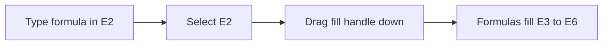

## Goal

By the end of this lesson, you can copy a formula down a column and fill a series with the fill
handle.

## Why It Matters

A shop list can have many rows, and each row needs its own total. A tuition centre's fee record
has one row for every student. Typing the same formula again and again takes a long time. With
the fill handle, you write the formula once and copy it to every row in one move.

**Diagram in words:** Type the formula once in E2 and select it. Drag the fill handle down, and
Excel copies the formula to E3, E4, E5 and E6.

## Key Terms

| Term | Simple meaning |
|------|----------------|
| Fill handle | The small square at the lower-right corner of the selected cell. You drag it to fill other cells. |
| Drag | Hold down the left mouse button, move the mouse, then let go. See [Lesson 1.5](../module-01-computer-basics/using-the-mouse.mdx). |
| Fill down | Copy a cell into the cells below it. |
| Series | Numbers or words that follow an order, like 1, 2, 3 or Jan, Feb, Mar. |
| Pattern | The first values you type, so Excel can guess what comes next. It is like showing someone the first two steps of a counting game. |

## Step by Step

Follow these steps on your own computer. You will make a bill for a small school shop. Open a
new blank workbook ([Lesson 7.1](starting-excel.mdx)). Type this list, but leave column A and
column E empty for now. Make the columns wider if needed ([Lesson 7.3](rows-and-columns.mdx)).

| Row | A | B | C | D | E |
|-----|---|---|---|---|---|
| 1 | No. | Item | Quantity | Price (Rs) | Total (Rs) |
| 2 | | Notebook | 4 | 80 | |
| 3 | | Pencil | 10 | 15 | |
| 4 | | Eraser | 6 | 10 | |
| 5 | | Ruler | 3 | 40 | |
| 6 | | Glue stick | 2 | 90 | |

**Fill a series of numbers**

Numbering the rows helps you count and talk about the items.

1. Type 1 in cell A2. Type 2 in cell A3. These two numbers show Excel the pattern.
2. Drag from A2 to A3 to select both cells, so that Excel can see the pattern.
3. Point to the fill handle, the small square at the lower-right corner of the selection.
4. Drag the fill handle down to A6, then let go. *While you drag, Excel shows the next value.
   A4, A5 and A6 show 3, 4 and 5.* You did not have to type each number.

**Copy a formula down**

5. Select cell E2. Type `=C2*D2` and press **Enter**. Quantity times price gives the total.
   *E2 shows 320.*
6. Select cell E2 again, so that the fill handle belongs to the cell with the formula.
7. Drag the fill handle down to E6, then let go. One drag fills every total.
   *E3 to E6 show 150, 60, 120 and 180.*
8. Select cell E4 and look at the formula bar, so that you can see what Excel copied.
   *The formula bar shows `=C4*D4`.*
9. You copied the formula from row 2. In row 4, Excel changed it to use row 4. That is why each
   total is right for its own row.

This table shows what Excel did. Each formula uses the cells in its own row.

| Cell | Formula | Result |
|------|---------|--------|
| E2 | `=C2*D2` | 4 × 80 = 320 |
| E3 | `=C3*D3` | 10 × 15 = 150 |
| E4 | `=C4*D4` | 6 × 10 = 60 |
| E5 | `=C5*D5` | 3 × 40 = 120 |
| E6 | `=C6*D6` | 2 × 90 = 180 |

**Fill a series of months**

Months are useful for monthly records, like a milk bill or a fee record.

10. Type Jan in cell G2. Type Feb in cell G3.
11. Select G2 and G3. Drag the fill handle down to G7. *G4 to G7 show Mar, Apr, May and Jun.*

{/* Screenshot to add: Cell E2 selected, with the mouse pointer on the fill handle at its lower-right corner. */}

## Practice

Your family buys milk from a milkman every day. Make a milk bill for six months. This is how your
sheet should look at the end. Column E shows the formula you copy and the correct result.

| Row | A | B | C | D | E |
|-----|---|---|---|---|---|
| 1 | No. | Month | Milk (litres) | Price per litre (Rs) | Bill (Rs) |
| 2 | 1 | Jan | 60 | 200 | `=C2*D2` gives 12000 |
| 3 | 2 | Feb | 56 | 200 | `=C3*D3` gives 11200 |
| 4 | 3 | Mar | 62 | 200 | `=C4*D4` gives 12400 |
| 5 | 4 | Apr | 60 | 200 | `=C5*D5` gives 12000 |
| 6 | 5 | May | 62 | 200 | `=C6*D6` gives 12400 |
| 7 | 6 | Jun | 60 | 200 | `=C7*D7` gives 12000 |

1. Open a new blank workbook. Type the headings in row 1.
2. Type 1 in A2 and 2 in A3. Select both and drag the fill handle down to A7. Check: 1 to 6.
3. Type Jan in B2 and Feb in B3. Select both and drag the fill handle down to B7. Check: Jan to
   Jun.
4. Type the litres in C2 to C7.
5. Type 200 in D2. Select D2 and drag the fill handle down to D7. The price is the same every
   month, so one value is enough. Check: every cell shows 200.
6. Select E2. Type `=C2*D2` and press **Enter**. Check: 12000.
7. Select E2 and drag the fill handle down to E7, so that every month gets its own bill.
8. Select E5 and read the formula bar. Check: `=C5*D5`.
9. Save the workbook with the name **Milk Bill** ([Lesson 7.2](entering-editing-saving-data.mdx)),
   so that your work is kept.
10. Check your work: A2 to A7 show 1 to 6, and B2 to B7 show Jan to Jun. E2 to E7 show 12000,
    11200, 12400, 12000, 12400 and 12000. With E5 selected, the formula bar shows `=C5*D5`.

## Check Questions

1. Point to the fill handle on a selected cell.

   

   
Show answer

   **Answer:** The small square at the lower-right corner of the selected cell.

   

2. You copy `=C2*D2` from E2 down to E3. What formula is in E3?

   

   
Show answer

   **Answer:** `=C3*D3`. Excel changes the row number to match the new row.

   

3. You want the series 1, 2, 3, 4, 5. What do you type before you drag?

   

   
Show answer

   **Answer:** Type 1 in the first cell and 2 in the next cell. Select both, then drag.

   

## Common Mistakes

- **Typing only 1 and then dragging** → Excel copies 1 into every cell. Type 1 and 2 first,
  select both, then drag.
- **Dragging too far** → Press **Ctrl+Z** (Undo, [Lesson 7.2](entering-editing-saving-data.mdx)).
  Then drag again, stopping at the last row.
- **You cannot see the fill handle** → Select **File** > **Options** > **Advanced**. Turn on
  **Enable fill handle and cell drag-and-drop**.
- **Selecting a different cell before dragging** → Select the cell with the formula first, then
  drag its fill handle.

## Sources

*These official pages were checked when this lesson was written.*

- [Microsoft Support, "Create a list of sequential dates"](https://support.microsoft.com/en-us/excel/get-started/create-a-list-of-sequential-dates) (applies to Excel 2021): "Select the fill handle at the lower-right corner of the cell, hold down, and drag to fill the rest of the series."
- [Microsoft Support, "Fill a formula down into adjacent cells"](https://support.microsoft.com/en-us/office/fill-a-formula-down-into-adjacent-cells-041edfe2-05bc-40e6-b933-ef48c3f308c6) (applies to Excel 2021): "Select the cell that has the formula you want to fill into adjacent cells. Drag the fill handle"; references "adjust for each row"; "If you don't see the fill handle … Select File > Options. Select Advanced. Under Editing Options, check the Enable fill handle and cell drag-and-drop box."
- [Microsoft Support, "Automatically number rows in Excel"](https://support.microsoft.com/en-us/excel/get-started/automatically-number-rows-in-excel) (applies to Excel 2021): "if you want the series 1, 2, 3, 4, 5..., type 1 and 2 in the first two cells"; "Select the cells that contain the starting values. Drag the fill handle"; "As you drag the fill handle across each cell, Excel displays a preview of the value."
- [Microsoft Support, "Fill data automatically in worksheet cells"](https://support.microsoft.com/en-us/office/fill-data-automatically-in-worksheet-cells-74e31bdd-d993-45da-aa82-35a236c5b5db) (applies to Excel 2021): "For the series 2, 2, 2, 2..., type 2 in first cell only."
- [Microsoft Support, "What is Excel?"](https://support.microsoft.com/en-us/office/what-is-excel-94b00f50-5896-479c-b0c5-ff74603b35a3) (applies to Excel 2021): "Enter the beginning of the series in two cells: such as Jan and Feb … Select the two cells containing the series, and then drag the fill handle."
- [Microsoft Support, "Overview of formulas in Excel"](https://support.microsoft.com/en-us/office/overview-of-formulas-in-excel-ecfdc708-9162-49e8-b993-c311f47ca173) (applies to Excel 2021): "if you copy or fill a relative reference in cell B2 to cell B3, it automatically adjusts from =A1 to =A2."
- [Microsoft Support, "Keyboard shortcuts in Excel"](https://support.microsoft.com/en-us/office/keyboard-shortcuts-in-excel-1798d9d5-842a-42b8-9c99-9b7213f0040f) (applies to Excel 2021): "Undo the last action. Ctrl+Z".

All results were calculated and checked again before writing: 4 × 80 = 320, 10 × 15 = 150,
6 × 10 = 60, 3 × 40 = 120, 2 × 90 = 180. Milk bill: 60 × 200 = 12000, 56 × 200 = 11200,
62 × 200 = 12400.
