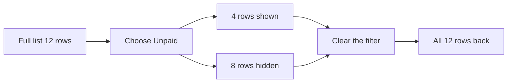

import PracticeFile from '@site/src/components/PracticeFile';

## Goal

By the end of this lesson, you can show only the rows you need with filter arrows, and bring all
the rows back again.

## Why It Matters

A tuition centre keeps a fee list with many students. At the end of the month, it wants to see
only the students who have not paid. A shopkeeper wants to see only the tea sales, or only the
big bills. A filter hides the other rows for a while. Nothing is deleted, so the full list comes
back when you clear the filter.

**Diagram in words:** You choose Unpaid, so Excel shows 4 rows and hides the other 8. When you
clear the filter, all 12 rows come back.

## Key Terms

| Term | Simple meaning |
|------|----------------|
| Filter | A way to show only the rows you want. The other rows are hidden for a while, like folding some pages of a register. |
| Filter arrow | A small arrow button in each heading cell. It appears when you turn on filters. |
| Filter button | The arrow changes to this button when its column is filtered. It tells you a filter is on. |
| Hidden row | A row that is still in the sheet, but not shown on the screen. |
| Clear a filter | Take the filter off, so that every row shows again. |
| Number Filters | Choices for filtering a column of numbers, such as **Greater Than**. |

Filtering does not change the order of your rows. To change the order, you sort
([Lesson 7.10](sorting-data.mdx)). In [Lesson 7.25](sort-filter-unique.mdx) the FILTER function
made a new list in other cells. Filter arrows work on the list itself and need no formula.

## Step by Step

:::info[Practice files]

- <PracticeFile href="/files/excel/filtering-data/fee-record-starter.xlsx">Download the starter file: Fee Record</PracticeFile>.
  It has the fee list already typed in, with no filter, so that you can start at step 2.
- <PracticeFile href="/files/excel/filtering-data/fee-record-finished.xlsx">Download the finished file: Fee Record</PracticeFile>.
  It shows the end of the steps: filter arrows on, and only the unpaid students showing. Open it
  after you finish, to compare with your work.

:::

Mrs Saima runs a tuition centre. She keeps a fee record for October. She wants to know who has
not paid yet. Open the starter file, or type this table into a new blank workbook
([Lesson 7.1](starting-excel.mdx)).

| Row | A | B | C | D |
|-----|---|---|---|---|
| 1 | Student | Grade | Fee (Rs) | Status |
| 2 | Ayesha | 9 | 2500 | Paid |
| 3 | Bilal | 10 | 3000 | Unpaid |
| 4 | Hira | 9 | 2500 | Paid |
| 5 | Kamran | 8 | 2000 | Unpaid |
| 6 | Maryam | 10 | 3000 | Paid |
| 7 | Noman | 9 | 2500 | Unpaid |
| 8 | Rabia | 8 | 2000 | Paid |
| 9 | Saad | 10 | 3000 | Paid |
| 10 | Sana | 9 | 2500 | Paid |
| 11 | Usman | 8 | 2000 | Unpaid |
| 12 | Zainab | 10 | 3000 | Paid |
| 13 | Hamza | 9 | 2500 | Paid |

**Turn on the filter arrows**

1. Open the starter file, or type the table.
2. Select any cell in the table, such as A1. This tells Excel which list you want to filter.
3. On the **Data** tab, select **Filter**. *A small arrow appears in each heading, from A1 to D1.*

**Show one grade only**

4. Select the arrow in B1, **Grade**. *A list opens with a tick box for each grade: 8, 9 and 10.*
5. Clear the **(Select All)** box. This removes every tick, so that you can choose only what
   you want.
6. Tick **9** and select **OK**. *Only five students show: Ayesha, Hira, Noman, Sana and Hamza.*
7. Look at the row numbers on the left. They jump: 1, 2, 4, 7, 10, 13. The other rows are
   hidden, not deleted.
8. Look at B1. The arrow has changed to a **Filter** button. It reminds you that this column is
   filtered.

**Clear the filter**

9. Select the **Filter** button in B1. Then select **Clear Filter From "Grade"**. *All 12
   students show again.*

**Show only the unpaid fees**

10. Select the arrow in D1, **Status**. Clear the **(Select All)** box, tick **Unpaid** and
    select **OK**. *Four students show: Bilal, Kamran, Noman and Usman, in rows 3, 5, 7 and 11.*
11. Add their fees: 3000 + 2000 + 2500 + 2000 = 9500. Mrs Saima is still waiting for Rs 9500
    this month. Now she knows whom to remind.
12. Save the workbook with the name **Fee Record**
    ([Lesson 7.2](entering-editing-saving-data.mdx)), so that your work is kept. Your sheet now
    looks like the finished file.

{/* Screenshot to add: The Fee Record sheet with the Status column filtered to Unpaid, showing rows 1, 3, 5, 7 and 11 and the Filter button in D1. */}

## Practice

:::info[Practice files]

- <PracticeFile href="/files/excel/filtering-data/shop-sales-starter.xlsx">Download the starter file: Shop Sales</PracticeFile>.
  It has the 15 bills already typed in. Use it if you want more time for the filters.
- <PracticeFile href="/files/excel/filtering-data/shop-sales-finished.xlsx">Download the finished file: Shop Sales</PracticeFile>.
  It shows the end of the task, with only the bills over Rs 2000 showing. Open it after you
  finish.

:::

Tariq has a small grocery shop. He writes every bill in a sales log. He wants to see his tea
sales, and then his big bills over Rs 2000.

| Row | A | B | C | D |
|-----|---|---|---|---|
| 1 | Bill No | Product | Quantity | Amount (Rs) |
| 2 | 101 | Tea | 2 | 900 |
| 3 | 102 | Sugar | 5 | 800 |
| 4 | 103 | Oil | 4 | 2240 |
| 5 | 104 | Rice | 10 | 3200 |
| 6 | 105 | Tea | 1 | 450 |
| 7 | 106 | Daal | 3 | 900 |
| 8 | 107 | Sugar | 2 | 320 |
| 9 | 108 | Oil | 1 | 560 |
| 10 | 109 | Tea | 6 | 2700 |
| 11 | 110 | Rice | 3 | 960 |
| 12 | 111 | Daal | 5 | 1500 |
| 13 | 112 | Sugar | 10 | 1600 |
| 14 | 113 | Oil | 5 | 2800 |
| 15 | 114 | Tea | 3 | 1350 |
| 16 | 115 | Rice | 2 | 640 |

1. Open the starter file, or type the table into a new blank workbook.
2. Select A1. On the **Data** tab, select **Filter**, so that the filter arrows appear.
3. Select the arrow in B1, **Product**. Clear **(Select All)**, tick **Tea** and select **OK**.
   Check: four bills show, 101, 105, 109 and 114.
4. Add the tea quantities in column C: 2 + 1 + 6 + 3 = 12. Tariq sold 12 packs of tea.
5. Select the **Filter** button in B1 and select **Clear Filter From "Product"**. All 15 bills
   show again.
6. Select the arrow in D1, **Amount (Rs)**. Select **Number Filters**, then select
   **Greater Than...**.
7. The **Custom AutoFilter** box opens. Type 2000 in the empty box on the right, and select
   **OK**. Only bills over Rs 2000 stay on the screen.
8. Save the workbook with the name **Shop Sales**, so that your work is kept.
9. Check your work: four bills show, in rows 4, 5, 10 and 14. They are 103 Oil 2240, 104 Rice
   3200, 109 Tea 2700 and 113 Oil 2800. D1 shows the **Filter** button, and B1 shows an arrow.

## Check Questions

1. Your filter shows 4 of the 12 students. Did Excel delete the other 8?

   

   
Show answer

   **Answer:** No. The other 8 rows are only hidden. Clear the filter and they show again.

   

2. Point to the button that turns the filter arrows on and off.

   

   
Show answer

   **Answer:** On the **Data** tab: **Filter**. Select it once to turn the arrows on. Select it
   again to remove the filters, and every row shows again.

   

3. In your Shop Sales sheet, show only the Sugar bills. Which bills show?

   

   
Show answer

   **Answer:** First clear the Amount filter. Then select the arrow in B1, clear **(Select
   All)**, tick **Sugar** and select **OK**. Three bills show: 102, 107 and 112.

   

## Common Mistakes

- **Forgetting that a filter is on** → Some rows seem lost. Look for a **Filter** button in the
  headings, or row numbers that jump. To clear every filter at once, select **Data** >
  **Clear**.
- **Ticking a value without clearing (Select All) first** → Every row still shows. Clear
  **(Select All)** first, then tick only the value you want.
- **Typing "Rs" next to the numbers**, like `Rs 2000` → The column mixes text and numbers, and
  **Number Filters** may not show. Type the numbers only, and put Rs in the heading.
- **Deleting rows to make a short list** → The data is gone for good. Use a filter instead, so
  that every row comes back when you clear it.

## Sources

*These official pages were checked when this lesson was written.*

- [Microsoft Support, "Filter data in a range or table in Excel"](https://support.microsoft.com/en-us/office/filter-data-in-a-range-or-table-01832226-31b5-4568-8806-38c37dcc180e) (applies to Excel 2021): "Use filters to temporarily hide some of the data in a table, so you can focus on the data you want"; "Select any cell within the range. Select Data > Filter. Select the column header arrow"; "Select Text Filters or Number Filters, and then select a comparison, like Between. Enter the filter criteria and select OK"; "Uncheck (Select All) and select the boxes you want to show. Select OK"; "The column header arrow changes to a Filter icon. Select this icon to change or clear the filter"; "Filtered data displays only the rows that meet criteria that you specify and hides rows that you do not want displayed"; "do not mix data types, such as text and number ... because only one type of filter command is available for each column". The page's picture of **Number Filters** shows the choice **Greater Than...** (steps 6–7), the **Custom AutoFilter** box with a value box on the right and **OK**, and the list item **Clear Filter From "SalesAmount"**.
- [Microsoft Support, "Use AutoFilter to filter your data"](https://support.microsoft.com/en-us/office/use-autofilter-to-filter-your-data-7d87d63e-ebd0-424b-8106-e2ab61133d92) (applies to Excel 2021): "When you filter data, entire rows will be hidden if the values in one or more columns don't meet the filtering criteria"; "Click Data > Filter"; "Uncheck (Select All) to clear all of the check boxes, and then check the boxes for the specific value(s) you want to see"; "Click OK to apply the filter."
- [Microsoft Support, "Clear or remove a filter"](https://support.microsoft.com/en-us/excel/clear-or-remove-a-filter) (applies to Excel 2021): "Click the Filter button next to the column heading, and then click `Clear Filter from <"Column Name">`"; "Clear all the filters in a worksheet: Click the Data tab, and then click Clear"; "If you want to completely remove filters, go to the Data tab and click the Filter button".

All results were worked out again before writing, with Python: Grade 9 has Ayesha, Hira, Noman,
Sana and Hamza (rows 2, 4, 7, 10 and 13); the unpaid students are Bilal, Kamran, Noman and Usman
(rows 3, 5, 7 and 11), and 3000 + 2000 + 2500 + 2000 = 9500. The tea bills are 101, 105, 109
and 114, with 12 packs in all; the bills over 2000 are 103 (2240), 104 (3200), 109 (2700) and
113 (2800); the sugar bills are 102, 107 and 112.
