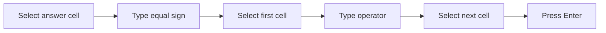

## Goal

By the end of this lesson, you can write a formula that adds, subtracts, multiplies or divides
numbers using cell addresses.

## Why It Matters

A shopkeeper adds the day's sales and works out the profit. A family shares a bill between
people. Excel can do these sums for you. When you change a number, Excel works out the new
answer for you.

**Diagram in words:** Select the cell for the answer and type an equal sign. Select the first
cell, type an operator, select the next cell, then press Enter.

## Key Terms

| Term | Simple meaning |
|------|----------------|
| Formula | A calculation you type in a cell. It always starts with an equal sign (`=`). |
| Operator | A sign that tells Excel what to do: `+` add, `-` subtract, `*` multiply, `/` divide. |
| Asterisk | The `*` sign. Excel uses it to multiply, not the letter x. |
| Forward slash | The `/` sign. Excel uses it to divide. |
| Result | The answer to a formula. Excel shows it in the cell. |
| Cell address | The name of a cell, like B1: column letter, then row number. See [Lesson 7.1](starting-excel.mdx). |

## Teacher Demo

Open a new blank workbook ([Lesson 7.1](starting-excel.mdx)). Type this table for Bilal's shop.
Type only the words and numbers. Leave cells B3, B5, B8 and B11 empty. Make column A wider
([Lesson 7.3](rows-and-columns.mdx)).

| Row | A | B | Formula for B | Correct result |
|-----|---|---|---------------|----------------|
| 1 | Morning sales (Rs) | 1200 | | |
| 2 | Evening sales (Rs) | 800 | | |
| 3 | Total sales (Rs) | | `=B1+B2` | 2000 |
| 4 | Cost of goods (Rs) | 1450 | | |
| 5 | Profit (Rs) | | `=B3-B4` | 550 |
| 6 | Pens sold | 12 | | |
| 7 | Price of one pen (Rs) | 25 | | |
| 8 | Money from pens (Rs) | | `=B6*B7` | 300 |
| 9 | Bill to share (Rs) | 1500 | | |
| 10 | People | 3 | | |
| 11 | Each person pays (Rs) | | `=B9/B10` | 500 |

1. Select cell B3. Say: "The answer goes here."
2. Type `=`. Say: "Every formula starts with an equal sign."
3. Select cell B1. *B1 appears in the formula.*
4. Type `+`.
5. Select cell B2. *The cell shows `=B1+B2`.*
6. Press **Enter**. *Cell B3 shows 2000.*
7. Select cell B3 and point to the formula bar. *The cell shows 2000. The formula bar shows
   `=B1+B2`.*
8. Select cell B5. Type `=B3-B4` and press **Enter**. *B5 shows 550.*
9. Select cell B8. Type `=B6*B7` and press **Enter**. *B8 shows 300.*
10. Select cell B11. Type `=B9/B10` and press **Enter**. *B11 shows 500.*
11. Select cell B1. Type 1500 and press **Enter**. *B3 changes to 2300. B5 changes to 850.*
12. Say: "We used cell addresses, not numbers. So Excel changed the answers for us."

:::info[Screenshot to add]

Cell B3 selected: the cell shows 2000 and the formula bar shows =B1+B2.

:::

## Student Task

Hina's class is going on a school trip. Type this table, starting in cell A1. Leave cells B3,
B5, B7 and B9 empty. The last column shows the correct result so you can check your work.

| Row | A | B | Formula to type in B | Correct result |
|-----|---|---|----------------------|----------------|
| 1 | Bus fare (Rs) | 350 | | |
| 2 | Lunch (Rs) | 250 | | |
| 3 | Cost for one student (Rs) | | `=B1+B2` | 600 |
| 4 | Money from home (Rs) | 1000 | | |
| 5 | Money left (Rs) | | `=B4-B3` | 400 |
| 6 | Number of students | 25 | | |
| 7 | Cost for the class (Rs) | | `=B3*B6` | 15000 |
| 8 | Number of groups | 5 | | |
| 9 | Students in each group | | `=B6/B8` | 5 |

1. Open a new blank workbook and type the words and numbers in the table.
2. Select B3. Type `=`, select B1, type `+`, select B2, and press **Enter**. Check: 600.
3. In B5, type `=B4-B3` and press **Enter**. Check: 400.
4. In B7, type `=B3*B6` and press **Enter**. Check: 15000.
5. In B9, type `=B6/B8` and press **Enter**. Check: 5.
6. Change the lunch in B2 to 300. Check: B3 shows 650, B5 shows 350 and B7 shows 16250.
7. Save the workbook with the name **School Trip** ([Lesson 7.2](entering-editing-saving-data.mdx)).
8. Show your teacher: cell B7 selected, with its result in the cell and its formula in the
   formula bar.

## Check Questions

1. What must every formula start with?
   **Answer:** An equal sign (`=`).
2. Which signs do you type to multiply and to divide?
   **Answer:** `*` (asterisk) to multiply and `/` (forward slash) to divide.
3. Select a cell with a formula. Point to where you can see the formula.
   **Answer:** The formula bar. The cell itself shows the result.

## Common Mistakes

- **Forgetting the equal sign** → Excel does not calculate. Select the cell, type the formula
  again, and start with `=`.
- **Typing x to multiply** → Use the asterisk (`*`), for example `=B6*B7`.
- **Typing numbers instead of cell addresses**, like `=1200+800` → Use cell addresses, like
  `=B1+B2`. Then the answer changes when a number changes.
- **Typing the wrong cell address** → Select the cell and check the formula in the formula bar.

## Sources

*For the teacher: these sources were checked before this lesson was written.*

- [Microsoft Support, "Overview of formulas in Excel"](https://support.microsoft.com/en-us/office/overview-of-formulas-in-excel-ecfdc708-9162-49e8-b993-c311f47ca173) (applies to Excel 2016 and 2019): formulas always begin with an equal sign; the steps (select a cell, type =, select a cell, type an operator, select the next cell, press Enter); the operators `+` `-` `*` `/`; a cell address is a reference; with numbers typed in a formula instead of references, the result changes only if you change the formula.
- [Microsoft Support, "Use Excel as your calculator"](https://support.microsoft.com/en-us/office/use-excel-as-your-calculator-a1abc057-ed11-443a-a635-68216555ad0a) (applies to Excel 2016 and 2019): `+` to add, `-` to subtract, `*` (asterisk) to multiply, `/` (forward slash) to divide; the formula stays visible in the formula bar whenever the cell is selected.
- [Microsoft Support, "Enter a formula"](https://support.microsoft.com/en-us/excel/enter-a-formula) (lists Excel 2024 and Mac versions; used as support only): when a formula refers to other cells, Excel recalculates the result when you change those cells.

All results in the tables were calculated and checked again before writing: 1200 + 800 = 2000;
2000 − 1450 = 550; 12 × 25 = 300; 1500 ÷ 3 = 500; after the change, 1500 + 800 = 2300 and
2300 − 1450 = 850. Student task: 600, 400, 15000 and 5; after the change, 650, 350 and 16250.
