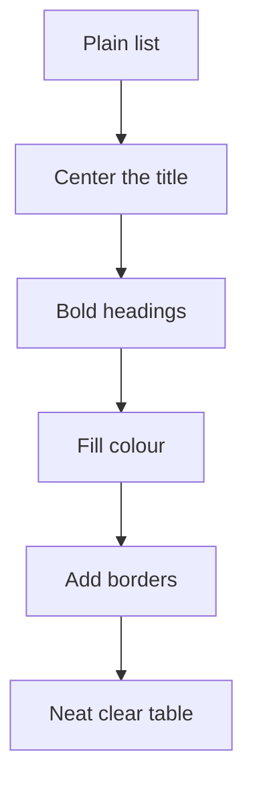

## Goal

By the end of this lesson, you can give a table a centred title, a bold coloured heading row and borders, so it is neat and clear.

## Why It Matters

A plain list of words and numbers is hard to read. A shop price list with a clear title, a bold
heading row and neat lines looks tidy. Customers and teachers can find what they need quickly.
A tidy table also looks good when you print it.

**Diagram in words:** Start with a plain list. Center the title, make the headings bold and
coloured, then add borders.

## Key Terms

| Term | Simple meaning |
|------|----------------|
| Format | To change how cells look, not what is in them. |
| Bold | Thick, dark letters. The keys are **Ctrl+B**. |
| Fill colour | A colour inside a cell, behind the text. |
| Border | A line you add around cells. Borders print on paper. |
| Gridlines | The light lines you see around every cell. They do not print unless you change a setting. |
| Alignment | Where the text sits in a cell: left, centre or right. |
| Merge & Center | A button that joins cells into one big cell and puts the text in the middle. |

## Teacher Demo

Open the **Shop List** workbook from [Lesson 7.3](./rows-and-columns.mdx). To select many cells,
click the first cell and drag to the last one. Formatting works much like in Word. See
[Lesson 4.5: Formatting Text](../module-04-ms-word/formatting-text.mdx).

**A title for the table**

1. Right-click the row number **1** and select **Insert**.
   *The class sees an empty row 1. The headings move to row 2.*
2. Click cell A1. Type **Hamza General Store** and press **Enter**.
3. Drag from A1 to C1 to select the three cells.
4. On the **Home** tab, select **Merge & Center**.
   *The class sees A1 to C1 become one cell, with the title in the middle.*
5. On the **Home** tab, in the **Font** group, select **Bold**. Then select **Font Size** and choose
   **16**. *The class sees a bigger, bold title.*

**The heading row**

6. Drag from A2 to C2 to select the headings. Press **Ctrl+B**.
   *The class sees the headings become bold.*
7. On the **Home** tab, in the **Font** group, select the arrow next to **Fill Color**. Under
   **Theme Colors** or **Standard Colors**, select a light colour.
   *The class sees the heading cells filled with colour.*
8. On the **Home** tab, in the **Alignment** group, select **Center**.
   *The class sees the headings in the middle of their cells.*

**Borders**

9. Say: "The light grey lines are gridlines. They do not print. Borders do."
10. Drag from A2 to the last price in column C.
11. On the **Home** tab, in the **Font** group, select the arrow next to **Borders**. Select
    **All Borders**. *The class sees a line around every cell in the table.*

    :::warning[UNVERIFIED]

    Microsoft confirms the **Borders** arrow and its list of border styles for Excel 2016/2019.
    The name **All Borders** is confirmed only for Excel for the web. Test it on a lab computer
    before teaching.

    :::

12. Press **Ctrl+S** to save.

:::info[Screenshot to add]

The finished Shop List: the merged, bold title, the coloured heading row and borders around every
cell.

:::

## Student Task

Use your **Shop List** workbook from Lesson 7.3.

1. Insert a new row 1 above your headings.
2. In A1, type a shop name, for example **Nadia Kiryana Store**.
3. Select A1 to C1. Select **Merge & Center**.
4. Make the title bold and size 16.
5. Select the headings in row 2. Make them bold, give them a light fill colour and center them.
6. Select the whole table, from A2 to the last price. Add **All Borders**.
7. Press **Ctrl+S** to save.
8. Show your teacher: your table with a centred title, a bold coloured heading row and borders
   around every cell.

## Check Questions

1. Show how you make the headings bold.
   **Answer:** Select the heading cells, then press Ctrl+B or select Bold on the Home tab.
2. What is the difference between gridlines and borders?
   **Answer:** Gridlines are the light lines around every cell, and they do not print. Borders are
   lines you add yourself, and they print.
3. You merge A1 to C1, but B1 also had some text in it. What happens to that text?
   **Answer:** It is deleted. Only the text in the top-left cell, A1, is kept.

## Common Mistakes

- **Formatting only one cell when you wanted the whole row** → Select all the cells first, then
  format them.
- **Typing parts of the title in B1 or C1 before merging** → Type the whole title in A1 only. Excel
  keeps only the top-left cell when it merges.
- **Choosing a dark fill colour, so the text is hard to read** → Choose a light colour. To remove a
  colour, select the arrow next to **Fill Color**, then **No Fill**.
- **Expecting the grey gridlines to print** → Add borders to the cells you want lines around.

## Sources

*For the teacher: these sources were checked before this lesson was written.*

- [Microsoft Support, "Merge and unmerge cells"](https://support.microsoft.com/en-us/office/merge-and-unmerge-cells-in-excel-5cbd15d5-9375-4540-907f-c673a93fcedf): applies to Excel 2016 and 2019; on the Home tab, select Merge & Center; to merge without centring, use the arrow next to it; only the upper-left cell's contents are kept, and the others are deleted.
- [Microsoft Support, "Change the format of a cell"](https://support.microsoft.com/en-us/office/change-the-format-of-a-cell-0a45ff85-ee24-4276-94e8-aed6083e8050): applies to Excel 2016 and 2019; in the Home tab Font area, select options such as Bold, Font Color or Font Size.
- [Microsoft Support, "Keyboard shortcuts in Excel"](https://support.microsoft.com/en-us/office/keyboard-shortcuts-in-excel-1798d9d5-842a-42b8-9c99-9b7213f0040f): applies to Excel 2016 and 2019; Ctrl+B applies bold; Ctrl+S saves.
- [Microsoft Support, "Apply or remove cell shading"](https://support.microsoft.com/en-us/excel/apply-or-remove-cell-shading-in-excel): applies to Excel 2016 and 2019; Home tab, Font group, arrow next to Fill Color, Theme Colors or Standard Colors; No Fill removes the colour.
- [Microsoft Support, "Align or rotate text in a cell"](https://support.microsoft.com/en-us/office/align-or-rotate-text-in-a-cell-8bf8177a-d2e8-4f5c-a707-d51625fd7758): applies to Excel 2016 and 2019; Home tab, Alignment group: Align Left, Center, Align Right.
- [Microsoft Support, "Apply or remove cell borders on a worksheet"](https://support.microsoft.com/en-us/excel/apply-or-remove-cell-borders-on-a-worksheet): applies to Excel 2016 and 2019; Home tab, Font group, arrow next to Borders, then a border style; cell borders appear on printed pages.
- [Microsoft Support, "Print gridlines in a worksheet"](https://support.microsoft.com/en-us/excel/print-gridlines-in-a-worksheet): the Borders > All Borders command (listed for Excel 2021 and newer, and Excel for the web only, so step 11 is UNVERIFIED).
- [Microsoft Support, "Show or hide gridlines on a worksheet"](https://support.microsoft.com/en-us/excel/show-or-hide-gridlines-on-a-worksheet): applies to Excel 2016 and 2019; gridlines and borders are different; gridlines do not print by default.
- [Microsoft Support, "Select cell contents in Excel"](https://support.microsoft.com/en-us/office/select-cell-contents-in-excel-23f64223-2b6b-453a-8688-248355f10fa9): applies to Excel 2016 and 2019; select a range by dragging over the cells with the left mouse button pressed.
