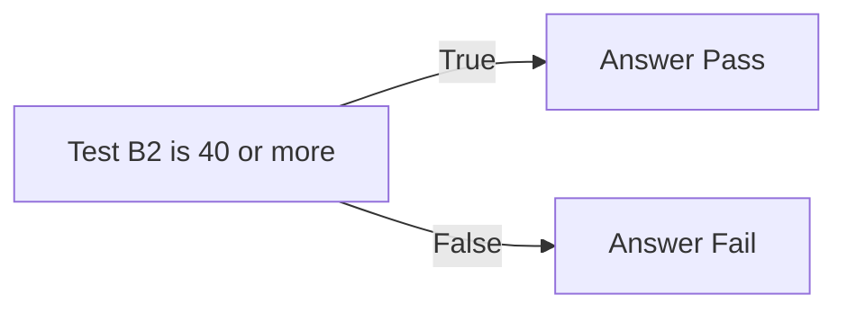

import PracticeFile from '@site/src/components/PracticeFile';

## Goal

By the end of this lesson, you can use IF to make Excel write one answer when a test is true and
another answer when it is false.

## Why It Matters

A school marks each student Pass or Fail. A shopkeeper needs to know which items to order again.
An office checks who has worked enough days for a bonus. Checking every row by eye takes time,
and you can miss one. IF makes the choice for every row, and it checks again when a
number changes.

**Diagram in words:** IF checks a test. If the test is true, it gives the first answer, Pass. If
the test is false, it gives the second answer, Fail.

## Key Terms

| Term | Simple meaning |
|------|----------------|
| IF | A function that makes a choice. It checks a test and gives one of two answers. |
| Test | A question with a yes or no answer, like "Is B2 40 or more?". In Excel you write it as `B2>=40`. |
| TRUE and FALSE | The two answers a test can give. TRUE means yes. FALSE means no. |
| Comparison sign | A sign that compares two values, like `>` for "greater than". |
| Argument | One piece of information you give a function. Arguments go inside the brackets, with commas between them. |
| Quotation marks | The `" "` signs. A text answer in a formula goes inside them, like `"Pass"`. |

An IF formula has three arguments: `=IF(test, answer if true, answer if false)`. Read it like a
sentence: "If the test is true, write this. Otherwise, write that." It is like a gatekeeper at a
school gate: "If you have a card, come in. Otherwise, go to the office."

These are the comparison signs you can use in a test:

| Sign | Meaning | Example | The example means |
|------|---------|---------|-------------------|
| `=` | Equal to | `B2=40` | B2 is exactly 40 |
| `>` | Greater than | `B2>40` | B2 is more than 40 |
| `<` | Less than | `B2<40` | B2 is less than 40 |
| `>=` | Greater than or equal to | `B2>=40` | B2 is 40 or more |
| `<=` | Less than or equal to | `B2<=40` | B2 is 40 or less |
| `<>` | Not equal to | `B2<>40` | B2 is anything except 40 |

## Step by Step

:::info[Practice files]

- <PracticeFile href="/files/excel/if-function/pass-fail-starter.xlsx">Download the starter file: Pass Fail</PracticeFile>.
  It has the students and their percentages already typed in, so that you can go straight to the
  formulas.
- <PracticeFile href="/files/excel/if-function/pass-fail-finished.xlsx">Download the finished file: Pass Fail</PracticeFile>.
  It has every formula in place. Open it after you finish, to compare with your work.

:::

A school needs a result for each student. The pass mark is 40%. Open a new blank workbook
([Lesson 7.1](starting-excel.mdx)). Type this table, but leave column C empty for now. The
table shows the formula and the correct results, so that you can check your work.

| Row | A | B | C |
|-----|---|---|---|
| 1 | Student | Percentage | Result |
| 2 | Ali | 72 | `=IF(B2>=40,"Pass","Fail")` gives Pass |
| 3 | Sana | 38 | Fail |
| 4 | Hamza | 40 | Pass |
| 5 | Fatima | 85 | Pass |
| 6 | Usman | 29 | Fail |
| 7 | Zainab | 56 | Pass |

**See a test on its own**

1. Select cell E2. Type `=B2>=40` and press **Enter**. This asks "Is B2 40 or more?".
   *E2 shows TRUE, because 72 is 40 or more.*
2. Select E2 and press **Delete** to clear it ([Lesson 7.2](entering-editing-saving-data.mdx)),
   so that the sheet stays tidy. A test alone only says TRUE or FALSE. IF turns that into words
   you choose.

**Write the IF formula**

3. Select C2. Type `=IF(B2>=40,"Pass","Fail")` and press **Enter**. *C2 shows Pass.*
4. Read the formula in three parts, split by the commas. The test is `B2>=40`. The answer if
   true is `"Pass"`. The answer if false is `"Fail"`. The words are in quotation marks because
   they are text.
5. Select C2 and drag the fill handle down to C7 ([Lesson 7.7](fill-handle.mdx)), so that every
   student gets a result. *C3 to C7 show Fail, Pass, Pass, Fail and Pass.*
6. Look at Hamza in row 4. His percentage is exactly 40. The sign `>=` means "40 or more", so
   40 counts. *C4 shows Pass.* With `>` alone, Hamza would get Fail.

**Watch IF check again**

7. Sana took a retest and scored 45. Select B3, type 45 and press **Enter**. *C3 changes to
   Pass.* You did not touch C3. IF checked the new number by itself.
8. Type 38 in B3 again and press **Enter**, so that your sheet matches the table.
   *C3 shows Fail again.*

{/* Screenshot to add: Cell C2 selected, with the formula bar showing =IF(B2>=40,"Pass","Fail") and column C showing Pass and Fail. */}

## Practice

:::info[Practice files]

- <PracticeFile href="/files/excel/if-function/shop-stock-starter.xlsx">Download the starter file: Shop Stock</PracticeFile>.
  It has the items and the stock already typed in. Use it if you want more time for the formulas.
- <PracticeFile href="/files/excel/if-function/shop-stock-finished.xlsx">Download the finished file: Shop Stock</PracticeFile>.
  It shows the end of the task, with Tea changed to 9. Open it after you finish.

:::

Imran has a small general store. When fewer than 10 of an item are left, he orders more from
the wholesale market. He wants Excel to show which items to order. Type this table. Leave
column C empty.

| Row | A | B | C |
|-----|---|---|---|
| 1 | Item | In stock | Status |
| 2 | Sugar (kg) | 25 | `=IF(B2<10,"Order more","OK")` gives OK |
| 3 | Cooking oil (bottles) | 6 | Order more |
| 4 | Tea (packs) | 12 | OK |
| 5 | Rice (kg) | 8 | Order more |
| 6 | Soap (bars) | 30 | OK |
| 7 | Matchboxes | 10 | OK |

1. Open a new blank workbook. Type the table, rows 1 to 7.
2. Select C2. Type `=IF(B2<10,"Order more","OK")` and press **Enter**. The test asks "Are fewer
   than 10 left?". Check: OK.
3. Select C2 and drag the fill handle down to C7. Check: Order more, OK, Order more, OK and OK.
4. Look at Matchboxes in row 7. 10 is not less than 10, so the answer is OK.
5. Imran sells three packs of tea. Select B4, type 9 and press **Enter**.
6. Look at C4. Check: it now shows Order more.
7. Save the workbook with the name **Shop Stock**
   ([Lesson 7.2](entering-editing-saving-data.mdx)), so that your work is kept.
8. Check your work: C2 to C7 show OK, Order more, Order more, Order more, OK and OK. Three items
   say Order more. With C5 selected, the formula bar shows `=IF(B5<10,"Order more","OK")`.

## Check Questions

1. B2 holds 40. What does `=IF(B2>=40,"Pass","Fail")` show?

   

   
Show answer

   **Answer:** Pass. The sign `>=` means "40 or more", and 40 counts.

   

2. In your Shop Stock sheet, select C3. Point to the test part of the formula in the formula bar.

   

   
Show answer

   **Answer:** `B3<10`. It is the part after `IF(` and before the first comma.

   

3. C2 holds Yes or No. Write an IF formula that shows Paid when C2 is Yes, and Unpaid
   otherwise.

   

   
Show answer

   **Answer:** `=IF(C2="Yes","Paid","Unpaid")`. The text Yes goes in quotation marks, like the
   two answers.

   

## Common Mistakes

- **Leaving out the quotation marks**, like `=IF(B2>=40,Pass,Fail)` → Excel shows `#NAME?`. Put
  every text answer in quotation marks: `"Pass"`.
- **Using `>` when the limit itself should pass** → A student with exactly 40 gets Fail. Use
  `>=` for "40 or more".
- **Swapping the two answers**, like `=IF(B2>=40,"Fail","Pass")` → Every result is the wrong
  way round. The answer for a true test always comes first.

## Sources

*These official pages were checked when this lesson was written.*

- [Microsoft Support, "IF function"](https://support.microsoft.com/en-us/office/if-function-69aed7c9-4e8a-4755-a9bc-aa8bbff73be2) (applies to Excel 2021): "Use the IF function, one of the logical functions, to return one value if a condition is true and another value if it's false"; syntax "IF(logical_test, value_if_true, [value_if_false])"; "logical_test (required) The condition you want to test"; example "=IF(C2=1,"Yes","No")"; "the IF function can be used to evaluate both text and values"; "If you are going to use text in formulas, you need to wrap the text in quotes"; example "=IF(C2="Yes",1,2)".
- [Microsoft Support, "Calculation operators and precedence in Excel"](https://support.microsoft.com/en-us/office/calculation-operators-and-precedence-in-excel-48be406d-4975-4d31-b2b8-7af9e0e2878a) (applies to Excel 2021): "When two values are compared by using these operators, the result is a logical value either TRUE or FALSE"; the comparison operators "`=` (equal sign) Equal to", "`>` (greater than sign) Greater than", "`<` (less than sign) Less than", "`>=` (greater than or equal to sign) Greater than or equal to", "`<=` (less than or equal to sign) Less than or equal to", "`<>` (not equal to sign) Not equal to".
- [Microsoft Support, "How to correct a #NAME? error"](https://support.microsoft.com/en-us/office/how-to-correct-a-name-error-b6d54e31-a743-4d7d-9b61-40002a7b4286) (applies to Excel 2021): "When you include text references in formulas, you need to enclose the text in quotation marks"; "If the syntax omits double quotation marks "" for a text value, you see the #NAME error."
- [Microsoft Support, "Fill a formula down into adjacent cells"](https://support.microsoft.com/en-us/office/fill-a-formula-down-into-adjacent-cells-041edfe2-05bc-40e6-b933-ef48c3f308c6) (applies to Excel 2021): "Select the cell that has the formula you want to fill into adjacent cells. Drag the fill handle"; references "adjust for each row".

All results were calculated and checked again before writing: 72, 40, 85 and 56 are 40 or more
(Pass); 38 and 29 are less than 40 (Fail); 45 is 40 or more (Pass). Stock: 6, 8 and 9 are less
than 10 (Order more); 25, 30 and 10 are not (OK).
