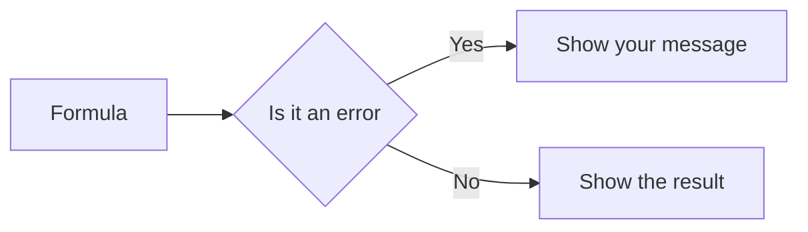

import PracticeFile from '@site/src/components/PracticeFile';

## Goal

By the end of this lesson, you can replace error values with a friendly message using IFERROR,
and round money and percentages with ROUND.

## Why It Matters

A shopkeeper works out the price of one biscuit pack from the carton price. If one carton is not
counted yet, the sheet shows `#DIV/0!`. A customer asks for an item that is not in the price
list, and the sheet shows `#N/A`. These codes look like a broken sheet. IFERROR shows a clear
message instead. ROUND turns 47.91667 rupees into 48 rupees, a price you can really charge.

**Diagram in words:** IFERROR first works out the formula. If the result is an error, you see
your own message. If not, you see the normal result.

## Key Terms

| Term | Simple meaning |
|------|----------------|
| Error value | A code that starts with `#`. Excel shows it when a formula cannot give an answer. |
| `#DIV/0!` | The error you see when a number is divided by zero or by an empty cell. |
| `#N/A` | The error you see when a formula cannot find what it was asked to look for. |
| `#VALUE!` | The error you see when something is wrong with the formula or with the cells it uses. Text in a sum is a common cause. |
| IFERROR | A function that shows your own message, or 0, when a formula gives an error. |
| ROUND | A function that rounds a number to the decimal places you choose. It changes the number itself. |
| Function inside a function | One function written inside another, like `=IFERROR(ROUND(B2/C2,0),"Count pieces")`. Excel works out the inside one first. |

Think of a shop assistant. When a customer asks for something the shop does not sell, a good
assistant says "Sorry, not in stock". IFERROR is that polite answer, instead of a strange code.

**Three errors you will meet**

| You see | What it means | Example |
|---------|---------------|---------|
| `#DIV/0!` | A number was divided by 0 or by an empty cell. | `=B4/C4` when C4 is empty |
| `#N/A` | A lookup could not find the value. | VLOOKUP looks for Sugar, but Sugar is not in the list |
| `#VALUE!` | The formula or its cells have a problem, such as text in a sum. | `=B2+C2` when C2 holds a word |

## Step by Step

:::info[Practice files]

- <PracticeFile href="/files/excel/iferror-and-round/shop-prices-starter.xlsx">Download the starter file: Shop Prices</PracticeFile>.
  It has both small tables already typed in, so that you can go straight to the formulas.
- <PracticeFile href="/files/excel/iferror-and-round/shop-prices-finished.xlsx">Download the finished file: Shop Prices</PracticeFile>.
  It has the final formulas in D2 to D6, B10 and B11. Open it after you finish, to compare.

:::

A general store buys goods by the carton. The owner wants the price of one piece. Open a new
blank workbook ([Lesson 7.1](starting-excel.mdx)). Type this table. Leave C4 empty, because the
soap bars are not counted yet. Leave column D and cells B10 and B11 empty.

| Row | A | B | C | D |
|-----|---|---|---|---|
| 1 | Item | Carton price (Rs) | Pieces | Price per piece (Rs) |
| 2 | Biscuit packs | 1150 | 24 | |
| 3 | Juice boxes | 1380 | 27 | |
| 4 | Soap bars | 2000 | *(empty)* | |
| 5 | Pencils | 1000 | 12 | |
| 6 | Notebooks | 1800 | 12 | |
| 9 | Item to find | Price per piece (Rs) | | |
| 10 | Notebooks | | | |
| 11 | Sugar | | | |

**See the first error: #DIV/0!**

1. Select D2. Type `=B2/C2` and press **Enter**. This divides the carton price by the number of
   pieces ([Lesson 7.6](first-formulas.mdx)). *D2 shows a long number that starts with 47.91.*
2. Drag the fill handle of D2 down to D6, so that every item gets the formula
   ([Lesson 7.7](fill-handle.mdx)). *D3 starts with 51.11. D4 shows `#DIV/0!`. D5 starts with
   83.33. D6 shows 150.*

D4 tries to divide 2000 by an empty cell. Excel shows `#DIV/0!` when a formula divides by zero or
by an empty cell.

**Round to whole rupees with ROUND**

`ROUND` needs two things: the number, and how many decimal places to keep. 0 means no decimal
places, so you get whole rupees.

3. Select D2. Type `=ROUND(B2/C2,0)` and press **Enter**. Shops charge whole rupees, so this
   gives a price you can use. *D2 shows 48.*
4. Fill D2 down to D6. *D3 shows 51, D5 shows 83 and D6 shows 150. D4 still shows `#DIV/0!`.*

**Show a message with IFERROR**

`IFERROR` also needs two things. First, the formula to try. Second, what to show if that formula
gives an error.

5. Select D2. Type `=IFERROR(ROUND(B2/C2,0),"Count pieces")` and press **Enter**. The ROUND
   formula from step 3 is now inside IFERROR. *D2 still shows 48, because it has no error.*
6. Fill D2 down to D6. *D4 now shows Count pieces. It tells the owner what to do.*

Put a message inside double quotation marks, like `"Count pieces"`. If you prefer a zero, write
0 without quotation marks: `=IFERROR(ROUND(B2/C2,0),0)`.

**Find a price, and meet #N/A**

A customer asks for an item. You look up its price with VLOOKUP
([Lesson 7.19](vlookup-and-xlookup.mdx)). The `$` signs keep the price list fixed when you copy
the formula ([Lesson 7.14](absolute-references.mdx)).

7. Select B10. Type `=VLOOKUP(A10,$A$2:$D$6,4,FALSE)` and press **Enter**. It finds Notebooks
   in column A and brings back the 4th column, the price per piece. *B10 shows 150.*
8. Fill B10 down to B11. *B11 shows `#N/A`, because Sugar is not in the list.*
9. Select B10. Type `=IFERROR(VLOOKUP(A10,$A$2:$D$6,4,FALSE),"Not in list")` and press
   **Enter**. Then fill it down to B11. *B10 shows 150. B11 shows Not in list.*

These are the correct results:

| Cell | Formula (row 2 or row 10) | Result |
|------|---------------------------|--------|
| D2 | `=IFERROR(ROUND(B2/C2,0),"Count pieces")` | 48 |
| D3 | same formula, filled down | 51 |
| D4 | same formula, filled down | Count pieces |
| D5 | same formula, filled down | 83 |
| D6 | same formula, filled down | 150 |
| B10 | `=IFERROR(VLOOKUP(A10,$A$2:$D$6,4,FALSE),"Not in list")` | 150 |
| B11 | same formula, filled down | Not in list |

**ROUND or a number format?**

In [Lesson 7.5](number-formats.mdx) you used **Decrease Decimal**. A number format changes only
how a number looks. Excel still uses the full number in calculations. ROUND changes the number
itself.

Here is why it matters. The biscuit price is 47.91667. With **Decrease Decimal**, it looks like
48. But 24 packs × 47.91667 is still 1150 rupees. With `ROUND`, the cell really holds 48. Then
24 packs × 48 is 1152 rupees. Use ROUND when the rounded number is the real price you charge.

{/* Screenshot to add: The Shop Prices sheet with D4 showing Count pieces and B11 showing Not in list, with the formula bar showing the IFERROR formula in D2. */}

## Practice

:::info[Practice files]

- <PracticeFile href="/files/excel/iferror-and-round/sales-target-starter.xlsx">Download the starter file: Sales Target</PracticeFile>.
  It has the names, targets and sales already typed in, with B5 empty. Use it if you want more time for the formulas.
- <PracticeFile href="/files/excel/iferror-and-round/sales-target-finished.xlsx">Download the finished file: Sales Target</PracticeFile>.
  It shows the end of the task, with Nida's target 50000 typed in B5. Open it after you finish.

:::

An office sells water filters. Each salesperson has a monthly sales target. The office wants to
see what percentage of the target each person reached. Nida joined this month, so she has no
target yet. Type this table. Leave B5 and column D empty.

| Row | A | B | C | D |
|-----|---|---|---|---|
| 1 | Salesperson | Target (Rs) | Sales (Rs) | % of target |
| 2 | Bilal | 150000 | 127500 | |
| 3 | Saba | 120000 | 131000 | |
| 4 | Imran | 90000 | 61250 | |
| 5 | Nida | *(empty)* | 15000 | |
| 6 | Faisal | 200000 | 172345 | |

1. Open a new blank workbook and type the table. Leave B5 empty.
2. Select D2. Type `=C2/B2*100` and press **Enter**. Sales divided by target, times 100, gives
   the percentage. Check: D2 shows 85.
3. Select D2 again. Type `=IFERROR(ROUND(C2/B2*100,2),"No target")` and press **Enter**.
   Percentages usually keep 2 decimal places, and the message covers a missing target.
4. Fill D2 down to D6. Check: D3 shows 109.17, D4 shows 68.06 and D6 shows 86.17.
5. Look at D5. It shows No target instead of `#DIV/0!`, because B5 is empty.
6. Nida's target is now set. Type 50000 in B5 and press **Enter**. Watch D5 change, because the
   formula updates by itself.
7. Save the workbook with the name **Sales Target**
   ([Lesson 7.2](entering-editing-saving-data.mdx)), so that your work is kept.
8. Check your work: D2 to D6 show 85, 109.17, 68.06, 30 and 86.17. When you select D2, the
   formula bar shows `=IFERROR(ROUND(C2/B2*100,2),"No target")`.

## Check Questions

1. A cell shows `#DIV/0!`. What does it mean, and how can you show "Count pieces" instead?

   

   
Show answer

   **Answer:** A number was divided by zero or by an empty cell. Put the formula inside
   IFERROR, like `=IFERROR(B4/C4,"Count pieces")`.

   

2. Type `=ROUND(47.9167,2)` in an empty cell and press **Enter**. What do you see? Then change the
   2 to 0. What do you see now?

   

   
Show answer

   **Answer:** First 47.92, because 2 keeps two decimal places. Then 48, because 0 rounds to a
   whole number.

   

3. You select **Decrease Decimal** on a cell holding 47.91667, and it shows 48. Does Excel now use
   48 in its calculations?

   

   
Show answer

   **Answer:** No. A number format changes only how the number looks. Excel still uses
   47.91667. To change the number itself, use ROUND.

   

## Common Mistakes

- **Using IFERROR before the formula works** → IFERROR hides every error, even a typing
  mistake. First check that the formula gives the right answer. Then add IFERROR.
- **Forgetting the quotation marks around the message**, like `"Count pieces"` → Type the
  message between double quotation marks. A zero needs no quotation marks.
- **Using a number format when you need the rounded value** → Decrease Decimal changes only the
  look. Use `=ROUND(…,0)` when the rounded number is the real price.
- **Forgetting the `$` signs in the VLOOKUP range** → When you fill down, the range moves and
  can miss an item. Write `$A$2:$D$6` ([Lesson 7.14](absolute-references.mdx)).

## Sources

*These official pages were checked when this lesson was written.*

- [Microsoft Support, "IFERROR function"](https://support.microsoft.com/en-us/office/iferror-function-c526fd07-caeb-47b8-8bb6-63f3e417f611) (applies to Excel 2021): "IFERROR returns a value you specify if a formula evaluates to an error; otherwise, it returns the result of the formula"; syntax `IFERROR(value, value_if_error)`; "The following error types are evaluated: #N/A, #VALUE!, #REF!, #DIV/0!, #NUM!, #NAME?, or #NULL!"; example `=IFERROR(A2/B2, "Error in calculation")`.
- [Microsoft Support, "ROUND function"](https://support.microsoft.com/en-us/office/round-function-c018c5d8-40fb-4053-90b1-b3e7f61a213c) (applies to Excel 2021): "The ROUND function rounds a number to a specified number of digits"; syntax `ROUND(number, num_digits)`; "If num_digits is greater than 0 (zero), then number is rounded to the specified number of decimal places"; "If num_digits is 0, the number is rounded to the nearest integer"; example `=ROUND(2.15, 1)` gives 2.2.
- [Microsoft Support, "How to correct a #DIV/0! error"](https://support.microsoft.com/en-us/office/how-to-correct-a-div-0-error-3a5a18a9-8d80-4ebb-a908-39e759a009a5) (applies to Excel 2021): "Microsoft Excel shows the #DIV/0! error when a number is divided by zero (0). It happens when you enter a simple formula like =5/0, or when a formula refers to a cell that has 0 or is blank"; "you can use =IFERROR(A2/A3,0)"; "both the IFERROR and IF(ISERROR()) methods are blanket error handlers, in that they will suppress all errors"; "You need to make sure your formula works properly before applying any error handling".
- [Microsoft Support, "How to correct a #N/A error"](https://support.microsoft.com/en-us/office/how-to-correct-a-n-a-error-a9708411-f82e-4e1b-8a7e-28c28311b993) (applies to Excel 2021): "The #N/A error generally indicates that a formula can't find what it's been asked to look for"; "there is no "Banana" listed in the lookup table, so VLOOKUP returns a #N/A error"; "use an error handler such as IFERROR in the formula. For example, =IFERROR(FORMULA(),0)"; "substitute your own text: =IFERROR(FORMULA(),"Error Message here")".
- [Microsoft Support, "How to correct a #VALUE! error"](https://support.microsoft.com/en-us/office/how-to-correct-a-value-error-15e1b616-fbf2-4147-9c0b-0a11a20e409e) (applies to Excel 2021): "#VALUE is Excel's way of saying, "There's something wrong with the way your formula is typed. Or, there's something wrong with the cells you are referencing.""; "Text or special characters within a cell can cause the #VALUE! error"; "Formulas with math operations like + and * might not be able to calculate cells that contain text or spaces."
- [Microsoft Support, "VLOOKUP function"](https://support.microsoft.com/en-us/office/vlookup-function-0bbc8083-26fe-4963-8ab8-93a18ad188a1) (applies to Excel 2021): syntax `VLOOKUP (lookup_value, table_array, col_index_num, [range_lookup])`; "Exact match - 0/FALSE searches for the exact value in the first column"; "If range_lookup is FALSE, the #N/A error value indicates that the exact number isn't found."
- [Microsoft Support, "Round a number to the decimal places I want"](https://support.microsoft.com/en-us/office/round-a-number-to-the-decimal-places-i-want-49b936f9-6904-425d-aa98-02ffb7f9a17b) (applies to Excel 2021): "Go to Home > Number and select Increase Decimal or Decrease Decimal to show more or fewer digits after the decimal point"; "Round a number to the number of digits you want by using the ROUND function"; "Type =ROUND(A1,0) which equals 824"; "Type =ROUND(A1,2) which equals 823.78".
- [Microsoft Support, "Stop showing rounded numbers"](https://support.microsoft.com/en-us/excel/stop-showing-rounded-numbers) (applies to Excel 2021): a number can appear rounded "when the format is set to show a smaller number of decimal places than the actual number contains"; "the entire number is still visible in the formula bar at the top of the worksheet and used in calculations."
- [Microsoft Support, "Switch between relative, absolute, and mixed references"](https://support.microsoft.com/en-us/office/switch-between-relative-absolute-and-mixed-references-dfec08cd-ae65-4f56-839e-5f0d8d0baca9) (applies to Excel 2021): "When you copy a formula that contains a relative cell reference, that reference in the formula will change"; with dollar signs, "the formula stays exactly the same."

All results were calculated and checked again before writing: 1150 ÷ 24 = 47.9167 → 48;
1380 ÷ 27 = 51.1111 → 51; 1000 ÷ 12 = 83.3333 → 83; 1800 ÷ 12 = 150; 24 × 48 = 1152.
Sales: 127500 ÷ 150000 × 100 = 85; 131000 ÷ 120000 × 100 = 109.1667 → 109.17;
61250 ÷ 90000 × 100 = 68.0556 → 68.06; 15000 ÷ 50000 × 100 = 30;
172345 ÷ 200000 × 100 = 86.1725 → 86.17.
