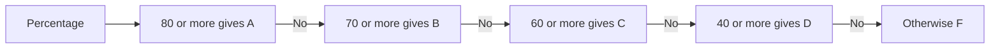
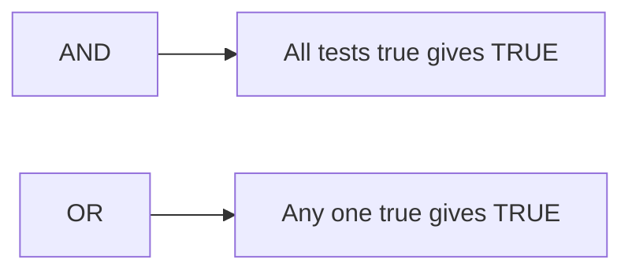

import PracticeFile from '@site/src/components/PracticeFile';

## Goal

By the end of this lesson, you can give grades with IFS, and check several tests at once with AND
and OR inside IF.

## Why It Matters

A result card gives each student a grade: A, B, C, D or F. That is more than two answers, so one
IF is not enough. A student passes only if every subject is passed. A tuition centre calls home
if a child missed any day of lessons. IFS, AND and OR let Excel make these choices for every row.

**Diagram in words:** IFS checks the tests in order, from the top grade down. It stops at the
first test that is true. If no test is true, the student gets F.

## Key Terms

| Term | Simple meaning |
|------|----------------|
| IFS | A function that checks several tests in order. It gives the answer of the first test that is true. |
| Grade band | A range of marks that gets one grade, like 70 to 79 for B. |
| Default answer | The last answer in IFS. It is used when no other test is true. You write it after the word TRUE. |
| AND | A function that gives TRUE only when **all** its tests are true. It is like a recipe: you need every ingredient. |
| OR | A function that gives TRUE when **any one** of its tests is true. It is like a shop that takes cash or a card: either one is enough. |

You learned IF, tests, TRUE and FALSE in [Lesson 7.15](if-function.mdx). This lesson builds on
them.

These grade bands are made up for practice. Your school or board may use different ones.

| Percentage | Grade |
|------------|-------|
| 80 and above | A |
| 70 to 79 | B |
| 60 to 69 | C |
| 40 to 59 | D |
| Below 40 | F |

**Diagram in words:** AND needs every test to be true. OR needs only one test to be true.

## Step by Step

:::info[Practice files]

- <PracticeFile href="/files/excel/ifs-and-or/subject-marks-starter.xlsx">Download the starter file: Subject Marks</PracticeFile>.
  It has the students and their marks already typed in, so that you can go straight to the
  formulas.
- <PracticeFile href="/files/excel/ifs-and-or/subject-marks-finished.xlsx">Download the finished file: Subject Marks</PracticeFile>.
  It has every formula in place. Open it after you finish, to compare with your work.

:::

A school needs a percentage, a grade and a pass or fail result for each student. Each subject is
out of 100. To pass, a student needs 40 or more in **every** subject. Open a new blank workbook
([Lesson 7.1](starting-excel.mdx)). Type columns A to D of this table. Leave columns E, F and G
empty. The table shows the correct results, so that you can check your work.

| Row | A | B | C | D | E | F | G |
|-----|---|---|---|---|---|---|---|
| 1 | Student | Maths | English | Urdu | Percentage | Grade | All subjects |
| 2 | Ali | 85 | 78 | 92 | 85 | A | Pass |
| 3 | Sana | 66 | 74 | 70 | 70 | B | Pass |
| 4 | Hamza | 35 | 70 | 81 | 62 | C | Fail |
| 5 | Fatima | 55 | 48 | 41 | 48 | D | Pass |
| 6 | Usman | 30 | 42 | 36 | 36 | F | Fail |
| 7 | Zainab | 90 | 62 | 79 | 77 | B | Pass |

**Percentage with AVERAGE**

1. Select E2. Type `=AVERAGE(B2:D2)` and press **Enter**
   ([Lesson 7.8](sum-and-average.mdx)). Each subject is out of 100, so the average of the three
   is the percentage. *E2 shows 85.*
2. Select E2 and drag the fill handle down to E7 ([Lesson 7.7](fill-handle.mdx)).
   *E3 to E7 show 70, 62, 48, 36 and 77.*

**Grades with IFS**

3. Select F2. Type `=IFS(E2>=80,"A",E2>=70,"B",E2>=60,"C",E2>=40,"D",TRUE,"F")` and press
   **Enter**. *F2 shows A.*
4. Read the formula in pairs: a test, then its answer. `E2>=80,"A"` means "if 80 or more,
   write A". The next pair is for B, and so on.
5. Drag the fill handle from F2 down to F7. *F3 to F7 show B, C, D, F and B.*
6. Look at Sana in row 3. Her 70 is also 40 or more, but she gets B, not D. IFS checks the tests
   from left to right and stops at the first true one. That is why the top grade comes first.
7. Look at the end of the formula: `TRUE,"F"`. TRUE is a test that is always true. So when no
   other test is true, the student gets F. Without it, Usman's cell would show `#N/A`.

**Pass in every subject with AND**

8. Select G2. Type `=IF(AND(B2>=40,C2>=40,D2>=40),"Pass","Fail")` and press **Enter**.
   *G2 shows Pass.*
9. AND checks all three marks. It gives TRUE only when every mark is 40 or more. IF then writes
   Pass for TRUE and Fail for FALSE. Notice the bracket after the last test: it closes AND.
   The two answers belong to IF.
10. Drag the fill handle from G2 down to G7. *G3 to G7 show Pass, Fail, Pass, Fail and Pass.*
11. Look at Hamza in row 4. His percentage is 62, a C grade. But he has 35 in Maths, so he gets
    Fail. One weak subject is enough to fail, and AND catches it.

{/* Screenshot to add: Cell F2 selected, with the formula bar showing the IFS formula and columns E to G filled in. */}

## Practice

:::info[Practice files]

- <PracticeFile href="/files/excel/ifs-and-or/tuition-attendance-starter.xlsx">Download the starter file: Tuition Attendance</PracticeFile>.
  It has the attendance and test marks already typed in. Use it if you want more time for the
  formulas.
- <PracticeFile href="/files/excel/ifs-and-or/tuition-attendance-finished.xlsx">Download the finished file: Tuition Attendance</PracticeFile>.
  It has every formula in place. Open it after you finish.

:::

Rukhsana runs a small tuition centre. Lessons are on Monday, Wednesday and Friday. P means
present and A means absent. She wants to know who missed any day this week. She also gives a
certificate to each child with no absence **and** 40 or more out of 50 in the weekly test.

| Row | A | B | C | D | E | F | G |
|-----|---|---|---|---|---|---|---|
| 1 | Student | Mon | Wed | Fri | Any absence? | Test (out of 50) | Certificate |
| 2 | Bilal | P | P | P | No | 45 | Yes |
| 3 | Mahnoor | P | A | P | Yes | 48 | No |
| 4 | Danish | P | P | P | No | 32 | No |
| 5 | Iqra | A | P | A | Yes | 41 | No |
| 6 | Faisal | P | P | P | No | 40 | Yes |
| 7 | Hira | P | P | A | Yes | 47 | No |

1. Open a new blank workbook. Type columns A to D and column F. Leave columns E and G empty.
   Type P and A as capital letters.
2. Select E2. Type `=IF(OR(B2="A",C2="A",D2="A"),"Yes","No")` and press **Enter**. OR gives
   TRUE if any one day is A. The letter A is text, so it goes in quotation marks. Check: No.
3. Drag the fill handle from E2 down to E7. Check: Yes, No, Yes, No and Yes.
4. Select G2. Type `=IF(AND(E2="No",F2>=40),"Yes","No")` and press **Enter**. Both tests must
   be true: no absence, and 40 or more in the test. Check: Yes.
5. Drag the fill handle from G2 down to G7. Check: No, No, No, Yes and No.
6. Look at Danish and Mahnoor. Danish came every day but scored 32. Mahnoor scored 48 but missed
   Wednesday. Neither gets a certificate, because AND needs both tests to be true.
7. Save the workbook with the name **Tuition Attendance**
   ([Lesson 7.2](entering-editing-saving-data.mdx)), so that your work is kept.
8. Check your work: E2 to E7 show No, Yes, No, Yes, No and Yes. G2 to G7 show Yes, No, No, No,
   Yes and No. Only Bilal and Faisal get a certificate.

## Check Questions

1. A student has 65%. Which grade does the IFS formula from Step by Step give?

   

   
Show answer

   **Answer:** C. 65 is not 80 or more, and not 70 or more. It is 60 or more, so IFS stops there
   and gives C.

   

2. In your Subject Marks sheet, select G4. Point to the part of the formula that makes Hamza
   fail.

   

   
Show answer

   **Answer:** `B4>=40`, the first test inside AND. Hamza's Maths mark is 35, so this test is
   FALSE. AND then gives FALSE, and IF writes Fail.

   

3. B2 holds P and C2 holds A. What does `=OR(B2="A",C2="A")` show? What would AND show with the
   same two tests?

   

   
Show answer

   **Answer:** OR shows TRUE, because one test is true. AND would show FALSE, because not every
   test is true.

   

## Common Mistakes

- **Putting the tests in the wrong order**, like `=IFS(E2>=40,"D",E2>=80,"A", …)` → Everyone
  with 40 or more gets D, because IFS stops at the first true test. Start with the highest band.
- **Leaving out `TRUE,"F"` at the end of IFS** → Students below 40 get `#N/A`. Add `TRUE,"F"`
  as the last pair.
- **Using AND when you mean "any"** → With AND in the attendance formula, only a child absent
  on all three days gets Yes. Use OR when one true test is enough.
- **Closing the AND bracket in the wrong place** → Close AND right after its last test, then add
  the two answers for IF: `=IF(AND(B2>=40,C2>=40,D2>=40),"Pass","Fail")`.

## Sources

*These official pages were checked when this lesson was written.*

- [Microsoft Support, "IFS function"](https://support.microsoft.com/en-us/office/ifs-function-36329a26-37b2-467c-972b-4a39bd951d45) (applies to Excel 2021): "The IFS function checks whether one or more conditions are met, and returns a value that corresponds to the first TRUE condition"; syntax "IFS(logical_test1, value_if_true1, [logical_test2, value_if_true2], [logical_test3, value_if_true3],…)"; example "=IFS(A2>89,"A",A2>79,"B",A2>69,"C",A2>59,"D",TRUE,"F")"; "multiple conditions need to be entered in the correct order"; "To specify a default result, enter TRUE for your final logical_test argument. If none of the other conditions are met, the corresponding value will be returned"; "If no TRUE conditions are found, this function returns #N/A error."
- [Microsoft Support, "AND function"](https://support.microsoft.com/en-us/office/and-function-5f19b2e8-e1df-4408-897a-ce285a19e9d9) (applies to Excel 2021): "The AND function returns TRUE if all its arguments evaluate to TRUE, and returns FALSE if one or more arguments evaluate to FALSE"; syntax "AND (logical1, [logical2], ...)"; "By using the AND function as the logical_test argument of the IF function, you can test many different conditions."
- [Microsoft Support, "OR function"](https://support.microsoft.com/en-us/office/or-function-7d17ad14-8700-4281-b308-00b131e22af0) (applies to Excel 2021): "The OR function returns TRUE if any of its arguments evaluate to TRUE, and returns FALSE if all of its arguments evaluate to FALSE"; syntax "OR (logical1, [logical2], ...)".
- [Microsoft Support, "Using IF with AND, OR and NOT functions in Excel"](https://support.microsoft.com/en-us/office/using-if-with-and-or-and-not-functions-in-excel-d895f58c-b36c-419e-b1f2-5c193a236d97) (applies to Excel 2021): "IF(AND(logical1, [logical2], ...), value_if_true, [value_if_false]))"; "IF(OR(logical1, [logical2], ...), value_if_true, [value_if_false]))"; example "=IF(OR(A5="Red",B5="Green"),TRUE,FALSE)"; "all of the examples have a closing parenthesis after their respective conditions are entered. The remaining True/False arguments are then left as part of the outer IF statement. You can also substitute Text or Numeric values for the TRUE/FALSE values to be returned."
- [Microsoft Support, "AVERAGE function"](https://support.microsoft.com/en-us/office/average-function-047bac88-d466-426c-a32b-8f33eb960cf6) (applies to Excel 2021): "Returns the average (arithmetic mean) of the arguments."

All results were calculated and checked again before writing: Ali (85 + 78 + 92) ÷ 3 = 85;
Sana 210 ÷ 3 = 70; Hamza 186 ÷ 3 = 62; Fatima 144 ÷ 3 = 48; Usman 108 ÷ 3 = 36; Zainab
231 ÷ 3 = 77. Grades A, B, C, D, F, B. Below 40 in any subject: Hamza (Maths 35) and Usman
(Maths 30, Urdu 36). Absent on any day: Mahnoor, Iqra and Hira. No absence and 40 or more:
Bilal (45) and Faisal (40).
