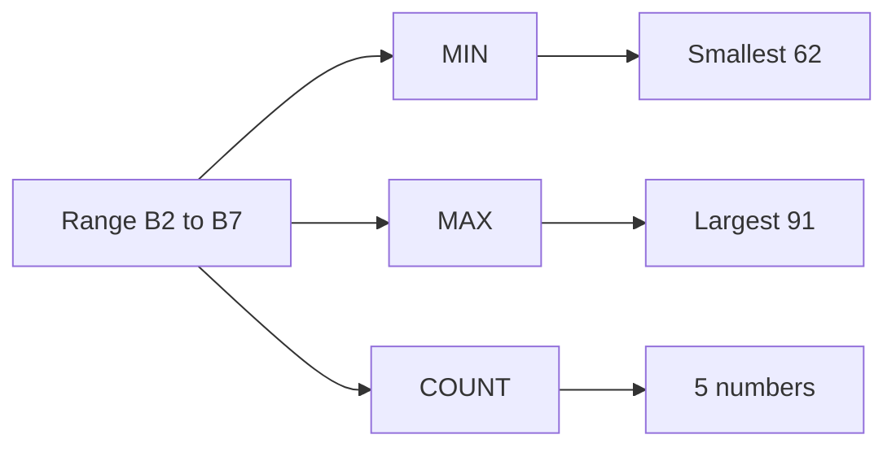

## Goal

By the end of this lesson, you can use MIN, MAX and COUNT to find the smallest, the largest and
how many numbers.

## Why It Matters

A school wants the highest and lowest marks in a test. A mobile shop wants its cheapest and
most expensive phone. A cricket team wants to know how many players scored runs. MIN, MAX and
COUNT answer these questions in one short formula. They work the same way for 5 numbers or 500.

**Diagram in words:** The same range goes into three functions. MIN gives the smallest mark,
62. MAX gives the largest, 91. COUNT gives 5, because only five cells hold numbers.

## Key Terms

| Term | Simple meaning |
|------|----------------|
| MIN | A function that gives the smallest number in a range. Think "minimum", like the lowest price on a list. |
| MAX | A function that gives the largest number in a range. Think "maximum", like the highest price on a list. |
| COUNT | A function that counts how many cells in a range hold numbers. It does not count words. |
| Text | Words in a cell, like "Absent". Excel does not calculate with text. |

You learned what a function and a range are in [Lesson 7.8](sum-and-average.mdx).

COUNT is like counting the paid boxes in a fee register. A box with a number is counted. A box
with a word, like "Absent", is skipped.

## Step by Step

You will check the results of a short test. Open a new blank workbook
([Lesson 7.1](starting-excel.mdx)). Type these test marks. Hamza was absent, so type the word
Absent in B4. Leave B8, B9 and B10 empty.

| Row | A | B |
|-----|---|---|
| 1 | Student | Marks |
| 2 | Ali | 78 |
| 3 | Sana | 85 |
| 4 | Hamza | Absent |
| 5 | Fatima | 91 |
| 6 | Usman | 62 |
| 7 | Zainab | 70 |
| 8 | Lowest | `=MIN(B2:B7)` gives 62 |
| 9 | Highest | `=MAX(B2:B7)` gives 91 |
| 10 | Students with marks | `=COUNT(B2:B7)` gives 5 |

**Find the lowest and highest marks**

These show the weakest and the best result at once.

1. Select cell B8. Type `=MIN(B2:B7)` and press **Enter**. *B8 shows 62.*

MIN found the smallest mark. It did not look at the word Absent.

2. Select cell B9. Type `=MAX(B2:B7)` and press **Enter**. *B9 shows 91.*

**Count the students who have marks**

This tells you how many students took the test.

3. Select cell B10. Type `=COUNT(B2:B7)` and press **Enter**. *B10 shows 5.*
4. Look at rows 2 to 7. There are six students, but COUNT gives 5.

COUNT counts only cells with numbers. Absent is a word, so COUNT skips it.

**See the answers change**

5. Select cell B4. Type 50 and press **Enter**. This gives Hamza a mark, so that you can see
   the formulas update. *B8 changes to 50. B10 changes to 6.*

{/* Screenshot to add: The marks list with B8, B9 and B10 showing 62, 91 and 5. */}

## Practice

A street cricket team keeps a score sheet after each match. Type the runs below. Rehan did not
bat, so type the words Did not bat for him. Type 0 for Danish, because he batted and scored no
runs.

| Row | A | B |
|-----|---|---|
| 1 | Player | Runs |
| 2 | Bilal | 45 |
| 3 | Kashif | 12 |
| 4 | Danish | 0 |
| 5 | Imran | 67 |
| 6 | Rehan | Did not bat |
| 7 | Asad | 23 |
| 8 | Faisal | 38 |
| 9 | Lowest | `=MIN(B2:B8)` gives 0 |
| 10 | Highest | `=MAX(B2:B8)` gives 67 |
| 11 | Players who batted | `=COUNT(B2:B8)` gives 6 |

1. Open a new blank workbook and type the table, rows 1 to 8.
2. Type the labels in A9, A10 and A11, so that each answer has a name.
3. In B9, type `=MIN(B2:B8)` and press **Enter**. This finds the lowest score.
4. In B10, type `=MAX(B2:B8)` and press **Enter**. This finds the top score.
5. In B11, type `=COUNT(B2:B8)` and press **Enter**. This counts the players who batted.
6. Think about why COUNT gives 6 and not 7. Rehan's cell holds words, not a number.
7. Save the workbook with the name **Cricket Runs**
   ([Lesson 7.2](entering-editing-saving-data.mdx)), so that your work is not lost.
8. Check your work: B9 shows 0, B10 shows 67 and B11 shows 6. Danish's 0 is counted, because 0
   is a number.

## Check Questions

1. Which function gives the highest mark in a test?

   

   
Show answer

   **Answer:** MAX, for example `=MAX(B2:B7)`.

   

2. A range holds 40, Absent, 55 and 0. What does COUNT give?

   

   
Show answer

   **Answer:** 3. COUNT counts the numbers 40, 55 and 0. It does not count the word Absent.

   

3. In your cricket sheet, select the cell that shows the lowest score. Point to its formula.

   

   
Show answer

   **Answer:** Cell B9. The formula bar shows `=MIN(B2:B8)`.

   

## Common Mistakes

- **Expecting COUNT to count names or words** → COUNT counts only cells with numbers. Count
  students by their marks, not by their names.
- **Mixing up MIN and MAX** → MIN is the smallest (minimum). MAX is the largest (maximum).
- **Leaving a cell empty instead of typing 0** → MIN, MAX and COUNT skip empty cells. If someone
  scored nothing, type 0.

## Sources

*These official pages were checked when this lesson was written.*

- [Microsoft Support, "MIN function"](https://support.microsoft.com/en-us/excel/functions/min-function) (applies to Excel 2021): "Returns the smallest number in a set of values"; "Empty cells, logical values, or text in the array or reference are ignored."
- [Microsoft Support, "MAX function"](https://support.microsoft.com/en-us/excel/functions/max-function) (applies to Excel 2021): "Returns the largest value in a set of values"; "Empty cells, logical values, or text in the array or reference are ignored."
- [Microsoft Support, "COUNT function"](https://support.microsoft.com/en-us/excel/functions/count-function) (applies to Excel 2021): "The COUNT function counts the number of cells that contain numbers"; "Empty cells, logical values, text, or error values in the array or reference are not counted."
- [Microsoft Support, "Calculate the smallest or largest number in a range"](https://support.microsoft.com/en-us/office/calculate-the-smallest-or-largest-number-in-a-range-in-excel-45fe249f-96c3-443b-8e9f-87f16c48462c) (applies to Excel 2021): examples `=MIN(A2:A7)` and `=MAX(A2:A7)`.

All results were calculated and checked again before writing. Marks 78, 85, 91, 62, 70: smallest
62, largest 91, five numbers. With 50 in B4: smallest 50, six numbers. Runs 45, 12, 0, 67, 23,
38: smallest 0, largest 67, six numbers.
