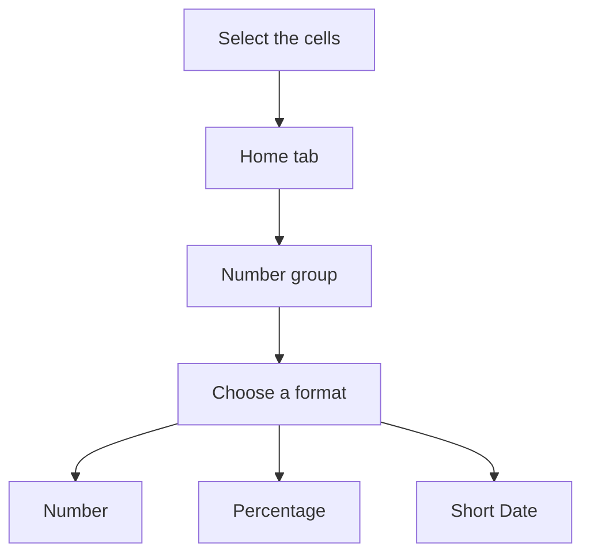

## Goal

By the end of this lesson, you can make numbers in Excel show as money, percentages and dates.

## Why It Matters

A shopkeeper writes prices, discounts and dates every day. In Excel, a number format changes
how a number looks. The number itself stays the same. Clear formats help your family, your
teacher or your customer read your sheet quickly.

**Diagram in words:** Select the cells, then go to the Number group on the Home tab. Choose the
format you need, for example Number, Percentage or Short Date.

## Key Terms

| Term | Simple meaning |
|------|----------------|
| Number format | How a number looks in a cell, for example 160.00 or 5%. The number itself does not change. |
| Decimal places | The digits after the dot in a number. 160.00 has 2 decimal places. |
| Percentage | A part of 100, shown with the % sign. The number 0.05 shows as 5%. |
| Short Date | A date format that shows a date with numbers only. |
| Long Date | A date format that shows the name of the month in words. |
| Currency | A number format for money. It adds the computer's money sign to the number. |
| Format Cells box | A window where you choose a number format and its settings. |
| Dialog box launcher | A small button next to a group name on the ribbon. It opens a box with more choices. |

The ribbon is the strip of tabs and buttons at the top of the window. You met it in
[Lesson 4.1](../module-04-ms-word/starting-word.mdx).

## Teacher Demo

**Money in this book:** Excel has a **Currency** format. It shows the computer's default money
sign. On a lab computer, this sign may not be Rs. So in this book, we use the **Number** format.
We write "Rs" in the column heading, like **Price (Rs)**.

Open a new blank workbook ([Lesson 7.1](starting-excel.mdx)). Type this table, starting in cell
A1 ([Lesson 7.2](entering-editing-saving-data.mdx)). Make the columns wider if you need to
([Lesson 7.3](rows-and-columns.mdx)).

| Row | A | B | C | D |
|-----|---|---|---|---|
| 1 | Item | Price (Rs) | Discount | Date sold |
| 2 | Sugar 1 kg | 160 | 0.05 | 15/3/2025 |
| 3 | Rice 1 kg | 350 | 0.1 | 18/3/2025 |
| 4 | Cooking oil 1 litre | 560 | 0.02 | 20/3/2025 |
| 5 | Tea 250 g | 420 | 0.15 | 22/3/2025 |
| 6 | Flour 5 kg | 650 | 0.2 | 25/3/2025 |

:::warning[UNVERIFIED]

Excel reads a typed date using the computer's date setting. This could not be confirmed in
official documentation for Excel 2016/2019. Teacher: before class, type 15/3/2025 on a lab
computer and apply **Long Date** (step 13). If the cell shows March, use day/month/year. If it
does not change, type the dates as month/day/year instead (3/15/2025).

:::

**Prices with decimal places**

1. Drag from cell B2 down to B6. *The five prices are selected.*
2. Select the **Home** tab.
3. In the **Number** group, select the dialog box launcher next to **Number**. *The **Format
   Cells** box opens.*
4. In the **Category** list, select **Number**.
5. In the **Decimal places** box, type 2. Select **OK**. *The prices show as 160.00, 350.00,
   560.00, 420.00 and 650.00.*
6. Select cell B2 and look at the formula bar. *The formula bar shows 160. The real number did
   not change.*
7. Select B2 to B6 again. Select **Decrease Decimal** two times. *The prices show as 160, 350,
   560, 420 and 650.*

**Discount as a percentage**

8. Select cells C2 to C6.
9. On the **Home** tab, in the **Number** group, select **Percent Style**. *The discounts show
   as 5%, 10%, 2%, 15% and 20%.*
10. Say: "Excel multiplies the number by 100 and adds the % sign."

**Dates**

11. Select cells D2 to D6.
12. In the **Number** group, open the **Number Format** list and select **Short Date**. *The
    dates show with numbers only.*
13. Open the **Number Format** list again and select **Long Date**. *The dates show the month
    name. If a cell shows `#####`, the column is too narrow.*
14. Make column D wider. *The full dates show.*
15. Select **Short Date** again for D2 to D6.

:::info[Screenshot to add]

The Number group on the Home tab, with the Number Format list open and Short Date showing.

:::

## Student Task

Type this table of a family's monthly expenses. Start in cell A1.

| Row | A | B | C | D |
|-----|---|---|---|---|
| 1 | Expense | Amount (Rs) | Share of budget | Date paid |
| 2 | House rent | 20000 | 0.4 | 15/4/2025 |
| 3 | Groceries | 15000 | 0.3 | 18/4/2025 |
| 4 | Electricity | 6000 | 0.12 | 20/4/2025 |
| 5 | Gas | 2500 | 0.05 | 22/4/2025 |
| 6 | School fees | 6500 | 0.13 | 25/4/2025 |

1. Open a new blank workbook and type the table. Use the date order your teacher tells you.
2. Select B2 to B6. Open the **Format Cells** box with the dialog box launcher next to
   **Number**.
3. Select **Number** in the **Category** list. Type 2 in **Decimal places**. Select **OK**.
   Check: B2 shows 20000.00.
4. Select cell B2 and read the formula bar. Check: it shows 20000.
5. Select C2 to C6 and select **Percent Style**. Check: you see 40%, 30%, 12%, 5% and 13%.
6. Select D2 to D6. In the **Number Format** list, select **Short Date**.
7. Save the workbook with the name **Household Formats** ([Lesson 7.2](entering-editing-saving-data.mdx)).
8. Show your teacher: the amounts with 2 decimal places, the shares as percentages, and the
   short dates.

## Check Questions

1. Point to the button that turns 0.05 into 5%.
   **Answer:** **Percent Style**, in the **Number** group on the **Home** tab.
2. A cell shows 160.00. What does the formula bar show when you select it?
   **Answer:** 160. A number format changes only how the number looks.
3. Why do we write "Rs" in the column heading?
   **Answer:** The **Currency** format uses the computer's money sign, and it may not be Rs. The
   heading tells the reader that the numbers are rupees.

## Common Mistakes

- **Typing 5 and then selecting Percent Style** → Excel multiplies by 100 and shows 500%. Type
  0.05 instead, then select **Percent Style**.
- **A cell shows `#####`** → The column is too narrow. Make the column wider
  ([Lesson 7.3](rows-and-columns.mdx)).
- **Thinking the format changed the number** → Select the cell and look at the formula bar. It
  shows the real number.
- **Typing the day and month in the wrong order** → Ask your teacher which order your lab
  computer uses.

## Sources

*For the teacher: these sources were checked before this lesson was written.*

- [Microsoft Support, "Available number formats in Excel"](https://support.microsoft.com/en-us/office/available-number-formats-in-excel-0afe8f52-97db-41f1-b972-4b46e9f1e8d2) (applies to Excel 2016 and 2019): the Number Format list on the Home tab; the dialog box launcher in the Number group; the Number, Currency, Percentage, Short Date and Long Date formats; Currency shows the default currency symbol; Percentage multiplies by 100; a format changes only how a number looks, and the formula bar shows the actual value.
- [Microsoft Support, "Format numbers as currency"](https://support.microsoft.com/en-us/office/format-numbers-as-currency-0a03bb38-1a07-458d-9e30-2b54366bc7a4) (applies to Excel 2016 and 2019): the Format Cells box, the Category list, the Decimal places box and OK.
- [Microsoft Support, "Format numbers as percentages"](https://support.microsoft.com/en-us/office/format-numbers-as-percentages-de49167b-d603-4450-bcaa-31fba6c7b6b4) (applies to Excel 2016 and 2019): the Percent Style button in the Number group on the Home tab; a number already in a cell is multiplied by 100 (10 becomes 1000%), and 0.1 shows as 10%.
- [Microsoft Support, "Round a number to the decimal places I want"](https://support.microsoft.com/en-us/office/round-a-number-to-the-decimal-places-i-want-49b936f9-6904-425d-aa98-02ffb7f9a17b) (applies to Excel 2016 and 2019): Home, Number group, Decrease Decimal shows fewer digits after the decimal point.
- [Microsoft Support, "How to correct a ##### error"](https://support.microsoft.com/en-us/office/how-to-correct-a-error-bf801d0a-2a6e-44bd-a70e-0f780ae8f11e) (applies to Excel 2016 and 2019): `#####` means the column is not wide enough; Short Date in the Number Format list.
- [Microsoft Support, "Format a date the way you want"](https://support.microsoft.com/en-us/office/format-a-date-the-way-you-want-8e10019e-d5d8-47a1-ba95-db95123d273e) (lists Excel 2021 and newer only, so the date-order step is marked UNVERIFIED): Excel reads typed dates using the date setting in Control Panel.
