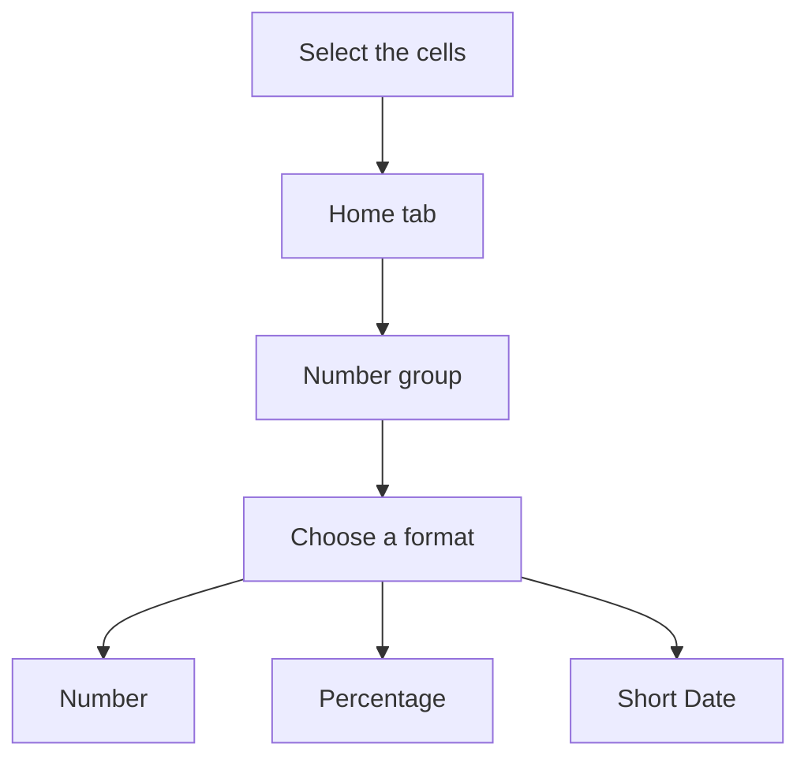

## Goal

By the end of this lesson, you can make numbers in Excel show as money, percentages and dates.

## Why It Matters

A shopkeeper writes prices, discounts and dates every day. A family writes its monthly budget:
rent, bills and the date each one was paid. In Excel, a number format changes how a number
looks. The number itself stays the same. Clear formats help your family or your customers read
your sheet quickly.

**Diagram in words:** Select the cells, then go to the Number group on the Home tab. Choose the
format you need, for example Number, Percentage or Short Date.

## Key Terms

| Term | Simple meaning |
|------|----------------|
| Number format | How a number looks in a cell, for example 160.00 or 5%. The number itself does not change. It is like the same person in different clothes. |
| Decimal places | The digits after the dot in a number. 160.00 has 2 decimal places. |
| Percentage | A part of 100, shown with the % sign. The number 0.05 shows as 5%. |
| Short Date | A date format that shows a date with numbers only. |
| Long Date | A date format that shows the name of the month in words. |
| Currency | A number format for money. It adds the computer's money sign to the number. |
| Format Cells box | A window where you choose a number format and its settings. |
| Dialog box launcher | A small button next to a group name on the ribbon. It opens a box with more choices. |

The ribbon is the strip of tabs and buttons at the top of the window. You met it in
[Lesson 4.1](../module-04-ms-word/starting-word.mdx).

## Step by Step

**Money in this book:** Excel has a **Currency** format. It shows the computer's default money
sign. On your computer, this sign may not be Rs. So in this book, we use the **Number** format.
We write "Rs" in the column heading, like **Price (Rs)**.

Follow these steps on your own computer. You will tidy up a shop's sales list. Open a new blank
workbook ([Lesson 7.1](starting-excel.mdx)). Type this table, starting in cell A1
([Lesson 7.2](entering-editing-saving-data.mdx)). Make the columns wider if you need to
([Lesson 7.3](rows-and-columns.mdx)).

| Row | A | B | C | D |
|-----|---|---|---|---|
| 1 | Item | Price (Rs) | Discount | Date sold |
| 2 | Sugar 1 kg | 160 | 0.05 | 15/3/2025 |
| 3 | Rice 1 kg | 350 | 0.1 | 18/3/2025 |
| 4 | Cooking oil 1 litre | 560 | 0.02 | 20/3/2025 |
| 5 | Tea 250 g | 420 | 0.15 | 22/3/2025 |
| 6 | Flour 5 kg | 650 | 0.2 | 25/3/2025 |

**Typing dates:** Your computer has a setting for the order of the day and the month. So check
where 15/3/2025 sits after you press **Enter**. A real date moves to the right of its cell. If it
stays on the left, type the month first, like 3/15/2025.

**Prices with decimal places**

1. Drag from cell B2 down to B6, so that the format goes on all the prices at once.
   *The five prices are selected.*
2. Select the **Home** tab.
3. In the **Number** group, select the dialog box launcher next to **Number**. This opens more
   choices. *The **Format Cells** box opens.*
4. In the **Category** list, select **Number**.
5. In the **Decimal places** box, type 2. Select **OK**. Many bills show money this way.
   *The prices show as 160.00, 350.00, 560.00, 420.00 and 650.00.*
6. Select cell B2 and look at the formula bar, so that you can see the real number.
   *The formula bar shows 160. The real number did not change.*
7. Select B2 to B6 again. In the **Number** group, select **Decrease Decimal** until the decimal
   places are gone. Whole rupees look cleaner in a small shop list.
   *The prices show as 160, 350, 560, 420 and 650.*

**Discount as a percentage**

A buyer understands "5% off" better than 0.05.

8. Select cells C2 to C6.
9. On the **Home** tab, in the **Number** group, select **Percent Style**. *The discounts show
   as 5%, 10%, 2%, 15% and 20%.*
10. Excel multiplies the number by 100 and adds the % sign. That is why you type 0.05 for 5%.

**Dates**

11. Select cells D2 to D6.
12. In the **Number** group, open the **Number Format** list and select **Short Date**. Use this
    when you want a short, plain date. *The dates show with numbers only.*
13. Open the **Number Format** list again and select **Long Date**. This shows the month name in
    words. *The dates show the month name. If a cell shows `#####`, the column is too narrow.*
14. Make column D wider, so that the full date fits. *The full dates show.*
15. Select **Short Date** again for D2 to D6, so that the table stays small and neat.

{/* Screenshot to add: The Number group on the Home tab, with the Number Format list open and Short Date showing. */}

## Practice

A family wants to see its monthly budget clearly. Type this table of the family's expenses.
Start in cell A1.

| Row | A | B | C | D |
|-----|---|---|---|---|
| 1 | Expense | Amount (Rs) | Share of budget | Date paid |
| 2 | House rent | 20000 | 0.4 | 15/4/2025 |
| 3 | Groceries | 15000 | 0.3 | 18/4/2025 |
| 4 | Electricity | 6000 | 0.12 | 20/4/2025 |
| 5 | Gas | 2500 | 0.05 | 22/4/2025 |
| 6 | School fees | 6500 | 0.13 | 25/4/2025 |

1. Open a new blank workbook and type the table. Type the dates in the same order that worked
   in Step by Step.
2. Select B2 to B6. Open the **Format Cells** box with the dialog box launcher next to
   **Number**.
3. Select **Number** in the **Category** list. Type 2 in **Decimal places**. Select **OK**.
   Check: B2 shows 20000.00.
4. Select cell B2 and read the formula bar. Check: it shows 20000.
5. Select C2 to C6 and select **Percent Style**, so that each share shows as a part of 100.
   Check: you see 40%, 30%, 12%, 5% and 13%.
6. Select D2 to D6. In the **Number Format** list, select **Short Date**.
7. Save the workbook with the name **Household Formats** ([Lesson 7.2](entering-editing-saving-data.mdx)),
   so that your work is kept.
8. Check your work: B2 to B6 show 20000.00, 15000.00, 6000.00, 2500.00 and 6500.00. C2 to C6
   show 40%, 30%, 12%, 5% and 13%. D2 to D6 show dates with numbers only.

## Check Questions

1. Point to the button that turns 0.05 into 5%.

   

   
Show answer

   **Answer:** **Percent Style**, in the **Number** group on the **Home** tab.

   

2. A cell shows 160.00. What does the formula bar show when you select it?

   

   
Show answer

   **Answer:** 160. A number format changes only how the number looks.

   

3. Why do we write "Rs" in the column heading?

   

   
Show answer

   **Answer:** The **Currency** format uses the computer's money sign, and it may not be Rs. The
   heading tells the reader that the numbers are rupees.

   

## Common Mistakes

- **Typing 5 and then selecting Percent Style** → Excel multiplies by 100 and shows 500%. Type
  0.05 instead, then select **Percent Style**.
- **A cell shows `#####`** → The column is too narrow. Make the column wider
  ([Lesson 7.3](rows-and-columns.mdx)).
- **Thinking the format changed the number** → Select the cell and look at the formula bar. It
  shows the real number.
- **Typing the day and month in the wrong order** → A real date moves to the right of its cell.
  If your date stays on the left, type the month first, like 4/15/2025.

## Sources

*These official pages were checked when this lesson was written.*

- [Microsoft Support, "Available number formats in Excel"](https://support.microsoft.com/en-us/office/available-number-formats-in-excel-0afe8f52-97db-41f1-b972-4b46e9f1e8d2) (applies to Excel 2021): "select the Dialog Box Launcher next to Number on the Home tab in the Number group"; Currency "displays the default currency symbol with numbers"; Percentage "Multiplies the cell value by 100 and displays the result with a percent (%) symbol"; "You can see the actual value in the formula bar."
- [Microsoft Support, "Format numbers as currency"](https://support.microsoft.com/en-us/office/format-numbers-as-currency-0a03bb38-1a07-458d-9e30-2b54366bc7a4) (applies to Excel 2021): "On the Home tab, select the Number Format launcher next to Number"; "In the Format Cells dialog box, in the Category list"; "In the Decimal places box, enter the number of decimal places that you want."
- [Microsoft Support, "Format numbers as percentages"](https://support.microsoft.com/en-us/office/format-numbers-as-percentages-de49167b-d603-4450-bcaa-31fba6c7b6b4) (applies to Excel 2021): "click Percent Style in the Number group on the Home tab, or press Ctrl+Shift+%"; "if a cell contains the number 10, Excel multiplies that number by 100"; "If you then format 0.1 as a percentage, the number will be correctly displayed as 10%"; "On Windows: In the Number group, select the button next to Number to display the Format Cells window."
- [Microsoft Support, "Round a number to the decimal places I want"](https://support.microsoft.com/en-us/office/round-a-number-to-the-decimal-places-i-want-49b936f9-6904-425d-aa98-02ffb7f9a17b) (applies to Excel 2021): "Go to Home > Number and select Increase Decimal or Decrease Decimal to show more or fewer digits after the decimal point."
- [Microsoft Support, "Stop showing rounded numbers"](https://support.microsoft.com/en-us/excel/stop-showing-rounded-numbers) (applies to Excel 2021): "the entire number is still visible in the formula bar at the top of the worksheet and used in calculations."
- [Microsoft Support, "How to correct a ##### error"](https://support.microsoft.com/en-us/office/how-to-correct-a-error-bf801d0a-2a6e-44bd-a70e-0f780ae8f11e) (applies to Excel 2021): ##### shows "when a column isn't wide enough to show all of the cell contents"; "select the Number Format arrow, and pick Short Date."
- [Microsoft Support, "Format a date the way you want"](https://support.microsoft.com/en-us/office/format-a-date-the-way-you-want-8e10019e-d5d8-47a1-ba95-db95123d273e) (applies to Excel 2021): "Select the Number Format dropdown, then select Short Date. For a longer date like Saturday, February 02, 2026, pick Long Date instead"; Excel formats a typed date "according to the default date setting in Control Panel" (the note on typing dates).
- [Microsoft Support, "Format numbers as dates or times"](https://support.microsoft.com/en-us/office/format-numbers-as-dates-or-times-418bd3fe-0577-47c8-8caa-b4d30c528309) (applies to Excel 2021): "This default format is based on the regional date and time settings that are specified in Control Panel."
- [Microsoft Support, "Convert dates stored as text to dates"](https://support.microsoft.com/en-us/office/convert-dates-stored-as-text-to-dates-8df7663e-98e6-4295-96e4-32a67ec0a680) (applies to Excel 2021): "Dates that are formatted as text are left-aligned in a cell (instead of right-aligned)." This is the check in the note on typing dates.
