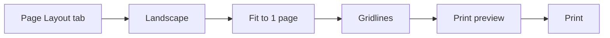

## Goal

By the end of this lesson, you can set up a worksheet in landscape, fit it on one page, preview it and print it.

## Why It Matters

A shop owner prints a price list for the counter. A teacher prints a result sheet for the notice board. A sheet that is cut across two pages is hard to read. Page setup makes the printed page neat, and print preview saves paper.

**Diagram in words:** Use the Page Layout tab to choose Landscape, fit the sheet on 1 page and turn on gridlines. Check the print preview, and print only when it looks right.

## Key Terms

| Term | Simple meaning |
|------|----------------|
| Page setup | Settings that decide how your sheet looks on paper. |
| Orientation | The way the page stands. Portrait is tall. Landscape is wide. |
| Fit to 1 page | Excel makes the sheet smaller so it prints on one page. |
| Print preview | A picture of how your page will look on paper, before you print. |
| Gridlines | The faint lines between cells on the screen. Excel does not print them unless you ask. |
| Page Layout tab | A tab on the ribbon with the page setup buttons. |

## Teacher Demo

You printed in Word in Lesson 4.11. Printing in Excel is similar. Before class, type the table from the Student Task into a new workbook. Add the Total formulas.

:::note[Before class]

Microsoft says the **Orientation** button is dimmed when no printer is set up on the computer. Check one lab computer before class. If **Orientation** is dimmed, ask the lab in-charge to set up a printer in Windows.

:::

**Look at the print preview**

1. Select **File**, then **Print**. *The class sees the print preview: a picture of the page.*
2. Point to the preview. Say: "Look. The faint lines between the cells are not on the page."
3. Select the arrow at the top-left of the screen. *The class is back on the worksheet.*

**Change the orientation**

4. Select the **Page Layout** tab.
5. In the **Page Setup** group, select **Orientation**, then **Landscape**. *The page is now wide.*

**Fit the sheet on one page**

6. In the **Scale to Fit** group, open the **Width** list and select **1 page**.
7. Open the **Height** list and select **1 page**.
8. Say: "Excel makes the sheet smaller to fit. A big sheet may become too small to read."

**Print the gridlines**

9. In the **Sheet Options** group, under **Gridlines**, select the **Print** check box. *A tick appears in the box.*

**Preview and print**

10. Press **Ctrl+F2**. *The print preview opens. The page is wide, and the gridlines show.*
11. If the lab has a printer, select **Print**. *The printer prints the page.*
12. If there is no printer, do not select **Print**. Select the arrow at the top-left to go back.

:::info[Screenshot to add]

The Page Layout tab, with Orientation, the Scale to Fit Width and Height lists, and the Gridlines Print check box marked.

:::

## Student Task

Open a new blank workbook. Type this table of weekly home expenses in rupees, starting in cell A1.

| | A | B | C | D | E | F |
|---|---|---|---|---|---|---|
| **1** | Item | Week 1 | Week 2 | Week 3 | Week 4 | Total |
| **2** | Groceries | 4500 | 3800 | 5200 | 4100 | |
| **3** | Milk | 1400 | 1400 | 1400 | 1400 | |
| **4** | Vegetables | 1200 | 950 | 1300 | 1100 | |
| **5** | Fruit | 800 | 600 | 900 | 700 | |
| **6** | Transport | 1500 | 1500 | 1800 | 1500 | |
| **7** | Mobile balance | 500 | 300 | 400 | 300 | |

1. Type the table above. Leave the Total column empty for now.
2. In cell F2, type `=SUM(B2:E2)` and press **Enter** (see [Lesson 7.8](sum-and-average.mdx)). Check: F2 shows 17600.
3. Copy the formula down to F7 with the fill handle (see [Lesson 7.7](fill-handle.mdx)). Check the totals: Milk 5600, Vegetables 4550, Fruit 3000, Transport 6300, Mobile balance 1500.
4. Select **File**, then **Print**. Look at the preview. Then select the arrow at the top-left to go back.
5. On the **Page Layout** tab, in the **Page Setup** group, select **Orientation**, then **Landscape**.
6. In the **Scale to Fit** group, set **Width** to **1 page** and **Height** to **1 page**.
7. In the **Sheet Options** group, under **Gridlines**, select the **Print** check box.
8. Press **Ctrl+F2** to see the print preview again. Check: the page is wide, it has gridlines, and everything is on one page.
9. Print only if your teacher says so. If not, go back to the worksheet without printing.
10. Save the workbook with the name **Weekly Expenses** (see [Lesson 7.2](entering-editing-saving-data.mdx)).
11. Show your teacher: your print preview in landscape, on one page, with gridlines.

## Check Questions

1. Show how you open the print preview.
   **Answer:** Select **File**, then **Print**. Or press **Ctrl+F2**.
2. Where do you change the page from portrait to landscape?
   **Answer:** **Page Layout** tab, **Page Setup** group, **Orientation**, then **Landscape**.
3. Point to the place where you turn on printing of gridlines.
   **Answer:** **Page Layout** tab, **Sheet Options** group, under **Gridlines**: the **Print** check box. Excel does not print gridlines unless you select it.

## Common Mistakes

- **Printing without looking at the preview first** → Always check the preview. It saves paper.
- **Fitting a very big sheet on one page** → The text may become too small to read. Check the preview. If it is too small, choose **Automatic** in the **Height** list.
- **The Orientation button is dimmed** → Press **Enter** or **Esc** if you are still typing in a cell. If it is still dimmed, no printer is set up; tell your teacher.
- **Expecting the faint lines between cells on paper** → Select the **Print** check box under **Gridlines**, or add borders (see [Lesson 7.4](formatting-cells.mdx)).

## Sources

*For the teacher: these sources were checked before this lesson was written.*

- [Microsoft Support, "Print an Excel worksheet in landscape or portrait orientation"](https://support.microsoft.com/en-gb/office/print-an-excel-worksheet-in-landscape-or-portrait-orientation-1af561b2-5444-4fc1-b24d-9e4d05b9ebf1): applies to Excel 2016 and 2019. **Page Layout** tab, **Page Setup** group, **Orientation**, **Portrait** or **Landscape**. Orientation is dimmed when no printer is set up, or while you are editing a cell (press Enter or Esc).
- [Microsoft Support, "Scale a worksheet"](https://support.microsoft.com/en-us/office/scale-a-worksheet-34a91eb5-8b4e-4a8a-ab28-b6492012eaae): applies to Excel 2016 and 2019. **Scale to Fit** group, **Width** and **Height** lists, **1 page**, **Automatic**; the printout may be hard to read because Excel shrinks the data.
- [Microsoft Support, "Show or hide gridlines on a worksheet"](https://support.microsoft.com/en-us/office/show-or-hide-gridlines-on-a-worksheet-3ef5aacb-4539-4ad5-9945-5ed53772dc4d): applies to Excel 2016 and 2019. Gridlines are the faint lines between cells; they do not print by default; **Page Layout** > **Sheet Options** > **Gridlines**, then the **Print** check box.
- [Microsoft Support, "Page Setup"](https://support.microsoft.com/en-us/excel/page-setup): applies to Excel 2016 and 2019. Gridlines are not printed by default, even when they show on the worksheet.
- [Microsoft Support, "Preview worksheet pages before you print"](https://support.microsoft.com/en-us/office/preview-worksheet-pages-before-you-print-bcd8f03a-c28d-42a2-9217-aab0e43aa930): applies to Excel 2016 and 2019. **File**, then **Print** shows the preview; **Ctrl+F2**; the arrow in the upper-left leaves the preview.
- [Microsoft Support, "Print a worksheet or workbook"](https://support.microsoft.com/en-us/office/print-a-worksheet-or-workbook-f4ad7962-b1d5-4eb9-a24f-0907f36c4b94): applies to Excel 2016 and 2019. **File**, **Print** (or Ctrl+P), choose settings, then select the **Print** button.
- [Microsoft Support, "SUM function"](https://support.microsoft.com/en-us/office/sum-function-043e1c7d-7726-4e80-8f32-07b23e057f89): applies to Excel 2016 and 2019. SUM adds values, for example `=SUM(A2:A10)`.
