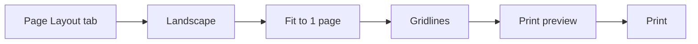

import PracticeFile from '@site/src/components/PracticeFile';

## Goal

By the end of this lesson, you can set up a worksheet in landscape, fit it on one page, preview it and print it.

## Why It Matters

A shop owner prints a price list for the counter. A school prints a result sheet for the notice board. A tuition centre prints its monthly fee record. A sheet that is cut across two pages is hard to read. Page setup makes the printed page neat, and print preview saves paper.

**Diagram in words:** Use the Page Layout tab to choose Landscape, fit the sheet on 1 page and turn on gridlines. Check the print preview, and print only when it looks right.

## Key Terms

| Term | Simple meaning |
|------|----------------|
| Page setup | Settings that decide how your sheet looks on paper. |
| Orientation | The way the page stands. Portrait is tall, like a notebook page. Landscape is wide, like the page turned on its side. |
| Fit to 1 page | Excel makes the sheet smaller so it prints on one page. |
| Print preview | A picture of how your page will look on paper, before you print. |
| Gridlines | The faint lines between cells on the screen. Excel does not print them unless you ask. |
| Page Layout tab | A tab on the ribbon with the page setup buttons. |

Print preview is like looking in the mirror before you leave home. You fix problems first, so that you do not waste paper.

## Step by Step

:::info[Practice files]

- <PracticeFile href="/files/excel/page-setup-and-printing/weekly-expenses-starter.xlsx">Download the starter file: Weekly Expenses</PracticeFile>.
  It has the expenses already typed in, with the Total column empty. Use it to start at step 1.
- <PracticeFile href="/files/excel/page-setup-and-printing/weekly-expenses-finished.xlsx">Download the finished file: Weekly Expenses</PracticeFile>.
  It has the totals and the page setup: Landscape, 1 page wide and tall, gridlines printed. Open it after you finish, to compare with your work.

:::

You printed in Word in Lesson 4.11. Printing in Excel is similar. Here you get a family's weekly expenses ready to print.

Open a new blank workbook. Type this table of weekly home expenses in rupees, starting in cell A1. Leave the Total column empty for now.

| | A | B | C | D | E | F |
|---|---|---|---|---|---|---|
| **1** | Item | Week 1 | Week 2 | Week 3 | Week 4 | Total |
| **2** | Groceries | 4500 | 3800 | 5200 | 4100 | |
| **3** | Milk | 1400 | 1400 | 1400 | 1400 | |
| **4** | Vegetables | 1200 | 950 | 1300 | 1100 | |
| **5** | Fruit | 800 | 600 | 900 | 700 | |
| **6** | Transport | 1500 | 1500 | 1800 | 1500 | |
| **7** | Mobile balance | 500 | 300 | 400 | 300 | |

**Add the totals**

The totals show what each item costs in a month.

1. In cell F2, type `=SUM(B2:E2)` and press **Enter** (see [Lesson 7.8](sum-and-average.mdx)). *F2 shows 17600.*
2. Copy the formula down to F7 with the fill handle (see [Lesson 7.7](fill-handle.mdx)). This saves typing five formulas. *The totals are: Milk 5600, Vegetables 4550, Fruit 3000, Transport 6300, Mobile balance 1500.*

**Look at the print preview**

Look first, so that you know what needs fixing.

3. Select **File**, then **Print**. *You see the print preview: a picture of the page.*
4. Look at the preview. The faint lines between the cells are not on the page.
5. Select the arrow at the top-left of the screen. *You are back on the worksheet.*

**Change the orientation**

A wide page gives a wide table more room.

6. Select the **Page Layout** tab.
7. In the **Page Setup** group, select **Orientation**, then **Landscape**. *The page is now wide.*

:::note[If Orientation is grey]

If you are still typing in a cell, press **Enter** or **Esc** first. If **Orientation** is still grey (dimmed), the computer has no printer set up. Ask for help to set up a printer in Windows.

:::

**Fit the sheet on one page**

This stops the table from being cut across two pages.

8. In the **Scale to Fit** group, open the **Width** list and select **1 page**.
9. Open the **Height** list and select **1 page**.

Excel makes the sheet smaller to fit. A big sheet may become too small to read.

**Print the gridlines**

Gridlines on paper help your eye follow each row.

10. In the **Sheet Options** group, under **Gridlines**, select the **Print** check box. *A tick appears in the box.*

**Preview and print**

11. Press **Ctrl+F2**, so that you can check the page again. *The print preview opens. The page is wide, and the gridlines show.*
12. If your computer has a printer, select **Print**. *The printer prints the page.*
13. If there is no printer, do not select **Print**. Select the arrow at the top-left to go back.
14. Save the workbook with the name **Weekly Expenses** (see [Lesson 7.2](entering-editing-saving-data.mdx)), so that your work is not lost.

{/* Screenshot to add: The Page Layout tab, with Orientation, the Scale to Fit Width and Height lists, and the Gridlines Print check box marked. */}

## Practice

:::info[Practice files]

- <PracticeFile href="/files/excel/page-setup-and-printing/tuition-fees-starter.xlsx">Download the starter file: Tuition Fees</PracticeFile>.
  It has the fee record already typed in, with the Total column empty. Use it if you want more time for page setup.
- <PracticeFile href="/files/excel/page-setup-and-printing/tuition-fees-finished.xlsx">Download the finished file: Tuition Fees</PracticeFile>.
  It has the totals and the same page setup. Open it after you finish, and check the print preview with **Ctrl+F2**.

:::

Mrs Rabia runs a home tuition centre. She wants to print her fee record for six months on one neat page. Open a new blank workbook. Type this table in rupees, starting in cell A1. A 0 means no fee was paid that month. Leave the Total column empty for now.

| | A | B | C | D | E | F | G | H |
|---|---|---|---|---|---|---|---|---|
| **1** | Student | Jan | Feb | Mar | Apr | May | Jun | Total |
| **2** | Ahmed | 2000 | 2000 | 2000 | 2000 | 2000 | 2000 | |
| **3** | Hira | 2500 | 2500 | 0 | 2500 | 2500 | 2500 | |
| **4** | Zeeshan | 1500 | 1500 | 1500 | 1500 | 1500 | 1500 | |
| **5** | Nimra | 3000 | 3000 | 3000 | 3000 | 0 | 3000 | |
| **6** | Faraz | 2000 | 2000 | 2000 | 2500 | 2500 | 2500 | |

1. Type the table above. Check every number, so that the totals are correct.
2. In cell H2, type `=SUM(B2:G2)` and press **Enter**. This adds Ahmed's six months.
3. Copy the formula down to H6 with the fill handle, so that every student gets a total.
4. Select **File**, then **Print**. Look at the preview. Then select the arrow at the top-left to go back.
5. On the **Page Layout** tab, in the **Page Setup** group, select **Orientation**, then **Landscape**. The wide page gives the eight columns more room.
6. In the **Scale to Fit** group, set **Width** to **1 page** and **Height** to **1 page**, so that nothing is cut off.
7. In the **Sheet Options** group, under **Gridlines**, select the **Print** check box, so that your eye can follow each row on paper.
8. Press **Ctrl+F2** to see the print preview again.
9. Print only if a printer is set up and you need a paper copy. If not, select the arrow at the top-left to go back without printing.
10. Save the workbook with the name **Tuition Fees** (see [Lesson 7.2](entering-editing-saving-data.mdx)), so that your work is not lost.
11. Check your work: the totals in H2 to H6 are 12000, 12500, 9000, 15000 and 13500. The preview shows one wide page with gridlines, and all columns from A to H.

## Check Questions

1. Show on your screen how you open the print preview.

   

   
Show answer

   **Answer:** Select **File**, then **Print**. Or press **Ctrl+F2**.

   

2. Where do you change the page from portrait to landscape?

   

   
Show answer

   **Answer:** **Page Layout** tab, **Page Setup** group, **Orientation**, then **Landscape**.

   

3. Point to the place where you turn on printing of gridlines.

   

   
Show answer

   **Answer:** **Page Layout** tab, **Sheet Options** group, under **Gridlines**: the **Print** check box. Excel does not print gridlines unless you select it.

   

## Common Mistakes

- **Printing without looking at the preview first** → Always check the preview. It saves paper.
- **Fitting a very big sheet on one page** → The text may become too small to read. Check the preview. If it is too small, choose **Automatic** in the **Height** list.
- **The Orientation button is grey (dimmed)** → Press **Enter** or **Esc** if you are still typing in a cell. If it is still grey, the computer has no printer set up. Ask for help to set one up.
- **Expecting the faint lines between cells on paper** → Select the **Print** check box under **Gridlines**, or add borders (see [Lesson 7.4](formatting-cells.mdx)).

## Sources

*These official pages were checked when this lesson was written.*

- [Microsoft Support, "Print an Excel worksheet in landscape or portrait orientation"](https://support.microsoft.com/en-gb/office/print-an-excel-worksheet-in-landscape-or-portrait-orientation-1af561b2-5444-4fc1-b24d-9e4d05b9ebf1) (applies to Excel 2021): "On the Page Layout tab, in the Page Setup group, select Orientation, and then select Portrait or Landscape." "If you don't have a printer set up, the Orientation option will appear dimmed"; "The option also appears dimmed when you're editing the contents of a cell. To resolve this, press Enter to accept the changes or Esc to cancel the changes."
- [Microsoft Support, "Scale a worksheet"](https://support.microsoft.com/en-us/office/scale-a-worksheet-34a91eb5-8b4e-4a8a-ab28-b6492012eaae) (applies to Excel 2021): "In the Scale to Fit group, in the Width dropdown list, select 1 page, and in the Height dropdown list, select Automatic"; "To print your worksheet on a single page, select 1 page in the Height box"; "the printout may be difficult to read because Excel shrinks the data to fit."
- [Microsoft Support, "Show or hide gridlines on a worksheet"](https://support.microsoft.com/en-us/office/show-or-hide-gridlines-on-a-worksheet-3ef5aacb-4539-4ad5-9945-5ed53772dc4d) (applies to Excel 2021): "Gridlines are the faint lines that appear between cells on a worksheet." "Gridlines do not print by default. For gridlines to appear on the printed page, select Page Layout > Sheet Options > Gridlines, and then select the Print check box."
- [Microsoft Support, "Page Setup"](https://support.microsoft.com/en-us/excel/page-setup) (applies to Excel 2021): "Gridlines are not printed by default, regardless of whether they are displayed on the worksheet or not."
- [Microsoft Support, "Preview worksheet pages before you print"](https://support.microsoft.com/en-us/office/preview-worksheet-pages-before-you-print-bcd8f03a-c28d-42a2-9217-aab0e43aa930) (applies to Excel 2021): "Click File, and then click Print to display the Preview window and printing options"; "You can also press Ctrl+F2"; "To exit Print Preview and return to your workbook, click any the arrow in the upper-left of the Print Preview window."
- [Microsoft Support, "Print a worksheet or workbook"](https://support.microsoft.com/en-us/office/print-a-worksheet-or-workbook-f4ad7962-b1d5-4eb9-a24f-0907f36c4b94) (applies to Excel 2021): "Select File > Print, or press CTRL+P"; "Optionally adjust Settings, then select the Print button."
- [Microsoft Support, "SUM function"](https://support.microsoft.com/en-us/office/sum-function-043e1c7d-7726-4e80-8f32-07b23e057f89) (applies to Excel 2021): "The SUM function adds values"; example `=SUM(A2:A10)`.

All results were calculated and checked again before writing. Weekly expenses: Groceries 4500 + 3800 + 5200 + 4100 = 17600; Milk 5600; Vegetables 4550; Fruit 3000; Transport 6300; Mobile balance 1500. Tuition fees: Ahmed 12000, Hira 12500, Zeeshan 9000, Nimra 15000, Faraz 13500.
