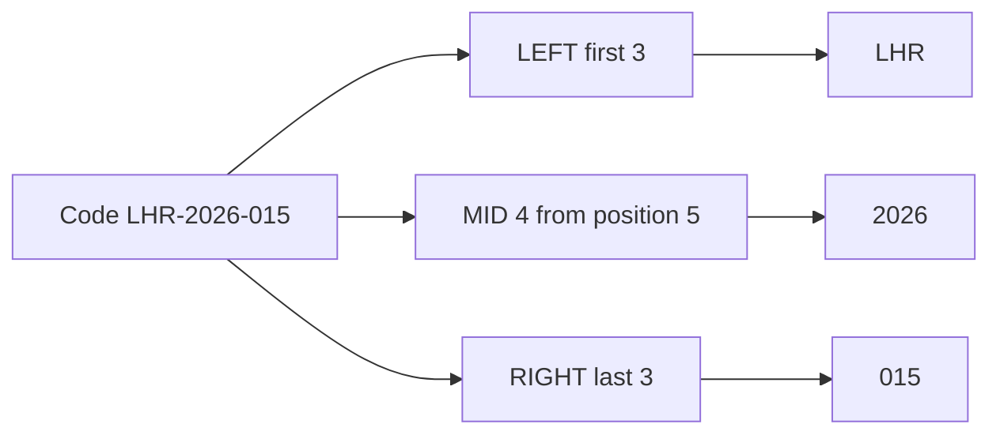

import PracticeFile from '@site/src/components/PracticeFile';

## Goal

By the end of this lesson, you can take a part out of a code with LEFT, RIGHT and MID, and count
its characters with LEN.

## Why It Matters

Many records use codes that hold several facts. A roll number like LHR-2026-015 can hold a city,
a year and a student number. A shoe shop's code can hold the type, the size and the colour.
Copying each part by hand is slow, and one typing slip gives a wrong list. These four functions
read the parts for you, and LEN shows a code that is too short or too long.

**Diagram in words:** One roll code holds three parts. LEFT takes the first 3 characters (LHR),
MID takes 4 characters starting at position 5 (2026), and RIGHT takes the last 3 characters
(015).

## Key Terms

| Term | Simple meaning |
|------|----------------|
| Text string | A piece of text in a cell, like a name or a code. |
| Character | One letter, digit, space or sign, like `L`, `2`, `-` or a space. |
| Position | The place of a character in the text. The first character is position 1, the next is 2, and so on. |
| LEFT | A function that gives the first characters of a text, from the left. |
| RIGHT | A function that gives the last characters of a text, from the right. |
| MID | A function that gives characters from the middle. You say where to start and how many to take. |
| LEN | A function that counts the characters in a text. Spaces and dashes count too. |

Think of a train with numbered carriages. LEFT takes the first few carriages. RIGHT takes the
last few. MID starts at a carriage number you choose and takes as many as you ask for. LEN counts
all the carriages.

The three "taking" functions have these parts ([Lesson 7.15](if-function.mdx) explains
arguments):

| Function | You write | It means |
|----------|-----------|----------|
| LEFT | `=LEFT(A2,3)` | The first 3 characters of A2 |
| RIGHT | `=RIGHT(A2,3)` | The last 3 characters of A2 |
| MID | `=MID(A2,5,4)` | 4 characters of A2, starting at position 5 |
| LEN | `=LEN(A2)` | How many characters A2 has |

This lesson takes text apart. [Lesson 7.22](joining-and-changing-text.mdx) does the opposite: it
joins pieces of text together.

## Step by Step

:::info[Practice files]

- <PracticeFile href="/files/excel/parts-of-text/roll-codes-starter.xlsx">Download the starter file: Roll Codes</PracticeFile>.
  It has the five roll codes already typed in, with the one typing mistake, so that you can go
  straight to the formulas.
- <PracticeFile href="/files/excel/parts-of-text/roll-codes-finished.xlsx">Download the finished file: Roll Codes</PracticeFile>.
  It shows the end of the task, with the mistake in A4 fixed. Open it after you finish.

:::

A computer institute gives every student a roll code. The code is the city, a dash, the year of
admission, a dash and the student number. The office wants each part in its own column, so that
it can sort and count them. All the codes here are made up.

Open a new blank workbook ([Lesson 7.1](starting-excel.mdx)). Type this table. Leave columns B
to E empty. Type A4 exactly as shown: it has a mistake that you will find with LEN.

| Row | A | B | C | D | E |
|-----|---|---|---|---|---|
| 1 | Roll code | City | Year | Number | Length |
| 2 | LHR-2026-015 | `=LEFT(A2,3)` gives LHR | `=MID(A2,5,4)` gives 2026 | `=RIGHT(A2,3)` gives 015 | `=LEN(A2)` gives 12 |
| 3 | KHI-2025-102 | KHI | 2025 | 102 | 12 |
| 4 | ISB-2026-07 | ISB | 2026 | -07 | 11 |
| 5 | MUL-2024-230 | MUL | 2024 | 230 | 12 |
| 6 | PEW-2026-041 | PEW | 2026 | 041 | 12 |

**LEFT: the city**

1. Select B2. Type `=LEFT(A2,3)` and press **Enter**. The city code is always the first 3
   characters. *B2 shows LHR.*

**MID: the year**

2. Count the positions in LHR-2026-015. L is 1, H is 2, R is 3 and the dash is 4. So the year
   starts at position 5 and is 4 characters long.
3. Select C2. Type `=MID(A2,5,4)` and press **Enter**. *C2 shows 2026.*

**RIGHT: the number**

4. Select D2. Type `=RIGHT(A2,3)` and press **Enter**. The student number is always the last 3
   characters. *D2 shows 015.* The zero in front stays, because RIGHT gives back characters,
   not a number.

**LEN: check the length**

5. Select E2. Type `=LEN(A2)` and press **Enter**. LEN counts every letter, digit and dash.
   *E2 shows 12.*
6. Select B2 to E2. Drag the fill handle down to row 6 ([Lesson 7.7](fill-handle.mdx)), so that
   every code gets the same four formulas.
7. Look down column E. Every good code has 12 characters. *E4 shows 11, and D4 shows -07.*
   One digit is missing from the code in A4.
8. Select A4. Type `ISB-2026-007` and press **Enter**, so that the code is correct.
   *E4 changes to 12, and D4 changes to 007.* The formulas read the new code by themselves.

{/* Screenshot to add: Columns A to E filled, with cell C2 selected and the formula bar showing =MID(A2,5,4). */}

## Practice

:::info[Practice files]

- <PracticeFile href="/files/excel/parts-of-text/shoe-codes-starter.xlsx">Download the starter file: Shoe Codes</PracticeFile>.
  It has the six stock codes already typed in, with one mistake. Use it if you want more time for
  the formulas.
- <PracticeFile href="/files/excel/parts-of-text/shoe-codes-finished.xlsx">Download the finished file: Shoe Codes</PracticeFile>.
  It shows the end of the task, with the code in A6 fixed. Open it after you finish.

:::

Farhan has a shoe shop. Each stock code is the type (4 letters), a dash, the size (2 digits), a
dash and the colour (3 letters). SHOE is a shoe, SNDL a sandal and KHSA a khussa. A good code has
11 characters. Farhan wants each part in a column, and a check for codes typed wrongly.

| Row | A | B | C | D | E | F |
|-----|---|---|---|---|---|---|
| 1 | Code | Type | Size | Colour | Length | Check |
| 2 | SHOE-41-BLK | | | | | |
| 3 | SNDL-38-BRN | | | | | |
| 4 | SHOE-43-BRN | | | | | |
| 5 | KHSA-39-RED | | | | | |
| 6 | SNDL-4-BLK | | | | | |
| 7 | SHOE-36-BLK | | | | | |

1. Open a new blank workbook. Type the table, rows 1 to 7, exactly as shown.
2. In B2, type `=LEFT(A2,4)`. In C2, type `=MID(A2,6,2)`. In D2, type `=RIGHT(A2,3)`. In E2,
   type `=LEN(A2)`. Check: B2 to E2 show SHOE, 41, BLK and 11.
3. In F2, type `=IF(E2=11,"OK","Check code")`. This uses IF from
   [Lesson 7.15](if-function.mdx), so that a wrong code stands out by itself. Check: F2 shows OK.
4. Select B2 to F2 and drag the fill handle down to row 7.
5. Look at row 6. Check: C6 shows 4-, E6 shows 10 and F6 shows Check code.
6. The sandal is really size 40. Select A6, type `SNDL-40-BLK` and press **Enter**.
7. Save the workbook with the name **Shoe Codes**
   ([Lesson 7.2](entering-editing-saving-data.mdx)), so that your work is kept.
8. Check your work: column B shows SHOE, SNDL, SHOE, KHSA, SNDL and SHOE. Column C shows 41, 38,
   43, 39, 40 and 36. Column D shows BLK, BRN, BRN, RED, BLK and BLK. Every cell in column E
   shows 11, and every cell in column F shows OK.

## Check Questions

1. A2 holds KHI-2025-102. What does `=LEFT(A2,3)` show, and what does `=RIGHT(A2,3)` show?

   

   
Show answer

   **Answer:** LEFT shows KHI, the first 3 characters. RIGHT shows 102, the last 3 characters.

   

2. In your Shoe Codes sheet, select C2. Point to the start position in the formula bar.

   

   
Show answer

   **Answer:** The formula is `=MID(A2,6,2)`. The start position is 6, the number after `A2`.
   The size starts at character 6, after SHOE and the dash.

   

3. A code should have 12 characters, but LEN shows 13. What does this tell you?

   

   
Show answer

   **Answer:** The code has one character too many. It may have an extra digit, an extra dash or
   a space. Look at the code and type it again.

   

## Common Mistakes

- **Forgetting that the dash counts**, like `=MID(A2,4,4)` for the year → C2 shows -202. Count
  every character, dashes too. The year starts at position 5: `=MID(A2,5,4)`.
- **Mixing up the order in MID**, like `=MID(A2,4,5)` → You get the wrong part. MID needs the
  start position first, then how many characters to take.
- **Typing a space inside or after a code** → LEN counts spaces, so the length is wrong, and the
  parts may come out wrong. Type the code again with no spaces.

## Sources

*These official pages were checked when this lesson was written.*

- [Microsoft Support, "LEFT function"](https://support.microsoft.com/en-us/office/left-leftb-functions-9203d2d2-7960-479b-84c6-1ea52b99640c) (applies to Excel 2021): "LEFT returns the first character or characters in a text string, based on the number of characters you specify"; syntax "LEFT(text, [num_chars])"; "Num_chars Optional. Specifies the number of characters you want LEFT to extract"; example "=LEFT(A2,4)" gives "Sale" from "Sale Price".
- [Microsoft Support, "RIGHT function"](https://support.microsoft.com/en-us/office/right-rightb-functions-240267ee-9afa-4639-a02b-f19e1786cf2f) (applies to Excel 2021): "RIGHT returns the last character or characters in a text string, based on the number of characters you specify"; syntax "RIGHT(text,[num_chars])"; example "=RIGHT(A2,5)" gives "Price".
- [Microsoft Support, "MID function"](https://support.microsoft.com/en-us/office/mid-midb-functions-d5f9e25c-d7d6-472e-b568-4ecb12433028) (applies to Excel 2021): "MID returns a specific number of characters from a text string, starting at the position you specify, based on the number of characters you specify"; syntax "MID(text, start_num, num_chars)"; "Start_num Required. The position of the first character you want to extract in text. The first character in text has start_num 1, and so on."
- [Microsoft Support, "LEN function"](https://support.microsoft.com/en-us/office/len-lenb-functions-29236f94-cedc-429d-affd-b5e33d2c67cb) (applies to Excel 2021): "LEN returns the number of characters in a text string"; syntax "LEN(text)"; "Spaces count as characters."
- [Microsoft Support, "IF function"](https://support.microsoft.com/en-us/office/if-function-69aed7c9-4e8a-4755-a9bc-aa8bbff73be2) (applies to Excel 2021): "Use the IF function, one of the logical functions, to return one value if a condition is true and another value if it's false"; "If you are going to use text in formulas, you need to wrap the text in quotes."
- [Microsoft Support, "Fill a formula down into adjacent cells"](https://support.microsoft.com/en-us/office/fill-a-formula-down-into-adjacent-cells-041edfe2-05bc-40e6-b933-ef48c3f308c6) (applies to Excel 2021): "Select the cell that has the formula you want to fill into adjacent cells. Drag the fill handle"; references "adjust for each row".

All results were worked out again before writing: in LHR-2026-015, characters 1 to 3 are LHR,
characters 5 to 8 are 2026 and the last 3 are 015; the code has 12 characters. ISB-2026-07 has
11 characters, and its last 3 are -07. In the shoe codes, characters 6 and 7 are the size;
SNDL-4-BLK has 10 characters, and its characters 6 and 7 are 4-. Every fixed code has 11
characters.
