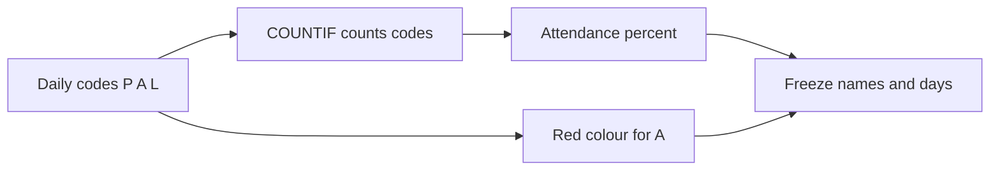

import PracticeFile from '@site/src/components/PracticeFile';

## Goal

By the end of this lesson, you can build a staff attendance sheet that counts each person's
present, absent and leave days and works out their attendance percentage.

## Why It Matters

Every office, shop and factory in Pakistan keeps a record of who came to work. The salary
often depends on it. A courier office in Gujranwala and a hardware shop in Sialkot both mark
each person P, A or L every day. At the end of the month, someone must count the letters for
every person. Counting by hand is slow, and one slip changes a salary. In this project, Excel
counts, works out the percentage, colours the absences red and keeps the names in view.

**Diagram in words:** From the daily codes, COUNTIF counts each person's days and ROUND gives
the attendance percent. A colour rule marks every A in red. Freeze Panes keeps the names and
the day row in view.

## Key Terms

| Term | Simple meaning |
|------|----------------|
| Attendance sheet | A table with one row per person and one column per working day, showing who came to work. |
| Working day | A day the office or shop is open. Here, Monday to Saturday. Sundays are left out. |
| Code | One letter for each day: P for present, A for absent and L for leave. |
| Leave | A day off that was asked for and allowed, like a sick day or a family wedding. |
| Attendance percentage | The present days out of every 100 working days: present ÷ working days × 100. |
| Freeze Panes | A setting that keeps some rows and columns in view while you scroll ([Lesson 7.28](freeze-panes.mdx)). |

Think of the register a school keeps for each section. Every morning, each name gets a tick or
a cross. At the end of the month, someone counts the ticks. COUNTIF is that counting, done in a
second.

## Step by Step

:::info[Practice files]

- <PracticeFile href="/files/excel/project-attendance-sheet/office-attendance-starter.xlsx">Download the starter file: Office Attendance</PracticeFile>.
  It has the names, the days and all 150 codes already typed in, so that you can start at
  step 3.
- <PracticeFile href="/files/excel/project-attendance-sheet/office-attendance-finished.xlsx">Download the finished file: Office Attendance</PracticeFile>.
  It shows the whole sheet done: the formulas, the red absences and the frozen panes. Open it
  after you finish, to compare with your work.

:::

**The story.** Tahira manages a courier office in Gujranwala with ten staff. Every morning she
marks each person P, A or L. Now it is 18 November 2026. She needs each person's attendance for
the first 15 working days, to work out the salaries.

**What the sheet is for.** Row 1 holds the dates in November, from 2 to 18. Sundays (8 and 15)
are left out. Columns Q, R and S count each person's codes. Column T shows the attendance
percentage. The red cells show every absence at a glance.

Row 1 has these headings. A1 is Name. B1 to P1 hold the numbers 2, 3, 4, 5, 6, 7, 9, 10, 11, 12,
13, 14, 16, 17 and 18. Q1 to T1 hold Present, Absent, Leave and Attendance %.

These are the codes. Each person's 15 codes go in B to P, one letter in each cell, from left to
right.

| Row | A | B to P |
|-----|---|--------|
| 2 | Imran Haider | P P P P P P P P P P P P P P P |
| 3 | Saba Naz | P P P A P P P P P P L P P P P |
| 4 | Kashif Mehmood | P P A P P P P A P P P P A P P |
| 5 | Nadia Parveen | P P P P P P L P P P P P P P P |
| 6 | Waqar Ahmed | A P P P A P L L P P P A P P P |
| 7 | Shazia Bibi | P P P P L L L P P P P P A P P |
| 8 | Adnan Rafiq | P P P P P P P P P P P P P P P |
| 9 | Mehwish Tariq | P P P P P P P P P A P P P P P |
| 10 | Zahid Hussain | P A P A P P L A P P A P P A P |
| 11 | Rabia Anwar | P P P P P P P P L P P P A P P |

**Get the codes in**

1. Open the starter file. Typing 150 codes takes a long time, and the formulas are the real
   work of this project. If you prefer to type, open a new blank workbook
   ([Lesson 7.1](starting-excel.mdx)) and type the headings and codes above.
2. Check a few rows against the table. Use capital letters and no spaces. A code with a space
   after it, like "P ", is not counted.

**Count the codes with COUNTIF**

COUNTIF counts the cells in a range that match a rule. You learned it in
[Lesson 7.17](counting-functions.mdx).

3. Select Q2. Type `=COUNTIF(B2:P2,"P")` and press **Enter**. This counts the P codes in
   Imran's row. *Q2 shows 15.* Imran came to work every day.
4. Select R2. Type `=COUNTIF(B2:P2,"A")` and press **Enter**. *R2 shows 0.*
5. Select S2. Type `=COUNTIF(B2:P2,"L")` and press **Enter**. *S2 shows 0.* The letter goes
   inside quotation marks, because it is text.

**The attendance percentage with ROUND**

6. Select T2. Type `=ROUND(Q2/COUNTA(B2:P2)*100,0)` and press **Enter**. Read it from the
   inside. COUNTA counts the day cells that have a code: 15. Present days ÷ 15 × 100 gives the
   percentage. ROUND makes it a whole number ([Lesson 7.20](iferror-and-round.mdx)). *T2 shows
   100.*

   COUNTA counts the days for you. So the same formula works for a month with 12 or 26 working
   days.

**Fill the formulas for everyone**

7. Select Q2 to T2. Drag the fill handle down to row 11 ([Lesson 7.7](fill-handle.mdx)), so
   that every person gets all four formulas.
8. Look at Saba in row 3. *Q3 shows 13, R3 shows 1, S3 shows 1 and T3 shows 87.* 13 ÷ 15 × 100
   is 86.67, and ROUND makes it 87.
9. Check one more thing. For every person, Present + Absent + Leave is 15. If a row does not add
   up to 15, a code has a typing mistake.

These are the correct results:

| Row | Name | Present | Absent | Leave | Attendance % |
|-----|------|---------|--------|-------|--------------|
| 2 | Imran Haider | 15 | 0 | 0 | 100 |
| 3 | Saba Naz | 13 | 1 | 1 | 87 |
| 4 | Kashif Mehmood | 12 | 3 | 0 | 80 |
| 5 | Nadia Parveen | 14 | 0 | 1 | 93 |
| 6 | Waqar Ahmed | 10 | 3 | 2 | 67 |
| 7 | Shazia Bibi | 11 | 1 | 3 | 73 |
| 8 | Adnan Rafiq | 15 | 0 | 0 | 100 |
| 9 | Mehwish Tariq | 14 | 1 | 0 | 93 |
| 10 | Zahid Hussain | 9 | 5 | 1 | 60 |
| 11 | Rabia Anwar | 13 | 1 | 1 | 87 |

**Make the absences red**

A red cell catches the eye, even in a big grid. You learned this in
[Lesson 7.27](conditional-formatting.mdx).

10. Select B2 to P11, the codes only. Do not select the names. A name like Adnan has the letter
    A in it, and the rule would colour it too.
11. On the **Home** tab, select **Conditional Formatting**, then **Highlight Cells Rules**, then
    **Text that Contains**.
12. In the box, type A. Choose a red format from the list, and select **OK**. *15 cells turn
    red.* Zahid's row has five red cells, the most of anyone.

**Freeze the names and the day row**

The sheet is 20 columns wide. When you scroll right to column T, the names in column A go off
the screen. Freeze Panes keeps them in view ([Lesson 7.28](freeze-panes.mdx)).

13. Select B2. Freeze Panes freezes the rows above the selected cell and the columns to its
    left. B2 has row 1 above it and column A to its left.
14. On the **View** tab, select **Freeze Panes**, then **Freeze Panes** again in the list.
15. Scroll to the right until you see column T. *Column A stays on the screen.* Now you can read
    each name next to its percentage.
16. Scroll down. *Row 1, with the dates, stays at the top.*
17. Save the workbook with the name **Office Attendance**
    ([Lesson 7.2](entering-editing-saving-data.mdx)), so that your work is kept.

To unfreeze later, on the **View** tab select **Freeze Panes**, then **Unfreeze Panes**.

{/* Screenshot to add: The Office Attendance sheet scrolled right, with column A frozen next to columns Q to T, the red A cells, and the View tab Freeze Panes list open. */}

## Practice

:::info[Practice files]

- <PracticeFile href="/files/excel/project-attendance-sheet/shop-attendance-starter.xlsx">Download the starter file: Shop Attendance</PracticeFile>.
  It has the names, the days and the codes already typed in, and the label Absent in A9.
- <PracticeFile href="/files/excel/project-attendance-sheet/shop-attendance-finished.xlsx">Download the finished file: Shop Attendance</PracticeFile>.
  It shows the end of the task, with Kiran's code on 1 December changed to L. Open it after you
  finish.

:::

Shakeel owns a hardware shop in Sialkot with six workers. He wants their attendance for the
first 12 working days of December 2026. He also wants to see how many people were absent on
each day, so that he knows which days were short of staff.

Row 1 has these headings. A1 is Name. B1 to M1 hold the numbers 1, 2, 3, 4, 5, 7, 8, 9, 10, 11,
12 and 14. N1 to Q1 hold Present, Absent, Leave and Attendance %. A9 holds the label Absent.

| Row | A | B to M |
|-----|---|--------|
| 2 | Arshad Ali | P P P P P P P P P P P P |
| 3 | Sajida Bano | P P A P P P P P P L P P |
| 4 | Nasir Khan | P P P P A P P P A P P A |
| 5 | Farah Naz | P L L P P P P P P P P P |
| 6 | Bilal Hussain | P P P P P A P P P P P P |
| 7 | Kiran Shahzad | A P P P P P P P A P P P |

1. Open the starter file, or type the headings, the codes and the label Absent in A9.
2. In N2, type `=COUNTIF(B2:M2,"P")`. In O2, type `=COUNTIF(B2:M2,"A")`. In P2, type
   `=COUNTIF(B2:M2,"L")`. The days are in B to M this time, because there are 12 of them.
3. In Q2, type `=ROUND(N2/COUNTA(B2:M2)*100,0)`. Check: Q2 shows 100.
4. Select N2 to Q2 and fill them down to row 7. Check: Q3 shows 83, because 10 ÷ 12 × 100 is
   83.33.
5. Now count the absences on each day. In B9, type `=COUNTIF(B2:B7,"A")`. This time the range
   goes down a column, so it counts one day for all six workers. Check: B9 shows 1.
6. Drag the fill handle of B9 across to M9, so that every day gets a count. Check: J9 shows 2.
   On 10 December, two workers were absent.
7. Kiran brings a note. Her absence on 1 December was approved leave. Select B7, type L and
   press **Enter**. Watch O7, P7 and B9 change by themselves.
8. Select B2 to M7. Add a **Text that Contains** rule for A with a red format.
9. Select B2. On the **View** tab, select **Freeze Panes**, then **Freeze Panes**. Scroll right
   and down to check that the names and the dates stay in view.
10. Save the workbook with the name **Shop Attendance**.
11. Check your work: N2 to N7 show 12, 10, 9, 10, 11 and 10. O2 to O7 show 0, 1, 3, 0, 1 and 1.
    P2 to P7 show 0, 1, 0, 2, 0 and 1. Q2 to Q7 show 100, 83, 75, 83, 92 and 83. Row 9 shows
    0, 0, 1, 0, 1, 1, 0, 0, 2, 0, 0 and 1 from B9 to M9. Six cells are red.

**Answer key (after Kiran's change)**

| Row | Name | Present | Absent | Leave | Attendance % |
|-----|------|---------|--------|-------|--------------|
| 2 | Arshad Ali | 12 | 0 | 0 | 100 |
| 3 | Sajida Bano | 10 | 1 | 1 | 83 |
| 4 | Nasir Khan | 9 | 3 | 0 | 75 |
| 5 | Farah Naz | 10 | 0 | 2 | 83 |
| 6 | Bilal Hussain | 11 | 1 | 0 | 92 |
| 7 | Kiran Shahzad | 10 | 1 | 1 | 83 |

Before the change, O7 showed 2, P7 showed 0 and B9 showed 1. Kiran's percentage stays 83,
because her present days did not change.

## Check Questions

1. Open your Office Attendance sheet. Point to the cell that shows how many days Zahid Hussain
   was absent. What number is in it?

   

   
Show answer

   **Answer:** Cell R10. It shows 5. His row also has five red cells: C10, E10, I10, L10 and
   O10.

   

2. Kashif was present on 12 of the 15 working days. Work out his attendance percentage without
   Excel.

   

   
Show answer

   **Answer:** 12 ÷ 15 × 100 = 80. T4 shows 80. No rounding is needed, because it is already a
   whole number.

   

3. You select C2 and select **Freeze Panes**. What stays in view when you scroll?

   

   
Show answer

   **Answer:** Row 1, and columns A and B. Freeze Panes freezes the rows above the selected cell
   and the columns to its left. To keep only the names, unfreeze, select B2 and freeze again.

   

## Common Mistakes

- **Leaving out the quotation marks**, like `=COUNTIF(B2:P2,P)` → The formula does not count the
  codes. Text in a rule goes inside quotation marks: `"P"`.
- **Selecting the names for the colour rule** → Names with the letter A, like Adnan, turn red
  too. Select only the codes, B2 to P11.
- **Typing a space after a code**, like "P " → COUNTIF does not count it, and the row adds up to
  less than 15. Select the cell and type the letter again.
- **Selecting A1 or B1 before Freeze Panes** → The wrong rows or columns stay in view. Select
  **Unfreeze Panes**, select B2, and freeze again.
- **Forgetting `*100`**, like `=ROUND(Q2/COUNTA(B2:P2),0)` → The cells show 1 instead of a
  percentage. The formula needs `*100`.

## Sources

*These official pages were checked when this lesson was written.*

- [Microsoft Support, "Use the COUNTIF function in Microsoft Excel"](https://support.microsoft.com/en-us/excel/get-started/use-the-countif-function-in-microsoft-excel) (applies to Excel 2021): "count the number of cells that meet a criterion"; syntax `COUNTIF(range, criteria)`; example `=COUNTIF(A2:A5,"apples")`; "Be sure to enclose the criteria argument in quotes"; "When counting text values, make sure the data doesn't contain leading spaces, trailing spaces ... In these cases, COUNTIF might return an unexpected value"; "Be aware that COUNTIF ignores upper and lower case in text strings."
- [Microsoft Support, "COUNTA function"](https://support.microsoft.com/en-us/excel/functions/counta-function) (applies to Excel 2021): "The COUNTA function counts the number of cells that are not empty in a range"; "The COUNTA function counts cells containing any type of information".
- [Microsoft Support, "ROUND function"](https://support.microsoft.com/en-us/office/round-function-c018c5d8-40fb-4053-90b1-b3e7f61a213c) (applies to Excel 2021): "The ROUND function rounds a number to a specified number of digits"; syntax `ROUND(number, num_digits)`; "If num_digits is 0, the number is rounded to the nearest integer".
- [Microsoft Support, "Use Excel as your calculator"](https://support.microsoft.com/en-us/office/use-excel-as-your-calculator-a1abc057-ed11-443a-a635-68216555ad0a) (applies to Excel 2021): "All formula entries begin with an equal sign (=)"; "the asterisk (*) to multiply, and the forward slash (/) to divide."
- [Microsoft Support, "Fill a formula down into adjacent cells"](https://support.microsoft.com/en-us/office/fill-a-formula-down-into-adjacent-cells-041edfe2-05bc-40e6-b933-ef48c3f308c6) (applies to Excel 2021): "Select the cell that has the formula you want to fill into adjacent cells. Drag the fill handle across the cells that you want to fill"; "relative references will be put in place to ensure the formulas adjust for each row".
- [Microsoft Support, "Use conditional formatting to highlight information in Excel"](https://support.microsoft.com/en-us/office/use-conditional-formatting-to-highlight-information-in-excel-fed60dfa-1d3f-4e13-9ecb-f1951ff89d7f) (applies to Excel 2021): "On the Home tab, in the Style group, click the arrow next to Conditional Formatting, and then click Highlight Cells Rules"; "Select the command you want, such as Between, Equal To Text that Contains, or A Date Occurring"; "Enter the values you want to use, and then select a format"; "If the Text that Contains dialog box appears, enter the formatting option you want to apply and click OK".
- [Microsoft Support, "Freeze panes to lock rows and columns"](https://support.microsoft.com/en-us/office/freeze-panes-to-lock-rows-and-columns-dab2ffc9-020d-4026-8121-67dd25f2508f) (applies to Excel 2021): "To keep an area of a worksheet visible while you scroll to another area of the worksheet, go to the View tab, where you can Freeze Panes to lock specific rows and columns in place"; "Freeze Panes freezes the rows above and the columns left of the selected cell"; "Select the cell below the rows and to the right of the columns you want to keep visible when you scroll. Select View > Freeze Panes > Freeze Panes"; "On the View tab > Freeze Panes > Unfreeze Panes".

All results were worked out again before writing, with Python. Office (15 working days, 2–18
November 2026 without the Sundays 8 and 15): present 15, 13, 12, 14, 10, 11, 15, 14, 9, 13;
absent 0, 1, 3, 0, 3, 1, 0, 1, 5, 1 (15 in all); leave 0, 1, 0, 1, 2, 3, 0, 0, 1, 1; percentages
13 ÷ 15 × 100 = 86.67 → 87, 12 ÷ 15 = 80, 14 ÷ 15 = 93.33 → 93, 10 ÷ 15 = 66.67 → 67,
11 ÷ 15 = 73.33 → 73, 9 ÷ 15 = 60. Shop (12 working days, 1–14 December 2026 without the Sundays
6 and 13), after Kiran's change: 10 ÷ 12 = 83.33 → 83, 9 ÷ 12 = 75, 11 ÷ 12 = 91.67 → 92;
absent per day 0, 0, 1, 0, 1, 1, 0, 0, 2, 0, 0, 1 (6 in all).
