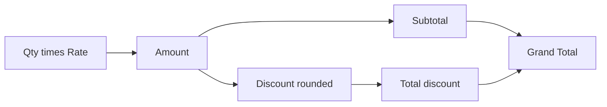

import PracticeFile from '@site/src/components/PracticeFile';

## Goal

By the end of this lesson, you can make a shop bill that works out each amount, a discount from
one rate cell, and the grand total in whole rupees.

## Why It Matters

A customer at a general store wants a clear bill. A stationery shop gives 10% off in the
back-to-school season. A wrong total can cost the shop money or upset a regular customer. In
Excel, the bill does every sum for you. When the offer changes, you change one cell, and the
whole bill updates.

**Diagram in words:** Quantity times rate gives each amount. Each amount gives a rounded
discount. The subtotal minus the total discount is the grand total, the money the customer pays.

## Key Terms

| Term | Simple meaning |
|------|----------------|
| Bill | A paper that lists what a customer bought and what they must pay. Some shops call it an invoice. |
| Bill number | A number on each bill, so that the shop can find it again later. |
| Qty | Short for quantity: how many pieces or kilograms the customer bought. |
| Rate | The price of one piece or one kilogram. |
| Amount | Qty times rate, for one line of the bill. |
| Subtotal | All the amounts added together, before the discount. |
| Grand total | The final money the customer pays: the subtotal minus the discount. |
| Thousands separator | The comma in a big number, like 5,785. It makes big numbers quicker to read. |

A discount is the part of the price taken off ([Lesson 7.14](absolute-references.mdx)). On a
bill, the rate cell is like the "5% off" poster on the shop door. Every item reads the same
poster.

## Step by Step

:::info[Practice files]

- <PracticeFile href="/files/excel/project-customer-bill/grocery-bill-starter.xlsx">Download the starter file: Grocery Bill</PracticeFile>.
  It has the shop name, bill details, rate and items already typed in. Give B5 the Percent
  Style (step 4), then go on to step 6.
- <PracticeFile href="/files/excel/project-customer-bill/grocery-bill-finished.xlsx">Download the finished file: Grocery Bill</PracticeFile>.
  It shows the whole bill done: the formulas, the number formats and the borders. Open it after
  you finish, to compare with your work.

:::

**The story.** Rafiq General Store has a sale week with 5% off every item. Nasreen Akhtar buys
her monthly groceries. The shop needs a bill for her, with the discount on each item.

**What the sheet is for.** Each line shows the amount and the discount. The bottom shows the
subtotal, the total discount and the grand total. The bill number and the customer are made up.

This is the finished bill. You will add columns D and E and cells D15 to D17 with formulas.

| Row | A | B | C | D | E |
|-----|---|---|---|---|---|
| 1 | Rafiq General Store | | | | |
| 2 | Bill No. | 2045 | | | |
| 3 | Date | 15/10/2026 | | | |
| 4 | Customer | Nasreen Akhtar | | | |
| 5 | Discount | 5% | | | |
| 6 | | | | | |
| 7 | Item | Qty | Rate (Rs) | Amount (Rs) | Discount (Rs) |
| 8 | Basmati rice (kg) | 5 | 340 | `=B8*C8` gives 1,700 | `=ROUND(D8*$B$5,0)` gives 85 |
| 9 | Sugar (kg) | 3 | 155 | 465 | 23 |
| 10 | Cooking oil (litre) | 3 | 545 | 1,635 | 82 |
| 11 | Tea (pack) | 1 | 480 | 480 | 24 |
| 12 | Daal (kg) | 4 | 285 | 1,140 | 57 |
| 13 | Washing powder (pack) | 1 | 365 | 365 | 18 |
| 14 | | | | | |
| 15 | | | Subtotal | `=SUM(D8:D13)` gives 5,785 | |
| 16 | | | Discount | `=SUM(E8:E13)` gives 289 | |
| 17 | | | Grand Total | `=D15-D16` gives 5,496 | |

**Type the bill details**

1. Open a new blank workbook ([Lesson 7.1](starting-excel.mdx)). Type the shop name in A1. A
   bill always starts with the shop's name, so that the customer knows where it came from.
2. Type the labels in A2 to A5 and the details in B2 to B4. Each bill has its own number, so
   that the shop can find it again if the customer comes back.
3. Type the date in B3 as 15/10/2026. If it stays on the left of the cell, type the month first,
   like 10/15/2026 ([Lesson 7.5](number-formats.mdx)).
4. Select B5. Type 0.05 and press **Enter**. Select B5 again, and on the **Home** tab select
   **Percent Style**. *B5 shows 5%.* The rate sits in one cell, so that one change updates the
   whole bill.

**The items and the amounts**

5. Type the headings in row 7 and the items in rows 8 to 13. Type Subtotal, Discount and Grand
   Total in C15, C16 and C17.
6. Select D8. Type `=B8*C8` and press **Enter**. Qty times rate is the amount for that line.
   *D8 shows 1700.*
7. Fill D8 down to D13 ([Lesson 7.7](fill-handle.mdx)). *D9 to D13 show 465, 1635, 480, 1140
   and 365.*

**The discount: see the problem first**

8. Select E8. Type `=D8*$B$5` and press **Enter**. The `$` signs keep B5 fixed when you copy the
   formula down ([Lesson 7.14](absolute-references.mdx)). *E8 shows 85.*
9. Fill E8 down to E13. *E9 shows 23.25, E10 shows 81.75 and E13 shows 18.25.*

A shop bill uses whole rupees. Nobody pays 81.75 rupees off at the counter. ROUND fixes this
([Lesson 7.20](iferror-and-round.mdx)).

**The discount in whole rupees**

10. Select E8. Type `=ROUND(D8*$B$5,0)` and press **Enter**. The 0 means no decimal places.
    *E8 still shows 85.*
11. Fill E8 down to E13. *E9 to E13 show 23, 82, 24, 57 and 18.* Each discount is now a whole
    number of rupees.

**Subtotal, discount and grand total**

12. Select D15. Type `=SUM(D8:D13)` and press **Enter** ([Lesson 7.8](sum-and-average.mdx)).
    This adds every amount. *D15 shows 5785.*
13. Select D16. Type `=SUM(E8:E13)` and press **Enter**. This adds every discount. *D16 shows
    289.*
14. Select D17. Type `=D15-D16` and press **Enter**. The customer pays the subtotal minus the
    discount. *D17 shows 5496.*

**Number formats: make the money clear**

15. Select C8 to E13. On the **Home** tab, select the dialog box launcher next to **Number**.
    *The **Format Cells** box opens.*
16. In the **Category** list, select **Number**. Type 0 in **Decimal places**. Check **Use 1000
    Separator (,)** and select **OK**. *D8 shows 1,700 and D10 shows 1,635.* The comma makes big
    amounts quicker to read.
17. Select D15 to D17 and give them the same format. *D15 shows 5,785 and D17 shows 5,496.*
18. Select B3. On the **Home** tab, open the **Number Format** list and select **Short Date**, so
    that the date shows with numbers only.

**Make it look like a bill**

19. Make A1 bold and size 16, and make the headings in row 7 bold
    ([Lesson 7.4](formatting-cells.mdx)). A clear title and headings help the customer read the
    bill.
20. Select A7 to E13 and add **All Borders**, so that the lines print on paper.
21. Save the workbook with the name **Customer Bill**
    ([Lesson 7.2](entering-editing-saving-data.mdx)), so that your work is kept.

{/* Screenshot to add: The finished grocery bill, with the shop name in bold at the top, borders around the items, and the Grand Total 5,496 in D17. */}

## Practice

:::info[Practice files]

- <PracticeFile href="/files/excel/project-customer-bill/stationery-bill-starter.xlsx">Download the starter file: Stationery Bill</PracticeFile>.
  It has the shop name, bill details and items already typed in. Use it if you want more time
  for the formulas.
- <PracticeFile href="/files/excel/project-customer-bill/stationery-bill-finished.xlsx">Download the finished file: Stationery Bill</PracticeFile>.
  It shows the end of the task, with the discount changed to 12%. Open it after you finish.

:::

Bright Stationers gives **10% off** in the back-to-school season. Kamran Yousaf buys supplies
for his children. Make his bill with the same layout as the Step by Step. Leave column D, column
E and D15 to D17 empty when you type.

| Row | A | B | C |
|-----|---|---|---|
| 1 | Bright Stationers | | |
| 2 | Bill No. | 318 | |
| 3 | Date | 16/10/2026 | |
| 4 | Customer | Kamran Yousaf | |
| 5 | Discount | 0.1 | |
| 7 | Item | Qty | Rate (Rs) |
| 8 | Notebook | 12 | 85 |
| 9 | Ball pens (pack of 10) | 2 | 245 |
| 10 | Geometry box | 1 | 420 |
| 11 | School bag | 1 | 2450 |
| 12 | Eraser | 6 | 18 |
| 13 | Sharpener | 6 | 23 |

1. Open a new blank workbook. Type the table. Type Amount (Rs) in D7 and Discount (Rs) in E7.
   Type Subtotal, Discount and Grand Total in C15, C16 and C17.
2. Select B5 and select **Percent Style**. Check: B5 shows 10%.
3. In D8, type `=B8*C8` and fill it down to D13. Check: D8 shows 1020.
4. In E8, type `=ROUND(D8*$B$5,0)` and fill it down to E13. Check: E12 shows 11, because 10% of
   108 is 10.8.
5. In D15, D16 and D17, type `=SUM(D8:D13)`, `=SUM(E8:E13)` and `=D15-D16`. Check: D15 shows
   4626, D16 shows 463 and D17 shows 4163.
6. Format C8 to E13 and D15 to D17 as **Number** with 0 decimal places and **Use 1000 Separator
   (,)**. Give B3 the **Short Date** format.
7. Kamran is a regular customer, so the owner gives him 12% instead. Select B5, type 0.12 and
   press **Enter**. Watch every discount and the grand total change, because they all use B5.
8. Save the workbook with the name **Stationery Bill**.
9. Check your work: B5 shows 12%. D8 to D13 show 1,020, 490, 420, 2,450, 108 and 138. E8 to E13
   show 122, 59, 50, 294, 13 and 17. D15 shows 4,626, D16 shows 555 and D17 shows 4,071. With E9
   selected, the formula bar shows `=ROUND(D9*$B$5,0)`.

## Check Questions

1. Open your Customer Bill. Point to the cell that holds the discount rate. Why does the
   discount formula write it as `$B$5`?

   

   
Show answer

   **Answer:** Cell B5. Every item uses the same rate, so its address must not change when you
   fill the formula down.

   

2. Without ROUND, E9 showed 23.25. What does `=ROUND(D9*$B$5,0)` show, and why?

   

   
Show answer

   **Answer:** 23. The 0 rounds the discount to a whole number of rupees.

   

3. Point to the grand total on your bill. How is it worked out?

   

   
Show answer

   **Answer:** Cell D17. It is the subtotal minus the discount: 5,785 − 289 = 5,496.

   

## Common Mistakes

- **Leaving out the `$` signs**, like `=ROUND(D8*B5,0)` → After filling down, E9 uses B6, which
  is empty, and shows 0. Write `$B$5`, so that every row uses the rate cell.
- **Typing 5 in B5 and then selecting Percent Style** → B5 shows 500%, and every discount is far
  too big. Type 0.05, then select **Percent Style**.
- **Adding the discount instead of taking it away**, like `=D15+D16` → The customer is charged
  more, not less. Use `=D15-D16`.
- **Using Decrease Decimal instead of ROUND** → The discount only looks like whole rupees. Excel
  still uses 23.25, so the grand total is not a whole number. Use `=ROUND(…,0)`.

## Sources

*These official pages were checked when this lesson was written.*

- [Microsoft Support, "Use Excel as your calculator"](https://support.microsoft.com/en-us/office/use-excel-as-your-calculator-a1abc057-ed11-443a-a635-68216555ad0a) (applies to Excel 2021): "All formula entries begin with an equal sign (=)"; "the minus sign (-) to subtract, the asterisk (*) to multiply".
- [Microsoft Support, "Switch between relative, absolute, and mixed references"](https://support.microsoft.com/en-us/office/switch-between-relative-absolute-and-mixed-references-dfec08cd-ae65-4f56-839e-5f0d8d0baca9) (applies to Excel 2021): "When you copy a formula that contains a relative cell reference, that reference in the formula will change"; "you make the cell reference absolute by preceding the columns (B and C) and row (2) with a dollar sign ($)"; "when you copy the formula =$B$4*$C$4 from D4 to D5, the formula stays exactly the same."
- [Microsoft Support, "ROUND function"](https://support.microsoft.com/en-us/office/round-function-c018c5d8-40fb-4053-90b1-b3e7f61a213c) (applies to Excel 2021): "The ROUND function rounds a number to a specified number of digits"; syntax `ROUND(number, num_digits)`; "If num_digits is 0, the number is rounded to the nearest integer."
- [Microsoft Support, "SUM function"](https://support.microsoft.com/en-us/office/sum-function-043e1c7d-7726-4e80-8f32-07b23e057f89) (applies to Excel 2021): "The SUM function adds values. You can add individual values, cell references or ranges or a mix of all three."
- [Microsoft Support, "Fill a formula down into adjacent cells"](https://support.microsoft.com/en-us/office/fill-a-formula-down-into-adjacent-cells-041edfe2-05bc-40e6-b933-ef48c3f308c6) (applies to Excel 2021): "Drag the fill handle across the cells that you want to fill"; "relative references will be put in place to ensure the formulas adjust for each row—unless you include absolute or mixed references before you fill the formula down."
- [Microsoft Support, "Format numbers as percentages"](https://support.microsoft.com/en-us/office/format-numbers-as-percentages-de49167b-d603-4450-bcaa-31fba6c7b6b4) (applies to Excel 2021): "To quickly apply percentage formatting to selected cells, click Percent Style"; "if a cell contains the number 10, Excel multiplies that number by 100, which means that you will see 1000.00%"; "If you then format 0.1 as a percentage, the number will be correctly displayed as 10%."
- [Microsoft Support, "Show or hide the thousands separator"](https://support.microsoft.com/en-us/office/show-or-hide-the-thousands-separator-b9f8aee0-ef50-42e5-8fd7-6e3ab1493876) (applies to Excel 2021): "On the Home tab, select the Dialog Box Launcher next to Number"; "On the Number tab, in the Category list, select Number"; "To display or hide the thousands separator, select or clear the Use 1000 Separator (,) check box"; "By default, Excel uses the comma as the system separator for thousands."
- [Microsoft Support, "Format numbers as currency"](https://support.microsoft.com/en-us/office/format-numbers-as-currency-0a03bb38-1a07-458d-9e30-2b54366bc7a4) (applies to Excel 2021): "In the Decimal places box, enter the number of decimal places that you want for the number"; "enter 0 in the Decimal places box."
- [Microsoft Support, "Format a date the way you want"](https://support.microsoft.com/en-us/office/format-a-date-the-way-you-want-8e10019e-d5d8-47a1-ba95-db95123d273e) (applies to Excel 2021): "Select the Number Format dropdown, then select Short Date."
- [Microsoft Support, "Available number formats in Excel"](https://support.microsoft.com/en-us/office/available-number-formats-in-excel-0afe8f52-97db-41f1-b972-4b46e9f1e8d2) (applies to Excel 2021): Number format: "You can specify the number of decimal places that you want to use, whether you want to use a thousands separator, and how you want to display negative numbers."

All results were calculated and checked again before writing. Grocery bill: amounts 5 × 340 =
1700, 3 × 155 = 465, 3 × 545 = 1635, 1 × 480 = 480, 4 × 285 = 1140, 1 × 365 = 365, subtotal
5785; 5% discounts 85, 23.25 → 23, 81.75 → 82, 24, 57, 18.25 → 18, total 289; grand total
5785 − 289 = 5496. Stationery bill: amounts 1020, 490, 420, 2450, 108 and 138, subtotal 4626;
at 10%: 102, 49, 42, 245, 10.8 → 11, 13.8 → 14, total 463, grand total 4163; at 12%: 122.4 →
122, 58.8 → 59, 50.4 → 50, 294, 12.96 → 13, 16.56 → 17, total 555, grand total 4071.
