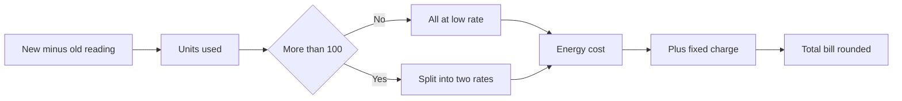

import PracticeFile from '@site/src/components/PracticeFile';

## Goal

By the end of this lesson, you can build an electricity bill calculator that works out the units
used, charges two practice rates with IF and rounds each bill to whole rupees.

## Why It Matters

Every month, a family in Pakistan waits for the electricity bill. In summer, fans and coolers make
it go up. A landlord with a few flats must split the cost fairly between the tenants. A small shop
wants to know why this month's bill is bigger than last month's. With a calculator sheet, you type
two meter readings, and Excel works out the rest.

**Diagram in words:** The units used are the new reading minus the old reading. Up to 100 units
cost the low rate, and the rest cost the high rate. Add the fixed charge and round the total.

## Key Terms

| Term | Simple meaning |
|------|----------------|
| Meter reading | The number on the electricity meter on the day it is read. |
| Units used | The new reading minus the old reading: the electricity used in that month. |
| Low rate | In this project, the price of each of the first 100 units. |
| High rate | In this project, the bigger price of every unit above 100. |
| Fixed charge | An amount added to every bill, however many units are used. |
| Tariff | The real price list for electricity. This lesson does **not** use it. |
| Practice rate | A made-up price used only to learn the sheet. It is not a real rule. |

Think of a car's distance meter. You read it at the start and at the end of a trip. The end
number minus the start number is the distance you drove. A meter reading works the same way.

:::caution[These are practice rates]

The rates in this lesson are **made up for practice**. They are **not** the real electricity
tariff. A real bill uses different prices and more charges. Do not use this sheet to check or pay
a real bill. Row 1 of every practice file says the same thing.

:::

## Step by Step

:::info[Practice files]

- <PracticeFile href="/files/excel/project-electricity-bill/flat-bills-starter.xlsx">Download the starter file: Flat Bills</PracticeFile>.
  It has the practice-rates note, the rates and the meter readings already typed in, so that you
  can start at step 4.
- <PracticeFile href="/files/excel/project-electricity-bill/flat-bills-finished.xlsx">Download the finished file: Flat Bills</PracticeFile>.
  It has every formula in place. Open it after you finish, to compare with your work.

:::

**The story.** Khalid Mahmood owns a small building in Rawalpindi with five flats. Each flat has
its own meter. At the end of the month, he reads every meter and works out each flat's bill.

**What the sheet is for.** The practice rates sit at the top, each in one cell. Every formula uses
those cells. If a rate changes, Khalid changes one cell, and every bill updates. The sheet shows,
for each flat, the units used, how they split between the two rates, and the bill.

These are the practice rates for this lesson:

- the first 100 units cost **Rs 18.40** each (the low rate);
- every unit above 100 costs **Rs 27.90** (the high rate);
- every bill also has a fixed charge of **Rs 150**.

| Row | A | B | C | D | E | F | G | H |
|-----|---|---|---|---|---|---|---|---|
| 1 | PRACTICE RATES ONLY: these rates are made up for learning. They are NOT the real electricity tariff. | | | | | | | |
| 2 | | | | | | | | |
| 3 | Low rate (Rs per unit) | 18.4 | | | | | | |
| 4 | High rate (Rs per unit) | 27.9 | | | | | | |
| 5 | Low-rate limit (units) | 100 | | | | | | |
| 6 | Fixed charge (Rs) | 150 | | | | | | |
| 7 | | | | | | | | |
| 8 | Flat | Old Reading | New Reading | Units Used | Low-Rate Units | High-Rate Units | Energy Cost (Rs) | Total Bill (Rs) |
| 9 | Flat 1 | 4520 | 4607 | | | | | |
| 10 | Flat 2 | 3815 | 3963 | | | | | |
| 11 | Flat 3 | 6102 | 6202 | | | | | |
| 12 | Flat 4 | 2740 | 2953 | | | | | |
| 13 | Flat 5 | 5388 | 5449 | | | | | |
| 14 | Total | | | | | | | |

**Type the note, the rates and the readings**

1. Open a new blank workbook ([Lesson 7.1](starting-excel.mdx)). Type the note in A1, so that
   anyone who opens the file knows the rates are not real.
2. Type the labels in A3 to A6 and the numbers in B3 to B6. Each rate sits in its own cell, so
   that one change can update every bill.
3. Type the headings in row 8, the flats and readings in rows 9 to 13, and Total in A14. Make
   the columns wider if the words do not fit ([Lesson 7.3](rows-and-columns.mdx)).

**Units used**

4. Select D9. Type `=C9-B9` and press **Enter** ([Lesson 7.6](first-formulas.mdx)). The new
   reading minus the old reading is the electricity used this month. *D9 shows 87.*

**Split the units with IF**

5. Select E9. Type `=IF(D9>$B$5,$B$5,D9)` and press **Enter** ([Lesson 7.15](if-function.mdx)).
   *E9 shows 87.*

The test asks "Are the units more than the limit in B5?". If yes, only 100 units get the low
rate. If no, all the units get the low rate. Flat 1 used 87 units, so all 87 are low-rate units.
The `$` signs keep B5 fixed when you fill the formula down
([Lesson 7.14](absolute-references.mdx)).

6. Select F9. Type `=D9-E9` and press **Enter**. The units left over are the high-rate units.
   *F9 shows 0*, because Flat 1 did not go above 100 units.

**The energy cost**

7. Select G9. Type `=E9*$B$3+F9*$B$4` and press **Enter**. Low-rate units times the low rate,
   plus high-rate units times the high rate. *G9 shows 1600.8.* Excel multiplies before it adds,
   so both parts are worked out first and then added.

**The total bill in whole rupees**

8. Select H9. Type `=ROUND(G9+$B$6,0)` and press **Enter**
   ([Lesson 7.20](iferror-and-round.mdx)). The energy cost plus the fixed charge is 1750.8. The 0
   in ROUND means no decimal places, so that the bill is in whole rupees. *H9 shows 1751.*

**Fill the formulas for every flat**

9. Select D9 to H9. Drag the fill handle down to row 13 ([Lesson 7.7](fill-handle.mdx)), so that
   every flat gets all five formulas at once.
10. Look at row 10. *E10 shows 100 and F10 shows 48.* Flat 2 used 148 units: 100 at the low rate
    and 48 at the high rate. *G10 shows 3179.2 and H10 shows 3329.*
11. Look at row 11. Flat 3 used exactly 100 units. *E11 shows 100 and F11 shows 0.* 100 is not
    more than 100, so every unit gets the low rate. *H11 shows 1990.*
12. Select G12 and read the formula bar. *It shows `=E12*$B$3+F12*$B$4`.* E9 and F9 changed to
    row 12, but `$B$3` and `$B$4` stayed the same.

These are the correct results:

| Row | Flat | Units Used | Low-Rate Units | High-Rate Units | Energy Cost (Rs) | Total Bill (Rs) |
|-----|------|------------|----------------|-----------------|------------------|-----------------|
| 9 | Flat 1 | 87 | 87 | 0 | 1600.8 | 1751 |
| 10 | Flat 2 | 148 | 100 | 48 | 3179.2 | 3329 |
| 11 | Flat 3 | 100 | 100 | 0 | 1840 | 1990 |
| 12 | Flat 4 | 213 | 100 | 113 | 4992.7 | 5143 |
| 13 | Flat 5 | 61 | 61 | 0 | 1122.4 | 1272 |

**Totals with SUM**

13. Select D14. Type `=SUM(D9:D13)` and press **Enter** ([Lesson 7.8](sum-and-average.mdx)).
    *D14 shows 609*, the units used by the whole building.
14. Drag the fill handle of D14 across to H14, so that each column gets its own total. *E14 shows
    448, F14 shows 161, G14 shows 12735.1 and H14 shows 13485.* Khalid collects Rs 13485 from the
    five flats.
15. Save the workbook with the name **Flat Bills**
    ([Lesson 7.2](entering-editing-saving-data.mdx)), so that your work is kept.

Flat 4 used about two and a half times the units of Flat 1, but pays almost three times as much.
The units above 100 cost more, so heavy use costs extra.

{/* Screenshot to add: The finished Flat Bills sheet with the practice-rates note in row 1, cell G12 selected and the formula bar showing =E12*$B$3+F12*$B$4. */}

## Practice

:::info[Practice files]

- <PracticeFile href="/files/excel/project-electricity-bill/house-bills-starter.xlsx">Download the starter file: House Bills</PracticeFile>.
  It has the practice-rates note, the rates and four months of meter readings already typed in.
  Use it if you want more time for the formulas.
- <PracticeFile href="/files/excel/project-electricity-bill/house-bills-finished.xlsx">Download the finished file: House Bills</PracticeFile>.
  It shows the end of the task, with the high rate changed to 30.6. Open it after you finish.

:::

Sadia's family lives in Sahiwal. In summer, the fans and the cooler run all day. Sadia wants to
compare four months of bills with the same practice rates. Each month's old reading is the month
before's new reading. Build the sheet with the same layout. The months are in rows 9 to 12, so
the Total row is row 13.

| Row | A | B | C |
|-----|---|---|---|
| 1 | PRACTICE RATES ONLY: these rates are made up for learning. They are NOT the real electricity tariff. | | |
| 3 | Low rate (Rs per unit) | 18.4 | |
| 4 | High rate (Rs per unit) | 27.9 | |
| 5 | Low-rate limit (units) | 100 | |
| 6 | Fixed charge (Rs) | 150 | |
| 8 | Month | Old Reading | New Reading |
| 9 | July | 8240 | 8506 |
| 10 | August | 8506 | 8738 |
| 11 | September | 8738 | 8917 |
| 12 | October | 8917 | 9011 |
| 13 | Total | | |
| 15 | July minus October (Rs) | | |

1. Open a new blank workbook. Type the table, and the headings in D8 to H8 as in the Step by Step.
2. In row 9, type the five formulas from the Step by Step: `=C9-B9`, `=IF(D9>$B$5,$B$5,D9)`,
   `=D9-E9`, `=E9*$B$3+F9*$B$4` and `=ROUND(G9+$B$6,0)`. Check: D9 shows 266 and H9 shows 6621.
3. Select D9 to H9 and fill them down to row 12. Check: H10 shows 5673, H11 shows 4194 and H12
   shows 1880.
4. In D13, type `=SUM(D9:D12)` and fill it across to H13. Check: H13 shows 18368.
5. In B15, type `=H9-H12`, so that you can compare the first month with the last. Check: B15
   shows 4741. July cost much more, because 166 of its units were at the high rate.
6. For practice, suppose the high rate goes up to 30.6. Select B4, type 30.6 and press **Enter**.
   Watch the bills change, because every energy cost formula uses B4.
7. Save the workbook with the name **House Bills**.
8. Check your work: D9 to D12 show 266, 232, 179 and 94. E9 to E12 show 100, 100, 100 and 94. F9
   to F12 show 166, 132, 79 and 0. G9 to G12 show 6919.6, 5879.2, 4257.4 and 1729.6. H9 to H12
   show 7070, 6029, 4407 and 1880. Row 13 shows 771, 394, 377, 18785.8 and 19386. B15 shows 5190.
   October's bill did not change, because it had no high-rate units.

## Check Questions

1. Open your Flat Bills sheet. Point to the cell that holds the high rate. Which bills change if
   you change it?

   

   
Show answer

   **Answer:** Cell B4. Only the flats with high-rate units change: Flat 2 and Flat 4. Flats 1, 3
   and 5 have 0 high-rate units, so their bills stay the same.

   

2. A flat used exactly 100 units. How many low-rate and high-rate units does it have, and why?

   

   
Show answer

   **Answer:** 100 low-rate units and 0 high-rate units. The IF test asks "more than 100?". 100 is
   not more than 100, so IF gives the units themselves, 100.

   

3. With the practice rates, work out the bill for a flat that used 120 units.

   

   
Show answer

   **Answer:** 100 low-rate units cost 100 × 18.4 = 1840. 20 high-rate units cost 20 × 27.9 =
   558. The energy cost is 2398. Add the fixed charge of 150: the bill is Rs 2548.

   

## Common Mistakes

- **Taking the new reading away from the old one**, like `=B9-C9` → The units show as a minus
  number, like -87. Use `=C9-B9`: new minus old.
- **Leaving out the `$` signs on the limit**, like `=IF(D9>B5,B5,D9)` → After filling down, row 10
  compares with B6, the fixed charge of 150. Flat 2 gets all 148 units at the low rate. Write
  `$B$5`.
- **Using Decrease Decimal instead of ROUND** → The bill only looks like whole rupees. Excel still
  uses 1750.8, so the total is not a whole number. Use `=ROUND(G9+$B$6,0)`.
- **Using the practice rates for a real bill** → These rates are made up. They are not the real
  tariff. Use this sheet only to learn.

## Sources

*These official pages were checked when this lesson was written.*

- [Microsoft Support, "Use Excel as your calculator"](https://support.microsoft.com/en-us/office/use-excel-as-your-calculator-a1abc057-ed11-443a-a635-68216555ad0a) (applies to Excel 2021): "All formula entries begin with an equal sign (=)"; "the plus sign (+) to add, the minus sign (-) to subtract, the asterisk (*) to multiply".
- [Microsoft Support, "Calculation operators and precedence in Excel"](https://support.microsoft.com/en-us/office/calculation-operators-and-precedence-in-excel-48be406d-4975-4d31-b2b8-7af9e0e2878a) (applies to Excel 2021): "When two values are compared by using these operators, the result is a logical value either TRUE or FALSE"; "`>` (greater than sign) Greater than"; "the following formula results in the value of 11, because Excel calculates multiplication before addition. The formula first multiplies 2 by 3, and then adds 5 to the result. =5+2*3".
- [Microsoft Support, "IF function"](https://support.microsoft.com/en-us/office/if-function-69aed7c9-4e8a-4755-a9bc-aa8bbff73be2) (applies to Excel 2021): "Use the IF function, one of the logical functions, to return one value if a condition is true and another value if it's false"; syntax "IF(logical_test, value_if_true, [value_if_false])"; example `=IF(C2>B2,C2-B2,0)`.
- [Microsoft Support, "Switch between relative, absolute, and mixed references"](https://support.microsoft.com/en-us/office/switch-between-relative-absolute-and-mixed-references-dfec08cd-ae65-4f56-839e-5f0d8d0baca9) (applies to Excel 2021): "When you copy a formula that contains a relative cell reference, that reference in the formula will change"; "when you copy the formula =$B$4*$C$4 from D4 to D5, the formula stays exactly the same."
- [Microsoft Support, "Fill a formula down into adjacent cells"](https://support.microsoft.com/en-us/office/fill-a-formula-down-into-adjacent-cells-041edfe2-05bc-40e6-b933-ef48c3f308c6) (applies to Excel 2021): "Drag the fill handle across the cells that you want to fill"; "relative references will be put in place to ensure the formulas adjust for each row—unless you include absolute or mixed references before you fill the formula down."
- [Microsoft Support, "ROUND function"](https://support.microsoft.com/en-us/office/round-function-c018c5d8-40fb-4053-90b1-b3e7f61a213c) (applies to Excel 2021): "The ROUND function rounds a number to a specified number of digits"; syntax `ROUND(number, num_digits)`; "If num_digits is 0, the number is rounded to the nearest integer."
- [Microsoft Support, "Round a number to the decimal places I want"](https://support.microsoft.com/en-us/office/round-a-number-to-the-decimal-places-i-want-49b936f9-6904-425d-aa98-02ffb7f9a17b) (applies to Excel 2021): "Go to Home > Number and select Increase Decimal or Decrease Decimal to show more or fewer digits after the decimal point" (Common Mistakes).
- [Microsoft Support, "SUM function"](https://support.microsoft.com/en-us/office/sum-function-043e1c7d-7726-4e80-8f32-07b23e057f89) (applies to Excel 2021): "The SUM function adds values. You can add individual values, cell references or ranges or a mix of all three."

All results were calculated and checked again before writing, with the made-up practice rates
(Rs 18.40 for each of the first 100 units, Rs 27.90 above 100, fixed charge Rs 150). Flats: 87
units → 87 × 18.4 = 1600.8, + 150 = 1750.8 → 1751; 148 → 1840 + 48 × 27.9 = 3179.2 → 3329; 100 →
1840 → 1990; 213 → 1840 + 113 × 27.9 = 4992.7 → 5143; 61 → 1122.4 → 1272; totals 609, 448, 161,
12735.1 and 13485. House at 27.9: bills 6621, 5673, 4194 and 1880, total 18368, July − October =
4741. At 30.6: 1840 + 166 × 30.6 = 6919.6 → 7070; 1840 + 132 × 30.6 = 5879.2 → 6029; 1840 + 79 ×
30.6 = 4257.4 → 4407; October 1729.6 → 1880; totals 771, 394, 377, 18785.8 and 19386; July −
October = 5190. Check Question 3: 1840 + 20 × 27.9 + 150 = 2548.
