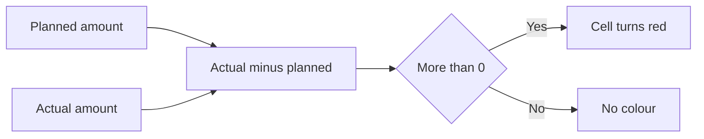

import PracticeFile from '@site/src/components/PracticeFile';

## Goal

By the end of this lesson, you can build a monthly family budget that compares planned and actual
spending, colours overspending red and shows it in a chart.

## Why It Matters

Every home in Pakistan has the same question at the end of the month: where did the money go?
Rent, groceries, the electricity bill and school fees all come out of one income. A family that
writes a plan, and then checks it, can save for a wedding, school admission or an emergency. A small shop owner
can use the same sheet for the shop's monthly costs. In this project, Excel does every sum and
points out the overspending for you.

**Diagram in words:** The actual amount minus the planned amount is the difference. A difference
more than 0 means overspending, so the cell turns red.

## Key Terms

| Term | Simple meaning |
|------|----------------|
| Budget | A plan for the money of one month: how much comes in and where it will go. |
| Income | The money that comes in, like a salary or money from home tailoring. |
| Planned | The amount the family decides to spend on one thing, before the month starts. |
| Actual | The amount really spent, from the bills and receipts at the end of the month. |
| Difference | Actual minus planned. A plus number means more was spent than planned. A minus number means less. |
| Share of income | How many rupees out of every 100 rupees of income go to one expense. |
| Overspending | Spending more than you planned. |
| Legend | The small key on a chart that tells you which colour stands for what. |

Think of the budget as a shopping list with prices written before you go to the bazaar. At home,
you write the real price next to each one. The difference shows where the list and the bazaar did
not agree.

## Step by Step

:::info[Practice files]

- <PracticeFile href="/files/excel/project-family-budget/october-budget-starter.xlsx">Download the starter file: October Budget</PracticeFile>.
  It has the incomes, the expenses and the planned and actual amounts already typed in, so that
  you can start at step 3.
- <PracticeFile href="/files/excel/project-family-budget/october-budget-finished.xlsx">Download the finished file: October Budget</PracticeFile>.
  It has every formula, the number format, the red rule and the chart in place. Open it after
  you finish, to compare with your work.

:::

**The story.** Tariq and Shabana live in Faisalabad with their two children. Tariq has a salary,
and Shabana earns from home tailoring. At the start of October, they planned how much to spend on
each thing. Now the month is over, and they have the real bills.

**What the sheet is for.** The sheet shows the total income, the plan and the real spending side
by side. It shows each expense as a share of the income and the money left at the end. Red cells
show where the family spent more than planned, and a chart shows it as a picture.

Savings is in the list on purpose. The family puts money aside first, like a bill they pay to
themselves.

| Row | A | B | C | D | E |
|-----|---|---|---|---|---|
| 1 | Income | Amount (Rs) | | | |
| 2 | Salary | 78000 | | | |
| 3 | Home tailoring | 14000 | | | |
| 4 | Total income | `=SUM(B2:B3)` gives 92000 | | | |
| 5 | | | | | |
| 6 | Expense | Planned (Rs) | Actual (Rs) | Difference (Rs) | Share of Income (%) |
| 7 | House rent | 22000 | 22000 | `=C7-B7` gives 0 | `=ROUND(C7/$B$4*100,1)` gives 23.9 |
| 8 | Groceries | 20000 | 21650 | 1650 | 23.5 |
| 9 | Electricity | 7500 | 8930 | 1430 | 9.7 |
| 10 | Gas | 2500 | 2180 | -320 | 2.4 |
| 11 | School fees | 8500 | 8500 | 0 | 9.2 |
| 12 | Transport | 5000 | 5640 | 640 | 6.1 |
| 13 | Mobile | 1500 | 1350 | -150 | 1.5 |
| 14 | Savings | 10000 | 10000 | 0 | 10.9 |
| 15 | Total | `=SUM(B7:B14)` gives 77000 | 80250 | 3250 | 87.2 |
| 16 | | | | | |
| 17 | Money left (Rs) | `=B4-C15` gives 11750 | | | |

**Type the incomes and the expenses**

1. Open a new blank workbook ([Lesson 7.1](starting-excel.mdx)). Type rows 1 to 3 of the table.
   Type Total income in A4. The incomes come first, because every share is worked out from them.
2. Type the headings in row 6 and the expenses in rows 7 to 14, with the planned and actual
   amounts. Type Total in A15 and Money left (Rs) in A17. Leave every other cell empty.

**The total income**

3. Select B4. Type `=SUM(B2:B3)` and press **Enter** ([Lesson 7.8](sum-and-average.mdx)).
   *B4 shows 92000.* This is all the money the family has for the month.

**The totals of the plan and the spending**

4. Select B15. Type `=SUM(B7:B14)` and press **Enter**. *B15 shows 77000*, the total of the plan.
5. Drag the fill handle of B15 across to C15 ([Lesson 7.7](fill-handle.mdx)), so that the actual
   amounts get their own total. *C15 shows 80250.* The family spent more than it planned.

**The difference: where the plan went wrong**

6. Select D7. Type `=C7-B7` and press **Enter** ([Lesson 7.6](first-formulas.mdx)). Actual minus
   planned shows how far the spending moved from the plan. *D7 shows 0*, because the rent was
   exactly as planned.
7. Drag the fill handle of D7 down to D15. *D8 shows 1650, D9 shows 1430 and D12 shows 640.*
   These are plus numbers, so the family spent more on groceries, electricity and transport.
   *D10 shows -320 and D13 shows -150.* Minus numbers mean less was spent on gas and the mobile.
   *D15 shows 3250*, the overspending for the whole month.

**The share of income, rounded**

8. Select E7. Type `=ROUND(C7/$B$4*100,1)` and press **Enter**. *E7 shows 23.9.* This means
   rent takes about 23.9 rupees out of every 100 rupees of income.

Here is how the formula works. `C7/$B$4*100` divides the rent by the income and changes it into a
percentage. The `$` signs keep B4 fixed when you fill the formula down
([Lesson 7.14](absolute-references.mdx)). ROUND with 1 keeps one decimal place, so that the
number is short and clear ([Lesson 7.20](iferror-and-round.mdx)).

9. Drag the fill handle of E7 down to E15. *E8 to E14 show 23.5, 9.7, 2.4, 9.2, 6.1, 1.5 and
   10.9.* *E15 shows 87.2*: the family spent 87.2% of its income this month.

**The money left**

10. Select B17. Type `=B4-C15` and press **Enter**. Income minus everything spent is the money left
    in hand. *B17 shows 11750.*

**Number formats: make the money clear**

11. Select B2 to B4. On the **Home** tab, select the dialog box launcher next to **Number**.
    *The **Format Cells** box opens.*
12. In the **Category** list, select **Number**. Type 0 in **Decimal places**. Check **Use 1000
    Separator (,)** and select **OK** ([Lesson 7.5](number-formats.mdx)). *B4 shows 92,000.* The
    comma makes big amounts quicker to read.
13. Give B7 to D15 and B17 the same format. *C15 shows 80,250, D10 shows -320 and B17 shows
    11,750.*

**Colour the overspending red**

14. Select D7 to D15, the differences and their total. The rule will check every cell you select.
15. On the **Home** tab, select **Conditional Formatting** > **Highlight Cells Rules** >
    **Greater Than** ([Lesson 7.27](conditional-formatting.mdx)).
16. Type 0 as the value. Pick a red format and select **OK**. *D8, D9, D12 and D15 turn red.* A
    difference more than 0 means overspending, so the red cells are the warnings.

**A chart of the plan and the spending**

17. Select A6 to C14: the headings, the expenses, and the planned and actual amounts. Leave out
    the Total row. Its columns would be very tall and make the others look tiny.
18. On the **Insert** tab, select **Recommended Charts**. Select the **All Charts** tab, then
    **Column**, then **OK** ([Lesson 7.11](simple-chart.mdx)). *A chart appears with two columns
    for each expense.*

    :::tip[If your screen looks different]

    If you do not get a plain column chart, select **Undo**, so that the chart goes away. Select
    A6 to C14 again. On the **Insert** tab, select **Insert Column or Bar Chart**. Then choose
    **Clustered Column**.

    :::

19. Select the **Chart Title** box. Select it again, select the words, and type **Planned and
    Actual Spending**. If you see no title box, select the **+** sign at the top-right of the
    chart, then the **Chart Title** check box.
20. Drag the chart to the right of the table, so that it does not cover any numbers.
21. Read the legend. It tells you which colour is Planned and which is Actual. Where the Actual
    column is taller, the family spent more than planned: Groceries, Electricity and Transport.
22. Save the workbook with the name **Family Budget**
    ([Lesson 7.2](entering-editing-saving-data.mdx)), so that your work is kept.

Tariq and Shabana can now see it at a glance. They kept Rs 11,750, but groceries and electricity
went over the plan. Next month, they can plan a little more for these, or try to spend less.

{/* Screenshot to add: The finished October budget with D8, D9, D12 and D15 in red, and the Planned and Actual Spending column chart to the right of the table. */}

## Practice

:::info[Practice files]

- <PracticeFile href="/files/excel/project-family-budget/peshawar-budget-starter.xlsx">Download the starter file: Peshawar Budget</PracticeFile>.
  It has the incomes, the expenses and the amounts already typed in. Use it if you want more time
  for the formulas.
- <PracticeFile href="/files/excel/project-family-budget/peshawar-budget-finished.xlsx">Download the finished file: Peshawar Budget</PracticeFile>.
  It shows the end of the task, with Transport changed to 4900. Open it after you finish.

:::

Rashid and Nargis live in Peshawar. Rashid runs a small shop, and Nargis gives home tuition. Build
their October budget with the same layout as the Step by Step. Leave the formula cells empty when
you type.

| Row | A | B | C |
|-----|---|---|---|
| 1 | Income | Amount (Rs) | |
| 2 | Shop income | 62000 | |
| 3 | Home tuition | 15000 | |
| 4 | Total income | | |
| 6 | Expense | Planned (Rs) | Actual (Rs) |
| 7 | House rent | 18000 | 18000 |
| 8 | Groceries | 19000 | 18400 |
| 9 | Electricity | 6500 | 7860 |
| 10 | Gas | 2800 | 3150 |
| 11 | School fees | 7000 | 7000 |
| 12 | Transport | 4500 | 4300 |
| 13 | Mobile | 1200 | 1290 |
| 14 | Savings | 8000 | 8000 |
| 15 | Total | | |
| 17 | Money left (Rs) | | |

1. Open a new blank workbook. Type the table. Type Difference (Rs) in D6 and Share of Income (%)
   in E6.
2. In B4, type `=SUM(B2:B3)`. Check: B4 shows 77000.
3. In B15, type `=SUM(B7:B14)` and fill it across to C15. Check: B15 shows 67000 and C15 shows
   68000.
4. In D7, type `=C7-B7` and fill it down to D15. Check: D15 shows 1000.
5. In E7, type `=ROUND(C7/$B$4*100,1)` and fill it down to E15. Check: E7 shows 23.4 and E15 shows
   88.3.
6. In B17, type `=B4-C15`. Check: B17 shows 9000.
7. Give B2 to B4, B7 to D15 and B17 the **Number** format with 0 decimal places and **Use 1000
   Separator (,)**.
8. Select D7 to D15 and add the **Greater Than** rule with the value 0 and a red format. Check:
   D9, D10, D13 and D15 turn red.
9. Select A6 to C14 and insert a column chart with the title **Planned and Actual Spending**.
   Move it to the right of the table.
10. Nargis finds a rickshaw receipt she forgot. The real transport cost was 4900, not 4300. Select
    C12, type 4900 and press **Enter**. Watch the red colour, the totals and the chart change by
    themselves.
11. Save the workbook with the name **Peshawar Budget**.
12. Check your work: B4 shows 77,000. D7 to D15 show 0, -600, 1,360, 350, 0, 400, 90, 0 and
    1,600. E7 to E15 show 23.4, 23.9, 10.2, 4.1, 9.1, 6.4, 1.7, 10.4 and 89.1. B15 shows 67,000,
    C15 shows 68,600 and B17 shows 8,400. D9, D10, D12, D13 and D15 are red. In the chart, the
    Actual column for Transport is now taller than the Planned one.

## Check Questions

1. Open your Family Budget. Point to the cell that shows the money left. What does it show, and
   how is it worked out?

   

   
Show answer

   **Answer:** Cell B17. It shows 11,750: the total income 92,000 minus the total spent 80,250.

   

2. D10 shows -320 for gas. Is it red? What does the minus sign tell the family?

   

   
Show answer

   **Answer:** No, it is not red. The rule colours only numbers greater than 0. The minus sign
   means the family spent 320 rupees less on gas than planned.

   

3. Someone types `=ROUND(C7/B4*100,1)` in E7, without the `$` signs, and fills it down. What does
   E8 show, and why?

   

   
Show answer

   **Answer:** `#DIV/0!`. In E8 the formula becomes `=ROUND(C8/B5*100,1)`. B5 is empty, and Excel
   cannot divide by an empty cell. Write `$B$4`, so that every row divides by the income.

   

## Common Mistakes

- **Leaving out the `$` signs on the income**, like `=ROUND(C7/B4*100,1)` → The rows below divide
  by empty cells and show `#DIV/0!`. Write `$B$4`.
- **Taking actual away from planned**, like `=B7-C7` → Overspending shows as a minus number, and
  the red rule colours the wrong cells. Use `=C7-B7`.
- **Selecting the Total row for the chart** → The Total columns are much taller, and the other
  columns look tiny. Select A6 to C14 only.
- **Selecting only D7 before making the red rule** → Only D7 is checked, and no other cell turns
  red. Select D7 to D15 first, then make the rule.

## Sources

*These official pages were checked when this lesson was written.*

- [Microsoft Support, "SUM function"](https://support.microsoft.com/en-us/office/sum-function-043e1c7d-7726-4e80-8f32-07b23e057f89) (applies to Excel 2021): "The SUM function adds values. You can add individual values, cell references or ranges or a mix of all three"; example `=SUM(A2:A10)`.
- [Microsoft Support, "Use Excel as your calculator"](https://support.microsoft.com/en-us/office/use-excel-as-your-calculator-a1abc057-ed11-443a-a635-68216555ad0a) (applies to Excel 2021): "All formula entries begin with an equal sign (=)"; "the minus sign (-) to subtract, the asterisk (*) to multiply, and the forward slash (/) to divide."
- [Microsoft Support, "ROUND function"](https://support.microsoft.com/en-us/office/round-function-c018c5d8-40fb-4053-90b1-b3e7f61a213c) (applies to Excel 2021): "The ROUND function rounds a number to a specified number of digits"; syntax `ROUND(number, num_digits)`; "If num_digits is greater than 0 (zero), then number is rounded to the specified number of decimal places."
- [Microsoft Support, "Switch between relative, absolute, and mixed references"](https://support.microsoft.com/en-us/office/switch-between-relative-absolute-and-mixed-references-dfec08cd-ae65-4f56-839e-5f0d8d0baca9) (applies to Excel 2021): "When you copy a formula that contains a relative cell reference, that reference in the formula will change"; "when you copy the formula =$B$4*$C$4 from D4 to D5, the formula stays exactly the same."
- [Microsoft Support, "Fill a formula down into adjacent cells"](https://support.microsoft.com/en-us/office/fill-a-formula-down-into-adjacent-cells-041edfe2-05bc-40e6-b933-ef48c3f308c6) (applies to Excel 2021): "Drag the fill handle across the cells that you want to fill"; "relative references will be put in place to ensure the formulas adjust for each row—unless you include absolute or mixed references before you fill the formula down."
- [Microsoft Support, "How to correct a #DIV/0! error"](https://support.microsoft.com/en-us/office/how-to-correct-a-div-0-error-3a5a18a9-8d80-4ebb-a908-39e759a009a5) (applies to Excel 2021): the error shows "when a formula refers to a cell that has 0 or is blank" (Check Question 3).
- [Microsoft Support, "Show or hide the thousands separator"](https://support.microsoft.com/en-us/office/show-or-hide-the-thousands-separator-b9f8aee0-ef50-42e5-8fd7-6e3ab1493876) (applies to Excel 2021): "On the Home tab, select the Dialog Box Launcher next to Number"; "On the Number tab, in the Category list, select Number"; "To display or hide the thousands separator, select or clear the Use 1000 Separator (,) check box."
- [Microsoft Support, "Format numbers as currency"](https://support.microsoft.com/en-us/office/format-numbers-as-currency-0a03bb38-1a07-458d-9e30-2b54366bc7a4) (applies to Excel 2021): "In the Decimal places box, enter the number of decimal places that you want for the number."
- [Microsoft Support, "Use conditional formatting to highlight information in Excel"](https://support.microsoft.com/en-us/office/use-conditional-formatting-to-highlight-information-in-excel-fed60dfa-1d3f-4e13-9ecb-f1951ff89d7f) (applies to Excel 2021): "examples of built-in conditional formatting criteria, such as Greater Than"; "On the Home tab, in the Style group, click the arrow next to Conditional Formatting, and then click Highlight Cells Rules. Select the command you want … Enter the values you want to use, and then select a format."
- [Microsoft Support, "Create a chart from start to finish"](https://support.microsoft.com/en-gb/office/create-a-chart-from-start-to-finish-0baf399e-dd61-4e18-8a73-b3fd5d5680c2) (applies to Excel 2021): "Select data for the chart"; "Select Insert > Recommended Charts"; "select the All Charts tab to see all chart types"; "Select a chart. Select OK"; "Charts contain several elements, such as a title, axis labels, a legend, and gridlines"; for a column chart, arrange the data "In columns or rows", with two series side by side in its example.
- [Microsoft Support, "Present your data in a column chart"](https://support.microsoft.com/en-us/office/present-your-data-in-a-column-chart-d89050ba-e6b6-47de-b090-e9ab353c4c00) (applies to Excel 2021): "On the Insert tab, select Insert Column or Bar Chart and choose a column chart option" (the backup way in the box after step 18).
- [Microsoft Support, "Available chart types in Office"](https://support.microsoft.com/en-us/office/available-chart-types-in-office-a6187218-807e-4103-9e0a-27cdb19afb90) (applies to Excel 2021): "Data that's arranged in columns or rows on a worksheet can be plotted in a column chart"; "A clustered column chart shows values in 2-D columns."
- [Microsoft Support, "Add or remove titles in a chart"](https://support.microsoft.com/en-us/office/excelexp/add-or-remove-titles-in-a-chart) (applies to Excel 2021): "In the chart, select the "Chart Title" box and type in a title"; "Select the + sign to the top-right of the chart."
- [Microsoft Support, "Edit titles or data labels in a chart"](https://support.microsoft.com/en-us/office/edit-titles-or-data-labels-in-a-chart-248bfe15-02ed-477a-81b6-b14e2c03b87e) (applies to Excel 2021): "Click again to place the title or data label in editing mode, drag to select the text that you want to change, type the new text or value."
- [Microsoft Support, "Move or resize a chart"](https://support.microsoft.com/en-us/office/move-or-resize-a-chart-f9d6087b-1d7b-4a72-8d81-1d0788ea783f) (applies to Excel 2021): "To move a chart, drag it to the location that you want."

All results were calculated and checked again before writing. October: income 78000 + 14000 =
92000; planned total 77000; actual total 80250; differences 0, 1650, 1430, −320, 0, 640, −150, 0,
total 3250; shares 22000 ÷ 92000 × 100 = 23.913 → 23.9, then 23.533 → 23.5, 9.707 → 9.7, 2.370 →
2.4, 9.239 → 9.2, 6.130 → 6.1, 1.467 → 1.5, 10.870 → 10.9, total 87.228 → 87.2; money left 92000 −
80250 = 11750. Peshawar: income 77000; planned 67000; actual 68000 (money left 9000, share 88.3);
after Transport becomes 4900, actual 68600, differences total 1600, money left 8400, shares 23.4,
23.9, 10.2, 4.1, 9.1, 6.4, 1.7, 10.4 and 89.1.
