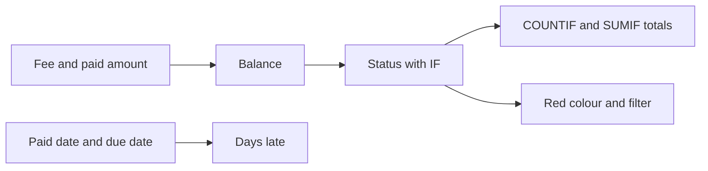

import PracticeFile from '@site/src/components/PracticeFile';

## Goal

By the end of this lesson, you can build a fee record that works out each student's balance,
status and days late, adds up the unpaid fees by group, and lists only the unpaid students.

## Why It Matters

Tuition centres, schools and computer courses in Pakistan collect fees every month. Some
students pay on time, some pay late, and some pay only part. The owner must know who still
owes money, how much, and how late. A tuition centre in Lahore and a computer course in Quetta
have the same work. A paper register makes this slow. In this project, Excel finds every
unpaid student and adds up what is still owed.

**Diagram in words:** Fee minus the paid amount gives the balance, and IF turns it into Paid or
Unpaid. The two dates give the days late. COUNTIF and SUMIF add up the unpaid fees, and a
colour rule and a filter show the unpaid list.

## Key Terms

| Term | Simple meaning |
|------|----------------|
| Fee record | A list of students with the fee each one must pay and what each one has paid. |
| Group | The students who study together, like Grade 9, or the Morning group of a course. |
| Balance | The money still owed: the fee minus the amount paid. |
| Due date | The last day to pay the fee without being late. |
| Days late | How many days after the due date the student paid. 0 means on time or early. |
| Unpaid list | The students who still owe some money. The owner calls them or sends a reminder. |

Think of a milk seller's notebook. Each house has a monthly bill. Next to each name, he writes
what was paid. At the end of the month, he reads only the names that still owe money. The
filter in this project gives you that short list.

## Step by Step

:::info[Practice files]

- <PracticeFile href="/files/excel/project-fee-record/tuition-fees-starter.xlsx">Download the starter file: Tuition Fees</PracticeFile>.
  It has the due date, the students, fees, payments and dates already typed in, so that you can
  start at step 3.
- <PracticeFile href="/files/excel/project-fee-record/tuition-fees-finished.xlsx">Download the finished file: Tuition Fees</PracticeFile>.
  It shows the whole record done: the formulas, the red Unpaid cells and the filter. Open it
  after you finish, to compare with your work.

:::

**The story.** Mr Rashid runs a tuition centre in Lahore for Grades 8, 9 and 10. The November
fee was due on 10 November 2026. Some students paid only part of it. Now he wants the list of
students who still owe money, and the total for each group.

**What the sheet is for.** The due date sits in one cell, B1. Columns F, G and H work out the
balance, the status and the days late. Rows 15 to 19 add up the unpaid fees. The filter shows
only the unpaid students.

**Typing dates:** the table writes dates as day/month/year, like 12/11/2026 for 12 November
2026. If your computer puts the month first, type the month first, like 11/12/2026. See
[Lesson 7.24](working-with-dates.mdx).

Type this table. Leave F to H and B15 to B19 empty for now.

| Row | A | B | C | D | E |
|-----|---|---|---|---|---|
| 1 | Due date | 10/11/2026 | | | |
| 3 | Student | Group | Fee (Rs) | Paid (Rs) | Paid On |
| 4 | Ahmed Raza | Grade 8 | 2500 | 2500 | 8/11/2026 |
| 5 | Zainab Ali | Grade 8 | 2500 | 1500 | 12/11/2026 |
| 6 | Hamid Nawaz | Grade 9 | 3000 | 3000 | 10/11/2026 |
| 7 | Sana Tariq | Grade 9 | 3000 | 2000 | 15/11/2026 |
| 8 | Omer Farooq | Grade 9 | 3000 | 3000 | 14/11/2026 |
| 9 | Hina Akram | Grade 10 | 3500 | 3500 | 9/11/2026 |
| 10 | Danish Iqbal | Grade 10 | 3500 | 1000 | 20/11/2026 |
| 11 | Maham Shah | Grade 8 | 2500 | 2500 | 11/11/2026 |
| 12 | Fahad Butt | Grade 10 | 3500 | 2000 | 18/11/2026 |
| 13 | Amna Yousaf | Grade 9 | 3000 | 1500 | 25/11/2026 |
| 15 | Unpaid students | | | | |
| 16 | Unpaid Grade 8 (Rs) | | | | |
| 17 | Unpaid Grade 9 (Rs) | | | | |
| 18 | Unpaid Grade 10 (Rs) | | | | |
| 19 | Total unpaid (Rs) | | | | |

Type these headings in F3 to H3: Balance (Rs), Status and Days Late. Leave rows 2 and 14 empty.
Row 14 keeps the totals apart from the student list, so that the filter does not hide them.

**Type the data**

1. Open a new blank workbook ([Lesson 7.1](starting-excel.mdx)). Type the table and the
   headings. Make column A wider if the words do not fit ([Lesson 7.3](rows-and-columns.mdx)).
2. Check every fee, payment and date. One wrong number puts a student on the wrong list.

**Balance and status**

3. Select F4. Type `=C4-D4` and press **Enter** ([Lesson 7.6](first-formulas.mdx)). The fee
   minus what was paid is what is still owed. *F4 shows 0.*
4. Select G4. Type `=IF(F4>0,"Unpaid","Paid")` and press **Enter**
   ([Lesson 7.15](if-function.mdx)). The test asks "Is any money still owed?". *G4 shows Paid.*

**Days late**

5. Select H4. Type `=IF(E4>$B$1,E4-$B$1,0)` and press **Enter**. If the student paid after
   the due date, Excel counts the days between the two dates. If not, the answer is 0. *H4
   shows 0, because Ahmed paid on 8 November.*

   Dates are stored as numbers, so one date minus another gives the days between them
   ([Lesson 7.24](working-with-dates.mdx)). The `$` signs keep B1 fixed when you fill down
   ([Lesson 7.14](absolute-references.mdx)).

:::tip[If your screen looks different]

If H4 shows a date instead of a number, the cell has a date format. Select H4 to H13. On the
**Home** tab, in the **Number** group, open the **Number Format** list and select **General**
([Lesson 7.5](number-formats.mdx)). The numbers of days then show.

:::

**Fill the formulas for everyone**

6. Select F4 to H4. Drag the fill handle down to row 13 ([Lesson 7.7](fill-handle.mdx)), so
   that every student gets all three formulas.
7. Look at Hamid in row 6. He paid on 10 November, the due date itself. *H6 shows 0.* 10
   November is not after 10 November, so he is not late.

These are the correct results:

| Row | Student | Balance (Rs) | Status | Days Late |
|-----|---------|--------------|--------|-----------|
| 4 | Ahmed Raza | 0 | Paid | 0 |
| 5 | Zainab Ali | 1000 | Unpaid | 2 |
| 6 | Hamid Nawaz | 0 | Paid | 0 |
| 7 | Sana Tariq | 1000 | Unpaid | 5 |
| 8 | Omer Farooq | 0 | Paid | 4 |
| 9 | Hina Akram | 0 | Paid | 0 |
| 10 | Danish Iqbal | 2500 | Unpaid | 10 |
| 11 | Maham Shah | 0 | Paid | 1 |
| 12 | Fahad Butt | 1500 | Unpaid | 8 |
| 13 | Amna Yousaf | 1500 | Unpaid | 15 |

Omer paid the full fee, but 4 days late. Paid tells you about the money. Days Late tells you
about the time.

**Count and add up the unpaid fees**

8. Select B15. Type `=COUNTIF(G4:G13,"Unpaid")` and press **Enter**
   ([Lesson 7.17](counting-functions.mdx)). *B15 shows 5.*
9. Select B16. Type `=SUMIF(B4:B13,"Grade 8",F4:F13)` and press **Enter**
   ([Lesson 7.18](sumif-sumifs-averageif.mdx)). SUMIF looks for Grade 8 in column B and adds the
   balances in the same rows. *B16 shows 1000.*
10. In B17, type `=SUMIF(B4:B13,"Grade 9",F4:F13)`. In B18, type
    `=SUMIF(B4:B13,"Grade 10",F4:F13)`. *B17 shows 2500 and B18 shows 4000.*
11. Select B19. Type `=SUM(F4:F13)` and press **Enter**. *B19 shows 7500.*
12. Check the totals: 1000 + 2500 + 4000 = 7500. The three groups together owe the same as the
    whole list. Mr Rashid still has Rs 7500 to collect.

**Make Unpaid red**

13. Select G4 to G13, the Status cells.
14. On the **Home** tab, select **Conditional Formatting**, then **Highlight Cells Rules**, then
    **Text that Contains** ([Lesson 7.27](conditional-formatting.mdx)).
15. In the box, type Unpaid. Choose a red format and select **OK**. *G5, G7, G10, G12 and G13
    turn red.*

**Filter the unpaid list**

16. Select A3 to H13, so that the filter covers the headings and the students, but not the
    totals ([Lesson 7.26](filtering-data.mdx)).
17. On the **Data** tab, select **Filter**. *An arrow appears in each heading cell in row 3.*
18. Select the arrow in G3, the Status heading. Uncheck **(Select All)**, check **Unpaid**, and
    select **OK**. *Only rows 5, 7, 10, 12 and 13 show: Zainab, Sana, Danish, Fahad and Amna.*
19. Save the workbook with the name **Tuition Fees**
    ([Lesson 7.2](entering-editing-saving-data.mdx)), so that your work is kept.

The hidden rows are not deleted, and the totals in rows 15 to 19 still count every student. To
see every row again, select the arrow in G3, check **(Select All)** and select **OK**.

{/* Screenshot to add: The filtered Tuition Fees sheet showing only the five Unpaid rows in red, the filter arrow on the Status heading and the totals in rows 15 to 19. */}

## Practice

:::info[Practice files]

- <PracticeFile href="/files/excel/project-fee-record/course-fees-starter.xlsx">Download the starter file: Course Fees</PracticeFile>.
  It has the due date, the students, fees, payments, dates and labels already typed in. Use it if
  you want more time for the formulas.
- <PracticeFile href="/files/excel/project-fee-record/course-fees-finished.xlsx">Download the finished file: Course Fees</PracticeFile>.
  It shows the end of the task, after Faizan's payment, with the filter on. Open it after you
  finish.

:::

A computer course centre in Quetta has a Morning group and an Evening group. The December fee
was due on 5 December 2026. Build its fee record with the same layout. The students are in rows
4 to 11, so the totals are in rows 13 to 16.

| Row | A | B | C | D | E |
|-----|---|---|---|---|---|
| 1 | Due date | 5/12/2026 | | | |
| 3 | Student | Group | Fee (Rs) | Paid (Rs) | Paid On |
| 4 | Rizwan Ali | Morning | 4000 | 4000 | 3/12/2026 |
| 5 | Saima Noreen | Evening | 3500 | 2000 | 7/12/2026 |
| 6 | Jawad Khan | Morning | 4000 | 2500 | 9/12/2026 |
| 7 | Ayesha Rehman | Evening | 3500 | 3500 | 5/12/2026 |
| 8 | Tahir Mehmood | Morning | 4000 | 4000 | 12/12/2026 |
| 9 | Nimra Saleem | Evening | 3500 | 1000 | 15/12/2026 |
| 10 | Faizan Ahmed | Morning | 4000 | 3000 | 6/12/2026 |
| 11 | Komal Aziz | Evening | 3500 | 3500 | 4/12/2026 |
| 13 | Unpaid students | | | | |
| 14 | Unpaid Morning (Rs) | | | | |
| 15 | Unpaid Evening (Rs) | | | | |
| 16 | Total unpaid (Rs) | | | | |

1. Open the starter file, or type the table and the headings Balance (Rs), Status and Days Late
   in F3 to H3.
2. In F4, G4 and H4, type the three formulas from the Step by Step: `=C4-D4`,
   `=IF(F4>0,"Unpaid","Paid")` and `=IF(E4>$B$1,E4-$B$1,0)`. Fill them down to row 11.
3. In B13, type `=COUNTIF(G4:G11,"Unpaid")`. Check: B13 shows 4.
4. In B14, type `=SUMIF(B4:B11,"Morning",F4:F11)`. In B15, type
   `=SUMIF(B4:B11,"Evening",F4:F11)`. In B16, type `=SUM(F4:F11)`. Check: B14 shows 2500,
   B15 shows 4000 and B16 shows 6500.
5. Faizan comes back on 8 December and pays the other Rs 1000. Select D10 and type 4000. Select
   E10 and type 8/12/2026. Watch his balance, status and days late change by themselves.
6. Select G4 to G11. Add a **Text that Contains** rule for Unpaid with a red format.
7. Select A3 to H11. On the **Data** tab, select **Filter**. Filter the Status column to show
   only **Unpaid**.
8. Save the workbook with the name **Course Fees**.
9. Check your work: after Faizan's payment, F4 to F11 show 0, 1500, 1500, 0, 0, 2500, 0 and 0.
   H4 to H11 show 0, 2, 4, 0, 7, 10, 3 and 0. B13 shows 3, B14 shows 1500, B15 shows 4000 and
   B16 shows 5500. After the filter, only Saima, Jawad and Nimra show, all three in red.

**Answer key (after Faizan's payment)**

| Row | Student | Balance (Rs) | Status | Days Late |
|-----|---------|--------------|--------|-----------|
| 4 | Rizwan Ali | 0 | Paid | 0 |
| 5 | Saima Noreen | 1500 | Unpaid | 2 |
| 6 | Jawad Khan | 1500 | Unpaid | 4 |
| 7 | Ayesha Rehman | 0 | Paid | 0 |
| 8 | Tahir Mehmood | 0 | Paid | 7 |
| 9 | Nimra Saleem | 2500 | Unpaid | 10 |
| 10 | Faizan Ahmed | 0 | Paid | 3 |
| 11 | Komal Aziz | 0 | Paid | 0 |

Before Faizan's payment, F10 showed 1000, G10 showed Unpaid and H10 showed 1.

## Check Questions

1. Open your Tuition Fees sheet. Point to the cell that shows how much Grade 10 still owes. What
   number is in it?

   

   
Show answer

   **Answer:** Cell B18. It shows 4000: Danish owes 2500 and Fahad owes 1500.

   

2. Maham paid the full fee on 11 November. What do G11 and H11 show, and why?

   

   
Show answer

   **Answer:** G11 shows Paid, because her balance is 0. H11 shows 1, because 11 November is one
   day after the due date, 10 November.

   

3. Sana pays her remaining Rs 1000. Which totals change, and to what?

   

   
Show answer

   **Answer:** Her balance becomes 0 and her status becomes Paid. B15 changes to 4, B17
   (Grade 9) to 1500, and B19 to 6500.

   

## Common Mistakes

- **Subtracting the wrong way round**, like `=D4-C4` → The balances come out as minus numbers,
  like −1000, and every status shows Paid. Take the paid amount away from the fee: `=C4-D4`.
- **Forgetting the `$` signs**, like `=IF(E4>B1,E4-B1,0)` → After filling down, the formulas
  use B2, B3 and other wrong cells. The days late come out wrong. Write `$B$1`.
- **Selecting the totals for the filter too**, like A3 to H19 → The total rows hide when you
  filter. Select only A3 to H13. The empty row 14 keeps them apart.
- **Typing the group differently in SUMIF**, like `"Grade9"` → The cell shows 0, because no
  cell in column B matches. Type the group exactly as it is in column B.

## Sources

*These official pages were checked when this lesson was written.*

- [Microsoft Support, "Use Excel as your calculator"](https://support.microsoft.com/en-us/office/use-excel-as-your-calculator-a1abc057-ed11-443a-a635-68216555ad0a) (applies to Excel 2021): "All formula entries begin with an equal sign (=)"; "the minus sign (-) to subtract".
- [Microsoft Support, "IF function"](https://support.microsoft.com/en-us/office/if-function-69aed7c9-4e8a-4755-a9bc-aa8bbff73be2) (applies to Excel 2021): "Use the IF function, one of the logical functions, to return one value if a condition is true and another value if it's false"; syntax "IF(logical_test, value_if_true, [value_if_false])"; "If you are going to use text in formulas, you need to wrap the text in quotes"; example `=IF(C2>B2,C2-B2,0)`: "instead of returning a text result, we are going to return a mathematical calculation".
- [Microsoft Support, "Calculation operators and precedence in Excel"](https://support.microsoft.com/en-us/office/calculation-operators-and-precedence-in-excel-48be406d-4975-4d31-b2b8-7af9e0e2878a) (applies to Excel 2021): "When two values are compared by using these operators, the result is a logical value either TRUE or FALSE"; "`>` (greater than sign) Greater than".
- [Microsoft Support, "DATEDIF function"](https://support.microsoft.com/en-us/office/datedif-function-25dba1a4-2812-480b-84dd-8b32a451b35c) (applies to Excel 2021), tip on finding days by subtracting one date from another: "This works because dates are stored as numbers in Excel".
- [Microsoft Support, "Available number formats in Excel"](https://support.microsoft.com/en-us/office/available-number-formats-in-excel-0afe8f52-97db-41f1-b972-4b46e9f1e8d2) (applies to Excel 2021): "General: The default number format that Excel applies when you type a number"; "Date: Displays date and time serial numbers as date values" (the If your screen looks different box).
- [Microsoft Support, "Switch between relative, absolute, and mixed references"](https://support.microsoft.com/en-us/office/switch-between-relative-absolute-and-mixed-references-dfec08cd-ae65-4f56-839e-5f0d8d0baca9) (applies to Excel 2021): "When you copy a formula that contains a relative cell reference, that reference in the formula will change"; "when you copy the formula =$B$4*$C$4 from D4 to D5, the formula stays exactly the same."
- [Microsoft Support, "Fill a formula down into adjacent cells"](https://support.microsoft.com/en-us/office/fill-a-formula-down-into-adjacent-cells-041edfe2-05bc-40e6-b933-ef48c3f308c6) (applies to Excel 2021): "Drag the fill handle across the cells that you want to fill"; "relative references will be put in place to ensure the formulas adjust for each row—unless you include absolute or mixed references before you fill the formula down."
- [Microsoft Support, "Use the COUNTIF function in Microsoft Excel"](https://support.microsoft.com/en-us/excel/get-started/use-the-countif-function-in-microsoft-excel) (applies to Excel 2021): "count the number of cells that meet a criterion"; syntax `COUNTIF(range, criteria)`; example `=COUNTIF(A2:A5,"apples")`.
- [Microsoft Support, "SUMIF function"](https://support.microsoft.com/en-us/excel/functions/sumif-function) (applies to Excel 2021): "You use the SUMIF function to sum the values in a range that meet criteria that you specify"; syntax `SUMIF(range, criteria, [sum_range])`; "the formula =SUMIF(B2:B5, "John", C2:C5) sums only the values in the range C2:C5, where the corresponding cells in the range B2:B5 equal "John.""; "Any text criteria or any criteria that includes logical or mathematical symbols must be enclosed in double quotation marks (")".
- [Microsoft Support, "SUM function"](https://support.microsoft.com/en-us/office/sum-function-043e1c7d-7726-4e80-8f32-07b23e057f89) (applies to Excel 2021): "The SUM function adds values."
- [Microsoft Support, "Use conditional formatting to highlight information in Excel"](https://support.microsoft.com/en-us/office/use-conditional-formatting-to-highlight-information-in-excel-fed60dfa-1d3f-4e13-9ecb-f1951ff89d7f) (applies to Excel 2021): "On the Home tab, in the Style group, click the arrow next to Conditional Formatting, and then click Highlight Cells Rules"; "Select the command you want, such as Between, Equal To Text that Contains, or A Date Occurring"; "If the Text that Contains dialog box appears, enter the formatting option you want to apply and click OK".
- [Microsoft Support, "Use AutoFilter to filter your data"](https://support.microsoft.com/en-us/office/use-autofilter-to-filter-your-data-7d87d63e-ebd0-424b-8106-e2ab61133d92) (applies to Excel 2021): "Select the data you want to filter. Click Data > Filter"; "Click the arrow in the column header"; "Uncheck (Select All) to clear all of the check boxes, and then check the boxes for the specific value(s) you want to see"; "Click OK to apply the filter."
- [Microsoft Support, "Filter data in a range or table in Excel"](https://support.microsoft.com/en-us/office/filter-data-in-a-range-or-table-01832226-31b5-4568-8806-38c37dcc180e) (applies to Excel 2021): "Use filters to temporarily hide some of the data in a table, so you can focus on the data you want"; "Filtered data displays only the rows that meet criteria that you specify and hides rows that you do not want displayed."

All results were worked out again before writing, with Python's date arithmetic. Tuition centre
(due 10 November 2026): balances 0, 1000, 0, 1000, 0, 0, 2500, 0, 1500, 1500; days late 0
(8 Nov), 2, 0 (10 Nov), 5, 4, 0 (9 Nov), 10, 1, 8, 15; unpaid 5; Grade 8 owes 1000, Grade 9
1000 + 1500 = 2500, Grade 10 2500 + 1500 = 4000, total 7500. Course centre (due 5 December
2026), after Faizan's payment: balances 0, 1500, 1500, 0, 0, 2500, 0, 0; days late 0, 2, 4, 0,
7, 10, 3, 0; unpaid 3; Morning 1500, Evening 1500 + 2500 = 4000, total 5500. Before the payment:
unpaid 4, Morning 2500, total 6500.
