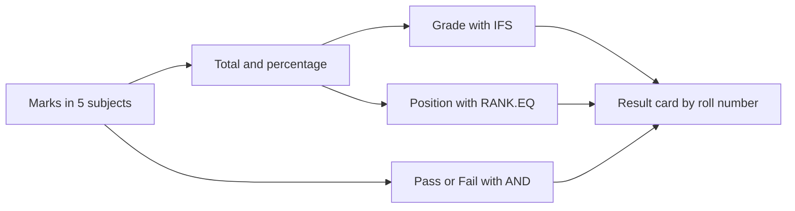

import PracticeFile from '@site/src/components/PracticeFile';

## Goal

By the end of this lesson, you can build a result sheet that gives every student a total,
percentage, grade, pass or fail and position, and shows one student's result card by roll
number.

## Why It Matters

Every school and tuition centre in Pakistan makes results after a test. Parents ask three
questions. How many marks? What grade? What position? A school in Bahawalpur may have 40
students in one section, and a tuition centre in Karachi may have 15. Working out each result
by hand takes hours, and one mistake upsets a family. In this project, Excel does every sum,
gives the grades and positions, and finds any student's result in a second.

**Diagram in words:** The marks give the total and the percentage. The percentage gives the
grade, the marks give Pass or Fail, and the total gives the position. VLOOKUP brings them
together on one student's result card.

## Key Terms

| Term | Simple meaning |
|------|----------------|
| Roll number | A number that belongs to one student only. Two students can share a name, but never a roll number. |
| Full marks | The most marks a student can get. Five subjects out of 100 each make 500. |
| Grade | A letter that sums up the percentage: A, B, C, D or F. |
| Pass mark | The least marks needed to pass one subject. Here it is 40 out of 100. |
| Position | A student's place in the results: 1st, 2nd, 3rd and so on, by total marks. |
| Result card | A short report of one student's result: name, total, percentage, grade, result and position. |

Think of a cricket scoreboard. Each player's runs add up to a total. The best total comes
first. When someone asks about one player, you read along that player's row. A result sheet
works the same way.

## Step by Step

:::info[Practice files]

- <PracticeFile href="/files/excel/project-result-card/school-result-starter.xlsx">Download the starter file: School Result</PracticeFile>.
  It has the roll numbers, names, marks and labels already typed in, so that you can start at
  step 3.
- <PracticeFile href="/files/excel/project-result-card/school-result-finished.xlsx">Download the finished file: School Result</PracticeFile>.
  It shows the whole sheet done: the formulas, the result card for roll number 107 and the
  chart. Open it after you finish, to compare with your work.

:::

**The story.** Mrs Shaheen is in charge of Grade 9 at a high school in Bahawalpur. Her section took a
term test in five subjects, each out of 100. A student must get 40 or more in **every** subject
to pass. She needs a grade, a result and a position for each student. Parents will also come
and ask for one child's result.

**What the sheet is for.** Columns H to L work out each result. Rows 11 and 12 count the passes
and fails. Rows 14 to 20 are the result card. Type a roll number in B14, and the card fills in
by itself.

These are the grade bands, the same as in [Lesson 7.16](ifs-and-or.mdx):

| Percentage | Grade |
|------------|-------|
| 80 or more | A |
| 70 to below 80 | B |
| 60 to below 70 | C |
| 40 to below 60 | D |
| Below 40 | F |

Type this table. Leave H to L, B11, B12 and B15 to B20 empty for now.

| Row | A | B | C | D | E | F | G |
|-----|---|---|---|---|---|---|---|
| 1 | Roll No | Name | English | Urdu | Maths | Science | Computer |
| 2 | 101 | Ayesha Siddiqui | 82 | 78 | 91 | 85 | 88 |
| 3 | 102 | Hassan Raza | 65 | 70 | 58 | 62 | 75 |
| 4 | 103 | Mahnoor Fatima | 74 | 81 | 69 | 77 | 80 |
| 5 | 104 | Ali Haider | 55 | 60 | 35 | 48 | 66 |
| 6 | 105 | Iqra Javed | 90 | 85 | 88 | 92 | 95 |
| 7 | 106 | Usman Ghani | 45 | 52 | 41 | 38 | 50 |
| 8 | 107 | Sidra Malik | 68 | 72 | 75 | 70 | 79 |
| 9 | 108 | Zeeshan Akhtar | 30 | 42 | 28 | 35 | 40 |
| 11 | Passed | | | | | | |
| 12 | Failed | | | | | | |
| 14 | Roll No | 104 | | | | | |
| 15 | Name | | | | | | |
| 16 | Total | | | | | | |
| 17 | Percentage | | | | | | |
| 18 | Grade | | | | | | |
| 19 | Result | | | | | | |
| 20 | Position | | | | | | |

Type these headings in H1 to L1: Total, Percentage, Grade, Result and Position.

**Type the marks**

1. Open a new blank workbook ([Lesson 7.1](starting-excel.mdx)). Type the table and the
   headings. Make column B wider if the names do not fit ([Lesson 7.3](rows-and-columns.mdx)).
2. Check every mark against the table. One wrong mark changes a total, a grade and maybe a
   position.

**Total and percentage**

3. Select H2. Type `=SUM(C2:G2)` and press **Enter** ([Lesson 7.8](sum-and-average.mdx)).
   *H2 shows 424.*
4. Select I2. Type `=H2/500*100` and press **Enter**. The full marks are 500, so this turns
   Ayesha's total into a percentage. *I2 shows 84.8.*

**The grade with IFS**

5. Select J2. Type `=IFS(I2>=80,"A",I2>=70,"B",I2>=60,"C",I2>=40,"D",TRUE,"F")` and press
   **Enter**. IFS checks the tests in order and gives the answer for the first one that is
   true. `TRUE` at the end catches everything below 40. *J2 shows A.*

**Pass or Fail with AND**

6. Select K2. Type `=IF(AND(C2>=40,D2>=40,E2>=40,F2>=40,G2>=40),"Pass","Fail")` and press
   **Enter**. AND is true only when all five marks are 40 or more. *K2 shows Pass.*

**The position with RANK.EQ**

7. Select L2. Type `=RANK.EQ(H2,$H$2:$H$9)` and press **Enter** ([Lesson 7.21](rank-eq.mdx)).
   The biggest total gets position 1. The `$` signs keep the list of totals fixed when you fill
   down. *L2 shows 2.*

**Fill the formulas for everyone**

8. Select H2 to L2. Drag the fill handle down to row 9 ([Lesson 7.7](fill-handle.mdx)), so
   that every student gets all five formulas.
9. Look at Ali Haider in row 5. *J5 shows D, but K5 shows Fail.* His percentage is 52.8, so his
   grade is D. But his Maths mark is 35, below 40, so he fails. The grade looks at the
   percentage. The result looks at every subject.

These are the correct results:

| Row | Name | Total | Percentage | Grade | Result | Position |
|-----|------|-------|------------|-------|--------|----------|
| 2 | Ayesha Siddiqui | 424 | 84.8 | A | Pass | 2 |
| 3 | Hassan Raza | 330 | 66 | C | Pass | 5 |
| 4 | Mahnoor Fatima | 381 | 76.2 | B | Pass | 3 |
| 5 | Ali Haider | 264 | 52.8 | D | Fail | 6 |
| 6 | Iqra Javed | 450 | 90 | A | Pass | 1 |
| 7 | Usman Ghani | 226 | 45.2 | D | Fail | 7 |
| 8 | Sidra Malik | 364 | 72.8 | B | Pass | 4 |
| 9 | Zeeshan Akhtar | 175 | 35 | F | Fail | 8 |

**Count the passes with COUNTIF**

10. Select B11. Type `=COUNTIF(K2:K9,"Pass")` and press **Enter**
    ([Lesson 7.17](counting-functions.mdx)). *B11 shows 5.*
11. Select B12. Type `=COUNTIF(K2:K9,"Fail")` and press **Enter**. *B12 shows 3.* 5 + 3 = 8,
    the number of students.

**The result card with VLOOKUP**

VLOOKUP finds a value in the first column of a table and brings back a value from the same row
([Lesson 7.19](vlookup-and-xlookup.mdx)). Here it finds the roll number in column A.

12. Select B15. Type `=VLOOKUP(B14,A2:L9,2,FALSE)` and press **Enter**. It looks for 104 in
    column A, and brings back column 2 of the table, the name. `FALSE` means an exact match.
    *B15 shows Ali Haider.*
13. Type the same formula in B16 to B20, but change the column number. Use 8 for Total, 9 for
    Percentage, 10 for Grade, 11 for Result and 12 for Position. Count the columns from A: A is
    1, B is 2, and so on up to L, which is 12.
14. *B16 to B20 show 264, 52.8, D, Fail and 6.* This is Ali's result card.
15. A parent asks for roll number 107. Select B14, type 107 and press **Enter**. *The card
    changes to Sidra Malik, 364, 72.8, B, Pass and 4.*

Excel 2021 also has XLOOKUP, a newer way to look up a value. For example,
`=XLOOKUP(B14,A2:A9,B2:B9,"Not found")` also gives the name. You can learn it in
[Lesson 7.19](vlookup-and-xlookup.mdx). VLOOKUP works in every version of Excel.

**A chart of the totals**

16. Select B1 to B9. Hold **Ctrl** and select H1 to H9. *The names and the totals are
    selected.* The chart needs both, so that each column has a name.
17. On the **Insert** tab, select **Recommended Charts**. Select the **All Charts** tab, select
    **Column**, and select **OK** ([Lesson 7.11](simple-chart.mdx)). *A column chart appears.*
18. Change the chart title to **Total Marks**. Drag the chart to the right of the table, so that
    it does not cover the marks. *Iqra's column is the tallest, and Zeeshan's is the shortest.*
19. Save the workbook with the name **School Result**
    ([Lesson 7.2](entering-editing-saving-data.mdx)), so that your work is kept.

{/* Screenshot to add: The School Result sheet with the result card for roll number 107 in rows 14 to 20 and the Total Marks column chart to the right of the table. */}

## Practice

:::info[Practice files]

- <PracticeFile href="/files/excel/project-result-card/tuition-result-starter.xlsx">Download the starter file: Tuition Result</PracticeFile>.
  It has the roll numbers, names, marks and labels already typed in. Use it if you want more time
  for the formulas.
- <PracticeFile href="/files/excel/project-result-card/tuition-result-finished.xlsx">Download the finished file: Tuition Result</PracticeFile>.
  It has every formula, the result card for roll number 203 and the chart. Open it after you
  finish.

:::

A tuition centre in Karachi gives a monthly test to six students. Each subject is out of **50**,
so the full marks are 250. The pass mark is **20** in each subject. Build the same sheet. The
students are in rows 2 to 7, so Passed and Failed are in rows 9 and 10. The result card starts
in row 12. Use the same grade bands.

| Row | A | B | C | D | E | F | G |
|-----|---|---|---|---|---|---|---|
| 1 | Roll No | Name | English | Urdu | Maths | Science | Computer |
| 2 | 201 | Hamza Iqbal | 42 | 38 | 45 | 40 | 44 |
| 3 | 202 | Areeba Khan | 35 | 40 | 30 | 38 | 37 |
| 4 | 203 | Fahad Mirza | 25 | 30 | 18 | 28 | 32 |
| 5 | 204 | Noor Fatima | 40 | 44 | 39 | 41 | 45 |
| 6 | 205 | Saad Anwar | 30 | 33 | 35 | 29 | 31 |
| 7 | 206 | Laiba Aslam | 20 | 24 | 22 | 21 | 26 |
| 9 | Passed | | | | | | |
| 10 | Failed | | | | | | |
| 12 | Roll No | 203 | | | | | |
| 13 | Name | | | | | | |
| 14 | Total | | | | | | |
| 15 | Percentage | | | | | | |
| 16 | Grade | | | | | | |
| 17 | Result | | | | | | |
| 18 | Position | | | | | | |

1. Open the starter file, or type the table and the headings Total to Position in H1 to L1.
2. In H2, type `=SUM(C2:G2)`. In I2, type `=H2/250*100`, because the full marks are 250.
3. In J2, type the same IFS formula as in the Step by Step.
4. In K2, type `=IF(AND(C2>=20,D2>=20,E2>=20,F2>=20,G2>=20),"Pass","Fail")`. The pass mark is 20
   this time.
5. In L2, type `=RANK.EQ(H2,$H$2:$H$7)`. Select H2 to L2 and fill them down to row 7.
6. Look at Hamza and Noor. Both have 209, so both get position 1. Areeba comes next with
   position 3, because two students are ahead of her.
7. In B9, type `=COUNTIF(K2:K7,"Pass")`. In B10, type `=COUNTIF(K2:K7,"Fail")`.
8. In B13 to B18, type `=VLOOKUP(B12,A2:L7,2,FALSE)` and the same with 8, 9, 10, 11 and 12, as
   in the Step by Step.
9. Select B1 to B7, hold **Ctrl** and select H1 to H7. Make a column chart titled **Total
   Marks**.
10. Save the workbook with the name **Tuition Result**.
11. Check your work: H2 to H7 show 209, 180, 133, 209, 158 and 113. I2 to I7 show 83.6, 72,
    53.2, 83.6, 63.2 and 45.2. J2 to J7 show A, B, D, A, C and D. K2 to K7 show Pass, Pass,
    Fail, Pass, Pass and Pass. L2 to L7 show 1, 3, 5, 1, 4 and 6. B9 shows 5 and B10 shows 1.
    The card for 203 shows Fahad Mirza, 133, 53.2, D, Fail and 5.

**Answer key**

| Row | Name | Total | Percentage | Grade | Result | Position |
|-----|------|-------|------------|-------|--------|----------|
| 2 | Hamza Iqbal | 209 | 83.6 | A | Pass | 1 |
| 3 | Areeba Khan | 180 | 72 | B | Pass | 3 |
| 4 | Fahad Mirza | 133 | 53.2 | D | Fail | 5 |
| 5 | Noor Fatima | 209 | 83.6 | A | Pass | 1 |
| 6 | Saad Anwar | 158 | 63.2 | C | Pass | 4 |
| 7 | Laiba Aslam | 113 | 45.2 | D | Pass | 6 |

Laiba has the lowest total, but she passes. Every one of her marks is 20 or more.

## Check Questions

1. Open your School Result sheet. Type 102 in B14. Point to the cell that shows Hassan's
   position. What does it show?

   

   
Show answer

   **Answer:** Cell B20. It shows 5. B15 to B19 show Hassan Raza, 330, 66, C and Pass.

   

2. Usman Ghani has 45.2 percent, but his result is Fail. Why?

   

   
Show answer

   **Answer:** His Science mark is 38, below the pass mark of 40. AND needs every subject to be
   40 or more, so one low mark makes the result Fail.

   

3. A student's total is 400 out of 500. Work out the percentage and the grade.

   

   
Show answer

   **Answer:** 400 ÷ 500 × 100 = 80. 80 is 80 or more, so the grade is A.

   

## Common Mistakes

- **Putting the IFS tests in the wrong order**, like `=IFS(I2>=40,"D",I2>=80,"A", …)` → Everyone
  with 40 or more gets D. IFS stops at the first true test, so start with the highest band.
- **Forgetting the `$` signs in RANK.EQ**, like `=RANK.EQ(H2,H2:H9)` → After filling down, the
  list moves down one row each time, and the positions go wrong. Use `$H$2:$H$9`.
- **Counting the column number from the wrong place in VLOOKUP** → The card shows the wrong
  thing, like the grade instead of the result. Count from column A, the first column of the
  table: K is 11.
- **Leaving out `FALSE` in VLOOKUP** → VLOOKUP may look for a close match and give the wrong
  student. Always end with `FALSE` for an exact match.
- **Typing a roll number that is not in the list**, like 110 → The card shows `#N/A`. Check the
  roll number. You can also wrap the formula in IFERROR ([Lesson 7.20](iferror-and-round.mdx)).

## Sources

*These official pages were checked when this lesson was written.*

- [Microsoft Support, "SUM function"](https://support.microsoft.com/en-us/office/sum-function-043e1c7d-7726-4e80-8f32-07b23e057f89) (applies to Excel 2021): "The SUM function adds values. You can add individual values, cell references or ranges or a mix of all three."
- [Microsoft Support, "Use Excel as your calculator"](https://support.microsoft.com/en-us/office/use-excel-as-your-calculator-a1abc057-ed11-443a-a635-68216555ad0a) (applies to Excel 2021): "All formula entries begin with an equal sign (=)"; "the asterisk (*) to multiply, and the forward slash (/) to divide."
- [Microsoft Support, "IFS function"](https://support.microsoft.com/en-us/office/ifs-function-36329a26-37b2-467c-972b-4a39bd951d45) (applies to Excel 2021): "The IFS function checks whether one or more conditions are met, and returns a value that corresponds to the first TRUE condition"; example "=IFS(A2>89,"A",A2>79,"B",A2>69,"C",A2>59,"D",TRUE,"F")"; "multiple conditions need to be entered in the correct order"; "To specify a default result, enter TRUE for your final logical_test argument."
- [Microsoft Support, "Using IF with AND, OR and NOT functions in Excel"](https://support.microsoft.com/en-us/office/using-if-with-and-or-and-not-functions-in-excel-d895f58c-b36c-419e-b1f2-5c193a236d97) (applies to Excel 2021): "IF(AND(logical1, [logical2], ...), value_if_true, [value_if_false]))"; "You can also substitute Text or Numeric values for the TRUE/FALSE values to be returned."
- [Microsoft Support, "AND function"](https://support.microsoft.com/en-us/office/and-function-5f19b2e8-e1df-4408-897a-ce285a19e9d9) (applies to Excel 2021): "The AND function returns TRUE if all its arguments evaluate to TRUE, and returns FALSE if one or more arguments evaluate to FALSE".
- [Microsoft Support, "RANK.EQ function"](https://support.microsoft.com/en-us/office/rank-eq-function-284858ce-8ef6-450e-b662-26245be04a40) (applies to Excel 2021): "Returns the rank of a number in a list of numbers"; syntax `RANK.EQ(number,ref,[order])`; "If Order is 0 (zero) or omitted, Excel ranks Number as if Ref were a list sorted in descending order"; "RANK.EQ gives duplicate numbers the same rank. However, the presence of duplicate numbers affects the ranks of subsequent numbers".
- [Microsoft Support, "Switch between relative, absolute, and mixed references"](https://support.microsoft.com/en-us/office/switch-between-relative-absolute-and-mixed-references-dfec08cd-ae65-4f56-839e-5f0d8d0baca9) (applies to Excel 2021): "When you copy a formula that contains a relative cell reference, that reference in the formula will change"; "when you copy the formula =$B$4*$C$4 from D4 to D5, the formula stays exactly the same."
- [Microsoft Support, "Use the COUNTIF function in Microsoft Excel"](https://support.microsoft.com/en-us/excel/get-started/use-the-countif-function-in-microsoft-excel) (applies to Excel 2021): "count the number of cells that meet a criterion"; syntax `COUNTIF(range, criteria)`; example `=COUNTIF(A2:A5,"apples")`.
- [Microsoft Support, "VLOOKUP function"](https://support.microsoft.com/en-us/excel/functions/vlookup-function) (applies to Excel 2021): syntax `VLOOKUP (lookup_value, table_array, col_index_num, [range_lookup])`; "The value you want to look up must be in the first column of the range of cells you specify in the table_array argument"; col_index_num is "The column number (starting with 1 for the left-most column of table_array) that contains the return value"; "Exact match - 0/FALSE searches for the exact value in the first column"; approximate match "is the default method if you don't specify one"; "If range_lookup is FALSE, the #N/A error value indicates that the exact number isn't found."
- [Microsoft Support, "XLOOKUP function"](https://support.microsoft.com/en-us/excel/functions/xlookup-function) (applies to Excel 2021): "With XLOOKUP, you can look in one column for a search term and return a result from the same row in another column, regardless of which side the return column is on"; syntax `=XLOOKUP(lookup_value, lookup_array, return_array, [if_not_found], [match_mode], [search_mode])`; "XLOOKUP is not available in Excel 2016 and Excel 2019".
- [Microsoft Support, "Fill a formula down into adjacent cells"](https://support.microsoft.com/en-us/office/fill-a-formula-down-into-adjacent-cells-041edfe2-05bc-40e6-b933-ef48c3f308c6) (applies to Excel 2021): "Drag the fill handle across the cells that you want to fill"; "relative references will be put in place to ensure the formulas adjust for each row—unless you include absolute or mixed references before you fill the formula down."
- [Microsoft Support, "Select specific cells or ranges in Excel"](https://support.microsoft.com/en-us/excel/select-specific-cells-or-ranges-in-excel) (applies to Excel 2021): "Hold down the Ctrl key and left click each cell or range you want to include."
- [Microsoft Support, "Create a chart from start to finish"](https://support.microsoft.com/en-gb/office/create-a-chart-from-start-to-finish-0baf399e-dd61-4e18-8a73-b3fd5d5680c2) (applies to Excel 2021): "Select data for the chart"; "Select Insert > Recommended Charts"; "select the All Charts tab to see all chart types"; "Select OK".
- [Microsoft Support, "Add or remove titles in a chart"](https://support.microsoft.com/en-us/office/excelexp/add-or-remove-titles-in-a-chart) (applies to Excel 2021): "In the chart, select the "Chart Title" box and type in a title".

All results were worked out again before writing, with Python. School (out of 500): 82 + 78 +
91 + 85 + 88 = 424 → 84.8; 330 → 66; 381 → 76.2; 264 → 52.8 (Maths 35, Fail); 450 → 90;
226 → 45.2 (Science 38, Fail); 364 → 72.8; 175 → 35 (three marks below 40, Fail). Positions by
total: 450, 424, 381, 364, 330, 264, 226, 175 → 1 to 8. Passed 5, failed 3. Tuition (out of
250): 209 → 83.6; 180 → 72; 133 → 53.2 (Maths 18, Fail); 209 → 83.6; 158 → 63.2; 113 → 45.2
(every mark 20 or more, Pass). Positions: 209 and 209 → 1, 180 → 3, 158 → 4, 133 → 5, 113 → 6.
