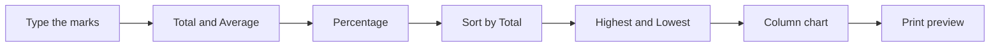

## Goal

By the end of this lesson, you can build a result sheet with totals, averages, percentages, a sort and a chart.

## Why It Matters

Every school in Pakistan makes result sheets after a test. A tuition centre makes one every month for parents. Adding marks by hand is slow, and one mistake changes a result. Excel does the sums for you. In this project you use everything you learned in Module 7.

**Diagram in words:** Type the marks, then add the Total, Average and Percentage formulas. Sort by Total, add the highest and lowest marks, make a chart and check the print preview.

## Key Terms

| Term | Simple meaning |
|------|----------------|
| Project | A bigger task where you use many skills together, like cooking a full meal instead of one dish. |
| Result sheet | A table that shows each student's marks, total and percentage. |
| Out of 50 | The most marks a student can get in one subject. Four subjects make 200 marks in all. |
| Percentage | A mark out of 100. Here it is the total divided by 200, times 100. |
| Highest | The biggest number in a column. The MAX function finds it. |
| Lowest | The smallest number in a column. The MIN function finds it. |
| Answer key | The correct results. Use it to check your own sheet. |

A percentage lets you compare results fairly. 172 out of 200 is the same as 86 out of 100.

## Step by Step

This is the result of a December test. Each subject is out of 50. First you type the marks and make the formulas for the first student.

1. Open a new blank workbook (see [Lesson 7.1](starting-excel.mdx)).
2. Type the headings in row 1, from A1 to H1: Name, English, Urdu, Maths, Computer, Total, Average, Percentage. The headings tell the reader what each column holds.
3. Type the six students in rows 2 to 7, as in the table below. Leave columns F, G and H empty for now. Make column A wider if the names do not fit (see [Lesson 7.3](rows-and-columns.mdx)).

| | A | B | C | D | E | F | G | H |
|---|---|---|---|---|---|---|---|---|
| **1** | Name | English | Urdu | Maths | Computer | Total | Average | Percentage |
| **2** | Ayesha Khan | 42 | 45 | 38 | 47 | | | |
| **3** | Bilal Ahmed | 35 | 40 | 44 | 39 | | | |
| **4** | Fatima Noor | 48 | 46 | 41 | 45 | | | |
| **5** | Hamza Ali | 30 | 36 | 33 | 28 | | | |
| **6** | Sana Riaz | 44 | 39 | 47 | 43 | | | |
| **7** | Usman Tariq | 38 | 42 | 29 | 35 | | | |

4. Check every name and mark. One wrong mark gives a wrong result.
5. In cell F2, type `=SUM(B2:E2)` and press **Enter** (see [Lesson 7.8](sum-and-average.mdx)). This adds Ayesha's four marks. *F2 shows 172.*
6. In cell G2, type `=AVERAGE(B2:E2)` and press **Enter**. This gives her usual mark per subject. *G2 shows 43.*
7. In cell H2, type `=F2/200*100` and press **Enter** (see [Lesson 7.6](first-formulas.mdx)). This turns her total into a percentage. *H2 shows 86.*

Ayesha got 172 out of 200. 172 divided by 200, times 100, is 86 percent.

The other students need the same three formulas. You will copy them down in the Practice, so that you do not type them five more times.

{/* Screenshot to add: The finished result sheet: the sorted table, the Highest and Lowest rows, and the column chart to the right. */}

## Practice

Now finish the result sheet on your own. A school would print a sheet like this for the notice board. After sorting, leave row 8 empty. The highest marks go in row 9 and the lowest in row 10.

1. Select F2 to H2. Drag the fill handle down to row 7 (see [Lesson 7.7](fill-handle.mdx)). Every student now has a Total, Average and Percentage.
2. Select one cell in the Total column, for example F2. One cell is enough for sorting.
3. On the **Data** tab, in the **Sort & Filter** group, select **Sort Largest to Smallest** (see [Lesson 7.10](sorting-data.mdx)). The student with the highest total comes first.
4. In A9, type **Highest**. In B9, type `=MAX(B2:B7)` (see [Lesson 7.9](min-max-count.mdx)). Drag the fill handle across to F9. This shows the top mark in each subject.
5. In A10, type **Lowest**. In B10, type `=MIN(B2:B7)`. Drag the fill handle across to F10. This shows the lowest mark in each subject.
6. Drag to select A1 to A7. Hold **Ctrl** and drag to select F1 to F7. *The names and the totals are selected.* The chart needs both, so that each column has a name.
7. Make a column chart with **Insert**, **Recommended Charts**, **All Charts**, **Column** and **OK** (see [Lesson 7.11](simple-chart.mdx)).
8. Change the chart title to **Total Marks**. Drag the chart to the right of the table, so that it does not cover the marks.
9. Make the heading row bold if you have time, so that it stands out (see [Lesson 7.4](formatting-cells.mdx)).
10. Set the page to **Landscape** and fit it to **1 page** wide and **1 page** tall. Press **Ctrl+F2** to check the print preview (see [Lesson 7.12](page-setup-and-printing.mdx)).
11. Save the workbook with the name **Result Sheet** (see [Lesson 7.2](entering-editing-saving-data.mdx)), so that your work is not lost.
12. Check your work: every number matches the answer key below. Fatima Noor is in row 2 with Total 180, Average 45 and Percentage 90. Hamza Ali is in row 7. The chart is titled Total Marks.

**Answer key (after sorting)**

| Row | Name | English | Urdu | Maths | Computer | Total | Average | Percentage |
|---|---|---|---|---|---|---|---|---|
| 2 | Fatima Noor | 48 | 46 | 41 | 45 | 180 | 45 | 90 |
| 3 | Sana Riaz | 44 | 39 | 47 | 43 | 173 | 43.25 | 86.5 |
| 4 | Ayesha Khan | 42 | 45 | 38 | 47 | 172 | 43 | 86 |
| 5 | Bilal Ahmed | 35 | 40 | 44 | 39 | 158 | 39.5 | 79 |
| 6 | Usman Tariq | 38 | 42 | 29 | 35 | 144 | 36 | 72 |
| 7 | Hamza Ali | 30 | 36 | 33 | 28 | 127 | 31.75 | 63.5 |
| 9 | Highest | 48 | 46 | 47 | 47 | 180 | | |
| 10 | Lowest | 30 | 36 | 29 | 28 | 127 | | |

## Check Questions

1. Point to the cell on your sheet that shows the highest total. What number is in it?

   

   
Show answer

   **Answer:** Cell F9. It shows 180, Fatima Noor's total.

   

2. Hamza Ali's total is 127. What is his percentage? Show how you work it out.

   

   
Show answer

   **Answer:** 127 divided by 200 is 0.635. Times 100, it is 63.5.

   

3. Why do you sort by Total from largest to smallest?

   

   
Show answer

   **Answer:** So the student with the highest total comes first. Fatima Noor is at the top and Hamza Ali is at the bottom.

   

## Common Mistakes

- **Typing a total yourself instead of using SUM** → A typed number does not change when you fix a mark. Use `=SUM(B2:E2)`.
- **Dividing by 100 instead of 200 for the percentage** → Four subjects out of 50 make 200 marks. Use `=F2/200*100`.
- **Selecting the whole Total column of cells before sorting** → Select one cell only. If Excel warns you, choose **Expand the selection**.
- **Forgetting to hold Ctrl when selecting the totals for the chart** → The names are no longer selected. Select A1 to A7 again, then hold **Ctrl** and select F1 to F7.

## Sources

*These official pages were checked when this lesson was written.*

- [Microsoft Support, "SUM function"](https://support.microsoft.com/en-us/office/sum-function-043e1c7d-7726-4e80-8f32-07b23e057f89): applies to Excel 2016 and 2019. SUM adds values, for example `=SUM(A2:A10)`.
- [Microsoft Support, "AVERAGE function"](https://support.microsoft.com/en-us/office/average-function-047bac88-d466-426c-a32b-8f33eb960cf6): applies to Excel 2016 and 2019. AVERAGE returns the average (arithmetic mean), for example `=AVERAGE(A1:A20)`.
- [Microsoft Support, "MAX function"](https://support.microsoft.com/en-us/office/max-function-e0012414-9ac8-4b34-9a47-73e662c08098) and ["MIN function"](https://support.microsoft.com/en-us/office/min-function-61635d12-920f-4ce2-a70f-96f202dcc152): apply to Excel 2016 and 2019. MAX returns the largest value; MIN returns the smallest number.
- [Microsoft Support, "Use Excel as your calculator"](https://support.microsoft.com/en-us/office/use-excel-as-your-calculator-a1abc057-ed11-443a-a635-68216555ad0a): applies to Excel 2016 and 2019. Formulas begin with `=`; `/` divides and `*` multiplies.
- [Microsoft Support, "Fill a formula down into adjacent cells"](https://support.microsoft.com/en-us/office/fill-a-formula-down-into-adjacent-cells-041edfe2-05bc-40e6-b933-ef48c3f308c6): applies to Excel 2016 and 2019. Drag the fill handle across the cells you want to fill.
- [Microsoft Support, "Sort data in a range or table"](https://support.microsoft.com/en-us/office/sort-data-in-a-range-or-table-62d0b95d-2a90-4610-a6ae-2e545c4a4654): applies to Excel 2016 and 2019. **Data** tab, **Sort & Filter** group, **Sort Largest to Smallest**; the **Expand the selection** warning.
- [Microsoft Support, "Select specific cells or ranges in Excel"](https://support.microsoft.com/en-us/excel/select-specific-cells-or-ranges-in-excel): applies to Excel 2016 and 2019. Hold down **Ctrl** and select each cell or range to select cells that are not next to each other.
- [Microsoft Support, "Create a chart from start to finish"](https://support.microsoft.com/en-gb/office/create-a-chart-from-start-to-finish-0baf399e-dd61-4e18-8a73-b3fd5d5680c2) and ["Preview worksheet pages before you print"](https://support.microsoft.com/en-us/office/preview-worksheet-pages-before-you-print-bcd8f03a-c28d-42a2-9217-aab0e43aa930): apply to Excel 2016 and 2019. Chart steps and **Ctrl+F2** print preview (details in Lessons 7.11 and 7.12).

All results were calculated and checked again before writing: each total is the sum of four marks, the average is the total divided by 4, and the percentage is the total divided by 200, times 100.
