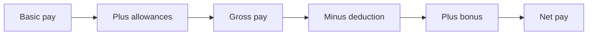

import PracticeFile from '@site/src/components/PracticeFile';

## Goal

By the end of this lesson, you can build a monthly salary sheet that works out allowances, gross
pay, a deduction, a bonus and net pay for every person.

## Why It Matters

Offices, shops and factories in Pakistan pay salaries every month. The pay is not
only one number. It has a basic pay, allowances added on top, money taken off, and sometimes a
bonus. A small travel agency or a bakery has the same work as a big office. One wrong sum means
someone gets the wrong pay. In this project, Excel works it out for every person at once.

**Diagram in words:** Basic pay plus the allowances is the gross pay. Take away the deduction,
add the bonus, and you get the net pay, the money the person takes home.

## Key Terms

| Term | Simple meaning |
|------|----------------|
| Basic pay | The main part of a salary, agreed when the person is hired. |
| Allowance | Extra money added to the basic pay for a need, like house rent or medical costs. |
| Gross pay | The basic pay plus all allowances, before anything is taken off. |
| Deduction | Money taken off the pay, like a fund or a tax. |
| Bonus | Extra money as a reward, here for not missing any day of work. |
| Net pay | The money the person takes home: gross pay minus the deduction, plus any bonus. |
| Practice rate | A made-up percentage used only to learn the sheet. It is not a real rule. |

Think of a shopping bag. The basic pay is what is inside. The allowances are extra things you
put in. The deduction is what you take out at the door. The bonus is a small gift added at the
end. Net pay is what you carry home.

:::caution[These are practice rates]

The rates in this lesson are **made up for practice**. They are not real tax rates or real pay
rules. Real offices follow their own pay rules and the tax law. Do not use these rates to pay a
real salary.

:::

## Step by Step

:::info[Practice files]

- <PracticeFile href="/files/excel/project-salary-sheet/office-salary-starter.xlsx">Download the starter file: Office Salary</PracticeFile>.
  It has the rates, names, basic pay and days absent already typed in. Give B1 to B3 the
  Percent Style (step 2), then go on to step 4.
- <PracticeFile href="/files/excel/project-salary-sheet/office-salary-finished.xlsx">Download the finished file: Office Salary</PracticeFile>.
  It has every formula in place. Open it after you finish, to compare with your work.

:::

**The story.** A small travel agency in Multan has six staff. At the end of October, the manager
must work out each person's pay. Anyone who missed no day of work gets a bonus of Rs 2000.

**What the sheet is for.** The rates sit at the top, each in one cell. Every formula uses those
cells. If a rate changes next year, the manager changes one cell, and every salary updates.

Type these rates and staff details. Leave columns D to I and the Total row empty for now.

| Row | A | B | C |
|-----|---|---|---|
| 1 | House rent rate | 40% | |
| 2 | Medical rate | 10% | |
| 3 | Deduction rate (practice only) | 5% | |
| 4 | Full attendance bonus (Rs) | 2000 | |
| 5 | | | |
| 6 | Name | Basic Pay (Rs) | Days Absent |
| 7 | Asad Mehmood | 40000 | 0 |
| 8 | Rubina Kausar | 32000 | 2 |
| 9 | Faisal Iqbal | 28000 | 0 |
| 10 | Hina Shah | 36000 | 1 |
| 11 | Tahir Abbas | 25000 | 0 |
| 12 | Mehwish Ali | 30000 | 3 |
| 13 | Total | | |

Type these headings in D6 to I6: House Rent (Rs), Medical (Rs), Gross Pay (Rs), Deduction (Rs),
Bonus (Rs) and Net Pay (Rs).

**Type the rates and the staff**

1. Open a new blank workbook ([Lesson 7.1](starting-excel.mdx)). Type the labels in A1 to A4.
   Type 0.4, 0.1 and 0.05 in B1 to B3, and 2000 in B4.
2. Select B1 to B3. On the **Home** tab, select **Percent Style**
   ([Lesson 7.5](number-formats.mdx)). *They show 40%, 10% and 5%.* Typing 0.4 gives 40%, so
   that the formulas use the right number.
3. Type the headings in row 6, the staff in rows 7 to 12, and Total in A13. Make the columns
   wider if the words do not fit ([Lesson 7.3](rows-and-columns.mdx)).

**The allowances**

4. Select D7. Type `=B7*$B$1` and press **Enter**. Basic pay times the house rent rate gives the
   house rent allowance. *D7 shows 16000.* The `$` signs keep B1 fixed when you copy the formula
   down ([Lesson 7.14](absolute-references.mdx)).
5. Select E7. Type `=B7*$B$2` and press **Enter**. This is the medical allowance. *E7 shows
   4000.*

**Gross pay and the deduction**

6. Select F7. Type `=B7+D7+E7` and press **Enter**. Basic pay plus both allowances is the gross
   pay. *F7 shows 60000.*
7. Select G7. Type `=F7*$B$3` and press **Enter**. The practice deduction is 5% of the gross pay.
   *G7 shows 3000.*

**The bonus with IF**

8. Select H7. Type `=IF(C7=0,$B$4,0)` and press **Enter** ([Lesson 7.15](if-function.mdx)). The
   test asks "Were 0 days missed?". If yes, the answer is the bonus in B4. If no, it is 0.
   *H7 shows 2000, because Asad missed no day.*

**Net pay**

9. Select I7. Type `=F7-G7+H7` and press **Enter**. Gross pay minus the deduction, plus the
   bonus, is the money Asad takes home. *I7 shows 59000.*

**Fill the formulas for everyone**

10. Select D7 to I7. Drag the fill handle down to row 12 ([Lesson 7.7](fill-handle.mdx)), so
    that every person gets all six formulas at once.
11. Select D9 and read the formula bar. *It shows `=B9*$B$1`.* B7 changed to B9 for Faisal's
    row, but `$B$1` stayed the same.
12. Look at the bonus column. *H8, H10 and H12 show 0.* Rubina, Hina and Mehwish missed some
    days, so the IF test is false for them.

These are the correct results:

| Row | Name | House Rent | Medical | Gross Pay | Deduction | Bonus | Net Pay |
|-----|------|------------|---------|-----------|-----------|-------|---------|
| 7 | Asad Mehmood | 16000 | 4000 | 60000 | 3000 | 2000 | 59000 |
| 8 | Rubina Kausar | 12800 | 3200 | 48000 | 2400 | 0 | 45600 |
| 9 | Faisal Iqbal | 11200 | 2800 | 42000 | 2100 | 2000 | 41900 |
| 10 | Hina Shah | 14400 | 3600 | 54000 | 2700 | 0 | 51300 |
| 11 | Tahir Abbas | 10000 | 2500 | 37500 | 1875 | 2000 | 37625 |
| 12 | Mehwish Ali | 12000 | 3000 | 45000 | 2250 | 0 | 42750 |

**Totals with SUM**

13. Select B13. Type `=SUM(B7:B12)` and press **Enter** ([Lesson 7.8](sum-and-average.mdx)).
    *B13 shows 191000.*
14. Drag the fill handle of B13 across to I13, so that every column gets its own total.
    *C13 shows 6, the days missed by all staff. D13 to I13 show 76400, 19100, 286500, 14325,
    6000 and 278175.*
15. Check the totals: 286500 − 14325 + 6000 = 278175. The office needs Rs 278175 to pay this
    month's salaries.
16. Save the workbook with the name **Office Salary**
    ([Lesson 7.2](entering-editing-saving-data.mdx)), so that your work is kept.

{/* Screenshot to add: The finished office salary sheet with the rates in B1 to B4, cell D9 selected and the formula bar showing =B9*$B$1. */}

## Practice

:::info[Practice files]

- <PracticeFile href="/files/excel/project-salary-sheet/bakery-salary-starter.xlsx">Download the starter file: Bakery Salary</PracticeFile>.
  It has the rates, workers, basic pay and days absent already typed in. Use it if you want more
  time for the formulas.
- <PracticeFile href="/files/excel/project-salary-sheet/bakery-salary-finished.xlsx">Download the finished file: Bakery Salary</PracticeFile>.
  It shows the end of the task, with the bonus changed to 1500. Open it after you finish.

:::

A bakery has five workers. Its practice rates are different: house rent 30%, medical 5%, a
deduction of 2%, and a full attendance bonus of Rs 1000. Build its salary sheet with the same
layout. The workers are in rows 7 to 11, so the Total row is row 12.

| Row | A | B | C |
|-----|---|---|---|
| 1 | House rent rate | 0.3 | |
| 2 | Medical rate | 0.05 | |
| 3 | Deduction rate (practice only) | 0.02 | |
| 4 | Full attendance bonus (Rs) | 1000 | |
| 6 | Name | Basic Pay (Rs) | Days Absent |
| 7 | Naveed Akram | 25000 | 0 |
| 8 | Shazia Parveen | 20000 | 1 |
| 9 | Arif Hussain | 22000 | 0 |
| 10 | Kiran Javed | 18000 | 2 |
| 11 | Sajid Mehmood | 16000 | 0 |
| 12 | Total | | |

1. Open a new blank workbook. Type the table and the headings in D6 to I6, as in the Step by
   Step.
2. Select B1 to B3 and select **Percent Style**. Check: 30%, 5% and 2%.
3. In row 7, type the six formulas from the Step by Step: `=B7*$B$1`, `=B7*$B$2`, `=B7+D7+E7`,
   `=F7*$B$3`, `=IF(C7=0,$B$4,0)` and `=F7-G7+H7`. Check: F7 shows 33750 and I7 shows 34075.
4. Select D7 to I7 and fill them down to row 11.
5. In B12, type `=SUM(B7:B11)` and fill it across to I12. Check: I12 shows 136623.
6. The bakery owner raises the bonus to Rs 1500. Select B4, type 1500 and press **Enter**.
   Watch the bonus column and the net pay change, because every IF formula uses B4.
7. Save the workbook with the name **Bakery Salary**.
8. Check your work: D7 to D11 show 7500, 6000, 6600, 5400 and 4800. F7 to F11 show 33750,
   27000, 29700, 24300 and 21600. G7 to G11 show 675, 540, 594, 486 and 432. H7 to H11 show
   1500, 0, 1500, 0 and 1500. I7 to I11 show 34575, 26460, 30606, 23814 and 22668. I12 shows
   138123.

**Answer key (after the bonus change)**

| Row | Name | House Rent | Medical | Gross Pay | Deduction | Bonus | Net Pay |
|-----|------|------------|---------|-----------|-----------|-------|---------|
| 7 | Naveed Akram | 7500 | 1250 | 33750 | 675 | 1500 | 34575 |
| 8 | Shazia Parveen | 6000 | 1000 | 27000 | 540 | 0 | 26460 |
| 9 | Arif Hussain | 6600 | 1100 | 29700 | 594 | 1500 | 30606 |
| 10 | Kiran Javed | 5400 | 900 | 24300 | 486 | 0 | 23814 |
| 11 | Sajid Mehmood | 4800 | 800 | 21600 | 432 | 1500 | 22668 |
| 12 | Total | 30300 | 5050 | 136350 | 2727 | 4500 | 138123 |

Row 12 also shows 101000 in B12 (basic pay) and 3 in C12 (days absent).

## Check Questions

1. Open your Office Salary sheet. Point to the cell that holds the bonus amount. What happens
   if you change it to 2500?

   

   
Show answer

   **Answer:** Cell B4. Asad, Faisal and Tahir get 2500 instead of 2000, and their net pay goes up
   by 500 each. The others still get 0.

   

2. Hina Shah missed 1 day. What bonus does she get, and why?

   

   
Show answer

   **Answer:** 0. The test `C10=0` is false, because C10 holds 1. So IF gives the second answer, 0.

   

3. Someone in the travel agency has a basic pay of Rs 20000 and missed no day. Work out the
   gross pay and the net pay with the practice rates.

   

   
Show answer

   **Answer:** House rent 8000 and medical 2000, so the gross pay is 30000. The deduction is
   1500 and the bonus is 2000. Net pay is 30000 − 1500 + 2000 = 30500.

   

## Common Mistakes

- **Forgetting the `$` signs on a rate**, like `=B7*B1` → After filling down, Rubina's row uses
  B2, the medical rate, and shows 3200 instead of 12800. Write `$B$1`.
- **Typing 40 in B1 and then selecting Percent Style** → B1 shows 4000%, and every allowance is
  far too big. Type 0.4, then select **Percent Style**.
- **Adding the deduction instead of taking it away**, like `=F7+G7+H7` → Every net pay is too
  big. Use `=F7-G7+H7`.
- **Using `>` in the bonus test**, like `=IF(C7>0,$B$4,0)` → The people who missed days get the
  bonus, and the others get nothing. The test must be `C7=0`.

## Sources

*These official pages were checked when this lesson was written.*

- [Microsoft Support, "Use Excel as your calculator"](https://support.microsoft.com/en-us/office/use-excel-as-your-calculator-a1abc057-ed11-443a-a635-68216555ad0a) (applies to Excel 2021): "All formula entries begin with an equal sign (=)"; "the plus sign (+) to add, the minus sign (-) to subtract, the asterisk (*) to multiply".
- [Microsoft Support, "Switch between relative, absolute, and mixed references"](https://support.microsoft.com/en-us/office/switch-between-relative-absolute-and-mixed-references-dfec08cd-ae65-4f56-839e-5f0d8d0baca9) (applies to Excel 2021): "When you copy a formula that contains a relative cell reference, that reference in the formula will change"; "when you copy the formula =$B$4*$C$4 from D4 to D5, the formula stays exactly the same."
- [Microsoft Support, "IF function"](https://support.microsoft.com/en-us/office/if-function-69aed7c9-4e8a-4755-a9bc-aa8bbff73be2) (applies to Excel 2021): "Use the IF function, one of the logical functions, to return one value if a condition is true and another value if it's false"; syntax "IF(logical_test, value_if_true, [value_if_false])"; example `=IF(C2>B2,C2-B2,0)`: "instead of returning a text result, we are going to return a mathematical calculation"; example `=IF(E7="Yes",F5*0.0825,0)`.
- [Microsoft Support, "Calculation operators and precedence in Excel"](https://support.microsoft.com/en-us/office/calculation-operators-and-precedence-in-excel-48be406d-4975-4d31-b2b8-7af9e0e2878a) (applies to Excel 2021): "When two values are compared by using these operators, the result is a logical value either TRUE or FALSE"; "`=` (equal sign) Equal to"; "`>` (greater than sign) Greater than".
- [Microsoft Support, "SUM function"](https://support.microsoft.com/en-us/office/sum-function-043e1c7d-7726-4e80-8f32-07b23e057f89) (applies to Excel 2021): "The SUM function adds values. You can add individual values, cell references or ranges or a mix of all three."
- [Microsoft Support, "Fill a formula down into adjacent cells"](https://support.microsoft.com/en-us/office/fill-a-formula-down-into-adjacent-cells-041edfe2-05bc-40e6-b933-ef48c3f308c6) (applies to Excel 2021): "Drag the fill handle across the cells that you want to fill"; "relative references will be put in place to ensure the formulas adjust for each row—unless you include absolute or mixed references before you fill the formula down."
- [Microsoft Support, "Format numbers as percentages"](https://support.microsoft.com/en-us/office/format-numbers-as-percentages-de49167b-d603-4450-bcaa-31fba6c7b6b4) (applies to Excel 2021): "To quickly apply percentage formatting to selected cells, click Percent Style"; "if a cell contains the number 10, Excel multiplies that number by 100, which means that you will see 1000.00%"; "If you then format 0.1 as a percentage, the number will be correctly displayed as 10%."

All results were calculated and checked again before writing. Office (practice rates 40%, 10%,
5%, bonus 2000): gross pay is basic × 1.5 and the deduction is 5% of gross, so Asad 40000 →
16000, 4000, 60000, 3000, +2000 = 59000; Rubina 32000 → 48000 − 2400 = 45600; Faisal 28000 →
42000 − 2100 + 2000 = 41900; Hina 36000 → 54000 − 2700 = 51300; Tahir 25000 → 37500 − 1875 +
2000 = 37625; Mehwish 30000 → 45000 − 2250 = 42750; totals 191000, 6, 76400, 19100, 286500,
14325, 6000 and 278175. Bakery (30%, 5%, 2%): gross pay is basic × 1.35; with bonus 1000 the net
total is 136623; with bonus 1500, net pays 34575, 26460, 30606, 23814 and 22668, total 138123.
