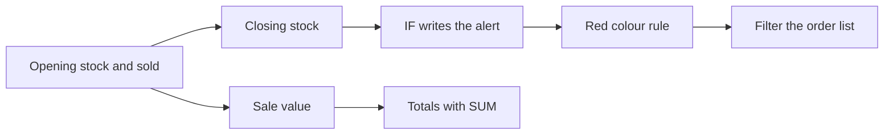

import PracticeFile from '@site/src/components/PracticeFile';

## Goal

By the end of this lesson, you can build a shop's stock and sales register that works out what
is left, what was sold, and what to order next.

## Why It Matters

Every shop needs to know three things at the end of a month. How much of each item is left? How
much money did each item bring in? What must be ordered before it runs out? A mobile shop in
Rawalpindi and a general store in Sukkur ask the same questions. Counting by hand in a register
takes hours. In this project, Excel does the sums, writes the alert and shows the order list.

**Diagram in words:** From the opening stock and the items sold, you work out the closing stock
and the sale value. IF writes the alert, a colour rule marks it red, a filter shows the order
list, and SUM gives the totals.

## Key Terms

| Term | Simple meaning |
|------|----------------|
| Stock register | A list of every item in a shop, with how many came in, went out and are left. |
| Opening stock | How many pieces of an item the shop had at the start of the month. |
| Closing stock | How many pieces are left at the end of the month: opening stock minus pieces sold. |
| Sale value | The money an item brought in: pieces sold times the price of one piece. |
| Low-stock alert | A warning that an item is nearly finished, so the shopkeeper orders more in time. |
| Order list | The items the shop must buy again from the wholesale market. |

Think of a water tank on the roof. In the morning it holds 500 litres. The family uses 450
litres. Only 50 are left, so it is time to run the motor. Closing stock and the low-stock alert
work the same way.

## Step by Step

:::info[Practice files]

- <PracticeFile href="/files/excel/project-stock-and-sales/mobile-shop-stock-starter.xlsx">Download the starter file: Mobile Shop Stock</PracticeFile>.
  It has the items, prices, opening stock and pieces sold already typed in, so that you can start
  at step 3.
- <PracticeFile href="/files/excel/project-stock-and-sales/mobile-shop-stock-finished.xlsx">Download the finished file: Mobile Shop Stock</PracticeFile>.
  It shows the whole register done: the formulas, the red alerts and the filter. Open it after
  you finish, to compare with your work.

:::

**The story.** Kashif has a small mobile accessories shop. On 1 October he counted every item.
On 31 October he added up the pieces sold from his sale slips. Now he wants a register that
answers his three questions.

**What the sheet is for.** Column E shows what is left. Column F shows the money from each item.
Column G warns him when fewer than 5 pieces are left. Row 11 gives the totals.

This is the finished register. You will add columns E, F and G and row 11 with formulas.

| Row | A | B | C | D | E | F | G |
|-----|---|---|---|---|---|---|---|
| 1 | Item | Price (Rs) | Opening Stock | Sold | Closing Stock | Sale Value (Rs) | Status |
| 2 | Phone charger | 450 | 30 | 26 | `=C2-D2` gives 4 | `=D2*B2` gives 11700 | `=IF(E2<5,"Order more","OK")` gives Order more |
| 3 | Data cable | 250 | 40 | 22 | 18 | 5500 | OK |
| 4 | Earphones | 350 | 25 | 21 | 4 | 7350 | Order more |
| 5 | Screen protector | 150 | 60 | 48 | 12 | 7200 | OK |
| 6 | Phone cover | 300 | 35 | 19 | 16 | 5700 | OK |
| 7 | Power bank | 2200 | 10 | 7 | 3 | 15400 | Order more |
| 8 | Memory card 32 GB | 800 | 15 | 9 | 6 | 7200 | OK |
| 9 | Car charger | 500 | 12 | 7 | 5 | 3500 | OK |
| 10 | | | | | | | |
| 11 | Total | | `=SUM(C2:C9)` gives 227 | 159 | 68 | 63550 | |

**Type the data**

1. Open a new blank workbook ([Lesson 7.1](starting-excel.mdx)). Type columns A to D, rows 1 to
   9, and type Total in A11. Leave row 10 empty. The empty row keeps the totals apart from the
   item list, like a line drawn under the items in a paper register.
2. Check every number against the table. One wrong number gives a wrong order list.

**Closing stock: what is left**

3. Select E2. Type `=C2-D2` and press **Enter**. Opening stock minus pieces sold is what is
   left on the shelf ([Lesson 7.6](first-formulas.mdx)). *E2 shows 4.*
4. Drag the fill handle of E2 down to E9 ([Lesson 7.7](fill-handle.mdx)), so that every item
   gets its own closing stock. *E3 to E9 show 18, 4, 12, 16, 3, 6 and 5.*

**Sale value: the money from each item**

5. Select F2. Type `=D2*B2` and press **Enter**. Pieces sold times the price of one piece is the
   money that item brought in. *F2 shows 11700.*
6. Fill F2 down to F9. *F3 to F9 show 5500, 7350, 7200, 5700, 15400, 7200 and 3500.*

**Status: the low-stock alert**

7. Select G2. Type `=IF(E2<5,"Order more","OK")` and press **Enter**
   ([Lesson 7.15](if-function.mdx)). The test asks "Are fewer than 5 left?". *G2 shows Order
   more, because only 4 chargers are left.*
8. Fill G2 down to G9, so that every item gets checked. *G4 and G7 also show Order more. The
   other rows show OK.*
9. Look at the car charger in row 9. 5 pieces are left, and 5 is not less than 5. *G9 shows OK.*

**Totals with SUM**

10. Select C11. Type `=SUM(C2:C9)` and press **Enter** ([Lesson 7.8](sum-and-average.mdx)).
    This adds the opening stock of all items. *C11 shows 227.*
11. Drag the fill handle of C11 across to F11, so that each column gets its own total.
    *D11 shows 159, E11 shows 68 and F11 shows 63550.*
12. Check the totals against each other: 227 − 159 = 68. The pieces you had, minus the pieces
    sold, equal the pieces left. Kashif sold goods worth Rs 63550 this month.

**Make the alerts red**

A red cell catches the eye, even in a long list. You learned this in
[Lesson 7.27](conditional-formatting.mdx).

13. Select G2 to G9, so that the rule covers only the Status cells.
14. On the **Home** tab, select **Conditional Formatting**, then **Highlight Cells Rules**, then
    **Text that Contains**.
15. In the box, type Order more. Choose a red format from the list, and select **OK**.
    *G2, G4 and G7 turn red.*

**Filter the order list**

Kashif takes only the order list to the wholesale market. A filter hides the other rows for a
while ([Lesson 7.26](filtering-data.mdx)).

16. Select A1 to G9, so that the filter covers the headings and the items, but not the totals.
17. On the **Data** tab, select **Filter**. *An arrow appears in each heading cell in row 1.*
18. Select the arrow in G1, the Status heading. Uncheck **(Select All)**, check **Order more**,
    and select **OK**. *Only rows 2, 4 and 7 show: Phone charger, Earphones and Power bank.*
19. Save the workbook with the name **Mobile Stock Register**
    ([Lesson 7.2](entering-editing-saving-data.mdx)), so that your work is kept.

The hidden rows are not deleted. To see every row again, select the arrow in G1, check
**(Select All)** and select **OK**.

{/* Screenshot to add: The filtered register showing only Phone charger, Earphones and Power bank, with the red Order more cells and the filter arrow on the Status heading. */}

## Practice

:::info[Practice files]

- <PracticeFile href="/files/excel/project-stock-and-sales/general-store-stock-starter.xlsx">Download the starter file: General Store Stock</PracticeFile>.
  It has the items, prices, opening stock and pieces sold already typed in. Use it if you want
  more time for the formulas.
- <PracticeFile href="/files/excel/project-stock-and-sales/general-store-stock-finished.xlsx">Download the finished file: General Store Stock</PracticeFile>.
  It shows the end of the task, with Biscuits sold changed to 72 and the filter on. Open it after
  you finish.

:::

Shabana runs a general store. Her goods sell faster than phone accessories, so she orders more
when **fewer than 10** pieces are left. Build her register for October with the same layout.
Leave columns E to G and row 10 empty when you type.

| Row | A | B | C | D |
|-----|---|---|---|---|
| 1 | Item | Price (Rs) | Opening Stock | Sold |
| 2 | Sugar (kg) | 155 | 60 | 52 |
| 3 | Cooking oil (litre) | 545 | 40 | 26 |
| 4 | Tea (pack) | 480 | 30 | 24 |
| 5 | Rice (kg) | 340 | 50 | 35 |
| 6 | Daal (kg) | 285 | 25 | 18 |
| 7 | Soap (bar) | 95 | 48 | 30 |
| 8 | Biscuits (pack) | 60 | 80 | 70 |
| 9 | Matchbox | 10 | 100 | 64 |
| 11 | Total | | | |

1. Open a new blank workbook. Type the same headings as in the Step by Step, from A1 to G1.
   They are Item, Price (Rs), Opening Stock, Sold, Closing Stock, Sale Value (Rs) and Status.
2. Type the items in rows 2 to 9, and Total in A11.
3. In E2, type `=C2-D2`. In F2, type `=D2*B2`. Fill both down to row 9. Check: E2 shows 8 and F2
   shows 8060.
4. In G2, type `=IF(E2<10,"Order more","OK")` and fill it down to G9. The limit is 10 this time,
   because Shabana's goods sell faster. Check: three items show Order more.
5. In C11, type `=SUM(C2:C9)`. Fill it across to F11. Check: F11 shows 58470.
6. Two more packs of biscuits are sold. Select D8, type 72 and press **Enter**. Watch E8, F8, G8
   and the totals change by themselves, because they are formulas.
7. Select G2 to G9. Add a **Text that Contains** rule for Order more with a red format.
8. Select A1 to G9. On the **Data** tab, select **Filter**. Filter the Status column to show
   only **Order more**.
9. Save the workbook with the name **General Store Register**.
10. Check your work: before the filter, E2 to E9 show 8, 14, 6, 15, 7, 18, 8 and 36. F2 to F9
    show 8060, 14170, 11520, 11900, 5130, 2850, 4320 and 640. Row 11 shows 433, 321, 112 and
    58590. After the filter, only Sugar, Tea, Daal and Biscuits show, all four in red with
    Order more.

**Answer key (before the filter)**

| Row | Item | Closing Stock | Sale Value (Rs) | Status |
|-----|------|---------------|-----------------|--------|
| 2 | Sugar (kg) | 8 | 8060 | Order more |
| 3 | Cooking oil (litre) | 14 | 14170 | OK |
| 4 | Tea (pack) | 6 | 11520 | Order more |
| 5 | Rice (kg) | 15 | 11900 | OK |
| 6 | Daal (kg) | 7 | 5130 | Order more |
| 7 | Soap (bar) | 18 | 2850 | OK |
| 8 | Biscuits (pack) | 8 | 4320 | Order more |
| 9 | Matchbox | 36 | 640 | OK |
| 11 | Total | 112 | 58590 | |

## Check Questions

1. Open your Mobile Stock Register. Point to the cell that shows the money from all sales this
   month. What number is in it?

   

   
Show answer

   **Answer:** Cell F11. It shows 63550, so Kashif sold goods worth Rs 63550.

   

2. In Shabana's register, the biscuits changed from OK to Order more. Why?

   

   
Show answer

   **Answer:** Sold went up from 70 to 72, so the closing stock went down from 10 to 8. 8 is less
   than 10, so IF wrote Order more.

   

3. A shop had 20 power banks and sold 17. Its limit is 5. What are the closing stock and the
   status?

   

   
Show answer

   **Answer:** The closing stock is 20 − 17 = 3. 3 is less than 5, so the status is Order more.

   

## Common Mistakes

- **Subtracting the wrong way round**, like `=D2-C2` → The closing stock comes out negative,
  like −4. Take the sold pieces away from the opening stock: `=C2-D2`.
- **Typing a closing stock number instead of a formula** → It does not change when more pieces
  are sold. Use `=C2-D2`, so that the register updates itself.
- **Leaving out the quotation marks around Order more** → Excel shows `#NAME?`. Text in a formula
  goes inside quotation marks: `"Order more"`.
- **Using `<=` instead of `<`**, like `=IF(E2<=5,"Order more","OK")` → The car charger, with
  exactly 5 left, also shows Order more. Kashif's rule is "fewer than 5", so use `<`.

## Sources

*These official pages were checked when this lesson was written.*

- [Microsoft Support, "Use Excel as your calculator"](https://support.microsoft.com/en-us/office/use-excel-as-your-calculator-a1abc057-ed11-443a-a635-68216555ad0a) (applies to Excel 2021): "All formula entries begin with an equal sign (=)"; "the minus sign (-) to subtract, the asterisk (*) to multiply".
- [Microsoft Support, "SUM function"](https://support.microsoft.com/en-us/office/sum-function-043e1c7d-7726-4e80-8f32-07b23e057f89) (applies to Excel 2021): "The SUM function adds values. You can add individual values, cell references or ranges or a mix of all three"; example `=SUM(A2:A10)`.
- [Microsoft Support, "IF function"](https://support.microsoft.com/en-us/office/if-function-69aed7c9-4e8a-4755-a9bc-aa8bbff73be2) (applies to Excel 2021): "Use the IF function, one of the logical functions, to return one value if a condition is true and another value if it's false"; syntax "IF(logical_test, value_if_true, [value_if_false])"; "If you are going to use text in formulas, you need to wrap the text in quotes".
- [Microsoft Support, "Calculation operators and precedence in Excel"](https://support.microsoft.com/en-us/office/calculation-operators-and-precedence-in-excel-48be406d-4975-4d31-b2b8-7af9e0e2878a) (applies to Excel 2021): "`<` (less than sign) Less than"; "`<=` (less than or equal to sign) Less than or equal to".
- [Microsoft Support, "Fill a formula down into adjacent cells"](https://support.microsoft.com/en-us/office/fill-a-formula-down-into-adjacent-cells-041edfe2-05bc-40e6-b933-ef48c3f308c6) (applies to Excel 2021): "Select the cell that has the formula you want to fill into adjacent cells. Drag the fill handle across the cells that you want to fill"; "relative references will be put in place to ensure the formulas adjust for each row".
- [Microsoft Support, "Use conditional formatting to highlight information in Excel"](https://support.microsoft.com/en-us/office/use-conditional-formatting-to-highlight-information-in-excel-fed60dfa-1d3f-4e13-9ecb-f1951ff89d7f) (applies to Excel 2021): "On the Home tab, in the Style group, click the arrow next to Conditional Formatting, and then click Highlight Cells Rules"; "Select the command you want, such as Between, Equal To Text that Contains, or A Date Occurring"; "Enter the values you want to use, and then select a format"; "If the Text that Contains dialog box appears, enter the formatting option you want to apply and click OK"; it also gives the example "in an inventory worksheet sorted by categories, you could highlight products with fewer than 10 items on hand".
- [Microsoft Support, "Use AutoFilter to filter your data"](https://support.microsoft.com/en-us/office/use-autofilter-to-filter-your-data-7d87d63e-ebd0-424b-8106-e2ab61133d92) (applies to Excel 2021): "Select the data you want to filter. Click Data > Filter"; "Click the arrow in the column header"; "Uncheck (Select All) to clear all of the check boxes, and then check the boxes for the specific value(s) you want to see"; "Click OK to apply the filter."
- [Microsoft Support, "Filter data in a range or table in Excel"](https://support.microsoft.com/en-us/office/filter-data-in-a-range-or-table-01832226-31b5-4568-8806-38c37dcc180e) (applies to Excel 2021): "Use filters to temporarily hide some of the data in a table, so you can focus on the data you want"; "Filtered data displays only the rows that meet criteria that you specify and hides rows that you do not want displayed."

All results were calculated and checked again before writing. Mobile shop: closing stock 30 − 26
= 4, 40 − 22 = 18, 25 − 21 = 4, 60 − 48 = 12, 35 − 19 = 16, 10 − 7 = 3, 15 − 9 = 6, 12 − 7 = 5;
sale value 26 × 450 = 11700, 22 × 250 = 5500, 21 × 350 = 7350, 48 × 150 = 7200, 19 × 300 =
5700, 7 × 2200 = 15400, 9 × 800 = 7200, 7 × 500 = 3500; totals 227, 159, 68 and 63550. General
store with biscuits sold 72: closing stock 8, 14, 6, 15, 7, 18, 8, 36; sale value 8060, 14170,
11520, 11900, 5130, 2850, 4320, 640; totals 433, 321, 112 and 58590. Before the change, biscuits
sold 70 gave closing stock 10 (OK), sale value 4200 and a total of 58470.
