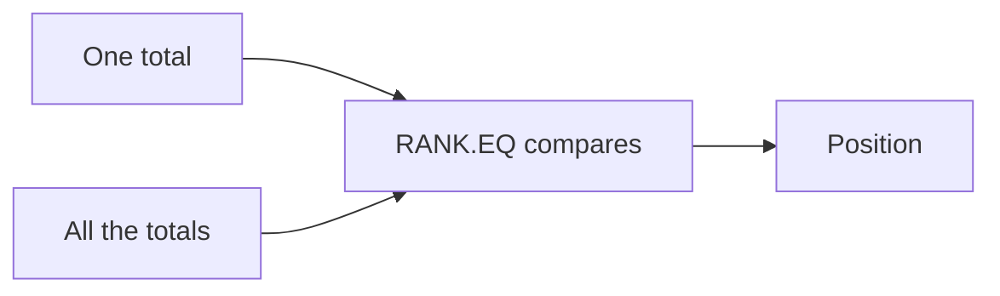
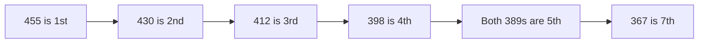

import PracticeFile from '@site/src/components/PracticeFile';

## Goal

By the end of this lesson, you can give every student a position, like 1st, 2nd and 3rd, with
the RANK.EQ function.

## Why It Matters

A school result card shows each student's position. A tuition centre gives a prize to the top
three. A sports day lists runners from fastest to slowest. Working out positions by hand is slow,
and one wrong mark changes everything. RANK.EQ works out every position for you, and it updates
when a mark changes.

**Diagram in words:** RANK.EQ takes one student's total and the list of all totals. It compares
them and gives that student's position.

## Key Terms

| Term | Simple meaning |
|------|----------------|
| Position | Where a number stands in a list. The highest total gets position 1, which means 1st. |
| RANK.EQ | A function that gives the position of one number in a list of numbers. |
| Descending order | From the highest to the lowest, like marks from 500 down to 0. |
| Ascending order | From the lowest to the highest, like race times from fastest to slowest. |
| Tie | Two or more equal numbers, like two students with the same total. |
| Order | The third, optional part of RANK.EQ. Leave it out for highest-first. Type 1 for lowest-first. |

The function is written like this: `=RANK.EQ(number, list, order)`.

- **number** is the one total you want the position of, like B2.
- **list** is all the totals, like `$B$2:$B$8`. The `$` signs keep it fixed when you copy the
  formula ([Lesson 7.14](absolute-references.mdx)).
- **order** is optional. Leave it out, and the highest number is 1st.

## Step by Step

:::info[Practice files]

- <PracticeFile href="/files/excel/rank-eq/result-positions-starter.xlsx">Download the starter file: Result Positions</PracticeFile>.
  It has the names and totals already typed in, so that you can go straight to RANK.EQ.
- <PracticeFile href="/files/excel/rank-eq/result-positions-finished.xlsx">Download the finished file: Result Positions</PracticeFile>.
  It has the RANK.EQ formula in C2 to C8. Open it after you finish, to compare with your work.

:::

A school has seven students in one section. Each total is out of 500. The result sheet stays
in this order, but every student needs a position. Open a new blank workbook
([Lesson 7.1](starting-excel.mdx)) and type this table. Leave column C empty.

| Row | A | B | C |
|-----|---|---|---|
| 1 | Name | Total (out of 500) | Position |
| 2 | Ayesha | 412 | |
| 3 | Bilal | 389 | |
| 4 | Hira | 455 | |
| 5 | Usman | 389 | |
| 6 | Zainab | 430 | |
| 7 | Kashif | 367 | |
| 8 | Mariam | 398 | |

1. Select C2. Type `=RANK.EQ(B2,$B$2:$B$8)` and press **Enter**. This compares Ayesha's total
   with all seven totals. *C2 shows 3. Ayesha is 3rd.*
2. Drag the fill handle of C2 down to C8, so that every student gets a position
   ([Lesson 7.7](fill-handle.mdx)). *C3 to C8 show 5, 1, 5, 2, 7 and 4.*
3. Select C8 and read the formula bar. *It shows `=RANK.EQ(B8,$B$2:$B$8)`.* B2 changed to B8,
   so each row uses its own total. The list stayed `$B$2:$B$8`, because of the `$` signs.
4. Look at Bilal and Usman. Both have 389, so both get position 5. Nobody gets position 6.
   Kashif, the next student, gets 7.

RANK.EQ gives equal numbers the same position. The next position is skipped, because two
students already share 5th place.

**Diagram in words:** The totals go from highest to lowest. The two totals of 389 share 5th
place, so 6th is skipped and 367 is 7th.

These are the correct results:

| Name | Total | Position |
|------|-------|----------|
| Ayesha | 412 | 3 |
| Bilal | 389 | 5 |
| Hira | 455 | 1 |
| Usman | 389 | 5 |
| Zainab | 430 | 2 |
| Kashif | 367 | 7 |
| Mariam | 398 | 4 |

The rows stay in the same order. If you want the list from 1st to last, sort it by the Position
column ([Lesson 7.10](sorting-data.mdx)).

{/* Screenshot to add: The result sheet with positions in column C, and the formula bar showing =RANK.EQ(B8,$B$2:$B$8) for cell C8. */}

## Practice

:::info[Practice files]

- <PracticeFile href="/files/excel/rank-eq/race-times-starter.xlsx">Download the starter file: Race Times</PracticeFile>.
  It has the runners and their times already typed in. Use it if you want more time for the formulas.
- <PracticeFile href="/files/excel/rank-eq/race-times-finished.xlsx">Download the finished file: Race Times</PracticeFile>.
  It shows the end of the task, with Rizwan's time corrected to 14. Open it after you finish.

:::

On sports day, six students run 100 metres. In a race, the **lowest** time wins. So here you
use order 1, for lowest-first. Type this table. Leave column C empty.

| Row | A | B | C |
|-----|---|---|---|
| 1 | Runner | Time (seconds) | Position |
| 2 | Ahmed | 14.2 | |
| 3 | Danish | 13.8 | |
| 4 | Rizwan | 15.1 | |
| 5 | Saad | 13.8 | |
| 6 | Owais | 14.9 | |
| 7 | Junaid | 13.5 | |

1. Open a new blank workbook and type the table.
2. Select C2. Type `=RANK.EQ(B2,$B$2:$B$7,1)` and press **Enter**. The 1 at the end makes the
   lowest time 1st.
3. Fill C2 down to C7. Check: C2 to C7 show 4, 2, 6, 2, 5 and 1. Junaid is 1st.
4. Look at Danish and Saad. They have the same time, so both are 2nd. Nobody is 3rd.
5. Select C7 and read the formula bar. Check that the list is still `$B$2:$B$7`.
6. The time for Rizwan was typed wrong. It was really 14.0 seconds. Type 14 in B4 and press
   **Enter**. Watch the positions change by themselves.
7. Save the workbook with the name **Race Positions**
   ([Lesson 7.2](entering-editing-saving-data.mdx)), so that your work is kept.
8. Check your work: C2 to C7 show 5, 2, 4, 2, 6 and 1. Junaid is 1st, Danish and Saad are both
   2nd, and Rizwan is now 4th.

## Check Questions

1. In `=RANK.EQ(B2,$B$2:$B$8)`, what does B2 mean, and what does `$B$2:$B$8` mean?

   

   
Show answer

   **Answer:** B2 is the one total you want the position of. `$B$2:$B$8` is the list of all
   totals. The `$` signs keep the list fixed when you fill the formula down.

   

2. In your result sheet, change Kashif's total in B7 to 455. Which positions do Hira and Kashif
   get, and who is 3rd?

   

   
Show answer

   **Answer:** Hira and Kashif are both 1st, because they have the same total. Nobody is 2nd.
   Zainab, with 430, is 3rd.

   

3. You rank race times, where the lowest time wins. What do you type as the order, and why?

   

   
Show answer

   **Answer:** Type 1, like `=RANK.EQ(B2,$B$2:$B$7,1)`. Any order that is not 0 ranks the lowest
   number 1st.

   

## Common Mistakes

- **Leaving out the `$` signs**, like `=RANK.EQ(B2,B2:B8)` → When you fill down, the list moves
  and the positions are wrong. Write the list as `$B$2:$B$8`.
- **Typing order 1 for marks** → The lowest marks become 1st. For marks, leave the order out.
- **A list that misses a student**, like `$B$2:$B$7` → Mariam in row 8 is not compared. Make the
  list cover every total.
- **Expecting 6th after two students share 5th** → RANK.EQ skips the next position after a tie.
  This is correct.

## Sources

*These official pages were checked when this lesson was written.*

- [Microsoft Support, "RANK.EQ function"](https://support.microsoft.com/en-us/office/rank-eq-function-284858ce-8ef6-450e-b662-26245be04a40) (applies to Excel 2021): "Returns the rank of a number in a list of numbers"; "if more than one value has the same rank, the top rank of that set of values is returned"; syntax `RANK.EQ(number,ref,[order])`; "Order Optional. A number specifying how to rank number"; "If Order is 0 (zero) or omitted, Excel ranks Number as if Ref were a list sorted in descending order"; "If Order is any nonzero value, Excel ranks Number as if Ref were a list sorted in ascending order"; "RANK.EQ gives duplicate numbers the same rank. However, the presence of duplicate numbers affects the ranks of subsequent numbers"; "if the number 10 appears twice and has a rank of 5, then 11 would have a rank of 7 (no number would have a rank of 6)."
- [Microsoft Support, "Switch between relative, absolute, and mixed references"](https://support.microsoft.com/en-us/office/switch-between-relative-absolute-and-mixed-references-dfec08cd-ae65-4f56-839e-5f0d8d0baca9) (applies to Excel 2021): "When you copy a formula that contains a relative cell reference, that reference in the formula will change"; "when you copy the formula =$B$4*$C$4 from D4 to D5, the formula stays exactly the same."

All results were calculated and checked again before writing. Totals from highest: 455 (Hira,
1), 430 (Zainab, 2), 412 (Ayesha, 3), 398 (Mariam, 4), 389 (Bilal and Usman, 5), 367 (Kashif, 7).
With Kashif at 455: Hira and Kashif 1, Zainab 3, Ayesha 4, Mariam 5, Bilal and Usman 6. Race
times from lowest: 13.5 (Junaid, 1), 13.8 (Danish and Saad, 2), 14.2 (Ahmed, 4), 14.9 (Owais, 5),
15.1 (Rizwan, 6). After the change: 13.5 (1), 13.8 (2), 14.0 (Rizwan, 4), 14.2 (Ahmed, 5),
14.9 (Owais, 6).
