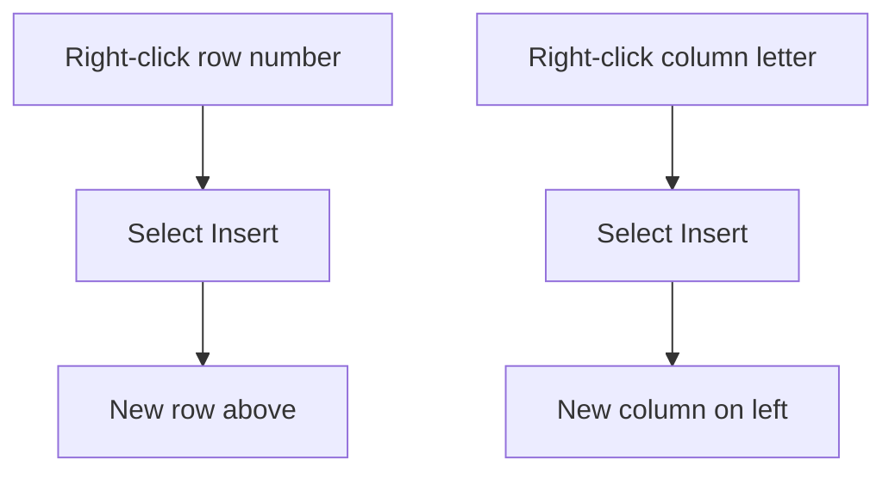

## Goal

By the end of this lesson, you can change the width of a column, make a row taller, and add or remove rows and columns.

## Why It Matters

Some words are too long for a narrow column, so you cannot read them. Sometimes you forget an
item in the middle of a shop list. A wedding guest list also grows when new names come in. In a
paper register you would have to write it all again. In Excel you can make space for the new
item and keep everything else in order.

## Key Terms

| Term | Simple meaning |
|------|----------------|
| Column heading | The box with the letter at the top of a column, for example C. |
| Row heading | The box with the number at the left of a row, for example 4. |
| Boundary | The thin line between two column headings or two row headings. You drag it to change the size. |
| Width and height | Width is how wide a column is. Height is how tall a row is. |
| AutoFit | Excel makes a column wide enough for what is in it, like a tailor fitting a shirt to its owner. |
| Insert | To add a new, empty row or column. |
| Delete | To remove a whole row or column and everything in it. |
| ##### | Hash signs. Excel shows them when a number does not fit in its column. |

## Step by Step

Follow these steps on your own computer. Open the **Shop List** workbook from
[Lesson 7.2](./entering-editing-saving-data.mdx). If you need help opening a file, see
[Lesson 4.3](../module-04-ms-word/saving-closing-opening.mdx). You drag and right-click as in
[Lesson 1.5: Using the Mouse](../module-01-computer-basics/using-the-mouse.mdx).

**Width and height**

1. Point to the boundary on the right side of the column A heading. Drag it to the right, so that
   long words fit. *You see column A get wider, so "Cooking oil" fits.*
2. Drag the boundary on the right side of the column C heading to the left, until the column is
   very narrow. This shows you what a column that is too narrow looks like.
   *You see the prices change to #####.*
3. Do not worry. The numbers are still there. The column is too narrow to show them.
4. Select the letter **C** at the top. Double-click the boundary to the right of the C heading.
   This is AutoFit. It sets the width for you, so that you do not have to guess.
   *You see column C become wide enough for the prices.*
5. Here is another way to AutoFit. With column C selected, on the **Home** tab, in the **Cells**
   group, select **Format**. Under **Cell Size**, select **AutoFit Column Width**. Use this way if
   double-clicking is hard for you.
6. Drag the boundary below the row 1 heading down. A taller heading row stands out from the list.
   *You see row 1 get taller.*

{/* Screenshot to add: The mouse pointer on the boundary between the column A and column B headings, ready to drag. */}

**Insert and delete**

**Diagram in words:** Right-click a row number and select Insert to get a new row above it.
Right-click a column letter and select Insert to get a new column on its left.

7. You forgot salt. It goes after rice. Right-click the row number **4**. Select **Insert**. This
   makes space in the middle, so the list stays in order.
   *You see an empty row 4. Cooking oil moves down to row 5.*
8. In the new row, type **Salt**, **1** and **60**.
9. Right-click the column letter **B** at the top. Select **Insert**. This makes room for a new
   column of information. *You see an empty column B. Quantity moves to column C.*
10. You do not need this column, so remove it. Right-click the column letter **B** again. Select
    **Delete**. *You see the empty column go away. Quantity is back in column B.*
11. The shop has stopped selling eggs. Right-click the row number of the **Eggs** row. Select
    **Delete**. *You see the Eggs row removed.*
12. The shop still sells eggs after all. Press **Ctrl+Z** to get the row back.
    *You see the Eggs row come back.*
13. Press **Ctrl+S** to save, so that your changes are kept.

## Practice

Imran's mobile shop has a new item to add. Open your **Mobile Stock** workbook from the Practice
in [Lesson 7.2](./entering-editing-saving-data.mdx).

1. Drag the boundary on the right of the column A heading until "Screen protector" fits.
2. Drag the boundary on the right of the column C heading to the left until you see #####.
3. Select the letter **C**. Double-click the boundary to the right of the C heading to AutoFit it.
   The prices show again.
4. Make row 1 taller by dragging the boundary below its row heading.
5. Imran now sells power banks. Insert a new row above **Memory card**. Type **Power bank**, **4**
   and **2500** in it.
6. Insert a new column before column B. Then delete that column again.
7. Delete the **Charger** row. Then press **Ctrl+Z** to bring it back.
8. Press **Ctrl+S** to save your workbook.
9. Check your work: Power bank is in row 6, and Memory card is below it in row 7. Charger is still
   in row 3. Quantity is in column B. No cell shows #####.

## Check Questions

1. Show how you make column A wide enough for its longest word.

   

   
Show answer

   **Answer:** Select the letter A, then double-click the boundary to the right of the A
   heading (AutoFit).

   

2. A cell shows ##### instead of a price. What does this mean, and how do you fix it?

   

   
Show answer

   **Answer:** The column is too narrow to show the number. Make the column wider, or use
   AutoFit.

   

3. You right-click row number 6 and select Insert. Where does the new row appear?

   

   
Show answer

   **Answer:** Above row 6. The old row 6 moves down to row 7.

   

## Common Mistakes

- **Thinking ##### means the number is lost** → The number is still there. Make the column wider
  and it shows again.
- **Right-clicking a cell instead of the row number or column letter** → Right-click the row number on
  the left. For a column, right-click the letter at the top.
- **Deleting the wrong row** → Press **Ctrl+Z** straight away to bring it back.
- **Dragging a boundary in the middle of a heading** → Point to the line between two headings,
  then drag.

## Sources

*These official pages were checked when this lesson was written.*

- [Microsoft Support, "Change the column width and row height"](https://support.microsoft.com/en-us/office/change-the-column-width-and-row-height-72f5e3cc-994d-43e8-ae58-9774a0905f46) (applies to Excel 2021): "drag the boundary on the right side of the column heading"; "double-click the boundary to the right of a selected column heading" to fit the contents; "Go to Home > Cells > Format. Under Cell Size, select AutoFit Column Width"; "drag the boundary below the row heading".
- [Microsoft Support, "How to correct a ##### error"](https://support.microsoft.com/en-us/office/how-to-correct-a-error-bf801d0a-2a6e-44bd-a70e-0f780ae8f11e) (applies to Excel 2021): "Microsoft Excel might show ##### in cells when a column isn't wide enough to show all of the cell contents"; drag the right edge of the column header to make it wider.
- [Microsoft Support, "Insert or delete rows and columns"](https://support.microsoft.com/en-us/office/insert-or-delete-rows-and-columns-6f40e6e4-85af-45e0-b39d-65dd504a3246) (applies to Excel 2021): "right-click the row number, and then select Insert or Delete"; "right-click the top of the column, and then select Insert or Delete"; the page summary says "Columns insert to the left, rows above"; "other rows or columns automatically shift up or to the left"; "press Ctrl + Z to restore it."
- [Microsoft Support, "Select cell contents in Excel"](https://support.microsoft.com/en-us/office/select-cell-contents-in-excel-23f64223-2b6b-453a-8688-248355f10fa9) (applies to Excel 2021): "Select the letter at the top to select the entire column."
- [Microsoft Support, "Overview of formulas in Excel"](https://support.microsoft.com/en-us/excel/get-started/overview-of-formulas-in-excel) (applies to Excel 2021): column letters and row numbers "are called row and column headings."
- [Microsoft Support, "Keyboard shortcuts in Excel"](https://support.microsoft.com/en-us/office/keyboard-shortcuts-in-excel-1798d9d5-842a-42b8-9c99-9b7213f0040f) (applies to Excel 2021): "Undo the last action. Ctrl+Z"; "Save a workbook. Ctrl+S".
