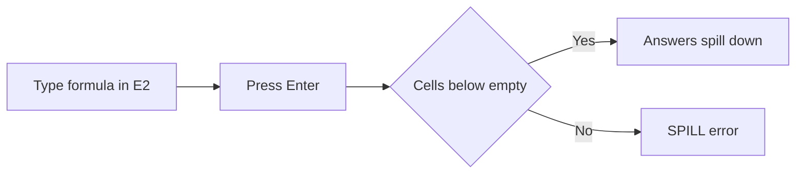

import PracticeFile from '@site/src/components/PracticeFile';

## Goal

By the end of this lesson, you can make lists that update themselves with UNIQUE, SORT and
FILTER, and fix a `#SPILL!` error.

## Why It Matters

A shopkeeper wants a list of the products sold this week, with no repeats. He wants to see the
biggest sales first, and only the sales over Rs 2000. A tuition centre wants its students in
order of marks, and a list of one grade only. These formulas make each list from one formula.
When a number changes, every list changes with it.

**Diagram in words:** You type one formula in one cell and press **Enter**. If the cells below
are empty, the answers spill into them. If something is in the way, Excel shows `#SPILL!`.

## Key Terms

| Term | Simple meaning |
|------|----------------|
| Array | A group of values: a column, a row, or a block of rows and columns. |
| Spill | When one formula gives many answers, Excel puts them in the cells next to it. The answers "spill" like water into empty cups. |
| Spill range | The cells that the answers spill into. Excel draws a border around it. |
| `#SPILL!` | An error. It means something is in the way, so the answers cannot spill. |
| UNIQUE | A function that gives a list with each value only once, with no repeats. |
| SORT | A function that gives a sorted copy of a list. Your typed list does not move. |
| FILTER | A function that gives only the rows that pass a test, like amounts over 2000. |

SORT, FILTER and UNIQUE work in Excel 2021 and newer versions. The Microsoft pages for them list
Excel 2021, but not Excel 2019. In [Lesson 7.10](sorting-data.mdx) the Sort buttons moved your
real data. The SORT function leaves your data where it is, and makes a sorted copy.

## Step by Step

:::info[Practice files]

- <PracticeFile href="/files/excel/sort-filter-unique/shop-sales-starter.xlsx">Download the starter file: Shop Sales</PracticeFile>.
  It has the week's sales and the headings already typed in, so that you can go straight to the
  formulas.
- <PracticeFile href="/files/excel/sort-filter-unique/shop-sales-finished.xlsx">Download the finished file: Shop Sales</PracticeFile>.
  It has every formula in place. Open it after you finish. In this file, the formula bar shows
  each formula inside curly brackets, `{ }`. The file stores an older kind of array formula,
  which keeps its answers in a fixed group of cells. The formula you type yourself spills.

:::

Rashid has a small general store. He writes each big sale in a list. Open a new blank workbook
([Lesson 7.1](starting-excel.mdx)). Type the sales in A1 to C11. Then type the headings in E1,
G1 to I1 and K1 to M1. Leave everything else empty.

| Row | A | B | C | E | G | H | I | K | L | M |
|-----|---|---|---|---|---|---|---|---|---|---|
| 1 | Day | Product | Amount (Rs) | Products | Day | Product | Amount (Rs) | Day | Product | Amount (Rs) |
| 2 | Monday | Sugar | 1200 | | | | | | | |
| 3 | Monday | Tea | 850 | | | | | | | |
| 4 | Tuesday | Rice | 2400 | | | | | | | |
| 5 | Tuesday | Sugar | 1500 | | | | | | | |
| 6 | Wednesday | Cooking oil | 3100 | | | | | | | |
| 7 | Wednesday | Tea | 950 | | | | | | | |
| 8 | Thursday | Rice | 1800 | | | | | | | |
| 9 | Thursday | Cooking oil | 2700 | | | | | | | |
| 10 | Friday | Sugar | 900 | | | | | | | |
| 11 | Friday | Tea | 1300 | | | | | | | |

**UNIQUE: each product once**

1. Select E2. Type `=UNIQUE(B2:B11)` and press **Enter**. You type the formula in one cell
   only. *E2 to E5 show Sugar, Tea, Rice and Cooking oil.* Each product shows once, in the order
   it first appears.
2. Select E4. *Excel draws a border around E2 to E5, the spill range.* The formula bar shows the
   formula in grey. Only E2 can be changed, because the formula lives there.

**See a `#SPILL!` error and fix it**

3. Type `Note` in E7 and press **Enter**. Nothing changes, because E7 is outside the
   spill range.
4. Type `Note` in E5 and press **Enter**. *E2 shows `#SPILL!`.* The word in E5 is in the way of
   the answers.
5. Select E5 and press **Delete**. Then clear E7 too, so that the sheet stays tidy. *The four
   products spill again.*

**SORT: biggest sales first**

6. Select G2. Type `=SORT(A2:C11,3,-1)` and press **Enter**. *G2 to I11 fill with all ten sales.
   The first row is Wednesday, Cooking oil, 3100. The last row is Monday, Tea, 850.*
7. Read the formula in three parts. `A2:C11` is the list to sort. `3` means sort by the third
   column, Amount. `-1` means largest first. With `1`, the smallest would come first.

**FILTER: only sales over Rs 2000**

8. Select K2. Type `=FILTER(A2:C11,C2:C11>2000)` and press **Enter**. The test `C2:C11>2000`
   checks every amount. *K2 to M4 show three sales: Tuesday Rice 2400, Wednesday Cooking oil
   3100 and Thursday Cooking oil 2700.*

**Watch the lists update**

9. A customer bought more sugar on Friday. Select C10, type 2200 and press **Enter**. *The
   FILTER list grows to four rows, with Friday Sugar 2200 last. In the SORT list, Friday Sugar
   moves up to the fourth row.*
10. Type 900 in C10 again and press **Enter**, so that your sheet matches the table.
    *The lists go back to how they were.*

{/* Screenshot to add: The Shop Sales sheet with E4 selected, the blue spill border around E2:E5, and the SORT and FILTER lists in G to M. */}

## Practice

:::info[Practice files]

- <PracticeFile href="/files/excel/sort-filter-unique/tuition-marks-starter.xlsx">Download the starter file: Tuition Marks</PracticeFile>.
  It has the students, grades, marks and headings already typed in. Use it if you want more
  time for the formulas.
- <PracticeFile href="/files/excel/sort-filter-unique/tuition-marks-finished.xlsx">Download the finished file: Tuition Marks</PracticeFile>.
  It has every formula in place, shown inside curly brackets like the Shop Sales file. Open it
  after you finish.

:::

Imran runs a tuition centre. He has test marks for three grades. He wants a list of the
grades, the students in order of marks, and the Grade 7 students only. Type the data in A1 to C9. Type the
headings Grades in E1, Student, Grade and Marks in G1 to I1, and the same three in K1 to M1.

| Row | A | B | C |
|-----|---|---|---|
| 1 | Student | Grade | Marks |
| 2 | Hassan | Grade 8 | 78 |
| 3 | Noor | Grade 7 | 91 |
| 4 | Ali Raza | Grade 6 | 64 |
| 5 | Sana | Grade 8 | 85 |
| 6 | Usman | Grade 7 | 72 |
| 7 | Iqra | Grade 6 | 59 |
| 8 | Bilal | Grade 8 | 88 |
| 9 | Amna | Grade 7 | 95 |

1. Open a new blank workbook. Type the data and the headings.
2. Select E2. Type `=UNIQUE(B2:B9)` and press **Enter**. Check: E2 to E4 show Grade 8, Grade 7
   and Grade 6.
3. Put the grade list in order. Select E2 and change the formula to `=SORT(UNIQUE(B2:B9))`.
   SORT sorts what UNIQUE gives it. Check: E2 to E4 show Grade 6, Grade 7 and Grade 8.
4. Select G2. Type `=SORT(A2:C9,3,-1)` and press **Enter**, so that the top marks come first.
   Check: G2 shows Amna and I2 shows 95.
5. Select K2. Type `=FILTER(A2:C9,B2:B9="Grade 7","No students")` and press **Enter**. The text
   Grade 7 is in quotation marks, like the text in IF ([Lesson 7.15](if-function.mdx)). The
   last part is what to show if no row passes the test.
6. Select K2 and change `"Grade 7"` to `"Grade 9"`. Check: K2 shows No students, because there is
   no Grade 9. Change it back to `"Grade 7"`.
7. Save the workbook with the name **Tuition Marks**
   ([Lesson 7.2](entering-editing-saving-data.mdx)), so that your work is kept.
8. Check your work: E2 to E4 show Grade 6, Grade 7 and Grade 8. G2 to G9 show Amna, Noor, Bilal,
   Sana, Hassan, Usman, Ali Raza and Iqra, with marks 95, 91, 88, 85, 78, 72, 64 and 59. K2 to M4
   show Noor 91, Usman 72 and Amna 95, all Grade 7.

## Check Questions

1. B2 to B6 hold Tea, Sugar, Tea, Rice and Sugar. What does `=UNIQUE(B2:B6)` show?

   

   
Show answer

   **Answer:** Three cells: Tea, Sugar and Rice. Each value shows once, in the order it first
   appears.

   

2. In your Shop Sales sheet, select a cell inside the SORT answers, like H5. Point to the cell
   that holds the formula.

   

   
Show answer

   **Answer:** G2, the top-left cell of the spill range. Only that cell holds the formula. The
   other cells show its answers.

   

3. A formula in E2 shows `#SPILL!`. What should you do?

   

   
Show answer

   **Answer:** Look for a cell below or beside E2 that is not empty. Delete or move what is in
   it. The answers then spill.

   

## Common Mistakes

- **Typing in a cell where answers need to spill** → The formula shows `#SPILL!`. Select the
  formula cell to see the dashed border, then clear the cells inside it.
- **Typing the formula into every cell** → Type it in the first cell only. Excel fills the
  rest by itself.
- **Leaving out the last part of FILTER when nothing may pass the test** → Excel shows
  `#CALC!`. Add a message as the last part, like `"No students"`.
- **Using `1` instead of `-1` in SORT** → The smallest comes first. Use `-1` for largest first.

## Sources

*These official pages were checked when this lesson was written.*

- [Microsoft Support, "Dynamic array formulas and spilled array behavior"](https://support.microsoft.com/en-us/office/dynamic-array-formulas-and-spilled-array-behavior-205c6b06-03ba-4151-89a1-87a7eb36e531) (applies to Excel 2021): "Excel formulas that return a set of values, also known as an array, return these values to neighboring cells. This behavior is called spilling"; "you only need to enter the formula in the top left cell"; "when you select any cell within the spill area, Excel will place a highlighted border around the range"; "Only the first cell in the spill area is editable. If you select another cell in the spill area, the formula will be visible in the formula bar, but the text is "ghosted""; "if there is anything blocking the output range ... Excel will return a #SPILL! error"; "If you remove the blockage, the formula will spill as expected"; "Older array formulas, known as legacy array formulas, always return a fixed-size result."
- [Microsoft Support, "How to correct a #SPILL! error"](https://support.microsoft.com/en-us/office/how-to-correct-a-spill-error-ffe0f555-b479-4a17-a6e2-ef9cc9ad4023) (applies to Excel 2021): "This error occurs when the spill range for a spilled array formula ... isn't blank"; "Select the cell containing the #SPILL! error to reveal a dashed border that indicates the intended spill range"; "You can then clear the error by either deleting, or moving the obstructing cell's entry."
- [Microsoft Support, "UNIQUE function"](https://support.microsoft.com/en-us/office/unique-function-c5ab87fd-30a3-4ce9-9d1a-40204fb85e1e) (applies to Excel 2021; the list does not include Excel 2019): "The UNIQUE function returns a list of unique values in a list or range"; syntax "=UNIQUE(array,[by_col],[exactly_once])"; "The UNIQUE function will return an array, which will spill if it's the final result of a formula"; "If you want to sort the list of names, you can add the SORT function: =SORT(UNIQUE(B2:B12&" "&A2:A12))".
- [Microsoft Support, "SORT function"](https://support.microsoft.com/en-us/office/sort-function-22f63bd0-ccc8-492f-953d-c20e8e44b86c) (applies to Excel 2021; the list does not include Excel 2019): "The SORT function sorts the contents of a range or array"; syntax "=SORT(array,[sort_index],[sort_order],[by_col])"; "[sort_index] ... A number indicating the row or column to sort by"; "[sort_order] ... 1 for ascending order (default), -1 for descending order"; "The SORT function will return an array, which will spill if it's the final result of a formula. This means that Excel will dynamically create the appropriate sized array range when you press ENTER."
- [Microsoft Support, "FILTER function"](https://support.microsoft.com/en-us/office/filter-function-f4f7cb66-82eb-4767-8f7c-4877ad80c759) (applies to Excel 2021; the list does not include Excel 2019): "The FILTER function allows you to filter a range of data based on criteria you define"; syntax "=FILTER(array,include,[if_empty])"; "[if_empty] ... The value to return if all values in the included array are empty (filter returns nothing)"; "If your dataset has the potential of returning an empty value, then use the 3rd argument ([if_empty]). Otherwise, a #CALC! error will result."
- [Microsoft Support, "Guidelines and examples of array formulas"](https://support.microsoft.com/en-us/office/guidelines-and-examples-of-array-formulas-7d94a64e-3ff3-4686-9372-ecfd5caa57c7) (applies to Excel 2021): "Dynamic array formulas ... only need to be input into a single cell, then confirmed by pressing Enter"; for older array formulas, "Excel surrounds the formula with braces (`{ }`)" (the note on the finished files).
- [Microsoft Support, "IF function"](https://support.microsoft.com/en-us/office/if-function-69aed7c9-4e8a-4755-a9bc-aa8bbff73be2) (applies to Excel 2021): "If you are going to use text in formulas, you need to wrap the text in quotes."

All results were worked out again before writing, with Python: the products in first-seen order
are Sugar, Tea, Rice and Cooking oil; the amounts from largest are 3100, 2700, 2400, 1800, 1500,
1300, 1200, 950, 900 and 850; the sales over 2000 are 2400, 3100 and 2700 (with 2200 in C10, a
fourth row is added and Friday Sugar is fourth largest). The grades sorted are Grade 6, Grade 7
and Grade 8; the marks from largest are 95, 91, 88, 85, 78, 72, 64 and 59; Grade 7 has Noor,
Usman and Amna.
