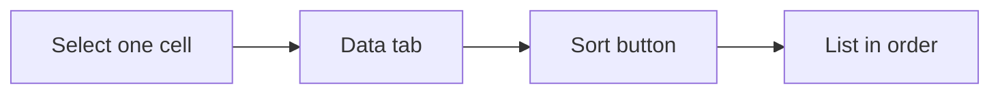

## Goal

By the end of this lesson, you can sort a list in A to Z or number order and keep each row together.

## Why It Matters

A shopkeeper wants to find items quickly in a long price list. A teacher wants to see marks from the lowest to the highest. Sorting puts a list in order in one click. You never need to type the list again.

**Diagram in words:** Select one cell in the column you want to sort. On the Data tab, select a sort button, and the whole list goes into order.

## Key Terms

| Term | Simple meaning |
|------|----------------|
| Sort | To put a list in order, for example A to Z, or smallest number to largest. |
| A to Z | Alphabet order for words. Atta comes before Tea. Z to A is the opposite order. |
| Smallest to Largest | Number order: the smallest number first, the biggest last. Largest to Smallest is the opposite. |
| Data tab | A tab on the ribbon. It has the sort buttons. |
| Heading row | The first row of a table. It holds the column names, like Item and Price (Rs). |
| Warning box | A small window where Excel stops and asks you what to do. |
| Expand the selection | A choice in Excel's warning box. It sorts the whole table, so each row stays together. |

## Teacher Demo

Before class, open a new blank workbook (see [Lesson 7.1](starting-excel.mdx)). Type this shop list, starting in cell A1.

| | A | B | C |
|---|---|---|---|
| **1** | Item | Price (Rs) | Quantity |
| **2** | Sugar | 150 | 10 |
| **3** | Tea | 420 | 4 |
| **4** | Atta | 120 | 25 |
| **5** | Rice | 300 | 12 |
| **6** | Oil | 550 | 8 |
| **7** | Daal | 280 | 15 |

**Sort words from A to Z**

1. Point to row 3. Say: "Tea costs Rs 420. Let us check that Tea keeps its price after sorting."
2. Select cell A2. It is one cell in the Item column. *Cell A2 is selected.*
3. Select the **Data** tab. *The class sees the Data tab buttons.*
4. In the **Sort & Filter** group, select **Sort A to Z**. *The items are now in this order: Atta, Daal, Oil, Rice, Sugar, Tea.*
5. Point to Tea. Say: "Tea still costs Rs 420. The whole row moved together." *Tea, 420 and 4 are still in one row.*
6. Select **Sort Z to A**. *Tea is now at the top. Atta is at the bottom.*

**Sort numbers from smallest to largest**

7. Select cell B2. It is one cell in the Price column.
8. On the **Data** tab, in the **Sort & Filter** group, select **Sort Smallest to Largest**. *The order is now Atta (120), Sugar (150), Daal (280), Rice (300), Tea (420), Oil (550).*

:::info[Screenshot to add]

The Data tab, with the Sort & Filter group and its sort buttons marked.

:::

**The common mistake: sorting one column only**

9. Drag to select cells B2 to B7 only (the prices). *Only the prices are selected.*
10. Select **Sort Largest to Smallest**. *Excel shows a warning box with two choices: **Expand the selection** and **Continue with the current selection**.*
11. Select **Continue with the current selection**, then select **Sort**. *Only the prices move. Atta now shows Rs 550. That is wrong!*

    :::warning[UNVERIFIED]

    The name of the button that finishes the sort in the warning box (**Sort**) could not be confirmed in official documentation for Excel 2016/2019. Test it on a lab computer before teaching.

    :::

12. Select **Undo** (see [Lesson 7.2](entering-editing-saving-data.mdx)). *The prices go back to their own items.*
13. Select cells B2 to B7 again. Select **Sort Largest to Smallest**. *The warning box opens again.*
14. Select **Expand the selection**, then select **Sort**. *The order is now Oil (550), Tea (420), Rice (300), Daal (280), Sugar (150), Atta (120). Every item keeps its own price.*
15. Say: "Select one cell, not a whole column. If Excel warns you, choose Expand the selection."

## Student Task

Open a new blank workbook. Type this class list, starting in cell A1.

| | A | B | C |
|---|---|---|---|
| **1** | Name | City | Marks |
| **2** | Zainab | Karachi | 35 |
| **3** | Hina | Multan | 47 |
| **4** | Bilal | Peshawar | 29 |
| **5** | Ayesha | Lahore | 42 |
| **6** | Kamran | Quetta | 38 |
| **7** | Mariam | Faisalabad | 44 |

1. Type the table above. Check every name, city and mark.
2. Select one cell in the Name column, for example A3.
3. On the **Data** tab, in the **Sort & Filter** group, select **Sort A to Z**. Check: Ayesha is first and Zainab is last.
4. Select **Sort Z to A**. Check: Zainab is first and Ayesha is last.
5. Select one cell in the Marks column, for example C3.
6. Select **Sort Smallest to Largest**. Check: Bilal (Peshawar, 29) is first and Hina (Multan, 47) is last.
7. Select **Sort Largest to Smallest**. Check the order: Hina 47, Mariam 44, Ayesha 42, Kamran 38, Zainab 35, Bilal 29.
8. Check that every student still has their own city. For example, Ayesha must still be in Lahore.
9. Save the workbook with the name **Class List** (see [Lesson 7.2](entering-editing-saving-data.mdx)).
10. Show your teacher: your list sorted from largest to smallest marks, with Hina, Multan, 47 in the top row.

## Check Questions

1. Point to the button that puts names in alphabet order.
   **Answer:** On the **Data** tab, in the **Sort & Filter** group: **Sort A to Z**.
2. You sort the class list by Marks, from smallest to largest. Which student is at the top?
   **Answer:** Bilal, from Peshawar, with 29 marks.
3. Excel shows a warning box when you sort. Which choice keeps each row together?
   **Answer:** **Expand the selection**.

## Common Mistakes

- **Selecting a whole column of cells, then choosing Continue with the current selection** → The rows get mixed up. Select **Undo** at once. Then select one cell only, or choose **Expand the selection**.
- **Sorting by the wrong column** → Look at which column your selected cell is in before you sort. Select **Undo** if the order is wrong.
- **Typing "Rs" in the same cell as the number, like Rs 150** → Excel may not sort it as a number. Type only 150, and write "Rs" in the heading.
- **Not checking the result** → After sorting, check one row. Each name must still have its own city and marks.

## Sources

*For the teacher: these sources were checked before this lesson was written.*

- [Microsoft Support, "Sort data in a range or table"](https://support.microsoft.com/en-us/office/sort-data-in-a-range-or-table-62d0b95d-2a90-4610-a6ae-2e545c4a4654): applies to Excel 2016 and 2019. Select a cell in the column; **Data** tab, **Sort & Filter** group, **Sort A to Z**, **Sort Z to A**, **Sort Smallest to Largest**, **Sort Largest to Smallest**. Sorting a range inside a bigger range is not recommended. Excel warns you, with the choices **Expand the selection** and **Continue with the current selection**. You can select **Undo**. Check that numbers are stored as numbers.
- [Microsoft Support, "Quick start: Sort data in an Excel worksheet"](https://support.microsoft.com/en-us/excel/get-started-with-excel/quick-start-sort-data-in-an-excel-worksheet): applies to Excel 2016 and 2019. Select a single cell in the column you want to sort. Ascending is A to Z or smallest to largest; descending is Z to A or largest to smallest. The range can include a first row of headings.
