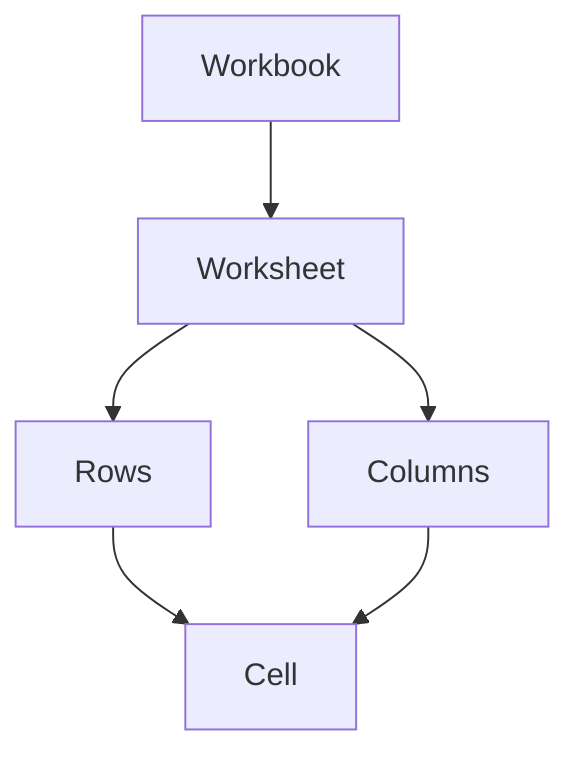
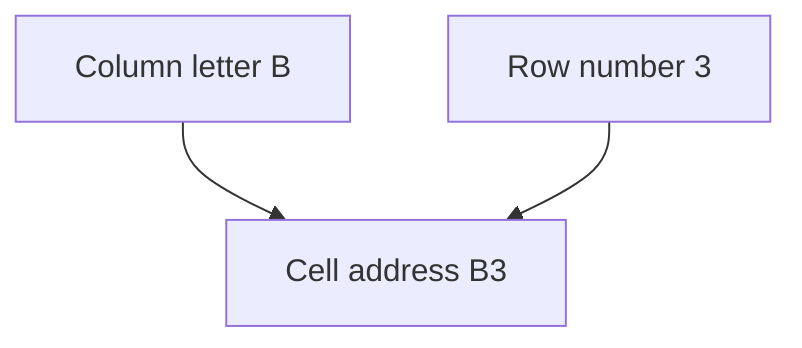

## Goal

By the end of this lesson, you can open Excel, start a blank workbook and find any cell by its address.

## Why It Matters

A shopkeeper writes items and prices in a register. A tuition centre keeps a list of who paid
the monthly fee. Excel keeps lists like these on the computer, in neat boxes. Every box has its
own address, like a house on a street. When you can find any box, you can start your own lists.

**Diagram in words:** A workbook holds worksheets. Each worksheet has rows and columns, and a
cell is the box where a row and a column meet.

## Key Terms

| Term | Simple meaning |
|------|----------------|
| Workbook | One Excel file. It holds one or more worksheets. It is like a whole register. |
| Worksheet | One page of boxes inside a workbook, like one page of a register. Its name is on a sheet tab at the bottom, for example Sheet1. |
| Row and column | A row goes across and has a number (1, 2, 3). A column goes down and has a letter (A, B, C). |
| Cell | One box, where a row and a column meet. You type in cells. |
| Cell address | The name of a cell: its column letter, then its row number. For example, B3. It is like a house number. |
| Active cell | The cell that is selected now. What you type goes into this cell. |
| Name Box | The small box to the left of the formula bar. You can type a cell address in it to go to that cell. |
| Formula bar | The long bar at the top of the worksheet. It shows what is inside the selected cell. |

## Step by Step

Follow these steps on your own computer. Excel has a ribbon with tabs, like Word. If you have
forgotten the ribbon, look back at
[Lesson 4.1: Starting Word](../module-04-ms-word/starting-word.mdx).

**Opening Excel**

These steps are the same on **Windows 10** and **Windows 11**.

1. Select the search box on the taskbar, so that you can find Excel quickly.
   *You see the search box open.*
2. Type **excel**. *You see Excel in the list of results.*
3. Select **Excel**. *You see Excel open.*
4. Select **Blank workbook**, so that you get a new, empty file. *You see an empty grid of
   boxes.* If Excel is already open, select **File**, then **New**, then **Blank workbook**. Or
   press **Ctrl+N**.

{/* Screenshot to add: A new blank workbook in Excel, with the column letters, row numbers, Name Box, formula bar and the Sheet1 tab labelled. */}

**Finding your way around**

Now learn the parts of the page. Then you always know where you are.

5. Look at the letters across the top. These are columns. Each column has a letter.
6. Look at the numbers down the left side. These are rows. Each row has a number.
7. Look at the sheet tab at the bottom. This worksheet is called Sheet1. The name helps you find
   the right page later.
8. Click the box where column B and row 3 meet. This cell is B3: letter first, then number.
   *You see a border around the cell. It is now the active cell.*

**Diagram in words:** The column letter comes first and the row number comes second. Column B
and row 3 make the cell address B3.

9. Look at the Name Box, to the left of the formula bar, so that you know where it is.
   *You see B3 in the Name Box.*
10. Click in the Name Box. Type **E7** and press **Enter**. This takes you to a cell without
    scrolling. *You see cell E7 selected.*
11. Type **Ali** and press **Enter**. Then click cell E7 again, so that you can check what is
    inside it. *You see Ali in the cell and in the formula bar.*

## Practice

You want to start a fee record for a small tuition centre. First, practise finding cells on your
own.

1. Open Excel from the search box on the taskbar.
2. Start a blank workbook, so that you have an empty page to work on.
3. Find the sheet tab at the bottom. Read its name.
4. Click cell A1. Then click cells C5, D2 and F10, one by one.
5. Look at the Name Box each time you click a cell. This helps you learn the addresses.
6. Click in the Name Box. Type **H12** and press **Enter**. This is the quick way to reach a
   far cell.
7. Click cell B2. Type your first name and press **Enter**. In a fee record, a student's name
   could go here.
8. Click cell B2 again. Look at the formula bar, so that you can see what the cell holds.
9. Find the cell where column D and row 4 meet. Say its address out loud.
10. Check your work: your first name is in cell B2. The sheet tab says Sheet1. The cell where
    column D and row 4 meet is D4.

## Check Questions

1. Point to column C and row 5 on your screen. What is the address of the cell where they meet?

   

   
Show answer

   **Answer:** C5. The column letter comes first, then the row number.

   

2. What is the difference between a workbook and a worksheet?

   

   
Show answer

   **Answer:** A workbook is the whole Excel file, like a whole register. A worksheet is one page
   of rows and columns inside it.

   

3. Show how you can go to cell H12 without scrolling.

   

   
Show answer

   **Answer:** Click in the Name Box, type H12 and press Enter.

   

## Common Mistakes

- **Writing the row number first, like 5C** → Write the column letter first, then the row
  number: C5.
- **Mixing up rows and columns** → Rows go across and have numbers. Columns go down and have
  letters.
- **Typing in the wrong cell** → Before you type, check which cell has the border around it. That
  is the active cell.

## Sources

*These official pages were checked when this lesson was written.*

- [Microsoft Support, "Find your Office apps in Windows"](https://support.microsoft.com/en-us/windows/find-your-office-apps-in-windows-76a91bce-ba92-b406-7213-0f4c4fe0d51c) (applies to Windows 10 and Windows 11): "type the app name in the search box on the taskbar … and then select it from the list of results."
- [Microsoft Support, "Can't find Office applications in Windows 10?"](https://support.microsoft.com/en-us/office/can-t-find-office-applications-in-windows-10-907ce545-6ae8-459b-8d9d-de6764a635d6) (applies to Office 2021): "Choose Start, and start typing the name of the application, like Word or Excel"; "For Microsoft 365, Office 2021 … choose Start and scroll to the Office application name, like Excel."
- [Microsoft Support, "What is Excel?"](https://support.microsoft.com/en-us/excel/get-started/what-is-excel) (applies to Excel 2021): "Create a workbook: Open Excel. Select Blank workbook. Or press Ctrl+N." (step 4).
- [Microsoft Support, "Basic tasks in Excel"](https://support.microsoft.com/en-us/office/basic-tasks-in-excel-dc775dd1-fa52-430f-9c3c-d998d1735fca) (applies to Excel 2021): "Excel documents are called workbooks. Each workbook has sheets"; "Click File, and then click New. Under New, click the Blank workbook"; "cell A1 is in the first row of column A."
- [Microsoft Support, "Keyboard shortcuts in Excel"](https://support.microsoft.com/en-us/office/keyboard-shortcuts-in-excel-1798d9d5-842a-42b8-9c99-9b7213f0040f) (applies to Excel 2021): "Open a new blank workbook. … Ctrl+N".
- [Microsoft Support, "Overview of formulas in Excel"](https://support.microsoft.com/en-us/excel/get-started/overview-of-formulas-in-excel) (applies to Excel 2021): "To refer to a cell, enter the column letter followed by the row number. For example, B2 refers to the cell at the intersection of column B and row 2."
- [Microsoft Support, "Select specific cells or ranges in Excel"](https://support.microsoft.com/en-us/excel/select-specific-cells-or-ranges-in-excel) (applies to Excel 2021): the "Name box, which is located to the left of the formula bar"; "type B3 to select that cell" and press Enter (step 10).
- [Microsoft Support, "Excel glossary"](https://support.microsoft.com/en-us/excel/excel-glossary) (applies to Excel 2021): the Name box "identifies the selected cell" (step 9); the formula bar "Displays the constant value or formula stored in the active cell" (step 11); "The active cell is bounded by a heavy border."
- [Microsoft Support, "Where are my worksheet tabs?"](https://support.microsoft.com/en-us/excel/where-are-my-worksheet-tabs) (applies to Excel 2021): "the worksheet tabs at the bottom of your Excel workbook."
- [Microsoft Support, "Rename a worksheet"](https://support.microsoft.com/en-us/office/rename-a-worksheet-3f1f7148-ee83-404d-8ef0-9ff99fbad1f9) (applies to Excel 2021): "By default, Excel names worksheets Sheet1, Sheet2, Sheet3 and so on."
