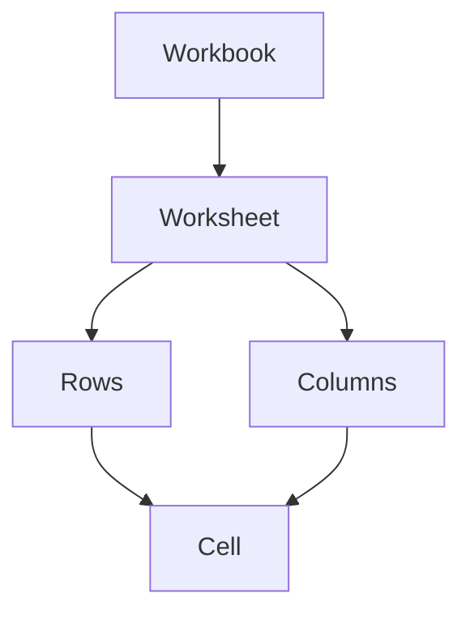
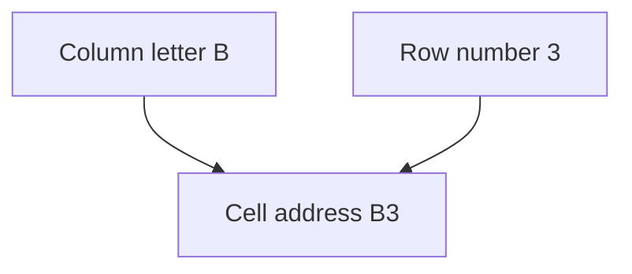

## Goal

By the end of this lesson, you can open Excel, start a blank workbook and find any cell by its address.

## Why It Matters

A shopkeeper writes items and prices in a register. A teacher writes marks in a mark book.
Excel keeps lists like these on the computer, in neat boxes. To use Excel, you first need to
find your way around those boxes. Every box has its own address, like a house on a street.

**Diagram in words:** A workbook holds worksheets. Each worksheet has rows and columns, and a
cell is the box where a row and a column meet.

## Key Terms

| Term | Simple meaning |
|------|----------------|
| Workbook | One Excel file. It holds one or more worksheets. |
| Worksheet | One page of boxes inside a workbook. Its name is on a sheet tab at the bottom, for example Sheet1. |
| Row and column | A row goes across and has a number (1, 2, 3). A column goes down and has a letter (A, B, C). |
| Cell | One box, where a row and a column meet. You type in cells. |
| Cell address | The name of a cell: its column letter, then its row number. For example, B3. |
| Active cell | The cell that is selected now. What you type goes into this cell. |
| Name Box | The small box to the left of the formula bar. You can type a cell address in it to go to that cell. |
| Formula bar | The long bar at the top of the worksheet. It shows what is inside the selected cell. |

## Teacher Demo

Use one lab computer that the whole class can see. Excel has a ribbon with tabs, like Word.
If students have forgotten the ribbon, look back at
[Lesson 4.1: Starting Word](../module-04-ms-word/starting-word.mdx).

**Opening Excel**

These steps are the same on **Windows 10** and **Windows 11**.

1. Select the search box on the taskbar. *The class sees the search box open.*
2. Type **excel**. *The class sees Excel in the list of results.*
3. Select **Excel**. *The class sees Excel open.*
4. Select **Blank workbook**. *The class sees an empty grid of boxes.*

   :::warning[UNVERIFIED]

   Microsoft confirms the Excel Start screen (with **Blank workbook**) only for newer versions,
   not for Excel 2016/2019. Test it on a lab computer before teaching. If you do not see
   **Blank workbook**, select **File**, then **New**, then **Blank workbook**. Pressing
   **Ctrl+N** also opens a new blank workbook. Both of these are confirmed for Excel 2016/2019.

   :::

:::info[Screenshot to add]

A new blank workbook in Excel, with the column letters, row numbers, Name Box, formula bar and
the Sheet1 tab labelled.

:::

**Finding your way around**

5. Point to the letters across the top. Say: "These are columns. Each column has a letter."
6. Point to the numbers down the left side. Say: "These are rows. Each row has a number."
7. Point to the sheet tab at the bottom. Say: "This worksheet is called Sheet1."
8. Click the box where column B and row 3 meet. Say: "This cell is B3. Letter first, then
   number." *The class sees a border around the cell. It is now the active cell.*

**Diagram in words:** The column letter comes first and the row number comes second. Column B
and row 3 make the cell address B3.

9. Point to the Name Box, to the left of the formula bar. *The class sees B3 in the Name Box.*
10. Click in the Name Box. Type **E7** and press **Enter**. *The class sees cell E7 selected.*
11. Type **Ali** and press **Enter**. Then click cell E7 again.
    *The class sees Ali in the cell and in the formula bar.*

    :::warning[UNVERIFIED]

    Microsoft confirms where the Name Box is and how to type an address in it. It does not say
    in words that the Name Box shows the address of the selected cell (step 9). For Excel
    2016/2019 it also only confirms that the formula bar shows formulas, not plain text
    (step 11). Test steps 9 and 11 on a lab computer before teaching.

    :::

## Student Task

Work at your own lab computer.

1. Open Excel from the search box on the taskbar.
2. Start a blank workbook.
3. Find the sheet tab at the bottom. Read its name.
4. Click cell A1. Then click cells C5, D2 and F10, one by one.
5. Look at the Name Box each time you click a cell.
6. Click in the Name Box. Type **H12** and press **Enter**.
7. Click cell B2. Type your first name and press **Enter**.
8. Click cell B2 again. Look at the formula bar.
9. Show your teacher: your name in cell B2. Then tell your teacher the address of the cell where
   column D and row 4 meet.

## Check Questions

1. Point to column C and row 5 on your screen. What is the address of the cell where they meet?
   **Answer:** C5. The column letter comes first, then the row number.
2. What is the difference between a workbook and a worksheet?
   **Answer:** A workbook is the whole Excel file. A worksheet is one page of rows and columns
   inside it.
3. Show how you can go to cell H12 without scrolling.
   **Answer:** Click in the Name Box, type H12 and press Enter.

## Common Mistakes

- **Writing the row number first, like 5C** → Write the column letter first, then the row
  number: C5.
- **Mixing up rows and columns** → Rows go across and have numbers. Columns go down and have
  letters.
- **Typing in the wrong cell** → Before you type, check which cell has the border around it. That
  is the active cell.

## Sources

*For the teacher: these sources were checked before this lesson was written.*

- [Microsoft Support, "Find your Office apps in Windows"](https://support.microsoft.com/en-us/windows/find-your-office-apps-in-windows-76a91bce-ba92-b406-7213-0f4c4fe0d51c): type the app name in the search box on the taskbar and select it from the results; the same on Windows 10 and Windows 11.
- [Microsoft Support, "Can't find Office applications in Windows 10?"](https://support.microsoft.com/en-us/office/can-t-find-office-applications-in-windows-10-907ce545-6ae8-459b-8d9d-de6764a635d6): applies to Office 2016 and 2019; another way is to choose Start and scroll to Excel.
- [Microsoft Support, "Basic tasks in Excel"](https://support.microsoft.com/en-us/office/basic-tasks-in-excel-dc775dd1-fa52-430f-9c3c-d998d1735fca): applies to Excel 2016 and 2019; Excel files are called workbooks and hold sheets; File, New, Blank workbook; cell A1 is in the first row of column A.
- [Microsoft Support, "Customize how Excel starts"](https://support.microsoft.com/en-us/excel/customize-how-excel-starts): Excel shows a Start screen with recent workbooks and templates (listed for Excel 2021 and newer only, so step 4 is UNVERIFIED).
- [Microsoft Support, "Keyboard shortcuts in Excel"](https://support.microsoft.com/en-us/office/keyboard-shortcuts-in-excel-1798d9d5-842a-42b8-9c99-9b7213f0040f): applies to Excel 2016 and 2019; Ctrl+N opens a new blank workbook.
- [Microsoft Support, "Overview of formulas in Excel"](https://support.microsoft.com/en-us/excel/get-started/overview-of-formulas-in-excel): applies to Excel 2016 and 2019; columns have letters and rows have numbers; B2 is where column B and row 2 meet; the formula bar is at the top of the worksheet.
- [Microsoft Support, "Select specific cells or ranges in Excel"](https://support.microsoft.com/en-us/excel/select-specific-cells-or-ranges-in-excel): applies to Excel 2016 and 2019; the Name Box is to the left of the formula bar; type a cell address such as B3 and press Enter to select that cell.
- [Microsoft Support, "Rename a worksheet"](https://support.microsoft.com/en-us/office/rename-a-worksheet-3f1f7148-ee83-404d-8ef0-9ff99fbad1f9): applies to Excel 2016 and 2019; sheet tabs are at the bottom, and Excel names worksheets Sheet1, Sheet2 and so on.
- [Microsoft Support, "Excel glossary"](https://support.microsoft.com/en-us/excel/excel-glossary): plain definitions of workbook, worksheet, cell, cell reference (address) and active cell.
