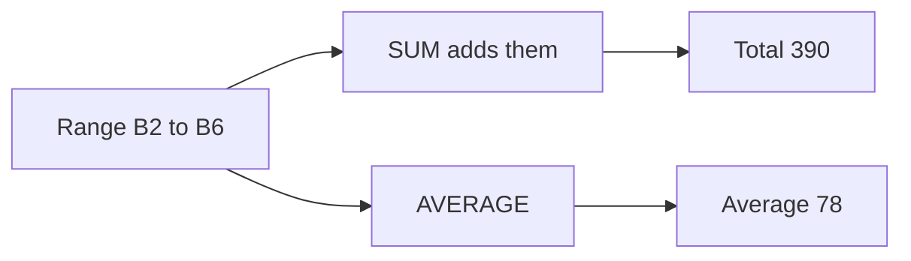

## Goal

By the end of this lesson, you can find the total and the average of a list of numbers with SUM,
AVERAGE and AutoSum.

## Why It Matters

A school result card needs the total marks of each student. A shopkeeper wants to know the
average sale of a day. A family adds up the monthly bills to plan its budget. Adding many
numbers with + signs takes a long time. A function does the work in one short formula.

**Diagram in words:** The range B2 to B6 holds five marks. SUM gives the total, 390, and AVERAGE
gives the average, 78.

## Key Terms

| Term | Simple meaning |
|------|----------------|
| Function | A ready-made formula with a name, like SUM. You give it cells and it gives a result. It is like a calculator button with a name. |
| Range | A group of cells next to each other. B2:B6 means all cells from B2 to B6, like "seats 2 to 6" in one row. |
| Colon | The `:` sign. In a range, it means "to". |
| SUM | A function that adds numbers. |
| AVERAGE | A function that adds numbers, then divides by how many numbers there are. |
| AutoSum | A button that writes a SUM formula for you. |

A formula starts with `=` ([Lesson 7.6](first-formulas.mdx)). A function goes inside a formula,
like `=SUM(B2:B6)`.

Think of a fee register with five amounts. The total is all the amounts added together. The
average is the "fair share": the total shared equally between the five.

## Step by Step

You will make a small mark sheet, like the back of a school result card. Open a new blank
workbook ([Lesson 7.1](starting-excel.mdx)). Type these marks. Leave rows 7 and 8 empty in
columns B and C. The table shows the formulas and the correct results, so that you can check
your work.

| Row | A | B | C |
|-----|---|---|---|
| 1 | Student | Maths | English |
| 2 | Ali | 78 | 70 |
| 3 | Sana | 85 | 88 |
| 4 | Hamza | 62 | 55 |
| 5 | Fatima | 91 | 95 |
| 6 | Usman | 74 | 67 |
| 7 | Total | `=SUM(B2:B6)` gives 390 | AutoSum gives 375 |
| 8 | Average | `=AVERAGE(B2:B6)` gives 78 | `=AVERAGE(C2:C6)` gives 75 |

**SUM typed by hand**

This adds all the Maths marks in one formula.

1. Select cell B7. The total goes here, below the marks.
2. Type `=SUM(B2:B6)` and press **Enter**. *B7 shows 390.*

B2:B6 is a range. It means B2 to B6, five cells. SUM adds them all.

**SUM with AutoSum**

AutoSum writes the SUM formula for you. This saves typing.

3. Select cell C7, below the English marks.
4. On the **Home** tab, select **AutoSum**. *C7 shows the formula `=SUM(C2:C6)`.*
5. Read the range in the formula before you go on. Excel guesses the cells. Check that it chose
   the right ones, so that your total is correct.
6. Press **Enter**. *C7 shows 375.*

**AVERAGE**

The average tells you the usual mark of the group.

7. Select cell B8. Type `=AVERAGE(B2:B6)` and press **Enter**. *B8 shows 78.*

390 divided by 5 is 78. AVERAGE did that for you.

8. Select cell C8. Type `=AVERAGE(C2:C6)` and press **Enter**. *C8 shows 75.*

{/* Screenshot to add: The Home tab with the AutoSum button, and cell C7 showing =SUM(C2:C6) before Enter is pressed. */}

## Practice

Saima has a small general store. She wants to know her total sales for the week and her
average sale per day. Type the days and sales. Leave B8 and B9 empty.

| Row | A | B |
|-----|---|---|
| 1 | Day | Sales (Rs) |
| 2 | Monday | 2500 |
| 3 | Tuesday | 3200 |
| 4 | Wednesday | 2800 |
| 5 | Thursday | 4100 |
| 6 | Friday | 3400 |
| 7 | Saturday | 5000 |
| 8 | Total | AutoSum gives `=SUM(B2:B7)`, result 21000 |
| 9 | Average | `=AVERAGE(B2:B7)` gives 3500 |

1. Open a new blank workbook and type the table, rows 1 to 7.
2. Type Total in A8 and Average in A9, so that each answer has a label.
3. Select B8. On the **Home** tab, select **AutoSum**.
4. Check that the formula says `=SUM(B2:B7)`. Then press **Enter**. You should see 21000.
5. Select B9. Type `=AVERAGE(B2:B7)` and press **Enter**. You should see 3500.
6. Change Saturday's sales in B7 to 5600. Watch B8 and B9. The formulas update the answers for
   you.
7. Save the workbook with the name **Weekly Sales**
   ([Lesson 7.2](entering-editing-saving-data.mdx)), so that your work is not lost.
8. Check your work: B8 shows 21600 and B9 shows 3600. When you select B8, the formula bar
   shows `=SUM(B2:B7)`.

## Check Questions

1. What does the range B2:B6 mean?

   

   
Show answer

   **Answer:** All the cells from B2 to B6: B2, B3, B4, B5 and B6.

   

2. Point to the AutoSum button on your screen.

   

   
Show answer

   **Answer:** It is on the **Home** tab: **AutoSum**.

   

3. The marks are 10, 20 and 30. What do SUM and AVERAGE give?

   

   
Show answer

   **Answer:** SUM gives 60. AVERAGE gives 20, because 60 divided by 3 is 20.

   

## Common Mistakes

- **Putting the total cell inside the average range**, like `=AVERAGE(B2:B7)` in the marks
  example → The answer is wrong (130). Use only the marks: `=AVERAGE(B2:B6)`.
- **Typing a dash instead of a colon**, like `=SUM(B2-B6)` → Excel subtracts instead. Use a colon:
  `=SUM(B2:B6)`.
- **Pressing Enter without checking AutoSum's range** → Select the cell and read the formula bar.
  If the range is wrong, type the formula yourself.

## Sources

*These official pages were checked when this lesson was written.*

- [Microsoft Support, "SUM function"](https://support.microsoft.com/en-us/office/sum-function-043e1c7d-7726-4e80-8f32-07b23e057f89) (applies to Excel 2016 and 2019): SUM adds values, cell references or ranges; example `=SUM(A2:A10)`.
- [Microsoft Support, "AVERAGE function"](https://support.microsoft.com/en-us/office/average-function-047bac88-d466-426c-a32b-8f33eb960cf6) (applies to Excel 2016 and 2019): AVERAGE returns the average (arithmetic mean); example `=AVERAGE(A1:A20)`.
- [Microsoft Support, "Calculate the average of a group of numbers"](https://support.microsoft.com/en-us/office/calculate-the-average-of-a-group-of-numbers-e158ef61-421c-4839-8290-34d7b1e68283) (applies to Excel 2016 and 2019): the average "is calculated by adding a group of numbers and then dividing by the count of those numbers".
- [Microsoft Support, "Use AutoSum to sum numbers"](https://support.microsoft.com/en-us/office/use-autosum-to-sum-numbers-543941e7-e783-44ef-8317-7d1bb85fe706) (applies to Excel 2016 and 2019): select the cell below the numbers, select AutoSum on the Home tab, press Enter; AutoSum enters a SUM formula; AutoSum is also on the Formulas tab.
- [Microsoft Support, "Overview of formulas in Excel"](https://support.microsoft.com/en-us/office/overview-of-formulas-in-excel-ecfdc708-9162-49e8-b993-c311f47ca173) (applies to Excel 2016 and 2019): a function is a ready-made formula, like SUM; a range is written with a colon, like A10:A20.

All results were calculated and checked again before writing: Maths 78 + 85 + 62 + 91 + 74 = 390,
390 ÷ 5 = 78; English 70 + 88 + 55 + 95 + 67 = 375, 375 ÷ 5 = 75; with the total included,
(390 + 390) ÷ 6 = 130. Sales total 21000, 21000 ÷ 6 = 3500; after the change, 21600 and 3600.
