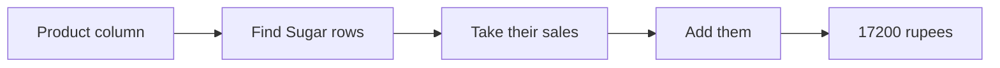
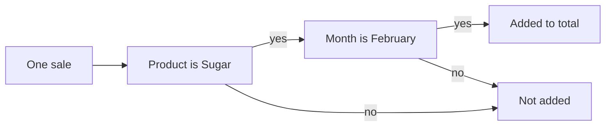

import PracticeFile from '@site/src/components/PracticeFile';

## Goal

By the end of this lesson, you can add and average only the numbers that match a rule, with
SUMIF, SUMIFS and AVERAGEIF.

## Why It Matters

A shopkeeper wants the total sugar sales, not the total of everything. A tuition centre wants
the fees collected from its Science group only. A family wants to know how much it spent on transport this
month. SUM adds the whole column. SUMIF adds only the rows that match your rule, like "Sugar".

**Diagram in words:** SUMIF looks down the Product column for Sugar. It takes the sales from the
same rows, adds them, and gives 17200 rupees.

## Key Terms

| Term | Simple meaning |
|------|----------------|
| SUMIF | A function that adds only the numbers whose row matches one rule, like "Sugar". |
| SUMIFS | A function that adds only the numbers whose row matches two or more rules, like "Sugar" and "February". |
| AVERAGEIF | A function that finds the average of only the numbers whose row matches one rule. |
| Criteria range | The cells that are checked against the rule, like the Product column. |
| Sum range | The cells that are added, like the Sales column. |

Criteria means the rule, as in [Lesson 7.17](counting-functions.mdx). A word rule goes inside
double quotes, like `"Sugar"`. SUM and AVERAGE are in [Lesson 7.8](sum-and-average.mdx).

Think of a shop's sales notebook. You run your finger down the Product column. Each time you see
Sugar, you add the amount next to it. SUMIF does exactly that.

**The order of the parts is different.** SUMIF puts the cells to add last. SUMIFS puts them
first. Microsoft calls this "a common source of problems", so look at this table carefully.

| Function | 1st part | 2nd part | 3rd part | More parts |
|----------|----------|----------|----------|------------|
| SUMIF | range (cells to check) | criteria (the rule) | sum_range (cells to add) | none |
| SUMIFS | sum_range (cells to add) | criteria_range1 (cells to check) | criteria1 (the rule) | more range and rule pairs |
| AVERAGEIF | range (cells to check) | criteria (the rule) | average_range (cells to average) | none |

## Step by Step

:::info[Practice files]

- <PracticeFile href="/files/excel/sumif-sumifs-averageif/shop-sales-starter.xlsx">Download the starter file: Shop Sales</PracticeFile>.
  It has the sales and the labels in column E already typed in, so that you can go straight to the formulas.
- <PracticeFile href="/files/excel/sumif-sumifs-averageif/shop-sales-finished.xlsx">Download the finished file: Shop Sales</PracticeFile>.
  It has every formula in F2 to F7. Open it after you finish, to compare with your work.

:::

Mr. Rashid has a general store. He writes every big sale of sugar, rice and tea in a list. He
wants to know which product brings in the most money. Open a new blank workbook
([Lesson 7.1](starting-excel.mdx)) and type his sales.

| Row | A | B | C |
|-----|---|---|---|
| 1 | Month | Product | Sales (Rs) |
| 2 | January | Sugar | 4500 |
| 3 | January | Rice | 6200 |
| 4 | January | Tea | 3000 |
| 5 | January | Sugar | 3500 |
| 6 | January | Rice | 5800 |
| 7 | February | Sugar | 5200 |
| 8 | February | Tea | 2700 |
| 9 | February | Rice | 4800 |
| 10 | February | Sugar | 4000 |
| 11 | February | Tea | 3300 |

Now type the labels in column E. Leave column F empty. The table shows the formulas and the
correct results, so that you can check your work.

| Row | E | F |
|-----|---|---|
| 1 | Question | Answer (Rs) |
| 2 | Sugar total | `=SUMIF(B2:B11,"Sugar",C2:C11)` gives 17200 |
| 3 | Rice total | `=SUMIF(B2:B11,"Rice",C2:C11)` gives 16800 |
| 4 | Tea total | `=SUMIF(B2:B11,"Tea",C2:C11)` gives 9000 |
| 5 | Sugar in February | `=SUMIFS(C2:C11,B2:B11,"Sugar",A2:A11,"February")` gives 9200 |
| 6 | Average Rice sale | `=AVERAGEIF(B2:B11,"Rice",C2:C11)` gives 5600 |
| 7 | All sales | `=SUM(C2:C11)` gives 43000 |

**SUMIF: a total for each product**

1. Select cell F2. Type `=SUMIF(B2:B11,"Sugar",C2:C11)` and press **Enter**. *F2 shows 17200.*

Read the formula in three parts. B2:B11 is where to look. `"Sugar"` is the rule. C2:C11 holds
the numbers to add. Excel adds 4500, 3500, 5200 and 4000.

2. Select F3. Type `=SUMIF(B2:B11,"Rice",C2:C11)` and press **Enter**. *F3 shows 16800.*
3. Select F4. Type `=SUMIF(B2:B11,"Tea",C2:C11)` and press **Enter**. *F4 shows 9000.*

Only the rule changed. Now Mr. Rashid can see that sugar brings in the most money.

**SUMIFS: a total with two rules**

4. Select F5. Type `=SUMIFS(C2:C11,B2:B11,"Sugar",A2:A11,"February")` and press **Enter**.
   *F5 shows 9200.*

Look at the order. In SUMIFS, the cells to add, C2:C11, come first. Then come the pairs: B2:B11
with `"Sugar"`, and A2:A11 with `"February"`. A sale is added only when both rules are true.
Only 5200 and 4000 are sugar sales in February.

**Diagram in words:** SUMIFS checks each sale. The sale is added only when the product is Sugar
and the month is February. If either answer is no, the sale is left out.

**AVERAGEIF: the usual sale of one product**

5. Select F6. Type `=AVERAGEIF(B2:B11,"Rice",C2:C11)` and press **Enter**. *F6 shows 5600.*

AVERAGEIF uses the same order as SUMIF. It adds the three rice sales, 16800, and divides by 3.

**Check the totals**

6. Select F7. Type `=SUM(C2:C11)` and press **Enter**. *F7 shows 43000.*

This checks your work. 17200 + 16800 + 9000 is also 43000, so every sale was counted once.

{/* Screenshot to add: The shop sales list with column F showing the answers, and F5 selected so the formula bar shows the SUMIFS formula. */}

## Practice

:::info[Practice files]

- <PracticeFile href="/files/excel/sumif-sumifs-averageif/accessory-sales-starter.xlsx">Download the starter file: Accessory Sales</PracticeFile>.
  It has the sales and labels already typed in. Use it if you want more time for the formulas.
- <PracticeFile href="/files/excel/sumif-sumifs-averageif/accessory-sales-finished.xlsx">Download the finished file: Accessory Sales</PracticeFile>.
  It has the four formulas in G2 to G5. Open it after you finish.

:::

Asif and Zara work in a mobile accessories shop. The owner wants to see what each one sells.

| Row | A | B | C |
|-----|---|---|---|
| 1 | Salesperson | Item | Amount (Rs) |
| 2 | Asif | Charger | 1200 |
| 3 | Zara | Earphones | 800 |
| 4 | Asif | Mobile cover | 600 |
| 5 | Zara | Charger | 1500 |
| 6 | Asif | Earphones | 950 |
| 7 | Zara | Mobile cover | 450 |
| 8 | Asif | Charger | 1300 |
| 9 | Zara | Charger | 1100 |
| 10 | Asif | Mobile cover | 500 |

1. Open a new blank workbook and type the table, rows 1 to 10.
2. In F1 to F5, type these labels: Question, Charger total, Asif's total, Zara's chargers,
   Average earphones sale. Type Answer (Rs) in G1.
3. In G2, add all the charger sales with SUMIF. Check B2:B10 for `"Charger"` and add C2:C10.
4. In G3, add all of Asif's sales with SUMIF. This time, check A2:A10 for `"Asif"`.
5. In G4, add only Zara's charger sales with SUMIFS. Put C2:C10 first. Then add two pairs:
   A2:A10 with `"Zara"`, and B2:B10 with `"Charger"`.
6. In G5, find the average earphones sale with AVERAGEIF.
7. Save the workbook with the name **Accessory Sales**
   ([Lesson 7.2](entering-editing-saving-data.mdx)), so that your work is not lost.
8. Check your work: G2 shows 5100, G3 shows 4550, G4 shows 2600 and G5 shows 875. G4's formula
   is `=SUMIFS(C2:C10,A2:A10,"Zara",B2:B10,"Charger")`.

## Check Questions

1. In `=SUMIF(B2:B11,"Tea",C2:C11)`, which part holds the numbers that are added?

   

   
Show answer

   **Answer:** C2:C11, the third part. B2:B11 is checked, and `"Tea"` is the rule.

   

2. Write a SUMIFS formula for Mr. Rashid's rice sales in January.

   

   
Show answer

   **Answer:** `=SUMIFS(C2:C11,B2:B11,"Rice",A2:A11,"January")`. It gives 12000, from 6200 and
   5800.

   

3. In your Accessory Sales sheet, select the cell with the average earphones sale. Point to its
   rule in the formula bar.

   

   
Show answer

   **Answer:** Cell G5. The formula is `=AVERAGEIF(B2:B10,"Earphones",C2:C10)`, and the rule is
   `"Earphones"`. It gives 875, from 800 and 950.

   

## Common Mistakes

- **Using the SUMIF order in SUMIFS**, like `=SUMIFS(B2:B11,"Sugar",C2:C11)` → In SUMIFS, the
  cells to add come first: `=SUMIFS(C2:C11,B2:B11,"Sugar")`.
- **Forgetting the double quotes around a word**, like `Sugar` instead of `"Sugar"` → Put every
  word rule inside double quotes.
- **Leaving out the cells to add in SUMIF**, like `=SUMIF(B2:B11,"Sugar")` → Excel then adds
  B2:B11, which holds only words. Add C2:C11 as the third part.
- **Making the ranges different sizes**, like B2:B11 with C2:C10 → Use ranges with the same rows.
  Then each rule lines up with its own number.

## Sources

*These official pages were checked when this lesson was written.*

- [Microsoft Support, "SUMIF function"](https://support.microsoft.com/en-us/excel/functions/sumif-function) (applies to Excel 2021): "You use the SUMIF function to sum the values in a range that meet criteria that you specify"; syntax `SUMIF(range, criteria, [sum_range])`; "the formula =SUMIF(B2:B5, "John", C2:C5) sums only the values in the range C2:C5, where the corresponding cells in the range B2:B5 equal "John.""; "If the sum_range argument is omitted, Excel adds the cells that are specified in the range argument"; "Sum_range should be the same size and shape as range"; "Any text criteria or any criteria that includes logical or mathematical symbols must be enclosed in double quotation marks (")"; example `=SUMIF(A2:A7,"Fruits",C2:C7)`.
- [Microsoft Support, "SUMIFS function"](https://support.microsoft.com/en-us/excel/functions/sumifs-function) (applies to Excel 2021): "adds all of its arguments that meet multiple criteria"; syntax `SUMIFS(sum_range, criteria_range1, criteria1, [criteria_range2, criteria2], ...)`; "The order of arguments differ between SUMIFS and SUMIF. In particular, the sum_range argument is the first argument in SUMIFS, but it is the third argument in SUMIF. This is a common source of problems using these functions."; "Make sure Criteria1,2 are in quotation marks if you are testing for text values"; "The Criteria_range argument must contain the same number of rows and columns as the Sum_range argument."
- [Microsoft Support, "AVERAGEIF function"](https://support.microsoft.com/en-us/excel/functions/averageif-function) (applies to Excel 2021): "Returns the average (arithmetic mean) of all the cells in a range that meet a given criteria"; syntax `AVERAGEIF(range, criteria, [average_range])`; "Average_range Optional. The actual set of cells to average. If omitted, range is used."
- [Microsoft Support, "SUM function"](https://support.microsoft.com/en-us/office/sum-function-043e1c7d-7726-4e80-8f32-07b23e057f89) (applies to Excel 2021): "The SUM function adds values."

All results were calculated and checked again before writing. Sugar 4500 + 3500 + 5200 + 4000 =
17200; Rice 6200 + 5800 + 4800 = 16800; Tea 3000 + 2700 + 3300 = 9000; together 43000, the same
as all sales. Sugar in February 5200 + 4000 = 9200. Rice average 16800 ÷ 3 = 5600. Rice in
January 6200 + 5800 = 12000. Chargers 1200 + 1500 + 1300 + 1100 = 5100; Asif 1200 + 600 + 950 +
1300 + 500 = 4550; Zara's chargers 1500 + 1100 = 2600; earphones (800 + 950) ÷ 2 = 875.
