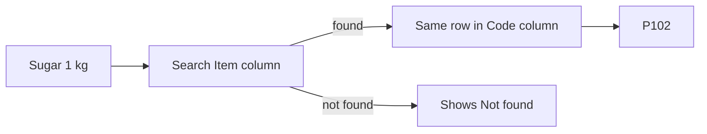

import PracticeFile from '@site/src/components/PracticeFile';

## Goal

By the end of this lesson, you can find a price, a name or a salary in a list by its code, with
VLOOKUP and XLOOKUP.

## Why It Matters

A shopkeeper types a product code and wants the price at once. An office clerk types a staff ID
and wants the salary. A school types a roll number and wants the student's name. Searching a
long list by eye is slow, and one wrong row gives a wrong answer. VLOOKUP and XLOOKUP find
the right row for you.

**Diagram in words:** VLOOKUP takes the code P104 and looks down the first column. It finds P104
in row 5, moves across to the third column, and gives the price, 450.

## Key Terms

| Term | Simple meaning |
|------|----------------|
| VLOOKUP | A function that searches the first column of a table, then gives a value from the same row. |
| XLOOKUP | A newer function that finds a value in one column and gives the value from the same row of another column. It is in Excel 2021. |
| Lookup value | The value you search for, like a product code. |
| Column number | In VLOOKUP, which column of the table to give back. The first column of the table is 1. |
| Exact match | Find only the exact value, not a close one. In VLOOKUP, you ask for it with FALSE. |
| `#N/A` | The message Excel shows when the exact value is not found. |

Think of a phone contact list. You search for a name, then read the number on the same line.
A lookup function does the same with a code and a price.

## Step by Step

You will build a price finder for a general store. The codes and prices are made up for
practice. Open a new blank workbook ([Lesson 7.1](starting-excel.mdx)) and type the price list.

| Row | A | B | C |
|-----|---|---|---|
| 1 | Code | Item | Price (Rs) |
| 2 | P101 | Basmati rice 1 kg | 380 |
| 3 | P102 | Sugar 1 kg | 160 |
| 4 | P103 | Cooking oil 1 litre | 560 |
| 5 | P104 | Tea pack | 450 |
| 6 | P105 | Flour 10 kg | 1300 |
| 7 | P106 | Daal chana 1 kg | 320 |

**Part 1: VLOOKUP**

:::info[Practice files]

- <PracticeFile href="/files/excel/vlookup-and-xlookup/price-list-starter.xlsx">Download the starter file: Price List</PracticeFile>.
  It has the price list and the code P104 in E2 already typed in, so that you can go straight to the formulas.
- <PracticeFile href="/files/excel/vlookup-and-xlookup/price-list-finished.xlsx">Download the finished file: Price List</PracticeFile>.
  It has the two VLOOKUP formulas in F2 and G2. Open it after Part 1, to compare with your work.

:::

Type Code in E1, Item in F1 and Price (Rs) in G1. Type P104 in E2. This is the code you want
to find.

| Row | E | F | G |
|-----|---|---|---|
| 1 | Code | Item | Price (Rs) |
| 2 | P104 | `=VLOOKUP(E2,A2:C7,2,FALSE)` gives Tea pack | `=VLOOKUP(E2,A2:C7,3,FALSE)` gives 450 |

1. Select cell F2. Type `=VLOOKUP(E2,A2:C7,2,FALSE)` and press **Enter**. *F2 shows Tea pack.*

Read the formula in four parts. E2 is the code to find. A2:C7 is the price list. 2 means "give
me column 2 of the list", the Item column. FALSE means "exact match only".

2. Select G2. Type `=VLOOKUP(E2,A2:C7,3,FALSE)` and press **Enter**. *G2 shows 450.*

Only the column number changed. Column 3 of the list is the price.

VLOOKUP always searches the **first** column of the table you give it. Here that is column A,
the codes. So the code column must be on the left of the column you want back.

3. Select E2, type P999 and press **Enter**. This code is not in the list, so that you can see
   what happens. *F2 and G2 show `#N/A`.*

`#N/A` means VLOOKUP did not find the exact code. Check the code for a typing mistake.

4. Select E2, type P104 again and press **Enter**. *F2 shows Tea pack and G2 shows 450 again.*

**Part 2: XLOOKUP**

:::info[Practice files]

- <PracticeFile href="/files/excel/vlookup-and-xlookup/price-list-xlookup-starter.xlsx">Download the starter file: Price List With XLOOKUP</PracticeFile>.
  It has the price list and every code and item to find already typed in, but no formulas.
- <PracticeFile href="/files/excel/vlookup-and-xlookup/price-list-xlookup-finished.xlsx">Download the finished file: Price List With XLOOKUP</PracticeFile>.
  It has both parts done: VLOOKUP in F2 and G2, and XLOOKUP in F5, F6 and F9. Open it after you finish.

:::

XLOOKUP is a newer lookup function. It is in Excel 2021, but not in Excel 2016 or Excel 2019.
It has two big helps. You can choose your own words for "not found". And the column to search
can be anywhere, even on the right.

Type these in the same sheet, below Part 1. Leave F5, F6 and F9 empty.

| Row | E | F |
|-----|---|---|
| 4 | Code | Price (Rs) |
| 5 | P106 | `=XLOOKUP(E5,A2:A7,C2:C7,"Not found")` gives 320 |
| 6 | P999 | `=XLOOKUP(E6,A2:A7,C2:C7,"Not found")` gives Not found |
| 7 | | |
| 8 | Item | Code |
| 9 | Sugar 1 kg | `=XLOOKUP(E9,B2:B7,A2:A7,"Not found")` gives P102 |

**Find a price with XLOOKUP**

5. Select F5. Type `=XLOOKUP(E5,A2:A7,C2:C7,"Not found")` and press **Enter**. *F5 shows 320.*

Read it in four parts. E5 is the code to find. A2:A7 is the column to search. C2:C7 is the
column to give back. `"Not found"` is the message to show if the code is missing. XLOOKUP finds
an exact match unless you ask for something else.

6. Select F6. Type `=XLOOKUP(E6,A2:A7,C2:C7,"Not found")` and press **Enter**.
   *F6 shows Not found.*

P999 is not in the list. Instead of `#N/A`, XLOOKUP shows your own clear message.

**Look to the left with XLOOKUP**

7. Select F9. Type `=XLOOKUP(E9,B2:B7,A2:A7,"Not found")` and press **Enter**. *F9 shows P102.*

This time XLOOKUP searched the Item column, B, and gave back the Code column, A. Column A is on
the left of column B. VLOOKUP cannot do this, because it only searches the first column of its
table.

**Diagram in words:** XLOOKUP searches the Item column for Sugar 1 kg. It gives the code from the
same row, P102. If the item is missing, it shows the words Not found.

{/* Screenshot to add: The price list with F2 and G2 showing Tea pack and 450, F5 and F6 showing 320 and Not found, and F9 selected so the formula bar shows the XLOOKUP formula. */}

## Practice

:::info[Practice files]

- <PracticeFile href="/files/excel/vlookup-and-xlookup/staff-salaries-starter.xlsx">Download the starter file: Staff Salaries</PracticeFile>.
  It has the staff list and the ID 204 in F2 already typed in. Use it for steps 1 to 4.
- <PracticeFile href="/files/excel/vlookup-and-xlookup/staff-salaries-finished.xlsx">Download the finished file: Staff Salaries</PracticeFile>.
  It has the two VLOOKUP formulas in G2 and H2. Open it after step 4.
- <PracticeFile href="/files/excel/vlookup-and-xlookup/staff-salaries-xlookup-starter.xlsx">Download the starter file: Staff Salaries With XLOOKUP</PracticeFile>.
  It has the staff list and every ID and name to find already typed in. Use it for the whole task.
- <PracticeFile href="/files/excel/vlookup-and-xlookup/staff-salaries-xlookup-finished.xlsx">Download the finished file: Staff Salaries With XLOOKUP</PracticeFile>.
  It has every formula, VLOOKUP and XLOOKUP. Open it after you finish.

:::

Mrs. Farzana keeps the staff list of a small office. She wants to type a staff ID or a name and
see the details at once. The names and salaries are made up.

| Row | A | B | C | D |
|-----|---|---|---|---|
| 1 | Staff ID | Name | Department | Salary (Rs) |
| 2 | 201 | Ahmed Raza | Accounts | 65000 |
| 3 | 202 | Sadia Noor | Sales | 52000 |
| 4 | 203 | Waqas Ali | Store | 38000 |
| 5 | 204 | Nadia Khan | Accounts | 71000 |
| 6 | 205 | Tariq Mehmood | Sales | 47000 |
| 7 | 206 | Sobia Akhtar | Reception | 41000 |

1. Open a new blank workbook and type the table, rows 1 to 7.
2. Type Staff ID in F1, Name in G1 and Salary (Rs) in H1. Type 204 in F2.
3. In G2, find the name with VLOOKUP. Search for F2 in A2:D7, give back column 2, and use FALSE.
4. In H2, find the salary the same way. The salary is column 4 of A2:D7.
5. Type Name in F4, Staff ID in G4 and Department in H4. Type Waqas Ali in F5 and Hamid Shah in
   F6.
6. In G5, find Waqas Ali's staff ID with XLOOKUP. Search B2:B7, give back A2:A7, and use
   `"Not found"`.
7. In H5, find his department the same way, but give back C2:C7.
8. Fill in G6 and H6 for Hamid Shah in the same way. He is not on the list.
9. Save the workbook with the name **Staff Salaries**
   ([Lesson 7.2](entering-editing-saving-data.mdx)), so that your work is not lost.
10. Check your work: G2 shows Nadia Khan and H2 shows 71000. G5 shows 203 and H5 shows Store.
    G6 and H6 show Not found. G5's formula is `=XLOOKUP(F5,B2:B7,A2:A7,"Not found")`.

## Check Questions

1. In `=VLOOKUP(E2,A2:C7,3,FALSE)`, what does the 3 mean, and what does FALSE mean?

   

   
Show answer

   **Answer:** 3 means "give back the third column of A2:C7", the price. FALSE means "exact match
   only".

   

2. Why can't VLOOKUP find a staff ID from a name in Mrs. Farzana's list?

   

   
Show answer

   **Answer:** VLOOKUP searches only the first column of its table. The names are in column B,
   and the IDs are on their left, in column A. XLOOKUP can do it, because it can give back a
   column on either side.

   

3. In your Staff Salaries sheet, select G6. Point to the part of the formula that makes it show
   Not found.

   

   
Show answer

   **Answer:** The fourth part, `"Not found"`. The formula is
   `=XLOOKUP(F6,B2:B7,A2:A7,"Not found")`. Hamid Shah is not on the list, so this message shows.

   

## Common Mistakes

- **Leaving out FALSE in VLOOKUP**, like `=VLOOKUP(E2,A2:C7,3)` → Without FALSE, VLOOKUP looks for
  a close match. It can give a wrong price. Always end with FALSE for codes and names.
- **Using VLOOKUP to find a code from an item** → VLOOKUP searches only the first column. The
  codes are on the left of the items. Use XLOOKUP for this, as in step 7.
- **Counting the column number from column A of the sheet** → Count from the first column of
  the table you gave. In B2:D7, column B is 1.
- **Typing the code with a mistake or an extra space**, like `P10 4` → The lookup gives `#N/A`
  or Not found. Check the code and type it again.

## Sources

*These official pages were checked when this lesson was written.*

- [Microsoft Support, "VLOOKUP function"](https://support.microsoft.com/en-us/excel/functions/vlookup-function) (applies to Excel 2021): "Use VLOOKUP when you need to find things in a table or a range by row. For example, look up a price of an automotive part by the part number"; syntax `VLOOKUP (lookup_value, table_array, col_index_num, [range_lookup])`; "The value you want to look up must be in the first column of the range of cells you specify in the table_array argument"; col_index_num is "The column number (starting with 1 for the left-most column of table_array) that contains the return value"; "The secret to VLOOKUP is to organize your data so that the value you look up (Fruit) is to the left of the return value (Amount) you want to find"; "Exact match - 0/FALSE searches for the exact value in the first column"; approximate match "is the default method if you don't specify one"; "If range_lookup is TRUE or left out, the first column needs to be sorted alphabetically or numerically. If the first column isn't sorted, the return value might be something you don't expect"; "If range_lookup is FALSE, the #N/A error value indicates that the exact number isn't found"; "if you specify B2:D11 as the range, you should count B as the first column"; "make sure the data in the first column doesn't have leading spaces, trailing spaces".
- [Microsoft Support, "XLOOKUP function"](https://support.microsoft.com/en-us/excel/functions/xlookup-function) (applies to Excel 2021): "With XLOOKUP, you can look in one column for a search term and return a result from the same row in another column, regardless of which side the return column is on"; "XLOOKUP is not available in Excel 2016 and Excel 2019"; syntax `=XLOOKUP(lookup_value, lookup_array, return_array, [if_not_found], [match_mode], [search_mode])`; "Where a valid match is not found, return the [if_not_found] text you supply"; "If a valid match is not found, and [if_not_found] is missing, #N/A is returned"; match_mode "0 - Exact match. If none found, return #N/A. This is the default"; "VLOOKUP can only look from left-to-right."

All results were checked again before writing, by finding each value in its row. P104 is in row
5: Tea pack, 450. P106 is in row 7: 320. P999 is not in the list. Sugar 1 kg is in row 3, code
P102. Staff ID 204 is in row 5: Nadia Khan, 71000. Waqas Ali is in row 4: 203, Store. Hamid
Shah is not in the list.
