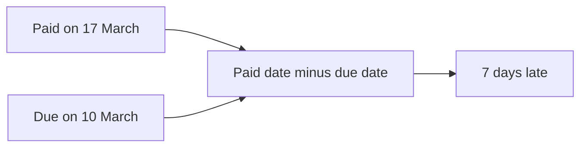

import PracticeFile from '@site/src/components/PracticeFile';

## Goal

By the end of this lesson, you can show today's date with TODAY and NOW, count the days between
two dates, and find an age in years with DATEDIF.

## Why It Matters

A tuition centre needs to know how many days late each fee was paid. A school checks a child's
age on the admission date. An office counts how many years each person has worked, to give a
long-service award. Counting days on a calendar is slow, and you can miss a day. Excel
counts them for you.

**Diagram in words:** Excel takes the due date away from the paid date. 17 March minus 10 March
gives 7, so the fee was paid 7 days late.

## Key Terms

| Term | Simple meaning |
|------|----------------|
| Serial number | The number Excel keeps for each date. 1 January 1900 is 1, the next day is 2, and so on. This is why you can subtract dates. |
| TODAY | A function that shows today's date. It has nothing inside its brackets: `=TODAY()`. |
| NOW | A function that shows today's date and the time now: `=NOW()`. |
| DAYS | A function that gives the number of days between two dates. The end date comes first. |
| DATEDIF | A function that gives the years, months or days between a start date and an end date. |
| Complete year | A full year. A child who turns 5 tomorrow is still 4 today. |

Each date is a number of days, like a page number in a very long diary. To find the days between
two dates, you take one page number away from the other. You learned to type and show dates in
[Lesson 7.5](number-formats.mdx), and to subtract with a formula in
[Lesson 7.6](first-formulas.mdx).

## Step by Step

:::info[Practice files]

- <PracticeFile href="/files/excel/working-with-dates/fee-record-starter.xlsx">Download the starter file: Fee Record</PracticeFile>.
  It has the students and both dates already typed in. Use it for parts 1 and 2.
- <PracticeFile href="/files/excel/working-with-dates/fee-record-finished.xlsx">Download the finished file: Fee Record</PracticeFile>.
  It has every formula in place. H1 and H2 show the date on the day you open it.
- <PracticeFile href="/files/excel/working-with-dates/admission-ages-starter.xlsx">Download the starter file: Admission Ages</PracticeFile>.
  It has the dates of birth and admission dates already typed in. Use it for part 3.
- <PracticeFile href="/files/excel/working-with-dates/admission-ages-finished.xlsx">Download the finished file: Admission Ages</PracticeFile>.
  It has every DATEDIF formula in place. Open it after you finish, to compare with your work.

:::

**Typing dates:** the tables write dates as day/month/year, like 10/3/2026 for 10 March 2026.
Your computer may use the month first ([Lesson 7.5](number-formats.mdx)). A real date moves to
the right of its cell. After you type C4, 17/3/2026, look at it. If it stays on the left, your
computer puts the month first. Then type every date month first, like 3/17/2026 and 3/10/2026.

**Part 1: days between two dates**

A tuition centre's March fee was due on 10 March 2026. Open a new blank workbook and type this
table. Leave columns D and E empty for now.

| Row | A | B | C | D | E |
|-----|---|---|---|---|---|
| 1 | Student | Due date | Paid on | Days late | Using DAYS |
| 2 | Ayesha Khan | 10/3/2026 | 8/3/2026 | `=C2-B2` gives -2 | `=DAYS(C2,B2)` gives -2 |
| 3 | Bilal Ahmed | 10/3/2026 | 10/3/2026 | 0 | 0 |
| 4 | Hira Shah | 10/3/2026 | 17/3/2026 | 7 | 7 |
| 5 | Danish Ali | 10/3/2026 | 2/4/2026 | 23 | 23 |
| 6 | Mariam Javed | 10/3/2026 | 12/3/2026 | 2 | 2 |

1. Select D2. Type `=C2-B2` and press **Enter**. This takes the due date away from the paid
   date. *D2 shows -2.* A minus number means Ayesha paid 2 days early.
2. Drag the fill handle from D2 down to D6 ([Lesson 7.7](fill-handle.mdx)), so that every
   student gets an answer. *D3 to D6 show 0, 7, 23 and 2.*
3. Look at Danish in row 5. He paid on 2 April. Excel counted across the end of March for you:
   21 days in March and 2 in April make 23.

:::tip[If your screen looks different]

If D2 shows a date instead of a number, the cell has a date format. Select D2 to D6. On the
**Home** tab, in the **Number** group, open the **Number Format** list and select **General**
([Lesson 7.5](number-formats.mdx)). The numbers of days then show.

:::

4. Select E2. Type `=DAYS(C2,B2)` and press **Enter**. DAYS does the same sum, with the end date
   first. *E2 shows -2, the same as D2.*
5. Drag the fill handle from E2 down to E6. *E3 to E6 show 0, 7, 23 and 2, the same as
   column D.* Use the way you find clearer.

**Part 2: today's date with TODAY and NOW**

6. Type `Today` in G1 and `Now` in G2, so that each answer has a label.
7. Select H1. Type `=TODAY()` and press **Enter**. Keep the two brackets, even with nothing
   inside. *H1 shows today's date.*
8. Select H2. Type `=NOW()` and press **Enter**. *H2 shows today's date and the time now.* If
   H2 shows `#####`, make column H wider ([Lesson 7.3](rows-and-columns.mdx)).

Your answers in H1 and H2 depend on the day you do this lesson. That is the point of these
functions. They change by themselves when the sheet calculates again, for example when you open
the workbook another day. So a daily sheet always shows the right date.

Sometimes you want a date that never changes, like the day a fee was paid. Then select a cell
and press **Ctrl+;** (the semicolon key). Excel types today's date as a fixed value, not a
formula.

**Part 3: age in years with DATEDIF**

A school checks each child's age on the admission date. Open the Admission Ages starter file, or
type this table in a new workbook. Leave column D empty.

| Row | A | B | C | D |
|-----|---|---|---|---|
| 1 | Student | Date of birth | Admission date | Age in years |
| 2 | Zara Hussain | 15/1/2021 | 1/4/2026 | `=DATEDIF(B2,C2,"Y")` gives 5 |
| 3 | Omar Farooq | 20/6/2019 | 1/4/2026 | 6 |
| 4 | Laiba Noor | 1/4/2021 | 1/4/2026 | 5 |
| 5 | Ahmed Saleem | 2/4/2021 | 1/4/2026 | 4 |
| 6 | Fatima Iqbal | 10/9/2022 | 6/4/2026 | 3 |

9. Select D2. Type `=DATEDIF(B2,C2,"Y")` and press **Enter**. The start date comes first, then
   the end date, then `"Y"` for complete years. *D2 shows 5.*
10. Drag the fill handle from D2 down to D6. *D3 to D6 show 6, 5, 4 and 3.*
11. Look at Laiba and Ahmed. Laiba turns 5 on her admission day, so she is 5. Ahmed turns 5 one
    day after his admission day, so he is still 4. DATEDIF counts only complete years.

:::caution[Use DATEDIF with care]

Microsoft says DATEDIF is kept for old workbooks, and it "may calculate incorrect results under
certain scenarios". Microsoft does not recommend its `"MD"` unit. In this book, use DATEDIF only
with `"Y"` for complete years. To count days, subtract the dates as in Part 1.

:::

{/* Screenshot to add: The Fee Record sheet with D2 selected and the formula bar showing =C2-B2, and H1 showing today's date. */}

## Practice

:::info[Practice files]

- <PracticeFile href="/files/excel/working-with-dates/staff-service-starter.xlsx">Download the starter file: Staff Service</PracticeFile>.
  It has the names, joining dates and the review date already typed in. Use it if you want more
  time for the formulas.
- <PracticeFile href="/files/excel/working-with-dates/staff-service-finished.xlsx">Download the finished file: Staff Service</PracticeFile>.
  It has every formula in place. Open it after you finish.

:::

A small office gives a long-service award to everyone with 5 or more complete years of work on
30 June 2026. The review date goes in one cell, G1. Every formula uses that one cell, so it is
fixed with `$` signs ([Lesson 7.14](absolute-references.mdx)).

| Row | A | B | C | D | E | F | G |
|-----|---|---|---|---|---|---|---|
| 1 | Name | Joining date | Days worked | Years | Award | Review date | 30/6/2026 |
| 2 | Kamran Akhtar | 15/3/2018 | | | | | |
| 3 | Sadia Parveen | 1/8/2021 | | | | | |
| 4 | Naveed Iqbal | 30/6/2021 | | | | | |
| 5 | Rubina Kausar | 10/1/2024 | | | | | |
| 6 | Tariq Mehmood | 1/7/2021 | | | | | |

1. Open a new blank workbook. Type the table, including F1 and the review date in G1.
2. Select C2. Type `=$G$1-B2` and press **Enter**. This counts the days from joining to the
   review date. Check: C2 shows 3029.
3. Select D2. Type `=DATEDIF(B2,$G$1,"Y")` and press **Enter**. Check: D2 shows 8.
4. Select E2. Type `=IF(D2>=5,"Yes","No")` and press **Enter**. This uses IF from
   [Lesson 7.15](if-function.mdx). Check: E2 shows Yes.
5. Select C2 to E2 and drag the fill handle down to row 6, so that every person gets an answer.
6. Look at Naveed and Tariq. Naveed joined exactly 5 years before the review date, so he gets the
   award. Tariq joined one day later, so he has only 4 complete years.
7. Save the workbook with the name **Staff Service**
   ([Lesson 7.2](entering-editing-saving-data.mdx)), so that your work is kept.
8. Check your work: C2 to C6 show 3029, 1794, 1826, 902 and 1825. D2 to D6 show 8, 4, 5, 2 and
   4. E2 to E6 show Yes, No, Yes, No and No. Two people get the award.

## Check Questions

1. A fee was due on 10/3/2026 and paid on 15/3/2026. The due date is in B2 and the paid date is
   in C2. What does `=C2-B2` show?

   

   
Show answer

   **Answer:** 5. The fee was paid 5 days late.

   

2. Open a new sheet. Type `=TODAY()` in one cell. Point to the date it shows. Will it show the
   same date tomorrow?

   

   
Show answer

   **Answer:** It shows today's date. Tomorrow it will show tomorrow's date, because TODAY
   changes when the sheet calculates again. Press **Ctrl+;** instead when you want a date that
   never changes.

   

3. A child was born on 20/6/2020. Admission is on 1/4/2026. What does
   `=DATEDIF(B2,C2,"Y")` show, if B2 holds the birth date and C2 the admission date?

   

   
Show answer

   **Answer:** 5. The child turned 5 on 20 June 2025, and turns 6 only on 20 June 2026. DATEDIF
   counts complete years.

   

## Common Mistakes

- **Putting the dates the wrong way round in DATEDIF**, like `=DATEDIF(C2,B2,"Y")` → Excel shows
  `#NUM!`, because the start date is after the end date. Put the earlier date first.
- **Putting the start date first in DAYS**, like `=DAYS(B2,C2)` → Every answer has the wrong
  sign: 7 becomes -7. DAYS needs the end date first.
- **Typing the day and month in the wrong order** → The date stays on the left of its cell, or
  Excel reads a different date, like 3 October for 10/3. Type dates in the order your computer
  uses ([Lesson 7.5](number-formats.mdx)).

## Sources

*These official pages were checked when this lesson was written.*

- [Microsoft Support, "TODAY function"](https://support.microsoft.com/en-us/office/today-function-5eb3078d-a82c-4736-8930-2f51a028fdd9) (applies to Excel 2021): "The TODAY function returns the serial number of the current date"; "If the cell format was General before the function was entered, Excel changes the cell format to Date"; syntax "TODAY()"; "The TODAY function syntax has no arguments"; "By default, January 1, 1900 is serial number 1"; for a number of days, the "cell ... must be formatted as General or Number for the result to display correctly" (the If your screen looks different box).
- [Microsoft Support, "NOW function"](https://support.microsoft.com/en-us/office/now-function-3337fd29-145a-4347-b2e6-20c904739c46) (applies to Excel 2021): "Returns the serial number of the current date and time"; syntax "NOW()"; "The results of the NOW function change only when the worksheet is calculated or when a macro that contains the function is run. It is not updated continuously."
- [Microsoft Support, "Insert the current date and time in a cell"](https://support.microsoft.com/en-us/office/insert-the-current-date-and-time-in-a-cell-b5663451-10b0-40ab-9e71-6b0ce5768138) (applies to Excel 2021): "A static value in a worksheet is one that doesn't change when the worksheet is recalculated or opened"; "To insert the current date, press Ctrl+; (semi-colon)"; "The date and time that are used are taken from the computer's system clock."
- [Microsoft Support, "DAYS function"](https://support.microsoft.com/en-us/office/days-function-57740535-d549-4395-8728-0f07bff0b9df) (applies to Excel 2021): "Returns the number of days between two dates"; syntax "DAYS(end_date, start_date)"; "If both date arguments are numbers, DAYS uses EndDate–StartDate to calculate the number of days in between both dates."
- [Microsoft Support, "DATEDIF function"](https://support.microsoft.com/en-us/office/datedif-function-25dba1a4-2812-480b-84dd-8b32a451b35c) (applies to Excel 2021): "Calculates the number of days, months, or years between two dates"; warning: "Excel provides the DATEDIF function in order to support older workbooks from Lotus 1-2-3. The DATEDIF function may calculate incorrect results under certain scenarios"; tip on finding days by subtracting dates: "This works because dates are stored as numbers in Excel"; syntax "DATEDIF(start_date,end_date,unit)"; ""Y" The number of complete years in the period"; "We don't recommend using the "MD" argument"; "The DATEDIF function is useful in formulas where you need to calculate an age"; "If the start_date is greater than the end_date, the result will be #NUM!."
- [Microsoft Support, "Calculate the difference between two dates"](https://support.microsoft.com/en-us/office/calculate-the-difference-between-two-dates-8235e7c9-b430-44ca-9425-46100a162f38) (applies to Excel 2021): "First put a start date in a cell, and an end date in another"; "The "y" returns the number of full years between the two days"; "You can also calculate age or someone's time of service."
- [Microsoft Support, "Available number formats in Excel"](https://support.microsoft.com/en-us/office/available-number-formats-in-excel-0afe8f52-97db-41f1-b972-4b46e9f1e8d2) (applies to Excel 2021): "General: The default number format that Excel applies when you type a number"; "Date: Displays date and time serial numbers as date values."
- [Microsoft Support, "Format a date the way you want"](https://support.microsoft.com/en-us/office/format-a-date-the-way-you-want-8e10019e-d5d8-47a1-ba95-db95123d273e) (applies to Excel 2021): a typed date is formatted "according to the default date setting in Control Panel"; "To enter a date that will update to the current date each time you reopen a worksheet or recalculate a formula, type =TODAY() in an empty cell, and then press ENTER"; "If a cell displays ##### after you apply date formatting to it, the cell probably isn't wide enough to show the whole number."
- [Microsoft Support, "IF function"](https://support.microsoft.com/en-us/office/if-function-69aed7c9-4e8a-4755-a9bc-aa8bbff73be2) (applies to Excel 2021): "Use the IF function, one of the logical functions, to return one value if a condition is true and another value if it's false."

All results were worked out again before writing, with Python's date arithmetic: 8 March is 2
days before 10 March; 17 March is 7 days after; 2 April is 23 days after (21 + 2). Ages on the
admission date: 5, 6, 5, 4 and 3 complete years. From each joining date to 30 June 2026: 3029,
1794, 1826, 902 and 1825 days, and 8, 4, 5, 2 and 4 complete years.
